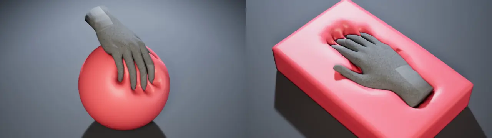

# MallangPhysics

[English](README.md) · [日本語](README.ja.md)

Windows의 Unreal Engine 5.6, 5.7, 5.8에서 스켈레탈 메시와 스태틱 메시를 말랑하게 만드는 오픈 소스 소프트바디 플러그인입니다(MIT 라이선스). 손과 물체가 누른 자리는 들어가고 둘레의 살은 솟으며, 움직이는 손은 피부를 끌고 가고, 몸이 움직이면 살이 출렁입니다. 에디터에서 메시를 한 번 베이크하고 컴포넌트 하나를 붙이면, 변형은 GPU에서 계산됩니다. Unity 6.3 URP 판이 베타로 같이 있습니다.

**영상:** https://www.youtube.com/watch?v=n5HpN2XGicA

**문서:** https://wjsekrud.github.io/MallangPhysics/ko/ (한국어, English)

## 내려받기

| | 위치 | 내용 |
|---|---|---|
| 소스 | 이 저장소의 [`Unreal/SoftbodySystem`](Unreal/SoftbodySystem) | C++ 소스가 모두 든 플러그인. 같은 소스가 5.6, 5.7, 5.8에서 빌드됩니다. |
| 미리 빌드한 판 | [Releases](https://github.com/wjsekrud/MallangPhysics/releases): `MallangPhysics-1.0.0-UE5.x-Win64.zip` | 엔진 버전 하나에 맞춰 미리 빌드한 플러그인. 셰이더와 공개 헤더가 들어 있습니다. 블루프린트 전용 프로젝트에서도 쓸 수 있습니다. Development와 Shipping으로 빌드·패키징되며, DebugGame은 빌드되지 않습니다. |
| 데모 프로젝트 | [Releases](https://github.com/wjsekrud/MallangPhysics/releases): `MallangPhysicsDemo-1.0.0-UE5.x.zip` | 미리 빌드한 판이 든 블루프린트 프로젝트. 같은 엔진 버전에서 Visual Studio 없이 열립니다. |
| Unity (베타) | 이 저장소의 [`Unity/com.wjsekrud.mallangphysics`](Unity/com.wjsekrud.mallangphysics) | Unity 6.3 + URP. [Unity 문서](https://wjsekrud.github.io/MallangPhysics/ko/unity/) 참고. |

## 설치

- 소스: `Unreal/SoftbodySystem`을 내 프로젝트의 `Plugins` 폴더에 복사하고 프로젝트를 빌드합니다.
- 미리 빌드한 판: 엔진 버전에 맞는 zip의 `SoftbodySystem` 폴더를 내 프로젝트의 `Plugins` 폴더에 풉니다.
- Unity: Package Manager에서 git 주소 `https://github.com/wjsekrud/MallangPhysics.git?path=/Unity/com.wjsekrud.mallangphysics`를 추가합니다.

그다음 [빠른 시작](https://wjsekrud.github.io/MallangPhysics/ko/Quick-Start)을 따릅니다.

## 라이선스

- 플러그인 소스, 미리 빌드한 판, Unity 패키지: [MIT 라이선스](LICENSE). Unity 패키지에 든 제3자 코드는 각자의 라이선스를 따릅니다([Third Party Notices](Unity/com.wjsekrud.mallangphysics/Third%20Party%20Notices.md)).
- 데모 프로젝트와 문서: Copyright © 2026 wjsekrud. All Rights Reserved. 다른 제작자의 콘텐츠는 각자의 라이선스를 따릅니다: [크레딧과 라이선스](https://wjsekrud.github.io/MallangPhysics/ko/Credits-and-License).

## 참고

- 2026년 11월부터 제작자가 오랫동안 이슈와 풀 리퀘스트에 답하지 못할 수 있습니다. 사용자끼리 묻고 답하는 곳은 [Discussions](https://github.com/wjsekrud/MallangPhysics/discussions)입니다.
- 코드 주석은 한국어입니다(셰이더 파일 맨 위 설명만 영어). 주석의 일지·ADR 번호는 공개하지 않는 설계 기록을 가리킵니다.
- 버그 제보: [Issues](https://github.com/wjsekrud/MallangPhysics/issues).
