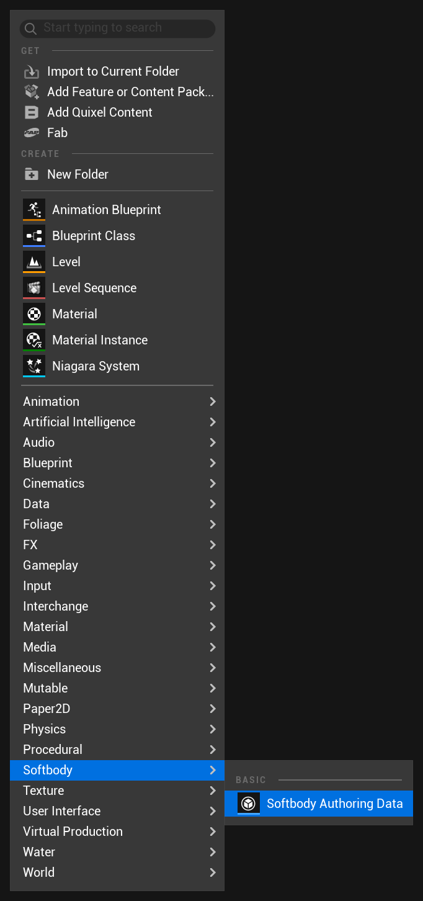
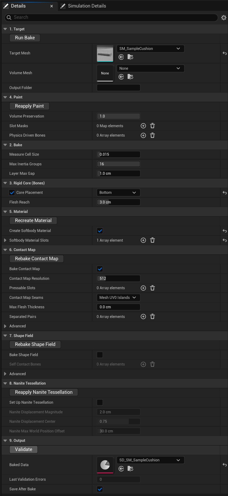
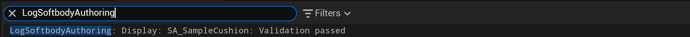

# Baking

Create **Softbody > Softbody Authoring Data** in the Content Browser, set **Target Mesh** and press **Run Bake**. The result is a **Baked Data** asset for the Softbody component's **Mesh Data**. The authoring asset is editor-only and is not packaged.

The Preview and Simulation tabs of the authoring asset window are on [Preview and Simulation](Preview-and-Simulation).

The bake writes into the Target Mesh (it adds UV channels where possible and saves it), so it refuses meshes under the engine folder, which is not Content.

## What Run Bake does

Run Bake takes minutes on a character and tens of seconds on the [Quick Start](Quick-Start) cushion. If the first stage fails, the bake stops; if a later stage fails, the remaining stages still run.

| Stage | Runs when | What it does |
|---|---|---|
| 1. Measuring the flesh | Always | Reads the paint and Volume Preservation to measure the flesh, and creates `SD_<mesh name>` and its textures in the **Output Folder**. |
| 2. Converting the slot mask paint | Always | Turns the paint into the values used for contact and jiggle, applies **Physics Driven Bones**, and finds the pieces painted in Flex. |
| 3. Creating the Softbody material | **Create Softbody Material** is on | Creates a Softbody material instance for each slot and assigns it. |
| 4. Baking the contact map | **Bake Contact Map** is on | Bakes the contact map. |
| 5. Baking the shape field | **Bake Shape Field** is on | Stores the mesh's shape on the Target Mesh. |
| 6. Setting up Nanite tessellation | **Set Up Nanite Tessellation** is on | Changes the mesh and all of its slot materials. |
| 7. Saving | **Save After Bake** is on | Saves what this bake changed, and the authoring asset itself. |

Messages go to the Output Log under `LogSoftbodyAuthoring`. When a stage fails, the reason is in the lines just above, under the bake's other log categories. Fixes are on [Troubleshooting](Troubleshooting).

### What the bake changes to the mesh and other assets {#what-the-bake-changes}

- **Stage 1**: adds a UV channel to the Target Mesh. On a static mesh that generates lightmap UVs, the generated lightmap UV moves after the Softbody channel. If no channel is free, it warns and turns lightmap generation off.
- **Stage 3**: creates `M_<mesh name>_Softbody` and, for each slot in **Softbody Material Slots**, an instance `MI_<mesh name>_<slot>`. It copies the base color, normal map and roughness textures from each slot's original material and assigns the instance. Slots that already use a Softbody material are left alone. Textures it cannot find are left empty, so set them on the instance.
- **Stage 4**: if [Contact Map Seams](#contact-map-seams) is Mesh UV0 Islands, it uses one more UV channel on the mesh and connects it in the Softbody material. If no slot uses a Softbody material yet, the map covers the whole mesh (or the Pressable Slots).
- **Stage 6**: the list of what it changes is on [Materials](Materials#nanite-tessellation).
- **Stage 7**: other assets that had unsaved changes before the bake are not saved; the log lists them.

## 1. Target

| Setting | Default | What it does |
|---|---|---|
| **Target Mesh** | None | The skeletal or static mesh to make soft. |
| [**Volume Mesh**](#volume-mesh) | None | Optional. A closed static mesh that fills the inside of an open or hollow target. |
| **Output Folder** | empty | Where the baked assets are written. Empty = the folder of this asset. |

### Volume Mesh

Use it for an open or hollow target: a trampoline sheet, a thin dish, an open tent, a hollow can. It is assumed to sit in the same place as the target with the same pivot, and it specifies a virtual mesh that takes the target as its surface. A skeletal target can use a static mesh of its bind pose. When baked, the target's surface counts as a thin skin over the volume mesh and can dent.

## 2. Bake

| Setting | Default | What it does |
|---|---|---|
| **Measure Cell Size** | 0.015 | How finely the flesh is measured, as a fraction of the mesh's longest side (0.015 is about 2.7 cm on a human-sized character). Smaller = more detail, slower bake. 0.005 to 0.1. |
| **Max Inertia Groups** | 16 | Skeletal meshes: how many bone groups can jiggle separately, each with its own entry in the component's **Inertia Group Overrides** ([Inertia](Inertia)). 1 to 16. |
| [**Layer Max Gap**](#layer-max-gap) | 1.0 cm | How far clothing that lies on the skin follows the paint and jiggle of the flesh under it. 0 = off, up to 10 cm. |

### Layer Max Gap

Skin right under the clothing and skin hidden inside the outer surface dent with the clothing over it.

For clothing that lies on the skin, such as a tight suit or leggings. When there is skin within this distance inward from a cloth vertex, the cloth takes the Depth, Jiggle and Volume paint of the flesh under it and moves with it. Cloth farther than half this distance follows less.

## 3. Rigid Core (Bones)

Flesh far from the rigid core is more sensitive to inertia, and its dents spread wider.

See the core in the **Rigid Core** view of the authoring asset window's Preview. It redraws as you change the values in this section, before you bake ([Rigid Core view](Preview-and-Simulation#rigid-core)).

| Setting | Default | What it does |
|---|---|---|
| [**Core Placement**](#core-placement) | Center | Static meshes: which part never moves. |
| [**Rigid Core Spheres**](#rigid-core-spheres) | empty | With Core Placement Custom Spheres: place the part that never moves as spheres. |
| [**Bone Thickness**](#bone-thickness) | 0.45 | How thick the bones or the core are. Larger = thinner flesh: less jiggle, narrower dents. 0.05 to 1. |
| [**Bone Overrides**](#bone-overrides) | empty | Sets the role (bone, lump, accessory) and thickness per bone. |
| [**Flesh Reach**](#flesh-reach) | 3 cm | Makes thick flesh jiggle by its paint, not by its thickness. About 3 for a human-sized body. |

### Core Placement

Used on static meshes.

- **Center**: a core like a bone runs through the middle of the shape (the middle plane of a slab, the center of a ball, the axis of a sausage), as thick as **Bone Thickness**. Use it for objects firm in the middle, such as a ball or a toy.
- **Bottom**: only the bottom of the mesh is held. Use it for objects resting on a floor or seat, such as a cushion or a pudding.
- **Custom Spheres**: uses the spheres you place in [Rigid Core Spheres](#rigid-core-spheres).

Center lets the surface dent only as deep as the flesh above the core, so a slab or cushion pressed deep wants Bottom.

### Rigid Core Spheres

For each sphere, enter **Center** and **Radius** in mesh space, in cm (radius default 10 cm). At least one must sit inside the mesh. A flat base is the top of a very large sphere.

### Bone Thickness

Used on skeletal meshes and with Core Placement Center. It sets how thick the bones or the core are, as a fraction of the distance to the skin. No physics asset is needed.

### Bone Overrides

Add one entry per bone.

- **Bone Name**: a bone of the target skeleton.
- **Include Child Bones** (on): whether child bones are included.
- **Role** (Rigid Core): one of the three below.
- **Bone Thickness** (0.45): used only when Role is Rigid Core.

Role:

- **Rigid Core**: the bone is used as a rigid core.
- **Lump**: the bone is not used as a rigid core. Flesh skinned to it becomes a lump that moves out of the way as a whole when pressed. Use it for breast and buttock bones.
- **Accessory**: for ribbon, necklace and belt bones rigged to a Softbody slot. The bone is neither rigid core nor a lump, and the part skinned to it jiggles along with its surroundings.

Bone Overrides apply only to bones skinned to a [Softbody slot](Concepts#softbody-slots) and do not shrink the Softbody slots. A bone that moves only other slots (usually hair, skirts and ornaments) is left out of the core and the inertia groups even without an entry.

### Flesh Reach

The limit thickness of painted skin. Flesh thicker than this does not jiggle more for being thicker, so areas painted the same Jiggle brightness jiggle about the same.

## 4. Paint

How to paint: [Painting](Painting). What Volume Preservation does: [Flesh material](Concepts#flesh-material).

| Setting | Default | What it does |
|---|---|---|
| **Volume Preservation** | 1 | The volume preservation rate: 1 for flesh or jelly, 0 for foam or a sponge. Values in between act like a denser foam that compresses only partly. 0 to 1. |
| [**Slot Masks**](Painting#the-four-channels) | empty | Per material slot: one paint texture, and where each of the four channels (Depth, Jiggle, Volume, Flex) is read from. |
| [**Physics Driven Bones**](Painting#physics-driven-bones) | empty | Bones already moved by another system. Flesh on them gets no Softbody inertia. |

## 5. Material

| Setting | Default | What it does |
|---|---|---|
| **Create Softbody Material** | off | Run Bake makes a Softbody material for the mesh (stage 3). Leave it off when you add the Softbody material functions to your own master material ([Materials](Materials)). |
| **Softbody Material Slots** | empty | The slots that get the Softbody material (usually skin and tight clothing). Together with the slots that already use a Softbody material, they are the [Softbody slots](Concepts#softbody-slots). A slot removed from the list leaves the Softbody slots only after you put its original material back. With Create Softbody Material on, an empty list is an error. |

## 6. Contact Map

| Setting | Default | What it does |
|---|---|---|
| **Bake Contact Map** | on | Off = no contact at all; the mesh only jiggles. |
| **Contact Map Resolution** | 512 | Cells along one side of the contact map (a power of two, 64 to 2048). Higher = sharper small dents such as fingertips, but more GPU time and memory. 512 for a human-sized character; 1024 if it is seen up close. |
| **Pressable Slots** | empty | The material slots that can be pressed. Empty = the slots that use a Softbody material (or the whole mesh if none do yet). The fewer the slots, the finer the detail. |
| [**Contact Map Seams**](#contact-map-seams) | Mesh UV0 Islands | How the contact map is split into pieces. |
| **Max Flesh Thickness** | 0 cm | Deeper than this from the surface counts as solid. 0 = no limit. Use it on boxes and cushions whose core sits only at the bottom; without it, pressing the top dents the sides too. |
| [**Separated Pairs**](#separated-pairs) | empty | Skeletal meshes: keeps apart parts whose surface is connected but whose inside is separate. |
| **Envelope Cell Size** (Advanced) | 0 cm | Cell size for finding the mesh's outer surface. 0 = automatic (longest side / 256). |
| **Envelope Triangles** (Advanced) | 40000 | Triangle count of the simplified outer surface. Raise it if flesh thickness on large curved areas looks stepped. 1000 to 400000. |

The log line "Contact map finished - resolution N, cell X cm" gives the average surface length of one cell.

### Contact Map Seams

Dents are slightly less exact across a split.

- **Mesh UV0 Islands**: the seams follow the UV0 seams, and each island is flattened again with even cell sizes, so the dent rim keeps its width where UV0 was stretched for texturing. Very uneven islands get a few extra seams in the contact map UV channel only. An island whose mirrored halves share the same UVs (left and right, or the two sides of a sheet) is cut where the mirror flips. Falls back to Automatic when UV0 has zero area or folded UVs.
- **Automatic (XAtlas)**: cuts by curvature.
- **Mesh UV0 Islands (As Is)**: the UV0 islands as laid out, for comparison. Cell size and dent rim width follow UV0's stretch.

### Separated Pairs

Use it for parts whose surface is connected but whose flesh underneath is separate, such as a left and right pair of lumps under one piece of clothing. Add one pair for each two parts to keep apart, and pick the top bone of each part in **Side A** and **Side B** (child bones included). For a rig where a part is split over several bone chains, add the top bone of each chain.

Pressing one side then does not raise, sink or drag the other. Clothing weighted to both parts is split by its bone weights. Check it in the Preview's [Separated Parts](Preview-and-Simulation#separated-parts-view) view.

## 7. Shape Field

A hand or prop that only presses can get a shape field without an authoring asset, from the Content Browser command **Softbody: Bake Shape Field** ([Colliders](Colliders)).

| Setting | Default | What it does |
|---|---|---|
| **Bake Shape Field** | off | Bakes this mesh's real shape, stored on the Target Mesh, so it presses other Softbody meshes with that shape instead of its simple collision or physics asset. |
| [**Self Contact Bones**](Colliders#self-contact) | empty | Skeletal meshes: the bones that also press the character's own flesh. Empty = every bone presses, so usually give only the two hands. Ignored on a static mesh. |
| **Shape Field Slots** | empty | The material slots the shape field is made from. Empty = the whole mesh. Leave out hair and accessory slots so they never press other Softbody meshes; the head then presses with the scalp. |
| **Shape Field Cell Size** (Advanced) | 0 cm | Cell size of the shape field. 0 = automatic (fine enough for fingers). Otherwise about a quarter of a finger's width. |
| [**Shape Field Part Overlap**](#shape-field-part-overlap) (Advanced) | 1 cm | Skeletal meshes: how far each bone's part of the shape reaches into its neighbor's. Too little shows grooves at the finger joints. |

### Shape Field Part Overlap

At least twice the pressed mesh's **Edge Smoothing** times its contact map cell size removes the grooves. The overlap scales with the pressing mesh: a hand placed at scale 0.75 overlaps 0.75 cm. 0 = no overlap.

## 8. Nanite Tessellation

| Setting | Default | What it does |
|---|---|---|
| [**Set Up Nanite Tessellation**](Materials#nanite-tessellation) | off | Draws the mesh with Nanite tessellation, so narrow dents such as fingertips show between vertices even on a low-density mesh. |
| **Nanite Displacement Magnitude** | 2 cm | The depth range tessellation can draw. Dents and bulges beyond it are cut off. 0.1 to 50 cm. |
| **Nanite Displacement Center** | 0.75 | Where that range sits. 0.75 = three quarters for dents, one quarter for bulges. 0 to 1. |
| **Nanite Max World Position Offset** | 30 cm | How far Nanite expects vertices to move. If it is less than the largest dent plus jiggle, the movement is cut off; if it is far larger, holes appear with the camera close ([Known Limitations](Known-Limitations#nanite-tessellation)). 1 to 200 cm. |

## 9. Output

| Setting | Default | What it does |
|---|---|---|
| **Baked Data** | None | The baked result, for the component's Mesh Data. Run Bake fills it in; you can also point it at an existing bake. |
| **Last Validation Errors** | -1 | Problems found by the last Validate. 0 = all good. -1 = not checked since the last bake. |
| **Save After Bake** | on | Saves what the bake changed as soon as it finishes (stage 7). |

## Buttons

| Button | Category | Time | What it does |
|---|---|---|---|
| **Run Bake** | 1. Target | minutes | Everything, in the order above. |
| **Reapply Paint** | 4. Paint | seconds to tens of seconds | Runs stage 2 and the contact map again. If the paint changed since the last Run Bake, runs Run Bake instead (minutes). |
| **Recreate Material** | 5. Material | | Creates and assigns the Softbody material again, then rebakes the contact map if there is one. |
| **Rebake Contact Map** | 6. Contact Map | tens of seconds | Bakes only the contact map again. |
| **Rebake Shape Field** | 7. Shape Field | tens of seconds | Bakes only the shape field again. |
| **Reapply Nanite Tessellation** | 8. Nanite Tessellation | | Applies the Nanite tessellation settings again. |
| **Validate** | 9. Output | | Checks the bake against the mesh without baking again. |

Every button except Validate is one undo step and saves afterwards when Save After Bake is on. Reapply Paint, Recreate Material, Rebake Contact Map and Reapply Nanite Tessellation need Baked Data. Rebake Shape Field needs only Target Mesh.

### Which button after which change

| You changed | Press |
|---|---|
| Target Mesh, Volume Mesh, Measure Cell Size, Max Inertia Groups, Layer Max Gap | Run Bake |
| Core Placement, Rigid Core Spheres, Bone Thickness, Bone Overrides, Flesh Reach | Run Bake |
| The Paint Texture or the channels of Slot Masks | Run Bake (pressing Reapply Paint runs Run Bake anyway) |
| Volume Preservation value | Nothing for dents; Run Bake for how a whole lump spreads (Validate reports it until then) |
| Physics Driven Bones | Reapply Paint |
| Re-imported a Paint Texture | The button in the notice (Run Bake or Reapply Paint) |
| Softbody Material Slots, or you want the generated material and instances again | Recreate Material |
| Assigned or changed the Softbody material yourself | Rebake Contact Map (Run Bake for a skeletal mesh) |
| Contact Map Resolution, Pressable Slots, Contact Map Seams, Max Flesh Thickness, Separated Pairs, Envelope Cell Size, Envelope Triangles | Rebake Contact Map |
| Turned Bake Contact Map on after a bake | Rebake Contact Map |
| Self Contact Bones, Shape Field Slots, Shape Field Cell Size, Shape Field Part Overlap, or turned Bake Shape Field on | Rebake Shape Field |
| Nanite Displacement Magnitude, Nanite Displacement Center, Nanite Max World Position Offset, or turned Set Up Nanite Tessellation on | Reapply Nanite Tessellation |
| Re-imported the Target Mesh itself | Run Bake (re-importing removes the baked UV channels; see [Known Limitations](Known-Limitations)) |

## Validate

**Validate** checks that the baked data, the mesh, its materials and its shape field still match, without baking again. The count goes to **Last Validation Errors** and the messages to the Output Log. Run Bake, Rebake Contact Map and Rebake Shape Field reset the count to -1. Every message and its fix: [Troubleshooting](Troubleshooting).

