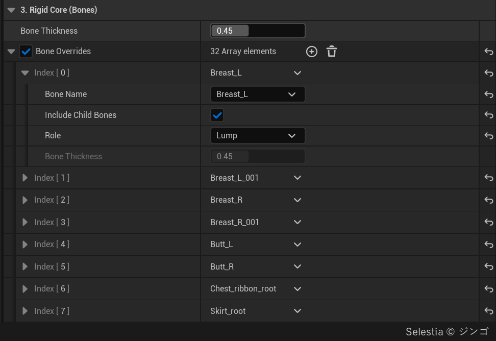
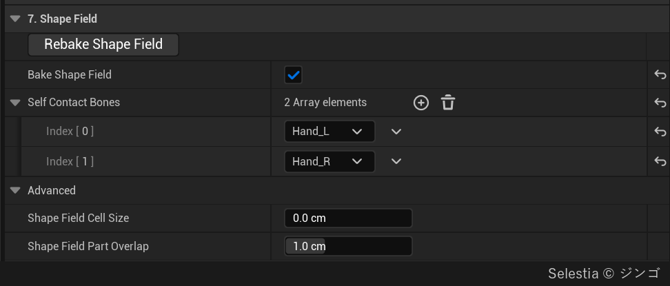
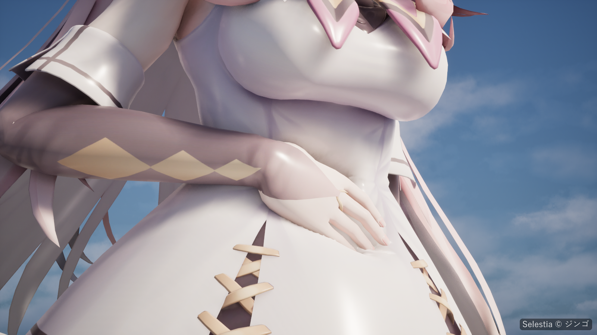

# Characters

A skeletal mesh bakes like a prop ([Quick Start](Quick-Start)).

## Before you bake

- The skeleton is the rigid core. The skin-weighted bones must sit inside the mesh. The bake needs no physics asset.
- The area Softbody applies to is the [Softbody slots](Concepts#softbody-slots): the material slots that use a Softbody material (**Softbody Material Slots** if **Create Softbody Material** is on). The rigid core and the [inertia groups](Inertia#inertia-groups) are also determined only by bones skinned to Softbody slots.
- Secondary bones (hair, skirt, accessories) are excluded by removing the slots they move from the Softbody slots. **Bone Overrides** only changes the role of a bone inside a Softbody slot, so the flesh of a bone set to Lump or Accessory is also deformed. Set only ribbon or necklace bones rigged together in a Softbody slot to **Accessory**.
- If you assign the materials yourself, you must press **Run Bake** after assigning them. If no slot uses a Softbody material, the bake treats the whole mesh as Softbody slots.
- Tight clothing modeled over the skin (tight suits, leggings) can stay in the same mesh. Meshes in close contact, such as clothing, share the values of the one underneath.
- Jiggle bones: if another system already moves them (a KawaiiPhysics node in a post process animation blueprint, or simulated physics bodies), list them in **Physics Driven Bones**. Otherwise, the **Role** of the bone can be set to **Lump** in **Bone Overrides**, so its area becomes a lump that the Softbody component moves.

## Bake settings

Settings of the Softbody Authoring Data that matter on a skeletal mesh. Defaults and ranges are on [Baking](Baking).

| Setting | Category | On a character |
|---|---|---|
| **Softbody Material Slots** | 5. Material | The slots that become [Softbody slots](Concepts#softbody-slots). Only bones skinned to these slots become the core and inertia groups. |
| [**Bone Thickness**](Baking#bone-thickness) | 3. Rigid Core (Bones) | How thick every bone is. Larger = thinner flesh everywhere: less jiggle, narrower dents. |
| [**Bone Overrides**](Baking#bone-overrides) | 3. Rigid Core (Bones) | The role of bones skinned to Softbody slots. Set **Role** to **Lump** on the top bone of a breast or buttock chain, and to **Accessory** on ribbon, necklace and belt chains rigged in a Softbody slot. |
| [**Flesh Reach**](Baking#flesh-reach) | 3. Rigid Core (Bones) | About 3 cm makes areas painted the same Jiggle brightness jiggle about the same, whatever the flesh thickness. |
| **Max Inertia Groups** | 2. Bake | How many bone groups can move separately. When they run out, a lump bone gets no group of its own. |
| [**Layer Max Gap**](Baking#layer-max-gap) | 2. Bake | Detection distance for polygons in close contact. Raise it for thick outer clothing; 0 turns it off. Whether they move together is decided by the contact map. |
| **Physics Driven Bones** | 4. Paint | Softbody inertia is not applied to the flesh on these bones (child bones included). |
| **Bake Shape Field** | 7. Shape Field | A seated character presses a Softbody sofa with the real shape of its body, and its Self Contact Bones can press its own body. |
| **Self Contact Bones** | 7. Shape Field | Sets the bones that can press other areas of the same skeletal mesh (usually both hands). |
| **Shape Field Slots** | 7. Shape Field | Sets, by material slot, the parts of the mesh that can press other Softbody meshes. |
| [**Separated Pairs**](Baking#separated-pairs) | 6. Contact Map | When the surface is connected but the inside is separated by bones, sets the groups of bones that must be separated to match contact and inertia response. |
| **Shape Field Part Overlap** | 7. Shape Field | Scale of the influence range of each bone when pressing other Softbody meshes. For a hand, too small can make the finger segments look broken in the dent. |

- With **Include Child Bones** on in **Bone Overrides**, one entry per chain is enough. Turn it off to change that bone only.
- With **Flesh Reach** at about 3 cm, thick white flesh becomes the reference flesh for **Inertia Amount**.
- Bones the skeleton does not have (ribs, pelvis, skull) are not found. The flesh thickness you want can be painted in Depth.
- Do not use the Content Browser command **Softbody: Bake Shape Field** on a character. It bakes with no Self Contact Bones, so every bone would press the body. If that already happened, **Rebake Shape Field** in the Softbody Authoring Data can overwrite it.

Bake messages and their fixes are on [Troubleshooting](Troubleshooting).

## Component settings

Settings of the Softbody component that matter on a character. Every setting is on [Softbody Component](Softbody-Component).

| Setting | Category | On a character |
|---|---|---|
| **Self Contact** | Contact > Colliders | On by default. Lets the Self Contact Bones dent the character's own belly or thighs. |
| **Lump Yield** | Inertia > Lumps | How easily a pressed lump moves out of the way. |
| **Lump Grip** | Inertia > Lumps | Strength with which friction pulls the whole lump. Contact Detail must be Full. |
| **Squeeze Stiffening** | Inertia > Lumps | Multiplier of the resistance to deformation by how deeply it is pressed. Higher means more resistance. |
| **Inertia Group Overrides** | Inertia | Amount Scale, Damping and Gravity Scale applied to the influence range of an individual bone. |
| **Inertia Amount** | Inertia | How far the reference flesh sags at 1 g. |
| **Animation Motion Weight** | Inertia | Inertia multiplier applied to the skeletal animation. |

- **Self Contact** ignores flesh that touches in the bind pose. Off does not stop the body pressing other Softbody meshes.
- **Lump Yield**: parts on the skeleton, such as the belly and back, never move as a lump.
- **Squeeze Stiffening**: if lumps move too far on deep pushes, lower Lump Yield instead of this value.

## Pressing with the whole body

The bake needs no physics asset, but pressing other Softbody meshes does: the character needs collision that blocks the pressed mesh's **Collider Channel** (Visibility by default), from its physics asset. With a shape field, it presses with its real shape instead of the physics asset's capsules.

The pressed object must be tagged `SoftbodyIgnore` or have its collision turned off, so that only one side is pressed. Softbodies pressing each other are not implemented yet. The contact can open a gap the size of the overlap. ([Colliders](Colliders)).

An animated character does not go still while pressed.
