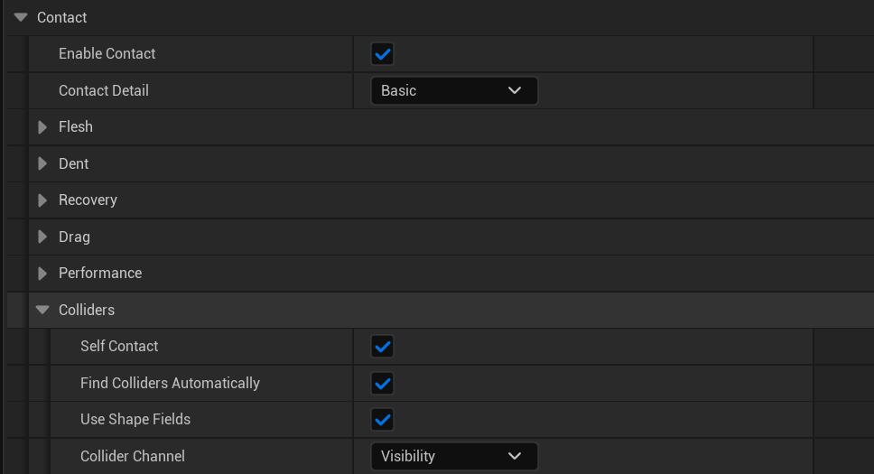
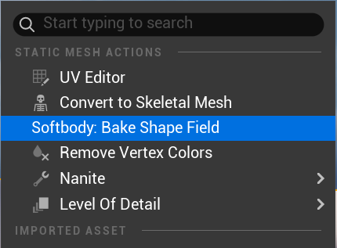
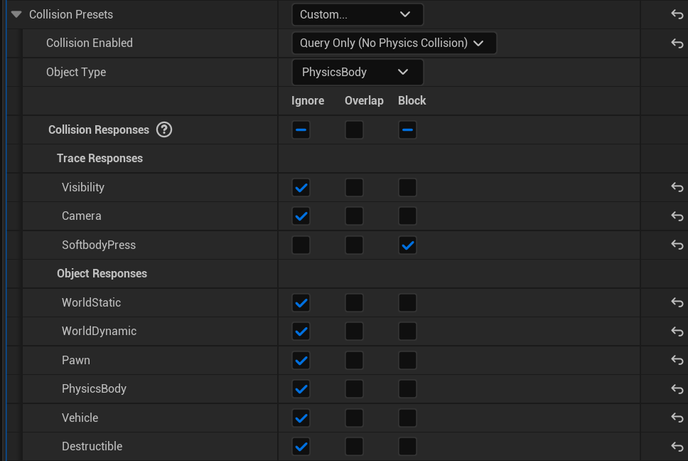

# Colliders

Anything that presses the flesh is a collider: a hand, a prop, a floor, another character. The Softbody component finds colliders by itself every frame.

## What can press the flesh

A collider presses the flesh when:

1. Its collision **blocks** the component's **Collider Channel** (default **Visibility**).
2. Its collision is enabled for queries. "No Collision" and "Physics Only" are skipped.
3. It is not on the Softbody component's own actor. A character's own hands press through [self contact](#self-contact).
4. Neither the component nor its actor has the tag `SoftbodyIgnore`.
5. It has simple collision shapes or a shape field.

| Collider | Presses with |
|---|---|
| Static mesh, shape component or any other primitive | Its simple collision: spheres, capsules, boxes and convex hulls. A tapered capsule counts as a capsule with its larger radius. |
| Skeletal mesh | Every body of its physics asset, each following its bone. Without a physics asset it presses nothing. |
| Any mesh with a baked shape field | Its real shape, part by part, instead of its simple collision or physics asset, while **Use Shape Fields** is on. Parts missing from the shape field do not press. |
| Complex (triangle mesh) collision only | Nothing, with one log line. |

Colliders are searched in a box around the mesh bounds grown by **Max Contact Depth** (at least 1 cm), and only while the mesh is on screen and not smaller than **Min Screen Size**.

## Settings

**Self Contact**, **Find Colliders Automatically**, **Use Shape Fields** and **Collider Channel** are under **Softbody > Contact > Colliders** ([Softbody Component](Softbody-Component)).

## Shape fields

A shape field is a baked copy of a mesh's real shape, stored on the mesh asset. With one, a hand presses with every finger and the hollow of the palm instead of the smooth, fingerless dent of its simple collision.

Right-click the static or skeletal mesh in the Content Browser and choose **Softbody: Bake Shape Field** to bake it. It saves the mesh. The log reports `shape field baked (N parts)`: one part per bone on a skeletal mesh, each following its bone, and one part on a static mesh.

- The shape field only replaces what the collider presses with. It is still found by its collision, so it needs collision that blocks the Collider Channel.
- The shape field is stored on the pressing mesh's asset and is used the same way against every Softbody mesh it presses. The pressed mesh's authoring asset plays no part; the pressed component only decides whether to use it, with **Use Shape Fields**.
- With a shape field, the physics asset and simple collision no longer press. After changing the mesh, you must bake the shape field again.
- Engine content cannot be baked.
- A mesh that already had unsaved changes is baked but not saved, so you must save it yourself.
- A shape field baked by an older plugin version is ignored as out of date, so you must bake it again.
- This command bakes the whole mesh. To bake only selected slots, use **Shape Field Slots** in a **Softbody Authoring Data** ([Baking](Baking#_7-shape-field)).
- A Softbody character's own skeletal mesh gets its shape field from its **Softbody Authoring Data** (**7. Shape Field**, **Self Contact Bones**) instead of this command. [Characters](Characters)

## Self contact

A character presses its own flesh only through a shape field on its own skeletal mesh, and only the parts under its **Self Contact Bones** press it. The whole body presses other Softbody meshes either way.

- **Self Contact Bones** sets the bones that can press other areas of the same skeletal mesh (usually both hands; child bones are included).
- Flesh that already touches in the bind pose is ignored.
- The hands also press each other.
- Turning off the Softbody component's **Self Contact** stops the character pressing its own body.
- If the skeleton changed after the bake, the log says a self contact part was skipped because its bone was not found. You must bake the shape field again.

## Softbody meshes pressing each other

A Softbody mesh presses other Softbody meshes like any other collider. If two press each other, each dents by the other's shape and a gap opens between them ([Known Limitations](Known-Limitations)). A mesh that is only pressed can have its collision turned off or be tagged `SoftbodyIgnore`.

## Out of reach and sleeping

Each frame, a found collider or self contact part that cannot reach any pressable flesh, with a margin of at least 2 cm, is dropped. When nothing is left, the dents ease back and contact sleeps ([Performance](Performance)).

If the self contact parts no longer match the contact map, a warning says **Rebake Contact Map** or **Rebake Shape Field** is needed.

## Per-frame limits

| Limit | Per mesh per frame | When exceeded |
|---|---|---|
| Simple collision shapes | 32 | The rest are skipped, logged once. |
| Convex hull planes, all shapes together | 2048 | Same. |
| Shape field parts, outside colliders and self contact parts together | 512 | A collider that would go over is skipped whole; self contact is skipped for that frame. Logged. |

Shapes are counted after the reach check, so only what is near each mesh counts. A collider with a shape field counts all its parts against the 512 limit.

## Setting up a hand that presses

Settings needed for a hand that is its own actor, or a hand on another character:

1. It must have collision that blocks the **Collider Channel** (a physics asset on a skeletal hand, simple collision on a static one).
2. To press with fingers and palm, you can bake its [shape field](#shape-fields).
3. If the Collider Channel is a project trace channel, you must set that channel to **Block** in the hand's collision.

A hand on the Softbody mesh's own actor presses through [self contact](#self-contact) instead.

## Recommended setup

With the default **Collider Channel** (**Visibility**), every floor, wall and prop that blocks Visibility is found. Each one that can reach pressable flesh takes one of the 32 shapes every frame and keeps the mesh from sleeping. One of these can limit what is found.

**A project trace channel.** Add a trace channel, for example `SoftbodyPress`, with **Default Response** set to **Ignore**. Set it as the **Collider Channel** on every Softbody component, and set it to **Block** on each collider that should press (hands, props). Everything else ignores it and never presses.

**The SoftbodyIgnore tag.** Keep Visibility and add the tag `SoftbodyIgnore` to the floor and wall actors, or to a single component.
