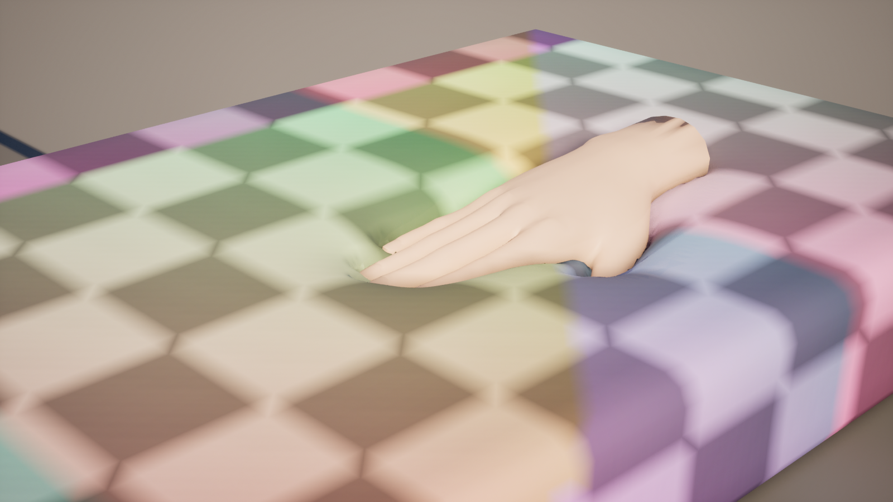
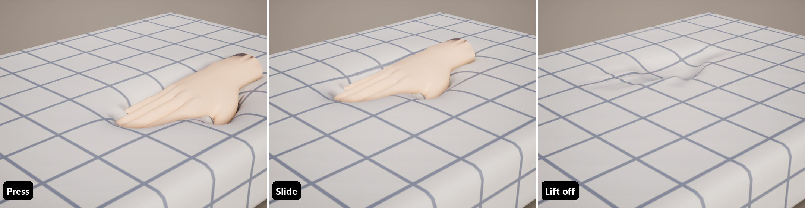
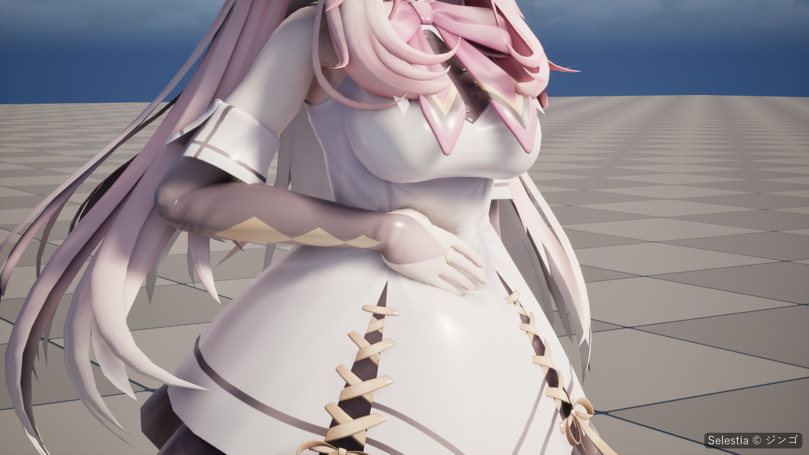

# Concepts

The words used across these pages. The settings they name are listed with their defaults on [Softbody Component](Softbody-Component) and [Baking](Baking).

## Contact map {#contact-map}

- **Contact** is everything hands and objects do to the surface: dents, bulges, drag and their recovery.
- The **contact map** is the baked grid over the pressable surface where contact is worked out (**Bake Contact Map**). Baking adds a UV channel to the mesh for it, and the material reads the result through that channel.
- A **contact map cell** is one square of the grid. **Edge Smoothing** is measured in cells.
- **Contact Map Seams** sets where the map is cut into pieces; by default the cuts follow the mesh's UV0 seams. Dents are slightly less exact across a cut. With **Debug View** on, **Debug View Mode** 2 draws the cells as a checker pattern; lines where the pattern breaks are the seams.

## Dent, bulge, drag, recovery and lasting marks {#dent-bulge-drag-recovery-and-lasting-marks}

- A **dent** is the surface sinking under a collider. It sinks as far as the collider reaches, and **Max Contact Depth** is the limit.
- A **bulge** is the flesh that rises around a dent. It exists only when **Contact Detail** is Full. **Volume Preservation** sets how much rises: flesh and jelly rise, foam only sinks ([Flesh material](#flesh-material)).
- **Drag** is the surface being pulled along by friction. The skin follows until the flesh pulls back harder than **Drag Friction**, then slips.
- **Recovery** is the surface springing back after the collider leaves, at **Recovery Rate**.
- A **lasting mark** is a dent that stays after release and then fades, like memory foam. It exists only when **Memory Time** is above 0.

## Flesh thickness and the rigid core {#flesh-thickness-and-the-rigid-core}

- The **rigid core** is the part that never moves. On a skeletal mesh it is the bones, found from the skeleton itself; no physics asset is needed. On a static mesh **Core Placement** sets it: through the middle of the shape, at the bottom, or spheres you place.
- **Flesh thickness** is the distance from the skin to the rigid core, measured by the bake. It sets how wide the dent and its bulge are and how far drag reaches. How much the flesh jiggles also follows it, together with the **Jiggle** paint and **Flesh Reach**.
- The **outer surface** is the simplified surface of the mesh that the bake measures thickness from. Vertices more than 5 cm off it (hair cards or ornaments floating off the body) follow the dents less, and from 10 cm not at all.
- A **volume mesh** is a closed static mesh, modeled in the same place, that gives an open or hollow target (a sheet, a thin dish, a tent) an inside to measure.

## Softbody slots {#softbody-slots}

- A **Softbody slot** is a material slot that uses a [Softbody material](Materials); it is the area of the mesh where Softbody applies. Other slots are not deformed.
- On a skeletal mesh, the rigid core and the [inertia groups](Inertia#inertia-groups) are set only from bones skinned to Softbody slots. Bones that move only other slots (usually hair, skirts and accessories) drop out automatically.
- If no slot uses a Softbody material when you bake, the whole mesh counts as a Softbody slot.

## Pressable slots and slot mask paint {#pressable-slots-and-slot-mask-paint}

- **Pressable Slots** are the material slots that can be pressed. Empty means the slots that use a Softbody material.
- **Slot paint** is one RGBA texture (**Paint Texture**) per material slot, painted in that slot's UV0. Its four channels each hold one property of the material: **Depth** (R, how deep the flesh is from the skin to the bone), **Jiggle** (G, how soft the flesh is), **Volume** (B, whether pressed flesh keeps its volume) and **Flex** (A, how the surface bends). White means unpainted in every channel. [Painting](Painting)

## Flesh material {#flesh-material}

How deep a collider goes is set by its animation or physics, not by the flesh. So how stiff the flesh is does not change the shape of a dent. These do:

| What | Set by | What it changes |
|---|---|---|
| Flesh thickness | Bake: where the rigid core sits (Core Placement, Rigid Core Spheres, Bone Thickness), Max Flesh Thickness and the Depth paint | The size of everything. Thick flesh gives wide, gently sloping dents and wide bulges; thin flesh gives tight ones. |
| Compressibility | **Volume Preservation** (Softbody Authoring Data, 4. Paint) × the Volume paint; while playing, **Volume Offset** (Softbody component) is added | 1 = flesh or jelly: it rises around a dent, and a pushed lump spreads sideways. 0 = foam: it compresses in place, so the dent has a crisp edge and nothing bulges. Values in between act like a denser foam that compresses only partly. |
| Skin | **Skin Tension** (Softbody component) | A taut skin over the whole mesh. 0 = bare flesh or jelly, above 1 = a drum skin (0 to 2). A tighter skin makes a dent rounder and wider, bridges the gaps between fingers and blurs the shape of what presses in. It matters most where the flesh is thin. |
| Surface bending | **Flex** paint; while playing, **Flex Offset** (Softbody component) is added | For when only part of the surface is stiff. The darker the gray, the stiffer the bend, and the wider and rounder the press spreads. Black is a **plate** that sinks and tilts as one piece. It works only when Contact Detail is Full. |
| Timing | **Recovery Rate**, **Memory Time**, **Memory Fade Time** | How fast a dent comes back, and whether it leaves a lasting mark. |
| Friction | **Drag Friction** | How far a moving hand drags the skin. |
| Firming under deep squeezes | **Squeeze Stiffening** | How much harder the flesh pushes back when squeezed deep. It applies to drag and lumps. |

No setting widens dents without changing the material. For wider, gentler dents make the flesh thicker, make the skin tighter, or paint Flex gray. Check the thickness in the [Flesh Thickness](Preview-and-Simulation#flesh-thickness) view of the authoring asset's Preview.

Volume Preservation applies to the whole mesh. Where only part of it differs, the Volume paint multiplies the value ([Painting](Painting)).

Skin Tension is one component value that is not painted. It is set per component, so actors that share one bake can have different skins. To try compressibility while playing, use **Volume Offset** on the Softbody component.

Dents and bulges follow it at once. How a whole lump spreads on a skeletal mesh stays as baked until you put the result into the authoring asset and press Run Bake.

A static mesh has no lump, so **Volume Offset** can make one bake foam on one actor and gel on another.

### Recipes {#recipes}

| Material | Volume Preservation | Skin Tension | Timing | Flesh thickness |
|---|---|---|---|---|
| Human skin | 1 | about 0.15 | defaults | from the bones; Depth paint where bone is near the skin |
| Jelly | 1 | 0 | defaults | thick: Core Placement Bottom, or a small core |
| Slime | 1 | 0 | Recovery Rate 1 | thick |
| Memory foam | 0 | 0 | Recovery Rate 8, Memory Time 1.5 | Bottom, with Max Flesh Thickness |
| Sponge | 0 | 0 | defaults | Bottom, with Max Flesh Thickness |
| Rubber | 1 | 0 | defaults | thin: a core close to the skin (Rigid Core Spheres, or Bone Thickness with Core Placement Center), or Max Flesh Thickness |
| Sausage | 1 | a little, for the casing | defaults | Core Placement Center: the core runs along the axis |
| Leather | as the inside | about 0.5 | defaults | as the inside |
| Drum skin | as the inside | 1 | defaults | as the inside |

The defaults are Recovery Rate 30 and Memory Time 0. If only part of the surface is leather or a hard decoration, paint Flex there instead of using Skin Tension.

## Lumps {#lumps}

A **lump** is flesh hanging on a bone with nothing rigid inside it, such as a breast or a buttock. You make one by setting that bone's **Role** to **Lump** in **Bone Overrides**: the bone and the bones below it leave the rigid core. A fingertip poke mostly dents; a wide, deep palm push moves the whole lump aside, and it wobbles back on release. A hand that grabs around it or lifts it from below carries it along. **Lump Yield**, **Lump Grip** and **Squeeze Stiffening** tune it. Parts on the skeleton, such as the belly or back, and static meshes never move as a lump.

## Self contact and shape fields {#self-contact-and-shape-fields}

- A **collider** is anything whose collision blocks the **Collider Channel** (Visibility). It presses with its simple collision or physics asset. [Colliders](Colliders)
- A **shape field** is a baked copy of a presser's real shape, used instead of its simple collision: a hand presses with its fingers and the hollow of its palm. Bake it with **Bake Shape Field** in the Softbody Authoring Data asset, or with **Softbody: Bake Shape Field** on a mesh that only presses.
- **Self contact** is a character's own hands denting its own belly or thighs. It needs a shape field, and only the **Self Contact Bones** (with their child bones, usually hand_l and hand_r) press the character itself. The whole body always presses other Softbody meshes.

## Layered clothing {#layered-clothing}

**Layered clothing** is clothing that lies on the skin, such as a tight suit or leggings. It dents and jiggles with the flesh under it, so the flesh never pokes through. The cloth takes Depth, Jiggle and Volume from the flesh under it; only Flex uses the paint of the cloth slot itself. Denting together is decided by the contact map: skin right under the clothing and skin hidden inside the outer surface dent with the clothing over it.

## Inertia and inertia groups {#inertia-and-inertia-groups}

- **Inertia** is the jiggle: when the mesh speeds up, turns, stops or tilts, the flesh lags behind and wobbles back (**Enable Inertia**). **Inertia Amount** sets how soft the flesh is, **Inertia Damping** how many times it overshoots before it stops, and **Jiggle Speed** the rhythm. It keeps running while contact sleeps and as long as **Enable Inertia** is on.
- The **measure bake** is the first bake step: it measures how soft each area is and finds the inertia groups.
- An **inertia group** is a set of bones that jiggles together, found by the bake (up to **Max Inertia Groups**). **Inertia Group Overrides** gives one group its own amount, damping and gravity. A static mesh is one group.

## Sleeping and still {#sleeping-and-still}

Contact costs GPU time only while something is happening.

- A mesh is **sleeping** when no collider can reach it, when it is outside every view, or when it looks smaller than **Min Screen Size**. Its dents ease back as if released, then its contact work stops. The first touch after that updates in the same frame.
- A pressed mesh is **still** when its colliders and bones have stopped moving and neither its settings nor its dents change any more. Its contact updates are skipped until something moves. A recovering mesh is never still.
- The **update budget** is the most meshes whose contact updates in one frame (4 per world); the rest take turns.
- The **contact update rate limit** caps how often each mesh updates, whatever the frame rate (**Limit Contact Update Rate** in Project Settings > Plugins > Softbody).

[Performance](Performance)

## Nanite tessellation {#nanite-tessellation}

The material moves vertices, so a dent narrower than the mesh's triangles cannot show on a plain mesh. **Set Up Nanite Tessellation** sets the mesh up to draw with Nanite tessellation, so fingertip dents appear between vertices even on a low-density mesh. It changes the mesh and all of its slot materials. [Materials](Materials)
