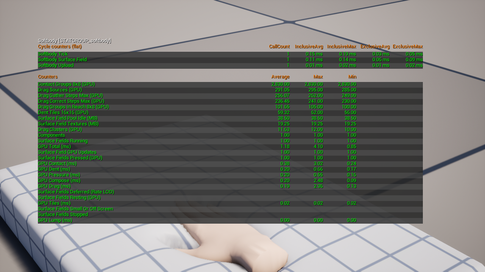
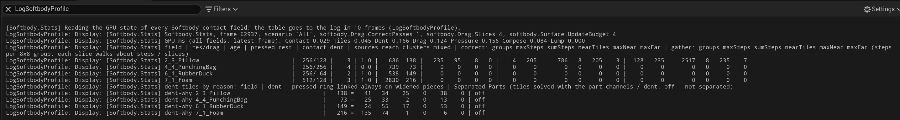

# Console Reference

The plugin's console variables, commands and `stat softbody` lines.

## Console variables

All `softbody.Surface.*` variables carry the Scalability flag, so they can be set per quality level. Distances are in cm. The first moment of contact always updates at once, whatever the screen size or update rate limit.

| Variable | Default | What it does |
|---|---|---|
| [`softbody.Surface.UpdateBudget`](#softbody-surface-updatebudget) | 4 | Most meshes whose contact updates in one frame, per world. 0 = no limit. |
| [`softbody.Surface.FullRateScreenSize`](#softbody-surface-fullratescreensize) | 0 | Meshes smaller on screen than this update at intervals instead of every frame. 0 = every frame. |
| `softbody.Surface.MaxInterval` | 4 | Longest gap in frames between updates of a small mesh. |
| [`softbody.Surface.MaxUpdateRate`](#softbody-surface-maxupdaterate) | -1 | Most updates per second of a touched mesh. -1 = use the Project Settings value, 0 = no limit. |
| [`softbody.Surface.TexturePool`](#softbody-surface-texturepool) | 2 | Spare contact texture sets kept per world for each kind. |
| [`softbody.Surface.CreateBudget`](#softbody-surface-createbudget) | 4 | Most contact texture memory (MB) created, and freed, per frame in a world. 0 = no limit. |
| [`softbody.Surface.ReleaseDelay`](#softbody-surface-releasedelay) | 10 | Seconds that contact textures and the like stay in memory after their last use. 0 = start freeing at once. |
| [`softbody.Surface.LoadBudget`](#softbody-surface-loadbudget) | 2 | Most contact map data (MB) loading at once in a world. 0 = no limit. |
| [`softbody.Surface.FirstUpdates`](#softbody-surface-firstupdates) | 2 | Most meshes per frame, in a world, running their first update. 0 = no limit. |
| [`softbody.Surface.StillDistance`](#softbody-surface-stilldistance) | 0.1 | Updates are skipped when colliders, bones and settings moved less than this. 0 = never skip. |
| `softbody.Surface.StillChange` | 0.001 | The threshold used by `softbody.Surface.StillDistance`: a displacement change below this value counts as an update that changed nothing. |
| [`softbody.Drag.CorrectPasses`](#softbody-drag-correctpasses) | 1 | Profiling: drag correction passes per update, 0 to 4. |
| [`softbody.Drag.Slices`](#softbody-drag-slices) | 4 | Profiling: slices of 64 threads per 8x8 group in the two drag passes, 4, 2 or 1. |
| `softbody.Scenario.Start` | (empty) | Profiling: the scenario to switch to when play begins (a `Softbody.Scenario` name such as `4_3`, `All` or `None`). Empty leaves every actor on. |

### `softbody.Surface.UpdateBudget` {#softbody-surface-updatebudget}

Meshes outside the budget take turns. The update order is:

1. Meshes just touched
2. Meshes on screen with a collider in reach
3. Meshes that are recovering
4. Meshes off screen

A mesh held back by the budget moves to the front after waiting `softbody.Surface.MaxInterval`.

### `softbody.Surface.FullRateScreenSize` {#softbody-surface-fullratescreensize}

Screen size is the bounding sphere diameter relative to screen height, about 0 to 1. A mesh smaller than this value updates only once every ceil(this value / screen size) frames, up to `softbody.Surface.MaxInterval`.

### `softbody.Surface.MaxUpdateRate` {#softbody-surface-maxupdaterate}

Limits the updates per second of a touched mesh, whatever the frame rate. -1 uses the Project Settings **Limit Contact Update Rate** and **Contact Updates Per Second**.

### `softbody.Surface.TexturePool` {#softbody-surface-texturepool}

The kinds are contact map resolution, with or without lumps, and coarse grid size. Spares are prepared a few textures per frame while a switched-on component uses that kind, so a first touch does not wait. Sets beyond this number, and all spares of a kind no switched-on component uses, are freed after `softbody.Surface.ReleaseDelay`.

### `softbody.Surface.CreateBudget` {#softbody-surface-createbudget}

Each texture counts as at least 0.5 MB. Switching many meshes on or touching many at once is spread over frames, and a mesh still waiting for its textures starts denting a few frames later.

### `softbody.Surface.ReleaseDelay` {#softbody-surface-releasedelay}

Contact textures, contact maps and a switched-off mesh's lookup tables stay in memory this long after their last use. Switching back on within this time recreates nothing; after it, the memory is freed a little per frame. GPU work stops at once either way.

### `softbody.Surface.LoadBudget` {#softbody-surface-loadbudget}

Each texture counts as at least 0.5 MB.

### `softbody.Surface.FirstUpdates` {#softbody-surface-firstupdates}

The first update is the one after switching on, spawning or streaming in, and it builds lookup tables on the render thread. The other meshes start a frame or two later. Meshes switched back on within `softbody.Surface.ReleaseDelay` do not count.

### `softbody.Surface.StillDistance` {#softbody-surface-stilldistance}

A pressed mesh whose colliders, bones and settings moved less than this since its last update, and whose last update changed less than `softbody.Surface.StillChange`, skips updates until something moves. Rotations count as the distance they move a point at the bounding radius.

### `softbody.Drag.CorrectPasses` {#softbody-drag-correctpasses}

At 0, skin held under a still press creeps slowly.

### `softbody.Drag.Slices` {#softbody-drag-slices}

More slices shorten the longest walk; the result differs only by rounding.

## Console commands

| Command | Arguments | What it does |
|---|---|---|
| `Softbody.Stats` | none | Profiling: writes one line per contact field to the log (LogSoftbodyProfile) about 10 frames later, without needing `stat softbody`. |
| [`Softbody.Profile`](#softbody-profile) | none | Profiling: runs `ProfileGPU` for this frame and writes the `Softbody.Stats` table. |
| [`Softbody.Scenario`](#softbody-scenario) | `[name]` | Profiling: lists the scenarios in this map, or with a name keeps only that scenario's actors on. |
| [`Softbody.Scenario.Pause`](#softbody-scenario-pause) | `[0 or 1]` | Profiling: freezes or resumes the motion of the scenario actors. |
| [`Softbody.HitchTest`](#softbody-hitchtest) | none | Testing: over about 76 s, switches components off and on and spawns them, recording frame times. |
| [`Softbody.CaptureField`](#softbody-capturefield) | `[full] [part of an actor or component name]` | Debug: saves this frame's contact textures under `Saved/SoftbodyCapture/`. |

### `Softbody.Profile` {#softbody-profile}

Each field's passes are grouped under `Softbody <actor name>`.

### `Softbody.Scenario` {#softbody-scenario}

Only while playing. [Profiling (advanced)](#profiling-advanced)

- With no argument it lists the scenarios in this map.
- With a name it keeps only that scenario's actors on. The others are hidden, with collision, ticking and physics off.
- `All` turns everything back on.
- `None` turns every tagged actor off.

### `Softbody.Scenario.Pause` {#softbody-scenario-pause}

Only while playing.

- `1`: freezes the motion of the scenario actors that are on while their Softbody components keep running.
- `0`: resumes the motion.
- With no argument it toggles.

### `Softbody.HitchTest` {#softbody-hitchtest}

It changes the level. Over about 76 s it does the following in turn, recording frame, game, render, RHI and GPU times:

- Switches every Softbody component off and on.
- Toggles the largest one repeatedly.
- Waits past `softbody.Surface.ReleaseDelay`.
- Runs a full garbage collection.
- Spawns and destroys copies.
- Toggles **Enable Contact**.

It writes a summary per step to the log (LogSoftbodyHitch) and a CSV per frame to `Saved/Profiling/SoftbodyHitch/`. `softbody.HitchTest.Start 1` runs it from the first frame of play, `softbody.HitchTest.Quit 1` closes a standalone game when it ends.

### `Softbody.CaptureField` {#softbody-capturefield}

It saves to `Saved/SoftbodyCapture/<date_time>_f<frame>/`, usually on the next tick. [Profiling (advanced)](#profiling-advanced)

## stat softbody

Not in Shipping builds. Lines marked (GPU) are read back only while stats are shown or a profiling command asks for them, and lag a few frames. The GPU time lines are the sum over every mesh with contact for the latest frame the GPU has finished, the same values `stat gpu` shows under the `Softbody` names; a stage that did not run in that frame shows 0. The count lines are per tick, and one component can appear in several of them.

| Line | What it shows |
|---|---|
| Softbody Tick | CPU time of all Softbody component ticks. |
| Softbody Upload | CPU time handing this frame's results to the material (inertia data, material parameters). |
| Softbody Surface Field | CPU time preparing contact updates (colliders, bones, the request). |
| GPU Total (ms) | Sum of the seven GPU lines below. |
| GPU Contact (ms) | The stage that measures where the colliders press. |
| GPU Tiles (ms) | The stage that lists which contact map groups need work. |
| GPU Dent (ms) | The dent stage. |
| GPU Drag (ms) | The drag stage. |
| GPU Pressure (ms) | The contact pressure stage, which draws the bulge around a press (Contact Detail Full). |
| GPU Compose (ms) | Combining dent, bulge and drag into the displacement the material reads, plus the normal tilt and **Dent Darkening**. |
| GPU Lump (ms) | The lump stage. |
| Components | Softbody components that ticked. |
| Surface Fields Running | Components with contact on that requested a contact update. |
| Surface Fields Stopped | Components with contact on that did not: sleeping, or not yet ready. |
| Surface Fields Small Or Off Screen | Out of every view last frame, or below **Min Screen Size**. |
| Surface Fields Nothing In Reach | Found colliders, but none within reach. |
| Surface Field GPU Updates | Updates that actually ran on the GPU, after the update budget. |
| Surface Fields Deferred (Rate LOD) | Requested but held back by the update budget, the update rate limit or the screen size rule. |
| Surface Fields Still (Pressed, No Change) | Pressed, but skipped the update because nothing moved and nothing changed. |
| Surface Fields Pressed (GPU) | Fields whose last readback had pressed cells. |
| Surface Fields Resting (GPU) | No pressed cell and recovery finished; the GPU skips every stage after contact. |
| Dent Tiles 16x16 (GPU) | 16x16-cell groups of the contact map solving dents. |
| Drag Sources (GPU) | Coarse cells holding skin for drag, pressed now or still holding from an earlier press. |
| Drag Groups In Reach 8x8 (GPU) | 8x8 groups of coarse cells that drag reaches. |
| Contact Groups 8x8 (GPU) | 8x8 groups of cells the contact stage runs on. |
| Drag Clusters (GPU) | 8x8 groups that contain drag sources. |
| Drag Mixed Clusters (GPU) | Of those, groups that span several pieces of the contact map; their sources are added one by one, not as one cluster. |
| Drag Correct Steps Max (GPU) | Longest walk of one 8x8 group in the drag correction pass, over all fields. |
| Drag Gather Steps Max (GPU) | Longest walk of one 8x8 group in the drag gather pass, over all fields. |
| Surface Field Textures (MB) | Contact texture sets held by touched meshes. |
| Surface Field Pool Idle (MB) | Spare sets waiting in the pool. |

## Profiling (advanced)

**Softbody.Stats** writes a header line (frame, active scenario, and the current `softbody.Drag.CorrectPasses`, `softbody.Drag.Slices` and `softbody.Surface.UpdateBudget`), a line with the GPU time of each stage, then one line per field, longest drag walk first. Steps are per 8x8 group; each slice walks about steps / `softbody.Drag.Slices`. After that come a `dent tiles by reason` header line and one `dent-why` line per field, which count the dent tiles by reason: pressed, ring (around the press), linked (across a contact map seam), always-on, widened, pieces (Flex plate pieces), and tiles solved through the **Separated Pairs** channels. The command turns the readback on for 30 frames.

**Softbody.Scenario** lets one map hold several test scenes:

1. Every actor of a scene must have the tag `SoftbodyScenario.<name>`. An actor may belong to several scenes. Actors without a scenario tag are never touched.
2. A Camera Actor can be added with the same tag. Switching to the scene views through it; switching back returns to the player view.
3. While playing, `Softbody.Scenario` lists the scenes with their actor and Softbody counts, and `Softbody.Scenario <name>` keeps only that scene on.

**Softbody.CaptureField** captures every Softbody component whose contact is on and ready, or only those whose actor or component name contains the argument. The folder holds EXR files with the raw values (the pressed area only, or the whole contact map with `full`), enlarged PNG previews of the pressed area, `view.png` with the screen at the same moment, and `capture.txt` with the contact settings at that moment. The result is logged under LogSoftbodyCapture.
