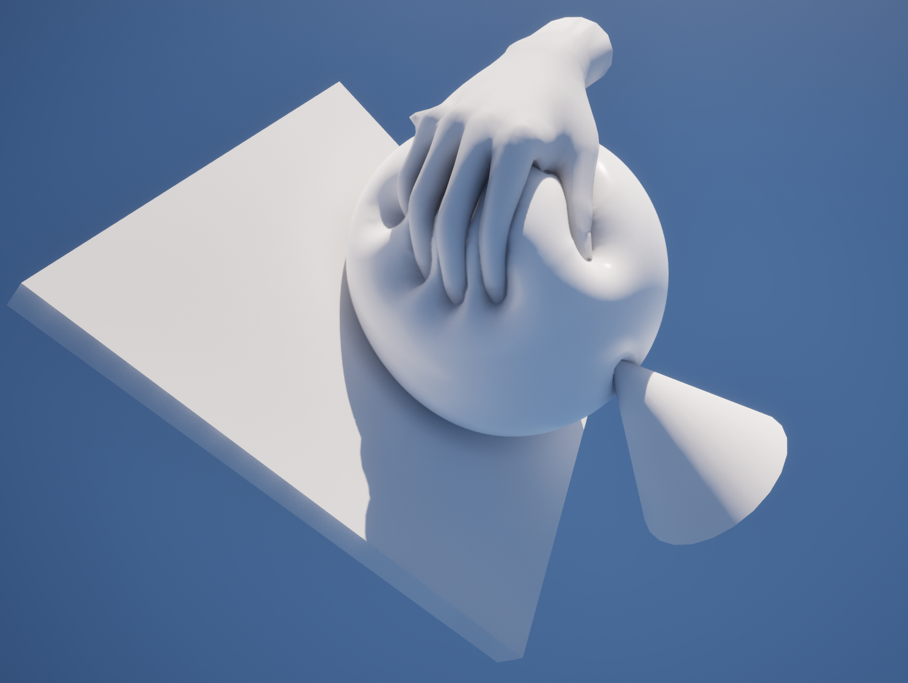

# Contact

What happens when hands and objects press the flesh, drag it and let it go. The settings are in the **Contact** category of the Softbody component; defaults and ranges are on [Softbody Component](Softbody-Component#contact).

## What contact does {#what-contact-does}

- **Dent**: the surface sinks under a collider. It sinks as far as the collider goes in; how firm the flesh is does not change the depth.
- **Bulge**: the flesh rises around the dent. Only with **Contact Detail** Full.
- **Drag**: friction pulls the surface along. Only with Full.
- **Recovery and lasting marks**: the surface comes back once the hand leaves, and a mark can stay like memory foam and fade.
- **Pushed lumps**: a lump such as a breast or buttock moves aside as one piece when a hand pushes it ([Inertia](Inertia#lumps)).

Contact runs on the baked contact map. A mesh baked without a contact map only runs inertia. [Concepts](Concepts#dent-bulge-drag-recovery-and-lasting-marks).

## What presses {#what-presses}

Each frame the component finds the colliders that overlap the mesh. Any collision that blocks the **Collider Channel** (Visibility by default) presses: hands, props, floors, other characters. It presses with its simple collision or physics asset bodies; a mesh with a baked [shape field](Colliders#shape-fields) presses with its real shape, between the fingers and into the hollow of the palm. The character's own hands press through **Self Contact**.

Conditions, limits and restricting what is found are on [Colliders](Colliders).

## The shape of a dent {#dent-shape}

| What you see | What sets it |
|---|---|
| How wide the dent and bulge are | The baked flesh thickness, **Skin Tension**, and with Full the **Flex** paint |
| How much the flesh rises around it | **Volume Preservation** on the authoring asset × Volume paint, plus **Volume Offset** while playing |
| How deep it can go | **Max Contact Depth** |
| The wall at the collider's edge | **Edge Smoothing** (Full), Nanite tessellation |
| How dark deep, narrow marks get | **Dent Darkening** |
| How far the skin is dragged | **Drag Friction** (Full) |
| How fast it comes back, and marks | **Recovery Rate**, **Memory Time**, **Memory Fade Time** |

No setting widens the dent without changing the material. [Flesh Thickness](Preview-and-Simulation#flesh-thickness), [Recipes](Concepts#recipes)

## Tuning {#tuning}

- Wider and softer: the flesh can be made thicker (move the rigid core, or Depth paint), **Skin Tension** can be raised, or with Full the surface can be painted gray in **Flex**.
- No rise around the dent (foam): **Volume Preservation** on the authoring asset can be set to 0, or Volume paint made darker. While playing, **Volume Offset** can be used.
- Sharper fingertip marks: **Contact Map Resolution** on the authoring asset can be raised. On low-density meshes Nanite tessellation can also be turned on.
- Steps where a round object presses deep: **Edge Smoothing** can be raised. It can be lowered if thin fingers look buried.
- How far the surface is dragged: **Drag Friction**. 0 means no drag.
- Marks that stay (memory foam): set **Memory Time** above 0, and set how fast marks fade with **Memory Fade Time**.
- Slow return: **Recovery Rate** can be lowered.
- Collision inside the visible skin (usually a body capsule): **Max Contact Depth** can be set to that gap.
- Lump push: [lumps in Inertia](Inertia#lumps)

## Detail and cost {#detail-and-cost}

- **Contact Detail**: Basic (the default) runs only dents and pushed lumps. Bulge, drag, Edge Smoothing and Flex paint work only in Full.
- **Enable Contact**: when off, only inertia remains and all contact cost goes away.
- **Min Screen Size**: dents stop updating while the mesh looks smaller than this value on screen.
- When nothing touches the mesh, the dent comes back and contact rests, so its GPU work stops ([Performance](Performance)).

## When nothing dents {#when-nothing-dents}

- The pressing object must block the Collider Channel and must not have a `SoftbodyIgnore` tag.
- The pressed slots must use a Softbody material. After changing the material, you must press **Rebake Contact Map** again.

[Troubleshooting](Troubleshooting#no-dents-checklist)
