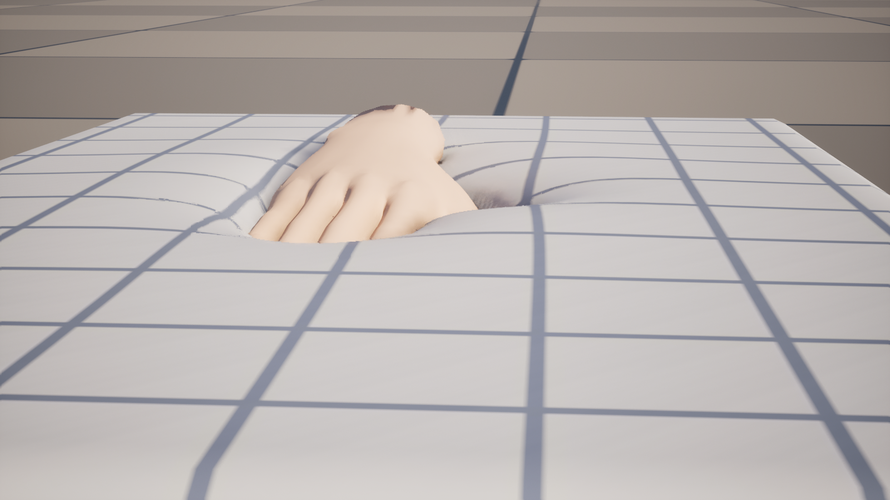
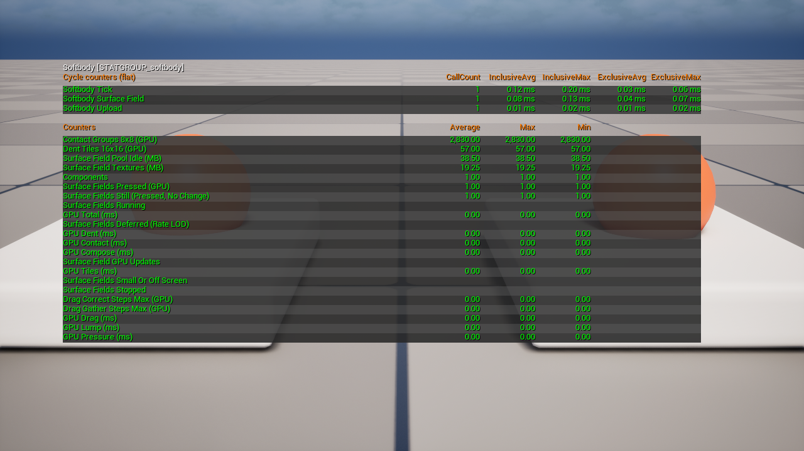

# How It Works

Settings are in [Softbody Component](Softbody-Component).

The bake gives every Softbody mesh a **contact map**: a flat atlas with one cell per patch of skin, holding that cell's rest position, outward normal, flesh thickness and skin weights. While the game runs, each awake mesh runs a chain of GPU compute passes (in `SoftbodySurfaceField.usf`) per contact update. They produce a displacement map and a normal map, which the material reads through the mesh's contact map UV channel. Inertia is a separate system on the CPU and in the vertex shader. [Inertia](Inertia)

## Three layers

| Layer | What it is |
|---|---|
| The model | Under a press the flesh acts as a layer of the baked thickness on the rigid core. The contact pressure that holds the skin against the collider is solved on the coarse grid. The layer's response to that pressure draws the dent and the bulge together: a narrow sinking part next to the collider and a wider ring that rises around it. Every width comes from the flesh thickness and **Skin Tension**, and how much rises from **Volume Preservation**. Foam can push back only so hard. Past that it gives way under the collider, so a foam dent has a crisp edge. The fine dent and the drag each solve one flesh-layer equation, x − ℓ²∇²x = f, on the contact map: the dent with the narrow width and the skin pinned to the collider, the drag with a wider width. Time enters through one rate: anything remembered from the last update shrinks by e−RΔt, with R the **Recovery Rate**. The dent is a remembered pressed depth with the skin pinned to it; drag is a remembered held position plus a pulling force; a lump (a whole piece of flesh hanging on a bone) moves aside until the pressing and gripping forces balance. One force law (**Squeeze Stiffening**) serves pressing, drag limits and lumps. |
| Rules that stop visible defects | Dent walls follow the collider's edge, not the cell grid (Nanite meshes place the wall between cells, easing back to plain interpolation where there is no wall to place — a collider lifting off at its edge, or a gap or sliver narrower than two cells; in Full, **Edge Smoothing** also slopes it); a buried collider does not dig its side faces in; seam cells mirror the cell on the other side of a UV seam, and an atlas neighbour guard keeps cells that touch in the atlas but not on the mesh apart; a baked surface-distance bound and a facing test stop drag and bulge leaking across folds or into another body part; a hand cannot pass through a lump; a newly pressed cell gets only half a drag step; stick and slip are judged inside the lump balance. |
| The GPU pipeline | Only pressed or still-recovering 8×8 cell groups run, so a resting mesh costs almost nothing. The contact pressure, drag and the coarse dent share one coarse grid. Contact maps come from a per-world pool. The shaders follow the D3D11 rules: at most eight writable outputs per pass, barriers only in uniform control flow. |

## One contact update

1. **Contact.** Each cell is skinned to its current position, and each collider's push-in depth is measured (shapes, bones, shape field parts, up to **Max Contact Depth**) with the distance to the collider's edge.
2. **Activity.** "Pressed now" and "left over from the last update" set how many groups every later pass runs on. Nothing pressed and nothing left means zero.
3. **Tiles.** The list of 16×16 dent tiles to solve: pressed or still holding a dent, one ring around them, and their partners across seams.
4. **Lump.** Each lump moves aside under the pressing force and, for a gripping hand, a spring or slip force limited by **Drag Friction**. The CPU reads the result and shifts the colliders for the next frame.
5. **Contact pressure.** Contact Detail Full only. The pressed cells are gathered into coarse cells, and one thread group solves their pressure so the skin meets the collider. It starts from zero every update and keeps no state. Each coarse cell within about six flesh thicknesses then adds up the rising ring from that pressure. Distances use the baked surface-distance bound, so the bulge does not cross folds or reach another body part. Where two cells differ in thickness the thinner one sets the response, so a bulge does not cross thin flesh over bone. It does not spread across areas painted with [Depth](Painting#the-four-channels) 0 either.
6. **Dent.** Solved first on the coarse grid, so wide dents (a palm, a seat) reach their full width in one update, then on the fine tiles. The pressed-depth memory shrinks by e−RΔt and is replaced by any deeper push; **Memory Time** and **Memory Fade Time** run the lasting mark. The rim width comes from each cell's flesh thickness, Volume Preservation and Skin Tension. With Contact Detail Basic only this step shapes the dent: foam still gives way and a tight skin still rounds the rim, but nothing rises.
7. **Drag.** A pressed cell moves its held position with the collider and builds up a pull; past the friction limit (**Drag Friction** times the pressing force) it slips. Every flesh cell then sums the pulls over surface distance, hidden across folds. How far the pull reaches comes from the flesh thickness and Skin Tension.
8. **Compose.** The displacement map: the dent minus the rising ring along the inward normal, plus drag along the surface. The rise stops at the collider and never goes higher than the flesh is thick. The shading normal is rotated from the displaced neighbours, so normal maps stay intact, and **Dent Darkening** is written. The update is flagged "changed" if anything moved more than `softbody.Surface.StillChange`.

The material reads the displacement in the vertex shader (vertices more than 5 cm off the outer surface follow less, and stop at 10 cm) and the normal rotation and darkening in the pixel shader. The GPU time of each stage is a `stat softbody` line: GPU Contact, Tiles, Dent, Drag, Pressure, Compose and Lump.

## Between updates

On the CPU, each Softbody mesh with contact enabled moves through these states:

1. **Sleeping.** No collider can reach the mesh (checked against wake-up boxes baked per bone). It holds no contact maps and the material's contact switch is off.
2. **First touch.** The mesh takes a set of contact maps from the world pool and updates the same frame. This first update sees no hand movement, so it adds no drag.
3. **Awake.** Every tick the mesh asks for an update, and the world picks which meshes run: meshes small on screen run every few frames, at most `softbody.Surface.UpdateBudget` run per frame, and the contact update rate limit caps updates per second. Out of every view or below **Min Screen Size** counts as out of reach. The time of skipped frames is solved in one step at the next update.
4. **Still.** Pressed, but colliders, bones, shape field parts, lump targets and settings have moved less than `softbody.Surface.StillDistance` (0.1 cm) since the last update that ran, and that update was flagged pressed and not changed. The mesh stops asking for updates: GPU cost 0, time does not accumulate. Anything moving past the threshold wakes it the same frame. A mesh recovering after release never goes still.
5. **Collider gone.** Each update that ran adds the recovery it completed to a settle counter, by work done rather than by ticks, so a mesh the budget skipped is not cleared early. Meshes not on screen count by ticks.
6. **Recovered.** When the counter reaches 1, the maps are cleared and returned to the pool and the contact switch goes off: back to state 1.

Turning the component off (Deactivate or Set Active false) jumps to state 1 from anywhere and clears inertia. Turning it on starts from rest, with no velocity history.

