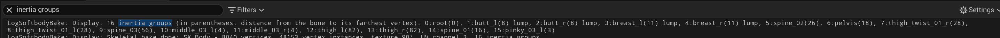

# Inertia

The settings are in the **Inertia** category of the Softbody component. Defaults and ranges are on [Softbody Component](Softbody-Component).

## Where the flesh moves {#where-the-flesh-moves}

How much each area moves comes from the bake. Soft flesh far from the bones (white in the **Jiggle** paint) moves most; firm areas, areas close to a bone and areas painted dark move less; the rigid core does not move. A whole belly or lump swings as one piece, with a soft gradient toward its base.

Play starts at rest: on the first frame the flesh takes the sag of the current pose without falling into it.

These shape the inertia before any component setting:

- **Bone Thickness** (bake): larger = thinner flesh, which reacts less to inertia. Per bone in **Bone Overrides**.
- **Jiggle** paint: the firmness of the flesh. Firm flesh can be painted gray. Black is flesh as hard as bone: it has no inertia, but it dents. Paint the bone itself in **Depth** ([Painting](Painting)).
- **Flesh Reach** (bake): makes the inertia of thick flesh follow the paint, not the thickness.
- **Physics Driven Bones**: no Softbody inertia on flesh skinned to bones that another system already moves (a KawaiiPhysics node, simulated physics bodies).

The paint and Flesh Reach apply with **Run Bake**, and Physics Driven Bones with **Reapply Paint**.

## Inertia groups {#inertia-groups}

The bake picks the inertia groups of a skeletal mesh from the skin weights, up to **Max Inertia Groups** (default 16, which is also the maximum):

1. The root bone always gets group 0.
2. The top bone of each chain set to **Lump** in Bone Overrides comes next, whatever its vertex count; lump bones below it join its group. These are the lump groups. Bones set to **Accessory** never get a group of their own: their vertices follow the group above them.
3. The remaining groups go to the bones that own the most vertices in the slots with a Softbody material. Bones that move only other slots, such as hair or skirt bones, get no group.
4. Every other bone joins the first group bone up its parent chain.

The bake log lists the result (`N inertia groups (in parentheses: distance from the bone to its farthest vertex): ...`), with `lump` after each lump group.

## Tuning {#tuning}

**Inertia Amount** is how far thick flesh painted white in Jiggle sags at 1 g. Each area wobbles at the speed that fits its own sag, so a bigger Inertia Amount wobbles bigger and slower.

- Rhythm only: **Jiggle Speed**. Wobbles faster or slower at the same size.
- Size only: **Actor Motion Weight** and **Animation Motion Weight**. Larger swings at the same speed.
- How many bounces: **Inertia Damping**. 0.25 bounces about twice and 0.4 about once, then stops.
- Only lumps should move with the body: parts on the skeleton do not sag. The jiggle of the other parts can be lowered with overrides or the **Jiggle** paint.
- One part should sag: it can be given a Gravity Scale in **Inertia Group Overrides**.
- More bounce, less sway: Z can be raised and the sideways axis (X or Y, depending on which way the mesh faces) lowered in **Inertia Direction Scale**.

### One body part {#one-body-part}

Add an entry to **Inertia Group Overrides** and pick the bone. The dropdown lists only the groups the bake found: a missing bone belongs to another group or needs a higher **Max Inertia Groups** and a new bake.

Each part can have its own inertia. With **Amount Scale** 0 the part does not jiggle.

## Lumps {#lumps}

**Lump Yield**, **Lump Grip** and **Squeeze Stiffening** (Inertia > Lumps) set how far a pressing hand pushes a lump. Set the bones to **Lump** on a skeletal mesh and bake. **Enable Contact** and **Enable Inertia** must be on, and Inertia Amount above 0. A static mesh has no lumps.

## When nothing jiggles {#when-nothing-jiggles}

- Lumps do not move as a whole, and the contact map log says `Lumps: skipped, no bone has the Lump role in Bone Overrides` or `Lumps: skipped, the baked data has no flesh softness for inertia`: set the bones to **Lump**, then press **Run Bake**.
- `Inertia groups: the mesh has no skin weights, so no inertia groups are made.`: the measure bake needs skin-weighted bones inside the mesh, so nothing jiggles without them.
- Flesh on a KawaiiPhysics or physics-driven bone does not jiggle: that is **Physics Driven Bones**. Remove the bone from the list and press **Reapply Paint** if Softbody should move it.

[Troubleshooting](Troubleshooting)
