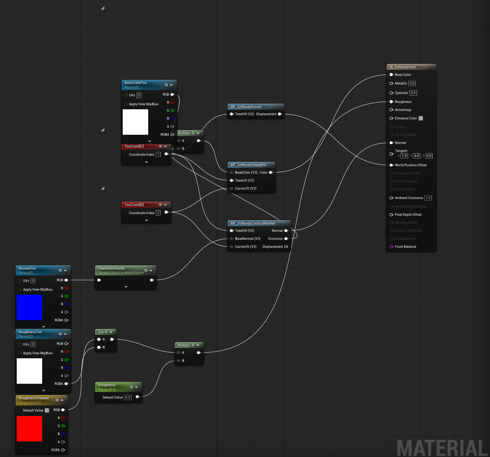
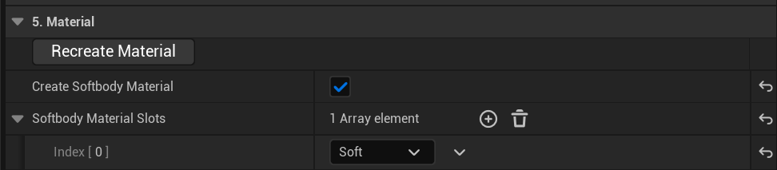
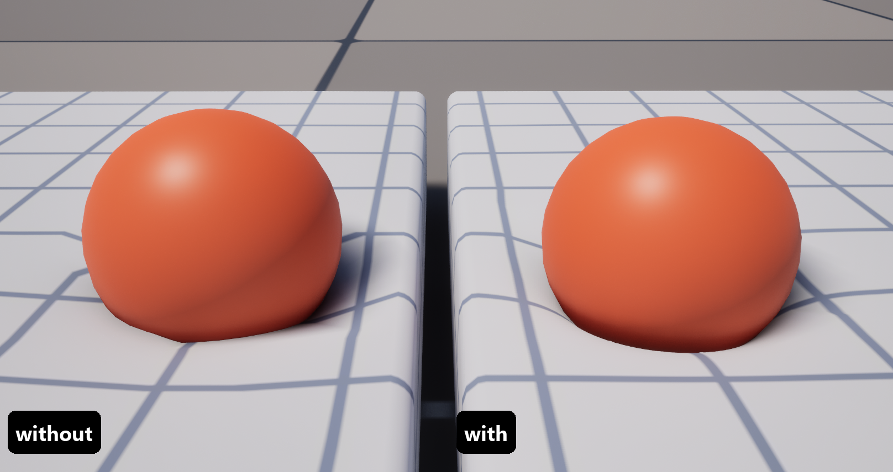
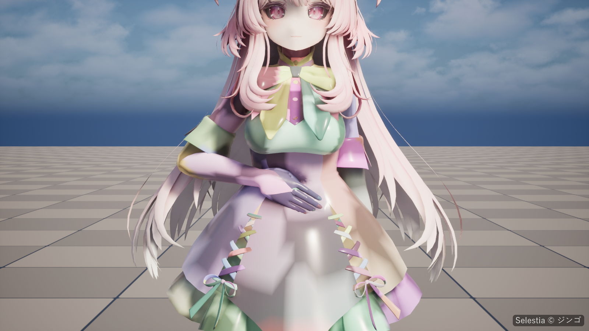

# Materials

A slot deforms only when its material contains the plugin's Softbody material functions ([Softbody slots](Concepts#softbody-slots)). Let the bake build the material, or add the functions to your own master material.

## The three material functions {#the-three-material-functions}

The plugin's Content folder (`/SoftbodySystem`) holds three material functions and the example material `M_SoftbodyHost` that wires them. Duplicate the example or copy its wiring.

| Function | Inputs | Outputs | Connect to |
|---|---|---|---|
| `MF_SoftbodyKernel` | `TexelUV` | `Displacement` | **World Position Offset** (required). Moves the vertices: dents, bulges, drag and jiggle. |
| [`MF_SoftbodyContactNormal`](#mf-softbodycontactnormal) | `TexelUV`, `CarrierUV`, `BaseNormal` | `Normal`, `Occlusion`, `Displacement` | `Normal` to **Normal**, `Occlusion` multiplied into the base color, and `Displacement` to the **Displacement** pin. |
| `MF_SoftbodyDebugVis` | `TexelUV`, `CarrierUV`, `BaseColor` | `Color` | **Base Color**. Passes your base color through, or shows the debug colors when Debug View is on. |

### MF_SoftbodyContactNormal {#mf-softbodycontactnormal}

- `BaseNormal`: a world-space normal. If unconnected, the vertex normal is used.
- `Normal`: connect to **Normal** (world space).
- `Occlusion`: multiply into the base color. This is **Dent Darkening**; 1 = unchanged.
- `Displacement`: connect to the **Displacement** pin. Set Up Nanite Tessellation connects it.

### Inputs and parameters {#inputs-and-parameters}

`TexelUV` is a Texture Coordinate node set to the UV channel the bake added for per-vertex data (**Texel UVChannel** on the Baked Data asset). `CarrierUV` is a Texture Coordinate node set to the contact map's UV channel (**Carrier UVChannel**).

At play time each slot whose material contains `MF_SoftbodyKernel` gets a dynamic instance, and the component fills the functions' own parameters.

## Let the bake make the material

1. In category **5. Material** of the Softbody Authoring Data asset, turn on **Create Softbody Material** and list the slots that should deform in **Softbody Material Slots**: skin and tight clothing, not the face or hair.
2. Press **Run Bake**. It makes the material before the contact map, so the contact map is already linked to it.
3. The Output Log line `slot '<slot>' now uses MI_<mesh>_<slot> ... Copied: ...` lists the textures it copied. Set anything listed as `(not found)` on the instance by hand: **BaseColorTex**, **NormalTex**, **RoughnessTex**.

It creates, in **Output Folder**, `M_<mesh>_Softbody` (a copy of the example material with its `TexelUV` node set to this mesh's Texel UVChannel) and one instance `MI_<mesh>_<slot>` per listed slot, and reuses them if they already exist. Slots that already have a Softbody material are left alone.

Only the three textures below are taken from the slot's original material. Its graph, parameter values and settings such as the shading model are not carried over, so to keep the original look, follow [Use your own master material](#use-your-own-master-material).

- Base color: a texture whose name contains `BaseColor`, `Albedo`, `Diffuse`, `_Col` or `_BC`, or ends in `_D`; otherwise the first sRGB texture that is not a normal map.
- Normal map: the first texture whose compression setting is a normal map. If none, the instance keeps the engine's flat normal.
- Roughness: a non-sRGB texture whose name contains `ORM`, `ARM` or `OcclusionRoughnessMetallic` (green channel), or contains `Rough` or ends in `_R` (red channel). Found: **RoughnessTex**, **RoughnessChannel** and **Roughness** = 1 are set on the instance. Not found: the log says `(not found, 0.5)` and roughness stays at the example's default, 0.5.

**Recreate Material** (same category) makes and assigns the Softbody material again. Use it after you change Softbody Material Slots, or after replacing a slot's material.

## After changing the material: Rebake Contact Map

Whenever you connect or change the Softbody material on the mesh after the bake, press **Rebake Contact Map** (category 6. Contact Map). It connects the contact map's UV channel to the `CarrierUV` inputs in each slot's base material (through a Texture Coordinate node named `Contact map UV channel`) and, when **Pressable Slots** is empty, limits the contact map to the slots that use a Softbody material. If a skeletal mesh gained or lost slots that use a Softbody material, press **Run Bake** instead: its rigid core and inertia groups follow those slots.

The UV channel numbers live in the base material's graph, not in the instance. If another Softbody mesh baked with a different channel shares the same base material, the bake leaves the material unchanged and logs an error: give this mesh its own copy of the material (or turn on Create Softbody Material), then rebake.

## Use your own master material

1. In the master material, turn off **Tangent Space Normal**: `MF_SoftbodyContactNormal` outputs a world-space normal.
2. Add a Texture Coordinate node set to the mesh's **Texel UVChannel** (shown on the Baked Data asset). Call it `TexelUV`.
3. Add `MF_SoftbodyKernel`, connect `TexelUV`, and connect its `Displacement` output to **World Position Offset**. If you already have a World Position Offset, add the two.
4. Add `MF_SoftbodyContactNormal` and connect `TexelUV`. Transform your normal to world space and connect it to `BaseNormal`. Connect the function's `Normal` output to **Normal**.
5. Multiply your base color by the function's `Occlusion` output.
6. Add `MF_SoftbodyDebugVis`, connect `TexelUV`, feed the darkened base color into `BaseColor`, and connect `Color` to **Base Color**.
7. Leave the `CarrierUV` inputs unconnected. Put the material (or an instance of it) on the slots and press **Rebake Contact Map**. For a skeletal mesh press **Run Bake** instead, so the rigid core and the inertia groups are picked again from the slots with a Softbody material.
8. Leave **Create Softbody Material** off.

The bake cannot change engine-content materials. Duplicate them into your project's Content folder first.

## Nanite tessellation

Category **8. Nanite Tessellation** sets the mesh up to draw with Nanite tessellation, so dents narrower than its triangles, such as fingertips, can show. Its settings are on [Baking](Baking). **Reapply Nanite Tessellation** applies them again; press it after changing the range settings or after assigning a new Softbody material.

What it changes:

- Mesh: Nanite enabled, UV interpolation (Lerp UVs) off, Max Edge Length Factor set to 4 if it is 0, Nanite data built. Without Max Edge Length Factor, a mesh with UV interpolation off draws flat areas heavily simplified even up close, and patterned textures break into zigzags.
- Every slot material: the Nanite usage flag (and Used with Skeletal Mesh for a skeletal target).
- Slot materials that contain the Softbody functions: the `Displacement` output of `MF_SoftbodyContactNormal` is connected to the **Displacement** pin, tessellation is enabled, and Displacement Scaling Magnitude and Center and Max World Position Offset Displacement are set from the three range settings.

It needs a slot that already uses a Softbody material, no translucent slot, and the Texel UVChannel in UV0 to UV3, since Nanite reads only four channels (otherwise remove unused UV channels from the mesh and press Run Bake again). Nanite skinning ignores morph targets. On skeletal meshes, set `r.Nanite.DicingRate=4` or higher under `[SystemSettings]` in your project's DefaultEngine.ini; below 4, skinned meshes break into pieces up close. Any tessellated mesh can show holes with the camera very close; see [Known Limitations](Known-Limitations#nanite-tessellation). The Output Log warns about each of these, and about hard normals that can open cracks; see [Troubleshooting](Troubleshooting).

## Debug View

**Debug View** (category Debug of the Softbody component) replaces the shading with debug colors drawn by `MF_SoftbodyDebugVis`. The modes are listed under **Debug View Mode** on [Softbody Component](Softbody-Component). A slot whose material does not contain `MF_SoftbodyDebugVis` keeps its normal shading in every mode. The authoring asset's Preview shows the same colors for the last bake without playing ([Last Bake view](Preview-and-Simulation#last-bake)).

