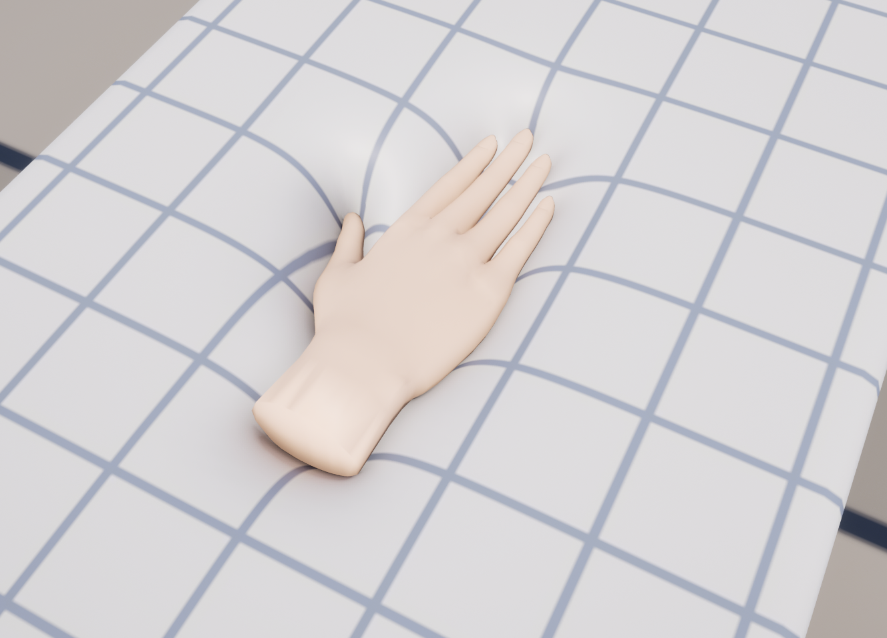

# Overview

MallangPhysics makes skeletal and static meshes soft in Unreal Engine 5.6–5.8. Hands and objects dent the surface, the flesh around the dent bulges, a moving hand drags the skin along, and the flesh jiggles when the body moves. You bake a mesh once in the editor and add one component; the mesh deforms on the GPU.

## Names in the editor

Inside the editor the component and asset names keep the working name (Softbody). The menu and setting names in this documentation are those of the English editor.

| | Name in the editor |
|---|---|
| Plugin | **MallangPhysics** |
| Component | **Softbody** |
| Bake asset | **Softbody Authoring Data** |
| Project settings | Project Settings > Plugins > **Softbody** |

## Status

Version 1.0.0. Supports Unreal Engine 5.6, 5.7 and 5.8 on Windows. Most visual checks were done on 5.8 with D3D12 and D3D11. See [Known Limitations](Known-Limitations).
