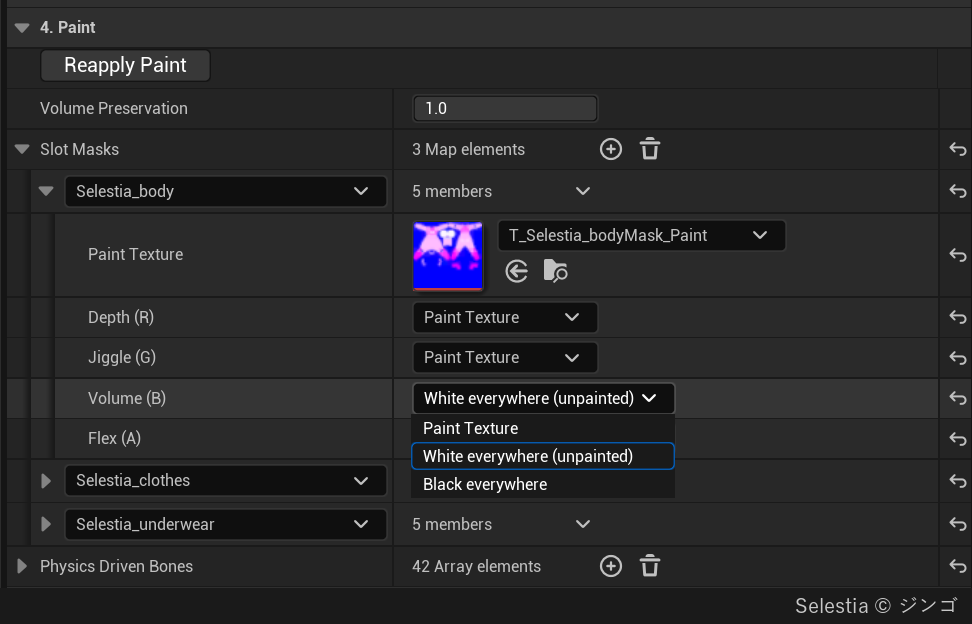

# Painting

Slot paint tells the bake how the material differs from place to place on a mesh. You paint one RGBA texture per material slot in that slot's UV0 layout. Its four channels each hold one property of the material. White means unpainted in every channel. A mesh with no paint counts as white everywhere.

## The four channels {#the-four-channels}

Each entry of **Slot Masks** (category 4. Paint) has one **Paint Texture** and four channels. The channels have fixed places.

| Channel | Painted brightness | Used for |
|---|---|---|
| Depth (R) | The depth the flesh can be pressed. The closer to white, the deeper it can be pressed. The closer to black, the thinner the flesh. | Places where the bone is closer to the skin than the skeleton's bones are: ribs, shins, the head. Paint bone in this channel only. |
| Jiggle (G) | How strongly the flesh reacts to inertia. The higher, the more sensitive to inertia. | Flesh whose firmness differs by area, such as a belly over muscle and soft love handles |
| Volume (B) | How much volume is kept when pressed. The higher, the more the surroundings bulge by the amount pressed. | A part in another material, such as a jelly toy on a foam base |
| Flex (A) | How stiff the material is. White bends freely. Black is a rigid body ([Plates](#plates)). | Leather, a tight suit, metal plates, gems, buckles, the pips of a soft die |

Each channel picks where it reads from. **Paint Texture** (the default) reads the channel from the texture. <strong>White everywhere (unpainted)</strong> and **Black everywhere** set the whole slot to one value, with no texture. If you pick Paint Texture and the slot has no texture, it is white.

- Volume (B) multiplies the authoring asset's **Volume Preservation** (4. Paint). With that value at 0, painting Volume has no effect.
- Flex works only when **Contact Detail** is Full. With Basic, a Flex-painted area presses like bare flesh, and the Output Log says so when play starts.
- If the whole surface has the same taut skin, use **Skin Tension** on the Softbody component instead of paint. If only part of the surface is stiff, paint Flex.
- While playing, **Volume Offset** and **Flex Offset** on the Softbody component add to the paint so you can try values ([Softbody Component](Softbody-Component#contact-flesh)).

The bake reads all four channels when it measures the flesh, so they apply with **Run Bake**. **Reapply Paint** runs Run Bake for you when the paint changed after the flesh was measured Once the asset has Baked Data, reimporting the Paint Texture shows a notification, and its button (**Run Bake** or **Reapply Paint**) applies the new paint.

## Making the paint texture {#making-the-paint-texture}

1. Import the texture with **sRGB** off. With sRGB on, gray is read darker (0.5 becomes 0.21).
2. Add an entry to **Slot Masks** and pick the material slot as its key.
3. Set **Paint Texture**. Leave a channel you did not paint on <strong>White everywhere (unpainted)</strong>.
4. Check the paint before baking in the [Paint (Current Slot Masks)](Preview-and-Simulation#paint-views) view of the bake asset window's Preview.
5. Press **Run Bake**.

How the texture is read:

- The paint is read once per vertex, at that vertex's UV0 position. Detail finer than the vertex spacing does not show. Pad the paint outward past the UV islands.
- A texture with no alpha channel has Flex white (bare flesh).
- When a PNG holds Flex in alpha, import replaces the color of fully transparent pixels with the color of their neighbors, which can change Depth, Jiggle and Volume on a plate. Export a TGA, or set **PNG Infill** in Project Settings > Texture Import to Never and reimport.
- If a channel is black over the whole texture, the whole slot becomes bone (Depth), flesh as hard as bone (Jiggle), foam (Volume) or one plate (Flex). If you do not use that channel, leave it on White everywhere.
- The texture must still have its source data, as an imported image does. A slot whose pixels cannot be read stays white, with a warning.
- An entry whose key is not a material slot of the Target Mesh is skipped with a warning. A slot with no entry counts as unpainted.
- Clothing within **Layer Max Gap** (2. Bake) of the skin takes Depth, Jiggle and Volume from the flesh under it. Only Flex reads the paint of the clothing slot itself. So paint a buckle on clothing in the clothing slot's Flex.

## Plates {#plates}

One connected area painted darker than white in Flex is one piece. Each piece becomes one of these.

- **Rigid plate:** it does not bend. It sinks and tilts as one piece and pushes the flesh under it. A piece painted black is a plate whatever its size. A gray piece also becomes a plate if it is small. When a piece is small compared with its painted stiffness, it moves as one body, like a coin set in tough leather.
- **Bending piece:** any other gray piece bends as painted.

Lowering Flex Offset turns more pieces into plates. At -1 every painted piece is a plate. A separate part that is not attached to the body (a gem sitting on the surface) is always a plate and rides on the flesh under it.

- This is different from Depth 0. A Depth 0 area stays in place. A plate moves over the flesh under it.
- Paint black only parts that keep their shape under a finger. Fabric ribbons, straps and bands get gray paint or none. A part that hangs from a physics bone moves with that physics.

The [Plates](Preview-and-Simulation#plates-view) view of the Preview shows with color whether each piece became a plate in the last bake, and why not if it did not. The Output Log lists the reason for each piece.

| Color | Reason | To make it a plate |
|---|---|---|
| Red | It wraps around the body (a ring around the neck, a band around the thigh) | Leave a thin white gap in the paint to split it into flat pieces. |
| White | There is no surface under it to press | — |
| Orange | The piece is too large | Leave thin white gaps and paint it as smaller pieces. |
| Purple | It touches the edge of the contact map | Bake again with a different **Contact Map Resolution**. |

## How much it jiggles {#how-much-it-jiggles}

Jiggle sets the difference between areas, and the Softbody component's **Inertia Amount** sets the overall size. The bake scales the jiggle so that flesh thicker than 3 cm and painted white in Jiggle (the reference flesh) sags exactly Inertia Amount at 1 g. So the same Inertia Amount is the same flesh on every mesh. Firmer or thinner areas move less than that.

When **Flesh Reach** (3. Rigid Core (Bones)) is 0, deeper flesh jiggles more, so a belly with no bone under it jiggles much more than other flesh painted the same brightness. For a human-sized body set it to about 3 ([Baking](Baking#_3-rigid-core-bones)). The bake warns in these two cases.

- The flesh of a Softbody slot hardly moves: check that Depth or Jiggle over soft flesh is not black.
- The deepest flesh moves several times more than the reference flesh: set Flesh Reach to about 3 and press Run Bake.

## Physics Driven Bones {#physics-driven-bones}

**Physics Driven Bones** (4. Paint) lists bones that another system already moves, such as a KawaiiPhysics node or a simulating physics body. Flesh skinned to those bones, and to the bones below them, loses Softbody jiggle by its skin weight. A vertex weighted half to a listed bone loses half of its jiggle. This happens after the scaling above, so listing the jiggle bones does not make the rest of the body jiggle more.

- **Reapply Paint** alone applies it (Run Bake is not needed).
- It needs the skeletal mesh's LOD0 skin weights on the CPU (Allow CPU Access for LOD0). If they cannot be read, it is skipped and the Output Log says so.

## Workflow and examples {#workflow-and-examples}

Start without any paint. Press Run Bake, press the mesh in Play, and paint only what looks wrong.

- **A character.** Paint Depth dark on places where the bone is close to the skin, such as the hands, feet and head. If the hands press the body with **Self Contact**, paint the hands' Depth close to 0. Paint firm flesh, such as a belly over muscle and the thighs, gray in Jiggle. A skeleton with no rib or pelvis bones treats the whole torso as thick flesh hanging on the spine, and **Bone Thickness** cannot help there. Paint those areas dark in Depth, set Flesh Reach to about 3 and press Run Bake.
- **Clothing and decoration slots.** Do not paint Depth with the rules for the body. Painting the Depth of clothing or decoration at 0 turns that part into bone. Leave these slots without an entry or on White everywhere, and paint Flex black only on buckles and gems.
- **A tight suit or leggings.** Nothing to paint. Cloth vertices take Depth, Jiggle and Volume from the flesh under them as they are.
- **A foam block or sponge.** Nothing to paint. Set **Volume Preservation** (4. Paint) to 0.
- **Part of a mesh in another material** (a jelly toy on a foam base, the yolk and white of a halved egg). Set Volume (B) of the foam slot to Black everywhere. No texture is needed.
- **Stiffness on part of the surface** (a leather patch, the pips of a soft die). Paint Flex only there. Bending leather is gray and hard pips are black. Set Contact Detail to Full.
- **A thin sheet over a Volume Mesh** (a trampoline, a dish). Set Volume Preservation to 0 so the thin skin does not bulge.

When the paint seems to do nothing, see [Troubleshooting](Troubleshooting).
