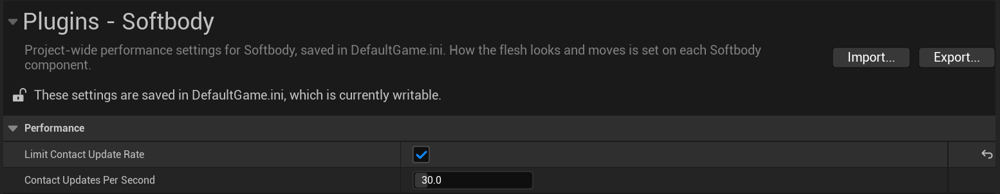
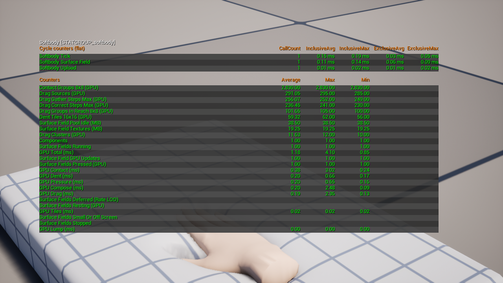

# Performance

Contact (dents, bulges, drag) costs GPU time and memory only for meshes that are being touched. It can be measured with `stat softbody`.

## Where the cost goes

| Cost | What it is | When it is paid |
|---|---|---|
| GPU time | One contact update | Per touched mesh, every frame unless a limit below skips it |
| CPU time | The component tick: collider search, inertia, the update request | Every tick for every active component (small) |
| Memory | One set of contact textures, sized by **Contact Map Resolution** | Per touched mesh, from first touch until full recovery |

Jiggle (inertia) is separate: a small CPU step per component plus work in the material's vertex shader, whether or not the mesh is touched.

## Life cycle

1. **Sleeping.** No collider is near the pressable surface: no texture set, no GPU work. With **Find Colliders Automatically** on, one overlap query per tick still looks for colliders while the mesh is in view and above **Min Screen Size**.
2. **First touch.** The mesh takes a texture set from the pool and updates on that same frame: the update rate limit and the small-mesh interval (`softbody.Surface.FullRateScreenSize`) do not apply, and it is first in line for the update budget.
3. **Pressed.** One update per frame, or fewer under the limits below.
4. **Still.** When the colliders, bones and settings have moved less than 0.1 cm since the last update, and that update changed no displacement by more than 0.001 cm, updates stop and GPU cost is 0. Anything moving past that wakes the mesh on the same frame. Animated characters do not go still while their bones move. Both thresholds are console variables.
5. **Recovering.** After release, updates continue while dents and drag recover at the **Recovery Rate**. A recovering mesh never goes still.
6. **Recovered.** With nothing in reach, the texture set is cleared and returned to the pool, and the mesh sleeps again.

## What makes it cheaper

| Setting | Where | Effect |
|---|---|---|
| [**Enable Contact**](Softbody-Component#enable-contact) off | Softbody component, Contact | Removes all contact cost and keeps the inertia. Can be switched while playing. |
| [**Contact Detail**](Softbody-Component#contact-detail) Basic (default) | Softbody component, Contact | Drops bulges, skin drag, Edge Smoothing and the Flex paint, so it costs less GPU time than Full (Full is about 1.6 times as much in the demo scenes). |
| **Contact Map Resolution** | Softbody Authoring Data, 6. Contact Map | Every update and every texture set scales with it. Needs a rebake. |
| **Pressable Slots** | Softbody Authoring Data, 6. Contact Map | Leaving out slots that are never pressed gives the map's cells to the rest. |
| [**Min Screen Size**](Softbody-Component#min-screen-size) | Softbody component, Contact, Performance | Stops computing dents while the mesh looks smaller than this on screen or is in no view. The default 0.15 is a human about 140 pixels tall at 1080p. |
| [**Limit Contact Update Rate**](Softbody-Component#limit-contact-update-rate) and **Contact Updates Per Second** | Project Settings, Plugins, Softbody | Caps the updates per second of each touched mesh. At 120 fps, 30 updates a second costs a quarter of the GPU time; at 60 fps, half. |
| `softbody.Surface.UpdateBudget` | Console ([Console Reference](Console-Reference)) | Caps how many meshes update in one frame, per world. The rest take turns. |
| **Self Contact Bones** | Softbody Authoring Data, 7. Shape Field | Every bone in the list is tested against the character's own flesh each update. |
| **Self Contact** off | Softbody component, Contact, Colliders | Skips the character's own shape field parts. |
| **Collider Channel** | Softbody component, Contact, Colliders | A channel that only hands and props block keeps the collider list short ([Colliders](Colliders#recommended-setup)). |
| `SoftbodyIgnore` tag | Any actor or component | Put it on anything that overlaps the mesh but must not press it. |
| **Find Colliders Automatically** off | Softbody component, Contact, Colliders | No overlap query and no outside colliders; only Self Contact remains. |

Deactivate or Set Active off returns the component's textures, clears its inertia, stops its tick and switches off the mesh's World Position Offset: no CPU or GPU cost until it is activated again, and its contact memory is freed after `softbody.Surface.ReleaseDelay` (see [Turning the component off and on](Softbody-Component#turning-the-component-off-and-on)).

## Reading stat softbody

The GPU lines are the sum over every touched mesh. [Console Reference](Console-Reference#stat-softbody)

GPU Total (ms) is the sum of the GPU lines below. Surface Field GPU Updates is the number of meshes updated, and Dent Tiles 16x16 (GPU) is the number of dent tiles (on a commercial character, tiles across seams can outnumber the pressed ones, and the counts by reason are in the `dent-why` lines of [Softbody.Stats](Console-Reference#profiling-advanced)).

- GPU Contact grows with the number of colliders and shape field parts, and with Contact Groups 8x8 (GPU), which is fixed per mesh.
- GPU Dent and GPU Pressure grow with the pressed area.
- GPU Drag follows the longest walk of one 8x8 group (Drag Correct Steps Max and Drag Gather Steps Max), not the pressed area. Many Drag Mixed Clusters mean a lot of drag across seams. Drag Sources at 0 means the drag work is minimal. With **Drag Friction** 0 or **Contact Detail** Basic the drag does not run at all. With Basic the contact pressure does not run either.
- GPU Tiles and GPU Compose are roughly constant per mesh. GPU Lump is 0 for meshes without lumps (every static mesh included).

If Surface Fields Running is high while nothing is visibly touched, meshes are recovering, or something that blocks the **Collider Channel** is being gathered as a collider.

For a per-mesh breakdown use `Softbody.Stats` or `Softbody.Profile`, and `Softbody.Scenario` to measure one scene at a time.

## Memory

A texture set is about 70 MB for a 1024x1024 character with lumps and about 3.9 MB for a 256x256 prop; a smaller **Contact Map Resolution** shrinks it. Memory grows with how many meshes are touched at once, not with how many are placed. The coarse-grid textures used by the dent, bulge and drag come and go with the set. Temporaries are one shared set per world.

The Mesh Data's contact map textures (about 5 MB for a 256x256 prop, 20 MB for a 512x512 one, 90 MB for a 1024x1024 character with lumps) load in the background, a few at a time (`softbody.Surface.LoadBudget`), when the first component that uses them switches on with contact. They unload at the next garbage collection once no component has used them for `softbody.Surface.ReleaseDelay`.

Switching components on and off, spawning and streaming do no heavy work in the frame they happen. Textures are created a few per frame (`softbody.Surface.CreateBudget`), and the pool (`softbody.Surface.TexturePool`) prepares spares for each kind a switched-on component uses, so a first touch does not wait. Setting the pool to 0 keeps no spares (a first touch then starts a few frames late).

What a switched-off component used stays for `softbody.Surface.ReleaseDelay`, so switching it back on recreates nothing, and is then freed a little per frame. Surface Field Textures (MB) shows what awake meshes hold; Surface Field Pool Idle (MB) shows the spares and the sets being prepared. `Softbody.HitchTest` measures all of this in your own level.
