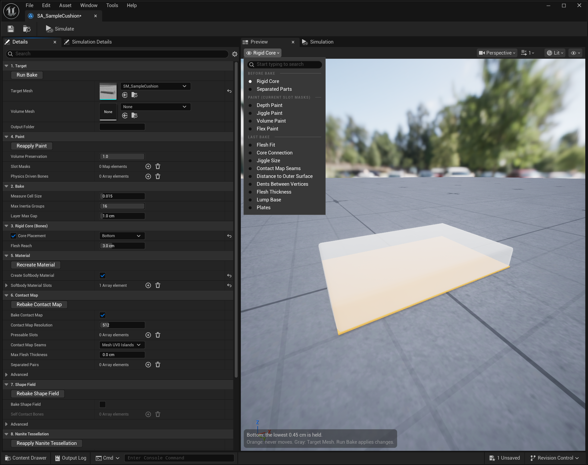
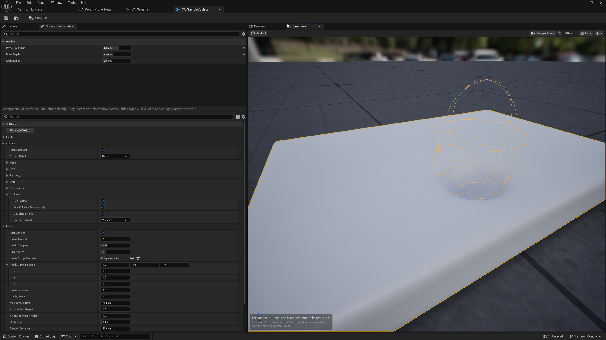

# Preview and Simulation

Double-click a Softbody Authoring Data asset to open a window with four tabs. Without placing anything in a level, you can see the values before the bake, the paint and the last bake result as colors on the mesh, and press or shake the last bake.

| Tab | What it does |
|---|---|
| **Details** | The bake settings and the bake buttons ([Baking](Baking)). |
| **Preview** | Draws the view you pick in the menu as colors on the mesh ([below](#preview)). |
| **Simulation** | Runs the last bake like a game, so you can press and shake it ([below](#simulation-tab)). |
| **Simulation Details** | The pressing finger, the grab circle and the component values used in the Simulation tab. |

**Simulate** on the toolbar brings the Simulation and Simulation Details tabs forward.

## Preview

Pick a view in the menu at the top left. The menu has three sections, and each redraws its views at a different time.

| Section | What it shows | Redraws |
|---|---|---|
| [**Before Bake**](#before-bake) | What the bake will make with the current settings | Whenever you change a value |
| [**Paint (Current Slot Masks)**](#paint-views) | The current paint set in Slot Masks | Whenever you change the paint or Slot Masks |
| [**Last Bake**](#last-bake) | The result of the last bake | When you bake again |

The first line at the bottom left is the state of the current view. If something is wrong it turns red and says what to press or fix. The dim lines under it explain the colors. The menus at the top right (camera, view mode, show) are the same as in any other UE viewport.

### Before Bake

| View | What it shows | What to check |
|---|---|---|
| [**Rigid Core**](#rigid-core) | The part the bake will hold still (orange). | Orange close to the skin makes the flesh there thin. |
| [**Separated Parts**](#separated-parts-view) | The two sides that [Separated Pairs](Baking#separated-pairs) will keep apart. | Check that orange and blue split where the two parts meet. |

#### Rigid Core

Draws Target Mesh in see-through gray, the rigid core the bake will hold as orange spheres, and Volume Mesh as blue lines. Orange never moves; the farther flesh is from orange, the thicker it is, so it jiggles more and its dents are wider. Thin bones are drawn thicker to match the measuring cell size. The bake uses the same thickness.

- **Skeletal mesh:** spheres placed along the bones. [Bone Thickness](Baking#bone-thickness) and [Bone Overrides](Baking#bone-overrides) set the thickness. If a ribbon or necklace bone makes an orange sphere just under the skin, set that bone's Role to Accessory.
- **Static mesh:** shown as [Core Placement](Baking#core-placement) says. Center is spheres through the middle of the shape, Bottom is a thin layer at the very bottom, Custom Spheres is the spheres you placed.

The line at the bottom left shows the number of spheres. It turns red in these cases:

- No bone sits inside the mesh. Baked like this, nothing jiggles.
- Custom Spheres is set but there are no spheres. Baking stops like this.
- The mesh (or Volume Mesh) has no closed inside, so no core can be placed.
- The last bake used different Bone Overrides, Bone Thickness or Softbody material slots than now. The current jiggle and contact differ from this preview, so you must press Run Bake.

#### Separated Parts {#separated-parts-view}

For each pair in [Separated Pairs](Baking#separated-pairs), one side is orange and the other blue. A vertex skinned to both sides gets a mix of the two colors, and anything in no pair is gray. Check that the colors split where two parts meet, such as between the two sides of a pair. Press Rebake Contact Map for a changed value to enter the bake.

It works on skeletal meshes only. These pairs are not used, and the bottom left says so in red:

- A pair with a bone that is not in the mesh, a pair with one side empty, a pair with the same bone on both sides.
- A pair that clashes with the pairs above. The contact map can keep apart only two groups, and this pair would need a third.

### Paint (Current Slot Masks) {#paint-views}

See, before baking, the paint that Slot Masks in [4. Paint](Baking#_4-paint) gives now. The meaning of the channels is on [Painting](Painting#the-four-channels).

**Depth Paint**, **Jiggle Paint** and **Volume Paint** draw that channel in black and white. White is 1, black is 0.

Sky blue means the slot has no paint, counted as 1. If a spot you thought you painted is sky blue, the slot is not in Slot Masks, or the channel is set to White everywhere (unpainted).

If a paint texture is not read the way you chose, the bottom left says so in red: the texture has no source pixels, sRGB is on, or it is a PNG with Flex in the alpha. How to fix it: [Troubleshooting](Troubleshooting).

#### Flex Paint

Pieces painted darker than white in Flex are drawn in a different color each. A black piece becomes a rigid plate, and a gray piece bends with its paint ([Plates](Painting#plates)). Dark gray is not a painted piece. The color explanation counts the pieces, and among them the separate parts that sit on the surface, such as gems. After baking, check in Last Bake's [Plates](#plates-view) whether they really became plates.

### Last Bake

The result of the last bake. The six views from Flesh Fit to Dents Between Vertices use the same colors as the Softbody component's **Debug View**, so you can see the same thing while playing with [Debug View Mode](Softbody-Component#debug-view-mode). These six need `MF_SoftbodyDebugVis` in the material; slots without it are drawn see-through gray. The material made by **Create Softbody Material** has it. The other three are views only in this window.

| View | What it shows | What to check |
|---|---|---|
| [**Flesh Fit**](#flesh-fit) | Whether each vertex sits inside the measured flesh. | A vertex that should jiggle but is red stays in place. |
| [**Core Connection**](#core-connection) | Whether the flesh is connected to the rigid core. | Magenta flesh does not jiggle. |
| [**Jiggle Size**](#jiggle-size) | How much each vertex jiggles within this mesh. | Check that the jiggle is split the way the paint and the bone settings say. |
| [**Contact Map Seams**](#contact-map-seams-view) | The contact map as a checker pattern. | Check whether a seam crosses a place that is often pressed. |
| [**Distance to Outer Surface**](#distance-to-outer-surface) | The distance from each vertex to the outer surface. | Check that clothing that should follow the dent is a strong color. |
| [**Dents Between Vertices**](#dents-between-vertices) | Where the dent is also read inside a triangle. | Check that places where a fingertip dent should show between vertices are green. |
| [**Flesh Thickness**](#flesh-thickness) | The flesh thickness that contact uses. | When dents are too wide or too narrow, look here first. |
| [**Lump Base**](#lump-base) | The surface a lump sits on. | Check that each lump's base ends at the base of the lump. |
| [**Plates**](#plates-view) | Which Flex pieces became rigid plates. | Check that pieces that should be plates are red, white, orange or purple. |

From Contact Map Seams on, the views read the contact map, so they show nothing if you baked with **Bake Contact Map** off. If the last bake is of another mesh or older than this view, the bottom left shows the button to press.

#### Flesh Fit

The bake fills the inside of the mesh with cells of Measure Cell Size to measure the flesh, and each vertex reads its jiggle from those cells.

- **Green:** inside the measured flesh.
- **Yellow:** just outside the flesh surface, so it uses the value of the nearest cell edge. The cells do not fit the surface exactly, so some yellow on the surface is normal.
- **Red:** no flesh around it, so it got no jiggle value. When it jiggles, only that vertex stays in place.

If a place that should jiggle is red, lower [Measure Cell Size](Baking#_2-bake) for parts thinner than a cell, and fill an open or hollow mesh with a [Volume Mesh](Baking#volume-mesh). Press [Validate](Baking#validate), and the `CoverageStats` line in the Output Log gives the share of green (inside), yellow (extrapolated) and red (not embedded).

#### Core Connection

- **Teal:** the flesh is connected to the rigid core.
- **Magenta:** a lump of flesh not connected to the core. The bake holds it still as a whole, so it does not jiggle. Vertices that are red in Flesh Fit are also magenta.

A part separate from the body can stay magenta if it does not need to jiggle. If it should jiggle, there must be a core inside it. On a skeletal mesh, set the Role of a bone that runs through it to Rigid Core; on a static mesh, place a core with [Core Placement](Baking#core-placement) or [Rigid Core Spheres](Baking#rigid-core-spheres). The bake log has the line `grid points not connected to the rigid core will not jiggle`.

#### Jiggle Size

Dark blue does not move; from green toward red it jiggles more. The real size of the jiggle comes from the component's [Inertia](Inertia) settings. This distribution comes from the [Jiggle and Depth paint](Painting#the-four-channels), [Bone Thickness](Baking#bone-thickness) and [Flesh Reach](Baking#flesh-reach).

Magenta is a vertex pushed the opposite way from the pull. It is a bake defect.

#### Contact Map Seams {#contact-map-seams-view}

Paints the places in the contact map as a checker pattern. Clothing and buttons with the same pattern as the skin under them dent with the skin. The lines where the pattern breaks are the seams where the contact map was split. A dent that crosses a seam is slightly less exact, so a line or a step can show. Gray is outside the contact map, so it does not dent.

If a seam crosses a place that is often pressed, such as the belly, change [Contact Map Seams](Baking#contact-map-seams) or move the mesh's UV0 seam. The default, Mesh UV0 Islands, splits along the UV0 seams.

#### Distance to Outer Surface

The outer surface is the skin the bake builds around the whole mesh. Green is a vertex on the outer surface, red is far outside it, and blue is deep inside it. The color is strongest at 10 cm.

A vertex follows the dent fully up to 5 cm (where the color is half mixed in) and does not follow at 10 cm (the strongest color). The distance is in mesh units, before the actor scale.

#### Dents Between Vertices

- **Green:** the dent is also read inside a triangle (the vertices and pixel shading of Nanite tessellation).
- **Red:** read at the vertices only.
- **Gray:** does not dent.

For a dent to show between vertices, the place must be green and [Set Up Nanite Tessellation](Materials#nanite-tessellation) must be on.

#### Flesh Thickness

Paints each vertex with the thickness of flesh from there down to the rigid core. Purple is the thinnest (the core touches the surface), teal is in between, and yellow is the thickest 10% of the places that have flesh. The color explanation gives the cm value of each color (at scale 1). Gray is a place that does not dent or is painted 0 in Depth.

Thick flesh makes the dent and the bulge around it spread wide. Pressing deeper than the flesh thickness pushes the skin past the rigid core. What changes the thickness:

- The core: [Core Placement](Baking#core-placement), [Rigid Core Spheres](Baking#rigid-core-spheres), [Bone Thickness](Baking#bone-thickness), [Bone Overrides](Baking#bone-overrides).
- Max Flesh Thickness ([6. Contact Map](Baking#_6-contact-map)).
- The [Depth paint](Painting#the-four-channels).

On an object whose core is only at the bottom, the sides come out yellow (very thick), and pressing the top dents the sides too. Use Max Flesh Thickness then. The flesh of a lump is measured to the [Lump Base](#lump-base).

#### Lump Base

For each bone whose Role is Lump in [Bone Overrides](Baking#bone-overrides), draws the body as it would be with no lump (the surface the lump sits on) as a colored surface. The color is the height up to the skin above it: purple at the edge, yellow at the highest point (the cm values are in the color explanation). Gray is the Target Mesh.

The bottom left gives, for each lump, how many cm the top is above the base and how many cm of flesh is under the base. A lump whose base was not found shows `no base` and the reason, and its flesh is measured to the bone. The reason is that the bone's skin weights cover the whole mesh piece, or that the bake could not find where the lump ends in the mesh shape. This view changes when you press Rebake Contact Map.

#### Plates {#plates-view}

Shows what happened to each piece painted in Flex in the last bake ([Plates](Painting#plates)). The color explanation counts the pieces of each color.

| Color | Meaning | If it should be a plate |
|---|---|---|
| A different color per piece | A rigid plate. It sinks and tilts as one piece. | |
| Light blue | A gray piece; the darker the paint, the stiffer it bends. | Set the component's Flex Offset negative. |
| Red | A piece wrapped around the body, so it bends with its paint. | Leave a thin white gap to split it into flat pieces. |
| White | No pressable surface under it, so it is not a plate. | Add the slot under it to Pressable Slots, or put the ornament close to the skin. |
| Orange | Covers too many coarse cells, so it bends with its paint. | Leave a thin white gap to split it into small pieces. |
| Purple | Touches the edge of the contact map, so it bends with its paint. | Bake again with a different Contact Map Resolution. |
| Dark gray | Not a painted piece. Where it is painted gray it bends with the paint, and white is bare skin. | |

The Output Log gives the reason for each piece ([Troubleshooting](Troubleshooting)).

## Simulation tab

Runs the last bake like a game. It starts the first time you look at the tab and runs only while the tab is visible and the editor is in front. Closing the tab releases everything it used. When a bake button such as Run Bake finishes, it restarts by itself. On a skeletal mesh, the **Post Process Anim Blueprint** set on the mesh asset (such as one with a KawaiiPhysics node) also runs, as in a level. The Preview tab draws the reference pose and does not run it.

- **Ctrl + left-drag:** press with a finger. The round tip sticks to the surface under the cursor and follows that surface inward, and it does not go past the far side. Turn the mouse wheel while holding to press deeper or shallower. The bottom left shows the current depth and tip size.
- **Ctrl + right-drag:** hold the skin in the Grab Radius circle under the cursor and pull it. The held spot moves at most 1.3 times the smaller of Grab Radius and the flesh thickness there, and stays at that limit if you pull farther. Turn the mouse wheel while holding to pull it nearer or farther. Basic pulls outward only; Full also stretches the skin sideways.
- **Ctrl + Shift + right-drag:** grab the whole mesh and pull it to see it jiggle (the same grab as in the Physics Asset Editor). The mouse wheel moves it nearer or farther, and it stays where you let go.
- **Click:** click the mesh to show the gizmo, and click empty space to hide it. **W** and **E** switch between move and rotate.
- **Restart** (top left): starts again from rest and puts the mesh back in its first place.

Dragging and the gizmo move by hand, so it is hard to repeat the same jiggle. An in-place animation does not move forward, so it jiggles less than in a game.

If no slot uses a Softbody material, the mesh does not move, and if it was baked without a contact map it does not dent. The bottom left says so in red.

### Simulation Details

The **Preview** category at the top holds values that exist only in this window.

| Setting | Default | What it does |
|---|---|---|
| **Animation** | None | Skeletal meshes: the animation to loop. Only animations that fit this mesh's skeleton are listed. |
| **Press Tip Radius** | 1 cm | Radius of the round tip that Ctrl + left-click presses with. A fingertip is about 1 cm, a palm about 4 cm. |
| **Press Depth** | 1 cm | How deep it goes in from the surface under the cursor. Change it with the mouse wheel while pressing. |
| **Grab Radius** | 2 cm | Radius of the patch of skin that Ctrl + right-drag holds, in world cm. About 1 cm is a pinch and 4 cm a handful. Change it with Ctrl + mouse wheel over the mesh, or with [ and ]. |

Below that are the Softbody component values ([Softbody Component](Softbody-Component)). They apply only to this preview, stay until you close the window, and reset when you close it.

To move them to a level, copy a value (or a category name) with Shift + right-click, and paste on the same row of the level's component with Shift + left-click. Pasting a category also brings in values you did not touch here, so if the level's component already has changed values, first bring that category into the preview.
