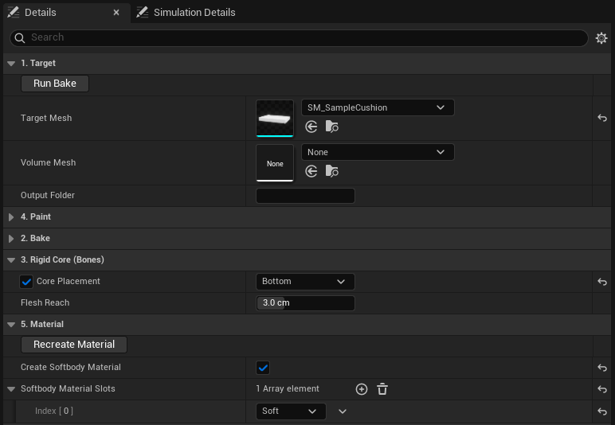
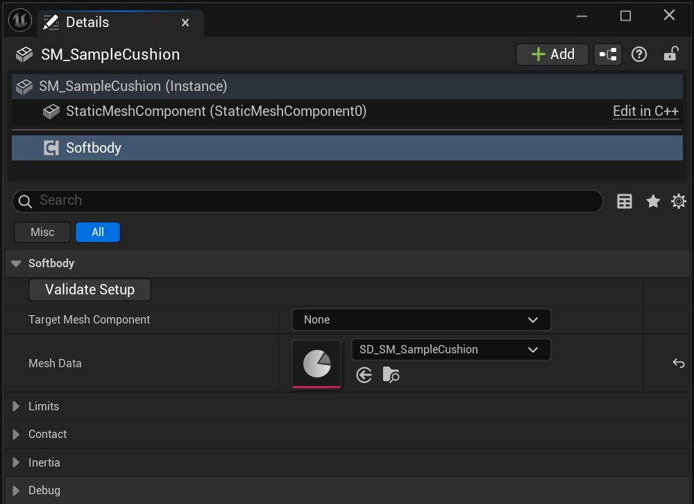
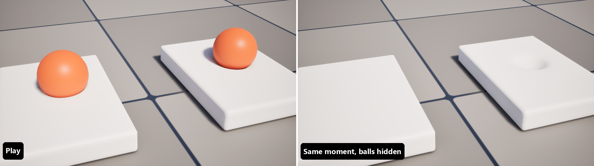

# Quick Start

Bake the sample cushion that ships with the plugin and drop a ball on it.

## 1. Copy the sample

Copy `SM_SampleCushion` from the plugin's `Samples` folder into your project's Content and use the copy. The bake writes into the mesh it bakes, and it refuses meshes under the engine folder.

## 2. Set up the bake

Create **Softbody > Softbody Authoring Data** in the Content Browser, open it and set:

| Setting | Category | Value |
|---|---|---|
| **Target Mesh** | 1. Target | your copy of `SM_SampleCushion` |
| **Core Placement** | 3. Rigid Core (Bones) | Bottom |
| **Create Softbody Material** | 5. Material | on |
| **Softbody Material Slots** | 5. Material | `Soft` |

Bottom holds only the bottom of the mat, which rests on the floor; the rest is flesh.

## 3. Bake

You must press **Run Bake**. It writes an `SD_` asset next to the authoring asset, plus a material for the `Soft` slot. The log says no textures were found and the lightmap UVs moved to channel 3; both are expected for this sample.

## 4. Press it in the asset window

Press **Simulate** on the toolbar of the authoring asset window, then Ctrl + left drag in the [Simulation tab](Preview-and-Simulation#simulation-tab) to press the cushion.

## 5. Add the component

Place the cushion in a level, add a **Softbody** component to it and set **Mesh Data** to the `SD_` asset.

## 6. Play

Put a sphere with **Simulate Physics** above the cushion and press Play. The ball sinks in, and the dent springs back when the ball rolls off.

Anything whose collision blocks the **Visibility** channel presses the flesh. [Colliders](Colliders)

## Things to try

On the Softbody component:

| Setting | Default | Try | |
|---|---|---|---|
| **Recovery Rate** | 30 | 8 | The dent takes about half a second to come back. |
| **Memory Time** | 0 s | 1.5 | Memory foam: a mark stays after the ball leaves, then fades. |
| **Contact Detail** | Basic | Full | The flesh rises around the dent. |
| **Skin Tension** | 0 | 0.5 | Leather: the dent is rounder and wider. |

On the Softbody Authoring Data (4. Paint), with Contact Detail Full. Dents change at once.

| Setting | Default | Try | |
|---|---|---|---|
| **Volume Preservation** | 1 | 0 | Foam: nothing rises, and the dent has a crisp edge. |

## Next

- [Baking](Baking) your own meshes
- [Characters](Characters) for skeletal meshes
- [Softbody Component](Softbody-Component) for every setting
