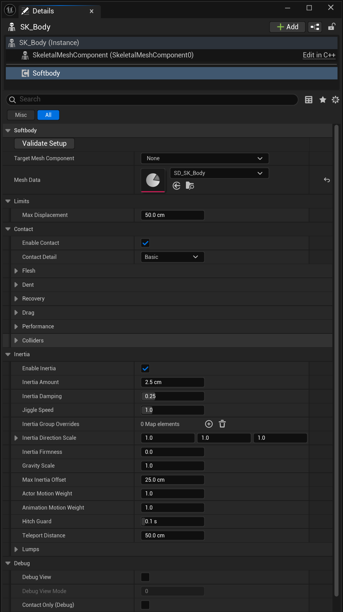
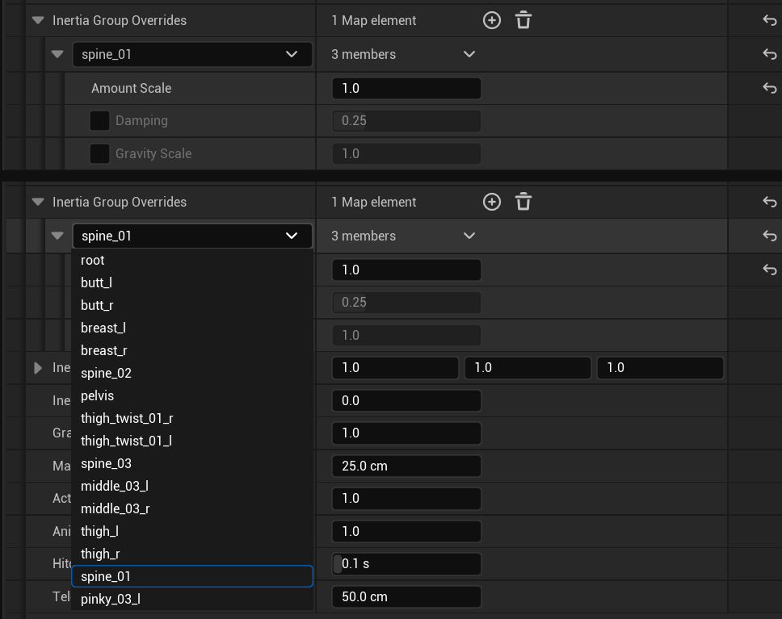
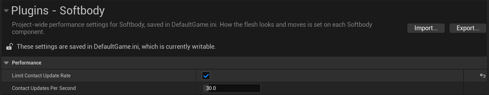

# Softbody Component

A mesh must have exactly one **Softbody** component. **Mesh Data** must be set to the Baked Data of that mesh's Softbody Authoring Data ([Baking](Baking)). The mesh's material must contain the Softbody material functions ([Materials](Materials)). The place to try these values without placing the mesh in a level is the [Simulation tab](Preview-and-Simulation#simulation-tab) of the authoring asset window.

## Settings

Units are cm and seconds. "0 to 1": clamped to that range. "Min 0, slider to 2": cannot go below 0; the slider stops at 2, but a larger value can be typed.

### Softbody

| Setting | Default | What it does |
|---|---|---|
| **Validate Setup** (button) | — | Checks the setup and writes problems to the Output Log. [Validate Setup](#validate-setup) |
| [**Target Mesh Component**](#target-mesh-component) | empty | The mesh this component deforms. Empty = picked automatically. |
| **Mesh Data** | empty | The Baked Data of the target mesh's Softbody Authoring Data. |

#### Target Mesh Component

If empty, the mesh component on this actor whose mesh Mesh Data was baked from is used. If none matches, the first mesh component without the `SoftbodyIgnore` component tag is used.

### Limits

| Setting | Default | What it does |
|---|---|---|
| [**Max Displacement**](#max-displacement) | 50 cm | The farthest any vertex may move from its modeled position, dents and jiggle together. Min 0. |

#### Max Displacement

Movement is unchanged up to 70% of the limit, then eases into it.

### Contact

| Setting | Default | What it does |
|---|---|---|
| [**Enable Contact**](#enable-contact) | on | Dents, bulges and drag. |
| [**Contact Detail**](#contact-detail) | Basic | Basic computes only dents and lumps pushed aside; Full computes every contact effect. |

[Contact](Contact)

#### Enable Contact

Off: all contact cost goes away, only the inertia remains, and lumps are no longer pushed. Nanite tessellation is not affected.

#### Contact Detail

- **Basic**: only dents and lumps pushed aside run. The bulge, skin drag (so a pressing hand's Lump Grip too), Edge Smoothing and Flex paint (bending surface and plates) are off, and their GPU work is skipped. Where Flex is painted the flesh dents like bare flesh. Volume Preservation and Skin Tension still shape the dent in Basic.
- **Full**: every contact effect. On Nanite meshes the dent wall along a moving hand's edge also jitters less. Costs more GPU time than Basic.

The settings of the effects that are off are kept. Switching while the mesh is pressed makes the bulge and dragged skin vanish or appear at once.

### Contact > Flesh {#contact-flesh}

| Setting | Default | What it does |
|---|---|---|
| [**Skin Tension**](#skin-tension) | 0 | The strength of the tight outer skin covering the flesh. 0 to 2. |
| [**Volume Offset**](#volume-offset) | 0 | Added to the volume preservation (Volume) of every place. The larger it is, the more the flesh around a dent bulges. -1 to 1. |
| [**Flex Offset**](#flex-offset) | 0 | Added to the Flex paint. Not finished yet and can be unstable. -1 to 1. |

How wide a dent and its bulge are comes from the baked flesh thickness and **Skin Tension**. How much rises comes from the authoring asset's **Volume Preservation** times the Volume paint, plus Volume Offset. With Contact Detail Full, the Flex paint also widens them. [Flesh material](Concepts#flesh-material)

#### Skin Tension

- Values: 0 = bare flesh or jelly, above 1 = a drum skin over thick flesh.
- A tighter skin makes a dent rounder and wider, bridges the gaps between fingers and blurs the shape of what presses in. The thinner the flesh, the stronger the effect.
- The same value gives the same surface on any mesh, and the Depth paint does not change it.
- It is a stretched skin, not a rigid shell, so a stiff area sinks flat instead of tilting like a plate.
- It applies to the whole mesh. Flex paint can be used on part of the surface ([Painting](Painting)).

#### Volume Offset

Added to the Volume of every place (the authoring asset's **Volume Preservation** times the Volume paint), so it changes every cell by the same amount whatever was painted. -1 makes everything move like foam, +1 like flesh. The sum stops at 0 (foam) and 1 (flesh). On a mesh that is all flesh a positive value changes nothing.

How a whole pushed lump spreads keeps the baked value. To change it, put the result into the authoring asset and press Run Bake.

#### Flex Offset

**This setting is not finished yet and can be unstable, so use it with care.**

Added to the Flex paint, so a negative value also makes unpainted skin bend. -1 makes every painted piece a rigid plate, +1 makes all of them bare flesh. Needs Contact Detail Full.

### Contact > Dent {#contact-dent}

| Setting | Default | What it does |
|---|---|---|
| [**Max Contact Depth**](#max-contact-depth) | 15 cm | The deepest a collider can push the surface in. Min 0. |
| [**Edge Smoothing**](#edge-smoothing) | 0.5 | With Contact Detail Full, smooths the dent wall at a collider's edge. 0 = off. Min 0, slider to 3. |
| [**Dent Darkening**](#dent-darkening) | 0.6 | How dark deep, narrow dents get (usually fingertip marks, gaps between fingers). 0 to 1. |

#### Max Contact Depth

Pushes are unchanged up to this depth, then ease off and stop at 1.3 times this value. A collider pushed deeper than that shows through the skin. A body's contact with itself stops at the flesh thickness regardless of this value.

#### Edge Smoothing

In contact map cells. Only the steep wall is smoothed: flat and light presses keep their full depth. Objects thinner than twice this width press less deeply.

#### Dent Darkening

Darkens deep, narrow dents (fingertip marks, gaps between fingers, dent walls); wide presses and shallow marks barely change. Needs a material that multiplies its base color by the Occlusion output of MF_SoftbodyContactNormal.

### Contact > Drag {#contact-drag}

| Setting | Default | What it does |
|---|---|---|
| [**Drag Friction**](#drag-friction) | 0.5 | With Contact Detail Full, the friction between a moving collider and the skin. 0 = off. Min 0, slider to 2. |

#### Drag Friction

A multiple of how hard the collider presses. The skin moves with the hand until the flesh pulls back harder than this, then slips. A hand that stops holds the skin. Fast and slow sweeps over the same distance drag the same.

Also limits how hard a grip carries a lump (Lump Grip).

### Contact > Recovery {#contact-recovery}

| Setting | Default | What it does |
|---|---|---|
| [**Recovery Rate**](#recovery-rate) | 30 | How quickly dents and dragged skin spring back after the collider leaves, per second. Min 0.1, slider to 40. |
| [**Memory Time**](#memory-time) | 0 s | How long flesh must be pressed to keep a mark, like memory foam. 0 = no marks. Min 0, slider to 10. |
| [**Memory Fade Time**](#memory-fade-time) | 1.5 s | With Memory Time above 0, how long a mark takes to fade to half. Min 0.05, slider to 10. |

#### Recovery Rate

The same for every dent size. The higher it is, the faster it springs back; the lower, the more a fast hand leaves a trail. The flesh around a press takes its shape at once whatever this is. It does not change how wide the dent is.

#### Memory Time

While pressed, it closes half the remaining difference to the pressed shape every this many seconds. A quick touch leaves almost nothing, a sliding hand a faint trail. While a mark remains, a hand that lets go slowly can show a small gap above the skin.

#### Memory Fade Time

Marks halve every this many seconds, also while still pressed, so when this is shorter than Memory Time a long press leaves only a shallow mark. The GPU keeps working until the marks have faded (about ten times this value).

### Contact > Colliders {#contact-colliders}

| Setting | Default | What it does |
|---|---|---|
| [**Self Contact**](Colliders#self-contact) | on | Skeletal meshes: lets the mesh press its own other areas (usually the hands dent the belly or thighs). Needs a shape field. |
| [**Find Colliders Automatically**](Colliders#what-can-press-the-flesh) | on | Every frame, finds colliders that overlap the mesh and lets them press. Off = outside colliders are ignored (Self Contact is separate). |
| [**Use Shape Fields**](Colliders#shape-fields) | on | A mesh with a baked shape field presses with its real shape. Off = simple collision, for comparison. |
| **Collider Channel** | Visibility | The collision channel used to find colliders. Anything whose collision blocks it presses the flesh. |

[Colliders](Colliders)

### Contact > Performance {#contact-performance}

| Setting | Default | What it does |
|---|---|---|
| [**Min Screen Size**](#min-screen-size) | 0.15 | Saves GPU time on meshes seen from far away by stopping the dent calculation. Min 0, slider to 1. |

#### Min Screen Size

The dent calculation stops while the mesh looks smaller than this on screen. The dents ease back as if released, then GPU work stops. It resumes once the mesh is about 20% above this value. Jiggle is not affected.

- Same unit as LOD Screen Size (largest over all views, editor viewports included).
- Because it measures the whole mesh, small meshes stop sooner.
- 0 = never stop by size.

### Inertia

| Setting | Default | What it does |
|---|---|---|
| **Enable Inertia** | on | Turns the inertia on. |
| [**Inertia Amount**](#inertia-amount) | 2.5 cm | How soft the flesh is. Min 0. |
| **Inertia Damping** | 0.25 | How many times a wobble overshoots before it stops: 0.25 about two, 0.4 about one, near 0.1 about seven. It does not change the speed. 0.01 to 0.99. |
| [**Jiggle Speed**](#jiggle-speed) | 1 | Changes only the rhythm of the jiggle, not its size. Min 0.1, slider 0.25 to 4. |
| [**Inertia Group Overrides**](#inertia-group-overrides-entry) | empty | Amount, damping and gravity for one inertia group (a bone). Fields in the table below. |
| **Inertia Direction Scale** | 1, 1, 1 | Scales the jiggle along the mesh's modeled axes (Z is up). Turning motion is not scaled. |
| [**Inertia Firmness**](#inertia-firmness) | 0 | Firms the flesh up in big movements, such as a body stopping after a run. 0 = off. Min 0. |
| [**Gravity Scale**](#gravity-scale) | 1 | How strongly gravity pulls lumps (flesh hanging on Lump bones) (0 = off). Min 0. |
| [**Max Inertia Offset**](#max-inertia-offset) | 25 cm | Safety limit on how far jiggle can move a vertex, per inertia group. Min 0. |
| **Actor Motion Weight** | 1 | The inertia multiplier applied to the actor moving or turning. It is not multiplied into the tilt sag. Min 0. |
| **Animation Motion Weight** | 1 | The inertia multiplier applied when the animation moves the bones. Min 0. |
| **Hitch Guard** | 0.1 s | A frame longer than this counts as a hitch and its acceleration is ignored. 0.01 to 1. |
| [**Teleport Distance**](#teleport-distance) | 50 cm | A move this much farther than the current speed allows in one frame counts as a teleport and does not jiggle the flesh. Min 0. |

#### Inertia Amount

How far the thick flesh painted white in Jiggle (the reference flesh) lags behind under a steady 1 g push. It means the same flesh on every character. Firmer or thinner areas move less, by the bake and the Jiggle paint.

Each part wobbles at the speed that fits its own sag; the larger the sag, the slower.

#### Jiggle Speed

2 wobbles twice as fast and settles in half the time; 0.5 is half as fast. The bounce height on landings and sudden stops and the sag when the body tilts stay the same. The number of overshoots is still set by Damping.

#### Inertia Firmness

The higher it is, the earlier the flesh firms up. At 1 the wobble is halved at a push of gravity's size (1 g), at 2 at half of that. The wobble never goes beyond Inertia Amount ÷ this value (cm). Small movements stay loose. At 0 it is off and the wobble grows with the movement.

#### Gravity Scale

The mesh is assumed modeled upright (+Z up) with its standing sag already in its shape. So at 1 they sag only when the body leans or lies down. Above 1 they also hang lower while upright, by the extra gravity. Below 1 only the lean sag shrinks. Lumps and static meshes follow this value.

Parts on the skeleton such as the torso and limbs do not sag. Giving a Gravity Scale in Inertia Group Overrides makes one of those parts sag. A static mesh placed at an angle keeps sagging by that angle.

#### Max Inertia Offset

For a static mesh it applies to the whole mesh. It only clips what is drawn, so reaching it flattens the peak of the movement without a pop.

#### Teleport Distance

A turn of more than 45 degrees beyond the current turning speed counts as a teleport too. Covers SetActorLocation without the teleport flag, respawns and animation cuts. Sudden stops such as landings still jiggle. At 0 only moves flagged as teleports count.

#### Inertia Group Overrides entry {#inertia-group-overrides-entry}

Keyed by bone name. A field with a tick box is used only while ticked. The group is picked from a dropdown of the groups the bake found. Unlisted parts and unticked fields use the values above.

| Setting | Default | What it does |
|---|---|---|
| **Amount Scale** | 1 | Multiplies Inertia Amount for this part. A part that moves more wobbles more slowly. 0 = this part does not jiggle. Min 0. |
| **Damping** (tick to use) | 0.25 | This part's Inertia Damping, the number of overshoots before it stops. 0.01 to 0.99. |
| **Gravity Scale** (tick to use) | 1 | How strongly gravity pulls this part (0 = none, above 1 it also hangs lower while upright). Replaces Gravity Scale for this part, so a part on the skeleton can sag too. Min 0. |

[Inertia](Inertia)

### Inertia > Lumps {#inertia-lumps}

| Setting | Default | What it does |
|---|---|---|
| [**Lump Yield**](#lump-yield) | 1 | How much pressing a lump also moves the whole lump aside. 0 = dent only. Min 0, slider to 4. |
| [**Lump Grip**](#lump-grip) | 1 | Strength with which friction pulls the whole lump. 0 = off. Min 0, slider to 4. |
| [**Squeeze Stiffening**](#squeeze-stiffening) | 3 | Multiplier of the resistance to deformation by how deeply it is pressed. Higher means more resistance. 0 = in proportion to depth. Min 0, slider to 6. |

A lump exists only for a bone set to **Lump** in Bone Overrides when a skeletal mesh is baked ([Baking](Baking)). Static meshes have no lumps.

#### Lump Yield

A fingertip poke mostly dents, a wide, deep palm push moves the lump, and a hand deeper than the flesh is thick (grabbing around it, lifting it from below) carries it. 1 = as much as the baked softness allows; higher = moves more easily. Parts on the skeleton (belly, back) and static meshes never move as a lump. Needs Enable Contact and Enable Inertia on, and Inertia Amount above 0.

#### Lump Grip

A light fingertip grip lets the skin slip; a wide, deep grip carries the lump until the flesh underneath pulls back harder than the friction, then slips. 1 = pulls as firmly as the flesh resists pressing; higher = harder. The skin grab in the [preview](Preview-and-Simulation#simulation-tab) (Ctrl + right-drag) pulls the lump in any Contact Detail. A pressing hand pulls it only with Contact Detail Full and Drag Friction above 0. Needs Lump Yield above 0 and Enable Inertia on.

#### Squeeze Stiffening

3 = about 2.3 times stiffer at half the flesh thickness and 6 times at full thickness; 5 = about 4 and 30 times. Shallow presses are hardly affected. It affects only pushed lumps and skin drag (Contact Detail Full, Drag Friction above 0).

### Debug

| Setting | Default | What it does |
|---|---|---|
| **Debug View** | off | Shows debug colors (Debug View Mode) instead of the normal shading, on materials that use MF_SoftbodyDebugVis. |
| [**Debug View Mode**](#debug-view-mode) | 0 | What the debug colors show; editable only while Debug View is on. 0 to 5. |
| **Contact Only (Debug)** | off | Turns every jiggle off to look at contact alone. Not for shipping. |

#### Debug View Mode

The same colors as Last Bake in the Preview of the authoring asset window. [Last Bake](Preview-and-Simulation#last-bake)

- 0: how well each vertex sits in the measured flesh (green inside, yellow estimated, red failed).
- 1: connection to the rigid core (cyan connected, magenta not).
- 2: contact map checker. Layers and buttons with the same pattern as the skin under them dent together; lines where the pattern breaks are seams.
- 3: distance to the outer surface (green on it, red far outside, blue deep inside; full color at 10 cm).
- 4: baked softness (navy does not move, then green, red is softest; magenta moves the opposite way).
- 5: dents between vertices (green reads dents inside triangles, red only at the vertices along seams).

### Events

| Event | What it does |
|---|---|
| **On Softbody Updated** | Called once per frame after the dents and jiggle have been updated and sent to the material. |

## Turning the component off and on

**Deactivate**, **Activate**, **Set Active**, **Toggle Active** and **Auto Activate** (on by default) switch the component completely.

- Off: no tick, no collider search, no GPU work. The jiggle state and drag history are cleared, and the mesh shows its modeled shape. World Position Offset is switched off on the mesh, so the Softbody material does no vertex work; other World Position Offset effects in the same materials, such as wind, stop too. If you change the mesh's Evaluate World Position Offset while it is off, turning it on puts back the value from before. Its contact textures, contact map and lookup tables stay in memory for `softbody.Surface.ReleaseDelay` (10 s), then are freed a little per frame.
- On: starts from rest, so actor or collider movement while it was off does not jolt the flesh or drag the skin. Neither switching does heavy work in that frame. Within the release delay nothing is recreated; after it, the contact map loads and textures are created a few per frame, so the mesh jiggles but does not dent for a few frames (up to about a second when many switch on at once).
- Activate with Reset ticked on an active component clears the jiggle state and drag history; the dents stay.
- Auto Activate off: nothing happens until Activate. The setup check still runs when play starts.

Turning **Enable Contact** off keeps the inertia and turns off only the contact.

## Validate Setup

Writes to the Output Log under `LogSoftbodyRuntime` and returns true when there is nothing to fix. Play runs the same check. It also reports settings that do nothing on this mesh (Lump Yield on a static mesh, Flex paint in Basic, a Volume Offset or Flex Offset clipped at its end, and so on). Validate Setup lists everything; play lists only what you changed from the default. [Troubleshooting](Troubleshooting)

## Project Settings > Plugins > Softbody {#project-settings-plugins-softbody}

| Setting | Default | What it does |
|---|---|---|
| [**Limit Contact Update Rate**](#limit-contact-update-rate) | off | Recompute each touched object's dents at most Contact Updates Per Second times a second. |
| **Contact Updates Per Second** | 30 | Updates per second when Limit Contact Update Rate is on. 5 to 240; the slider runs from 15 to 120. |

Console override: `softbody.Surface.MaxUpdateRate` ([Console Reference](Console-Reference)).

#### Limit Contact Update Rate

Applies whatever the frame rate. Between updates the dents keep their last shape and move with the mesh, so a fast hand can leave its print behind for up to one update interval. The first moment of contact always updates at once.

## Blueprint and C++

- Every component setting above, including the Inertia Group Overrides fields, is readable and writable from Blueprints (the Project Settings are not). Enable Contact and Debug View can be switched while playing. Changing Target Mesh Component or Mesh Data while playing sets the component up again on the next frame. Other values are picked up by the next update.
- **Validate Setup**: `ValidateSetup()`, returns true when the setup is valid.
- **On Softbody Updated**: assignable event.
- C++: `USoftbodyComponent` in `SoftbodyComponent.h`. `GetTargetMeshComponent()` returns the mesh being deformed, whether chosen or found.
- Ticks in Post Physics, after its target mesh, so physics-driven bones are in their final pose.
