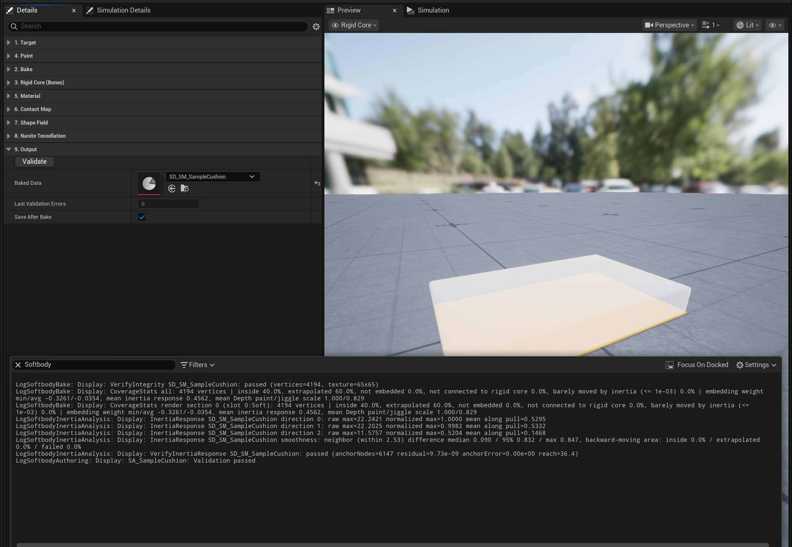
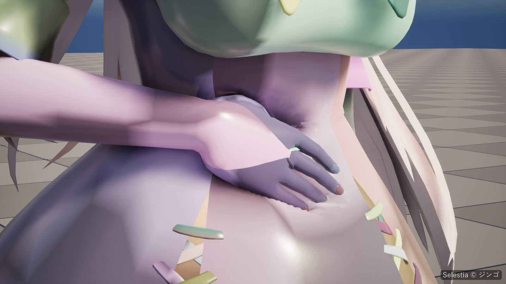

# Troubleshooting

Messages are quoted by their fixed part; filter the Output Log by `Softbody`. **Validate** on the Softbody Authoring Data and **Validate Setup** on the Softbody component run the checks on demand, and Play runs **Validate Setup** too. **Last Validation Errors** on the asset: 0 = all good, -1 = not checked since the last bake.

## Playing: nothing dents {#playing-nothing-dents}

| Message | Cause | Fix |
|---|---|---|
| `Contact is OFF for every Softbody component: it needs Shader Model 5` | The renderer is below Shader Model 5 (mobile preview, ES3.1). | Use a desktop renderer; D3D11 and D3D12 are verified. Jiggle still runs. |
| `Contact is OFF for every Softbody component: this GPU or driver` | The GPU or driver cannot read a four-channel float texture bound for writing. | A newer GPU driver may enable it. Jiggle still runs. |
| `Contact is off for ...: its contact map was baked with an older plugin` | **Mesh Data** was baked with an older plugin version. | Press **Rebake Contact Map** on its Softbody Authoring Data. |
| `contact is off, inertia still runs` | No contact map: **Bake Contact Map** was off, or the contact map bake failed. | Turn on **Bake Contact Map** and press **Rebake Contact Map** (or **Run Bake**). |
| `The rise around presses and drag are off for` | No bulge distance table of a supported layout, or the table has the wrong pixel format. | Press **Rebake Contact Map**. Dents still work. |
| `Drag is off for ...: its bulge grid is ... cells per side` | The mesh is about 10 m or larger, over the drag grid's 1024 cells per side. | None. Dents and bulges still work. |
| `MeshData is not assigned.` | **Mesh Data** is empty. | Set it to the **Baked Data** of the mesh's Softbody Authoring Data. |
| `no target mesh component` or `found no mesh component to deform` | No skeletal or static mesh component on the actor, and **Target Mesh Component** is empty. | Put the component on an actor with a mesh, or set **Target Mesh Component**. |
| `target mesh does not match MeshData source` | **Mesh Data** was baked from another mesh. | Point **Mesh Data** at this mesh's bake, or bake this mesh. |
| `has no material slot containing the Softbody material function parameters` | No slot uses a Softbody material. | [Let the bake make the material](Materials#let-the-bake-make-the-material), or [add MF_SoftbodyKernel to your own master material](Materials#use-your-own-master-material). |
| `also deforms ... Keep one Softbody component per mesh` | One mesh has two Softbody components, so they overwrite each other's material values. | Keep one component. |

## Playing: a collider does not press {#playing-a-collider-does-not-press}

| Message | Cause | Fix |
|---|---|---|
| `has no simple collision shapes and no baked shape field` | Only complex (triangle mesh) collision. Only spheres, capsules, boxes and convex shapes press. | Add simple collision or a physics asset, or bake a shape field (right-click the mesh, **Softbody: Bake Shape Field**). |
| `Contact skipped ... collision shape(s) over the per-frame budget` | Over 32 shapes (or 2048 convex planes) overlap the mesh in one frame, or a convex shape has no planes. | Fewer colliders at once; tag the ones that should not press `SoftbodyIgnore`. |
| `shape field of ... skipped` | Over 512 shape field parts in one frame, or the pressing mesh's bones changed since its shape field bake. | Fewer pressing meshes at once, or rebake the pressing mesh's shape field. |
| `self contact skipped this frame` | The same 512-part budget, reached with the character's own parts. | Fewer pressing meshes at once. |
| `self contact part ... skipped — bone not found` | The skeleton changed after the shape field bake. | Press **Rebake Shape Field**. |
| `self contact parts differ from the wake boxes baked into` | **Self Contact Bones** changed after the contact map bake, so the mesh cannot sleep while the hands are away. | Press **Rebake Contact Map** (or **Rebake Shape Field**). |
| No message, part of a collider (for example a character's feet) sinks in without pressing | A pressing mesh with a shape field presses only with its shape field, not its physics asset, and parts missing from the shape field do not press. | Bake the pressing mesh's shape field again: a Softbody character with **Rebake Shape Field** in its own Softbody Authoring Data, hands and props with **Softbody: Bake Shape Field**. |
| No message, the mesh never dents | | Work down the [checklist](#no-dents-checklist). |

## Bake stops or fails {#bake-stops-or-fails}

| Message | Cause | Fix |
|---|---|---|
| `Target Mesh is not set to a skeletal or static mesh` | **Target Mesh** is empty or of another type. | Set **Target Mesh**. |
| `Core Placement is Custom Spheres but Rigid Core Spheres has no sphere` | Custom Spheres needs at least one sphere. | Add one, or set **Core Placement** to Center or Bottom ([Baking](Baking)). |
| `Could not place the rigid core` | Center and Bottom read the inside of the mesh, and this mesh has none. | Use a closed mesh, set **Volume Mesh**, or use Custom Spheres. |
| `is engine content, and baking writes into the mesh` | The mesh is under the engine folder (plugin or engine content). | Duplicate it into your project's Content and bake the copy. |
| `has no LOD0 source geometry` | The mesh was imported without its source data. | Reimport it with its source data. |
| `The mesh already uses all ... UV channels` | The bake needs one more UV channel. | Remove an unused UV channel and bake again. |
| `Could not measure the flesh: the mesh encloses no volume` or `Could not build the outer surface: it came out empty` | The mesh is not closed (a single-sided sheet, an open tube). | Set **Volume Mesh** to a closed, filled mesh placed in the same spot. |
| `Bake stopped: the contact map normals point inward` | The faces point inward. | Make the mesh closed with faces pointing outward, then press **Rebake Contact Map**. |
| `No rigid core` | No skin-weighted bone lies inside the mesh. The bake continues without jiggle. | Check that the skeleton's bones sit inside the mesh. |
| `Inertia bake failed: the rigid core holds too few grid points` | The core is too thin for the measure grid. | Raise **Bone Thickness**, add **Rigid Core Spheres** (Custom Spheres), or lower **Measure Cell Size**. |
| `Inertia bake failed: no surface vertex can jiggle` | The rigid core or bone-painted flesh covers the whole mesh. | Lower **Bone Thickness**, or check that **Depth** and **Jiggle** on the soft flesh are not black. |
| `Could not fit ... contact map islands into one contact map` | Too many islands for the resolution. | Raise **Contact Map Resolution**. |
| `Could not use the mesh's UV0 islands for the contact map` | UV0 is unusable (the message says why), so islands were made automatically. | Fix UV0, or set **Contact Map Seams** to Automatic (XAtlas). |
| `The mesh already has ... UV channels, so the contact map UV channel could not be added` | No free UV channel (Nanite and skeletal meshes read UV0 to UV3). | Remove an unused UV channel and press **Rebake Contact Map**. |
| `is shared with other Softbody meshes that read a different UV channel` | Two baked meshes share one master material but need different UV channels. | Give this mesh its own copy of the material (or turn on **Create Softbody Material**), then press **Rebake Contact Map**. |
| `Some packages could not be saved` or `already had unsaved changes before the bake` | The bake does not save packages that already had unsaved changes. | Save them yourself. |
| `holds the bake of ..., another mesh with the same name` | A mesh with the same name in another folder was baked into this output folder, and this bake would overwrite it. | Set **Output Folder** to another folder. |
| `bulge distance table would be ... texels tall` | A large mesh at a high resolution makes the bulge distance table too tall for one texture. | Lower **Contact Map Resolution**. |

## Validate reports problems {#validate-reports-problems}

`Validation passed` can still have the warning about the Softbody material above it.

| Message | Cause | Fix |
|---|---|---|
| `Nothing to validate - Baked Data is empty` | No bake yet. | Press **Run Bake**. |
| `Baked Data was baked from a different mesh than Target Mesh` | **Target Mesh** changed after the bake. | Press **Run Bake**. |
| `Volume Mesh differs from the one Baked Data was baked with` | **Volume Mesh** changed after the bake. | Press **Run Bake**. |
| `The flesh softness bake is missing or out of date, so nothing jiggles` | No jiggle data: a skeletal mesh needs skin-weighted bones inside the mesh, a static mesh needs a rigid core from **Core Placement**. | Fix that, then press **Run Bake**. |
| `There is no contact map, so nothing dents` | **Bake Contact Map** is on but the contact map is missing. | Press **Rebake Contact Map** (or **Run Bake**). |
| `No slot uses a Softbody material, so the mesh will not deform` | The Softbody material is not on the mesh yet. | Assign it, then press **Rebake Contact Map**. |
| `feeds ... from UV channel ..., but this mesh's bake uses channel` | The material reads the wrong UV channel, usually because another Softbody mesh shares it. | Give this mesh its own copy of the material, then press **Rebake Contact Map**; for TexelUV also set the Texture Coordinate node to the right channel. |
| `has no shape field` | **Bake Shape Field** is on but the mesh has none. | Press **Rebake Shape Field** (or **Run Bake**). |
| `Shape Field Slots changed since the shape field bake` | **Shape Field Slots** changed after the shape field bake, or the Content Browser command baked the whole mesh again. | Press **Rebake Shape Field**. |
| `Volume Preservation is ... but the flesh was measured with` | **Volume Preservation** changed after the bake. Dents already use the new value. | Press **Run Bake**. |
| `the slot paint changed since the flesh was measured` | The paint changed after the last Run Bake, so jiggle and contact read different paint. | Press **Run Bake**. |
| `VerifyIntegrity <Baked Data>: ...` | A baked texture, table or UV channel no longer matches the mesh (edited or reimported after the bake). | Press **Run Bake**. |
| `VerifySkeletal: ...` (missing input, could not read the texture source, no render data, render data has no UV channel N) | The skeletal mesh's render data or the baked inertia group texture no longer matches the bake. | Press **Run Bake**; if the texture source cannot be read, save the project and bake again. |

## Paint, shape field, Nanite {#paint-shape-field-nanite}

| Message | Cause | Fix |
|---|---|---|
| `Could not read the slot paint, so Depth and Volume are baked as 1 everywhere` | The paint could not be read when the contact map was baked. | Press **Run Bake**. |
| `Paint: could not read the pixels of mask texture` or `its Paint Texture has no source pixels` | The Paint Texture has no source data, so that slot stays unpainted (white). Flex has no plates. | Reimport the texture, or set that channel to **White everywhere** or **Black everywhere**. |
| `has sRGB on, so the bake reads it as a color` | sRGB is on for the Paint Texture, so grays read darker (0.5 becomes 0.21). | Turn sRGB off in the texture settings. |
| `is a PNG with Flex in its alpha` | PNG import replaces the color of fully transparent pixels with a neighbor's, which can change Depth, Jiggle and Volume on the plates. | Export as TGA, or set **PNG Infill** to Never in Project Settings > Texture Import and reimport. |
| `which is black everywhere, so the whole slot becomes` | One channel is black over the whole texture, so the whole slot becomes bone, firm flesh, foam or one plate. | Set that channel to **White everywhere** if you do not use it. |
| `Paint: the flesh on the Softbody material slots barely moves` | The flesh that should jiggle barely moves. | Check that **Depth** and **Jiggle** on the soft flesh are not black. |
| `Paint: the deepest flesh moves ...x as far as the reference flesh` | The deep flesh moves far more than the reference flesh, so Inertia Amount shakes it that much more. | For a human-sized body set **Flesh Reach** to about 3 and press **Run Bake**. |
| `Paint: the jiggle amount (after Physics Driven Bones) changes sharply over a narrow strip` | **Physics Driven Bones** make the jiggle change sharply over a narrow strip. That spot may look torn or folded while it jiggles. The message gives the mesh position. | Make the skin weights of those bones fall off wide and gradual. |
| `The Flex paint dents like bare skin because Contact Detail is Basic` (Play, Validate Setup) | Flex only works with Contact Detail Full. | Set **Contact Detail** to Full on meshes that need plates or a bending surface. |
| `Flex plates: ... painted pieces wrap around the body` | A piece that wraps around the body cannot be a plate and bends as painted (red in the Plates view). | Split it into flat pieces with thin white gaps in the paint. |
| `Flex plates: ... painted pieces have no contact map cells under them` | The piece is outside the pressable slots, or a floating piece has no surface under it to press (white in the Plates view). | Add the slot underneath to **Pressable Slots**, or place the decoration close to the skin. |
| `Flex plates: ... painted pieces cover more than` | The piece is too big to be a plate and bends as painted (orange in the Plates view). | Paint it as smaller pieces with thin white gaps. |
| `Flex plates: ... painted pieces sit at the very edge of the contact map` | The piece sits on the edge of the contact map and cannot be read as a plate (purple in the Plates view). | Rebake with a different **Contact Map Resolution**. |
| `Flex: more than ... plates` | Too many separately painted plates; the extra ones bend as painted. | Reduce the number of separately painted plates. |
| `Paint: Physics Driven Bones were skipped` | LOD0 skin weights cannot be read on the CPU, or the mesh lacks the baked UV channel. | Turn on Allow CPU Access for LOD0 of the skeletal mesh (or press **Run Bake** again), then **Reapply Paint**. |
| `in Physics Driven Bones is not in the skeleton` | A bone name in **Physics Driven Bones** is misspelled. | Fix the name. |
| `Inertia groups: all ... groups are taken, so lump bone ... gets no group of its own` | More jiggling bones than **Max Inertia Groups** allows. | Raise **Max Inertia Groups** (up to 16). |
| `has no bone named ...; check Self Contact Bones` | A bone name in **Self Contact Bones** is misspelled. | Fix the name. |
| `none of the Self Contact Bones (or their child bones) is the main skin weight inside the mesh, so self contact is off` | The listed bones drive no flesh. | List the bones that actually move the hands. |
| `has no material slot named ...; check Shape Field Slots` | A slot in **Shape Field Slots** is not on the mesh (renamed or re-imported). The bake goes on without it. | Pick the slots from the list again and press **Rebake Shape Field**. |
| `none of the Shape Field Slots has any triangles` | The chosen slots have no triangles, so nothing was baked. | Pick the body slots, or clear **Shape Field Slots**. |
| `has no material slot names in its source geometry` | The mesh source has no slot names, so **Shape Field Slots** cannot be used. | Re-import the mesh, or clear **Shape Field Slots**. |
| `Self Contact Bones is empty, so every part presses the mesh itself` | Every part of the body presses the body. | For a body, list only the hands, such as `Hand_L` and `Hand_R`. |
| `no bone is the main skin weight inside the mesh` | The shape field bake could not give the inside of the mesh to any bone. | Check the skin weights. |
| `owns N cell(s) of flesh, too few to be its own part` | A bone drives too little flesh to be a shape field part and no parent bone is one, so that flesh is left out of the shape field. | Check the skin weights. |
| `On a static mesh the whole mesh presses, so Self Contact Bones is ignored` | Expected on static meshes. | Nothing. |
| `uses translucent material ..., so the whole mesh cannot render as Nanite` | Nanite needs opaque or masked materials on every slot. | Use an Opaque or Masked material on that slot. |
| `The mesh has ... morph targets, and Nanite skinning ignores them` | Nanite skinning does not play morph targets. | Put facial expressions on a separate head mesh; use helper bones for joint correction. |
| `vertices with hard normals; tessellation can open cracks there` | Hard normals on the softbody slots. | Smooth those normals in your DCC tool. |
| `r.Nanite.DicingRate is ..., so skinned meshes break into pieces up close` | The dicing rate is too low for skinned meshes. | Set `r.Nanite.DicingRate` to the value in the message or higher, under `[SystemSettings]` in DefaultEngine.ini. |
| `no material slot uses a softbody material (one that reads the contact map)` | Nanite tessellation is set up in the Softbody material, and no slot uses one. | Press **Recreate Material** or assign the Softbody material, then **Reapply Nanite Tessellation**. |
| `Nanite tessellation with Displacement Center 0` | The material's Nanite displacement Center is 0, so the dents between vertices are cut off. This happens when the material is set up by hand. | In the material's Details, set Center under Nanite > Displacement to about 0.75. Or set **Nanite Displacement Center** in the Softbody Authoring Data and click **Reapply Nanite Tessellation**. |

## No dents? Checklist {#no-dents-checklist}

On the Softbody component and the mesh's Softbody Authoring Data:

1. **Enable Contact** is on.
2. **Mesh Data** is this mesh's **Baked Data**. **Validate Setup** should log `setup valid` and `contact=surface field`; `contact=off (...)` gives the reason in parentheses.
3. The mesh was baked with **Bake Contact Map** on, and **Validate** passes.
4. The pressing object blocks the **Collider Channel** (default Visibility), has collision queries enabled, and has simple collision, a physics asset or a shape field. Neither it nor its actor is tagged `SoftbodyIgnore`, and it is not part of the Softbody component's own actor.
5. **Find Colliders Automatically** is on.
6. **Min Screen Size** (default 0.15): dents stop while the mesh looks smaller than this in every view, editor viewports included.
7. The pressable slots use a Softbody material. After swapping materials, press **Rebake Contact Map** once more to link the material to the contact map.
8. Between two Softbody meshes only one presses: turn off collision on the one that is only pressed ([Colliders](Colliders)).

## Dents look wrong {#dents-look-wrong}

- **Lines or steps across the surface.** Dents are slightly less exact across a split of the contact map. By default **Contact Map Seams** puts the splits on the mesh's UV0 seams. **Debug View** with **Debug View Mode** 2 shows them as lines where the checker breaks. If the bake warned that `the contact map UV channel could not be added`, dents across UV island borders are less detailed.
- **Fingertips make a blur instead of a dent.** Raise **Contact Map Resolution** On a low-density mesh, narrow dents between vertices need **Set Up Nanite Tessellation**; **Debug View Mode** 5 shows green where dents are read inside triangles and red where only the vertices along seams move.
- **The dent stops short, or the collider sinks in with no dent.** Up to **Max Contact Depth** (default 15 cm) the pressed depth is drawn as is; beyond it the depth shrinks smoothly and stops at 1.3 times. If your collision sits a few cm inside the visible skin (a body capsule), set **Max Contact Depth** to that gap.
- **Dents and bulges are too wide or too narrow.** Their width comes from the flesh thickness, the Softbody component's **Skin Tension** and, with Contact Detail Full, the **Flex** paint ([Flesh material](Concepts#flesh-material)). Check the thickness in the **Flesh Thickness** view, then move the rigid core (Core Placement, Rigid Core Spheres, Bone Thickness) or change Max Flesh Thickness or the Depth paint.
- **Pressing the top dents the sides too.** With the rigid core only at the bottom, the sides measure as very thick flesh. Set **Max Flesh Thickness** a little above the deepest press and below a quarter of the object's width.
- **Dents push sideways or the wrong way.** The volume mesh is not where the skin is; the bake log says `Volume mesh check: ... only ...% are inside volume mesh`. Its outside should sit on the target mesh's surface.
- **Cracks when tessellated.** Smooth the hard normals on the softbody slots.

## Jiggle wrong {#jiggle-wrong}

- **Nothing jiggles.** Check **Enable Inertia**. **Validate Setup** reports `inertia is enabled but MeshData has no inertia softness bake` when the bake has no jiggle data.
- **Some parts do not jiggle.** `inertia group bones were not found on the mesh's skeleton; those groups will not jiggle` means the skeleton changed since the bake. Press **Run Bake** again.
- **Frame drops jolt the flesh.** A frame longer than **Hitch Guard** (default 0.1 s) counts as a hitch and its acceleration is ignored. Lower it if drops still jolt.
- **A respawn or camera cut jolts the flesh.** A move farther than the current speed allows plus **Teleport Distance** (default 50 cm) counts as a teleport and does not jiggle; moves flagged as teleports always count. Lower the value, or move the actor with the teleport flag. Raise it if fast moves lose their jiggle.
- **Big lumps flatten at the top of a swing.** **Max Inertia Offset** (default 25 cm) clips what is drawn. Raise it.

## Material is white after Quick Start {#material-is-white-after-quick-start}

**Create Softbody Material** copies the base color, normal map and roughness textures of the slot's original material, and the sample cushion has none: `Copied: base color (not found), normal map (not found), roughness (not found, 0.5)`. Set BaseColorTex, NormalTex and RoughnessTex on the material instance by hand.

## Questions {#questions}

**Can I give the component a list of colliders by hand?** No, there is no list or Blueprint function for it. With **Find Colliders Automatically** off, no outside collider presses the mesh. Choose what presses with the **Collider Channel** and the `SoftbodyIgnore` tag ([Colliders](Colliders)).

**Do dents show in the level editor viewport without pressing Play?** No. The component runs only while the game runs. While you play in the editor, **Min Screen Size** still counts editor viewports as views.

**How do I remove Softbody from a mesh?** Remove the Softbody component and put the slot's original material back. The baked assets and the UV channels the bake added can stay or go; they do nothing without the component.

**After updating the plugin, what do I rebake?** When Validate or Validate Setup says something was baked with an older plugin, press the button the message names (**Run Bake**, **Rebake Contact Map**, **Rebake Shape Field**, **Reapply Paint**). With no such message, nothing needs a rebake.
