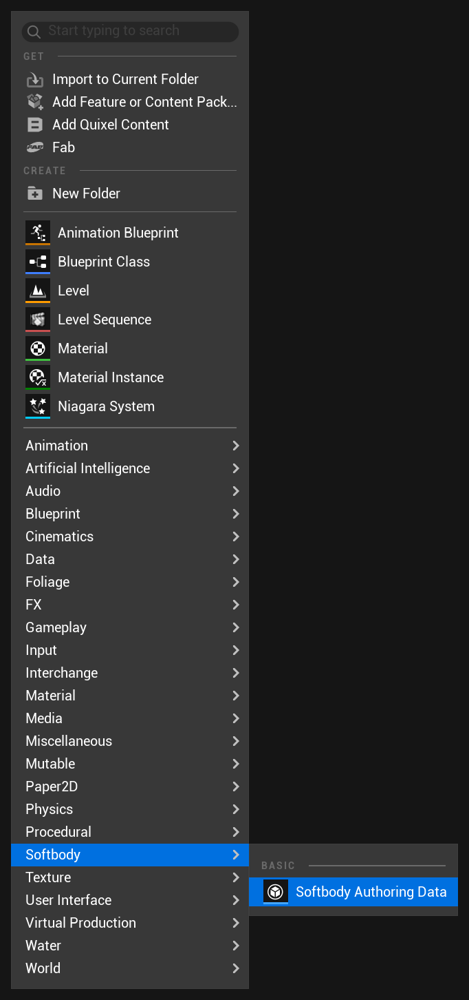
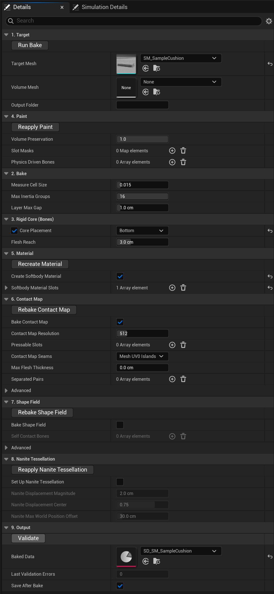
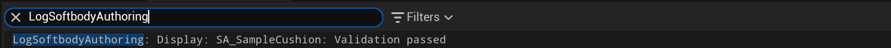

# 베이크

콘텐츠 브라우저에서 **Softbody > Softbody Authoring Data**를 만들고 **Target Mesh**를 지정한 뒤 **Run Bake**를 누릅니다. 결과는 Softbody 컴포넌트의 **Mesh Data**에 넣을 **Baked Data** 에셋입니다. 베이크 에셋은 에디터 전용이라 패키징되지 않습니다. 

베이크 에셋 창의 Preview와 Simulation 탭은 [미리보기와 시뮬레이션](Preview-and-Simulation)에 있습니다.

베이크는 Target Mesh에 직접 씁니다(가능하면 UV 채널을 더하고 메시를 저장합니다). 콘텐츠가 아닌 엔진 폴더 아래의 메시는 받지 않습니다.

## Run Bake가 하는 일 {#what-run-bake-does}

Run Bake는 캐릭터에서 몇 분, [빠른 시작](Quick-Start)의 방석에서 수십 초 걸립니다. 첫 단계가 실패하면 베이크가 멈춥니다. 그 뒤 단계가 실패하면 남은 단계는 그대로 실행됩니다.

| 단계 | 실행 조건 | 하는 일 |
|---|---|---|
| 1. Measuring the flesh | 항상 | 칠과 Volume Preservation을 읽어 살을 재고, **Output Folder**에 `SD_<mesh name>`과 그 텍스처를 만듭니다. |
| 2. Converting the slot mask paint | 항상 | 칠을 접촉과 출렁임에 쓸 값으로 바꾸고, **Physics Driven Bones**를 적용하고, Flex를 칠한 조각을 찾습니다. |
| 3. Creating the Softbody material | **Create Softbody Material**이 켜져 있을 때 | 슬롯마다 Softbody 머티리얼 인스턴스를 만들어 할당합니다. |
| 4. Baking the contact map | **Bake Contact Map**이 켜져 있을 때 | 접촉 맵을 베이크합니다. |
| 5. Baking the shape field | **Bake Shape Field**가 켜져 있을 때 | 메시의 모양을 Target Mesh에 저장합니다. |
| 6. Setting up Nanite tessellation | **Set Up Nanite Tessellation**이 켜져 있을 때 | 메시와 메시의 모든 슬롯 머티리얼을 바꿉니다. |
| 7. Saving | **Save After Bake**가 켜져 있을 때 | 이번 베이크가 바꾼 것과 베이크 에셋 자신을 저장합니다. |

메시지는 출력 로그에 `LogSoftbodyAuthoring` 카테고리로 나옵니다. 단계가 실패하면 그 이유는 바로 위 줄에, 베이크의 다른 로그 카테고리로 나옵니다. 고치는 방법은 [문제 해결](Troubleshooting)에 있습니다.

### 베이크가 메시와 다른 에셋에 바꾸는 것 {#what-the-bake-changes}

- **1단계**: Target Mesh에 UV 채널을 하나 더합니다. 라이트맵 UV를 생성하는 스태틱 메시에서는 생성되는 라이트맵 UV를 Softbody 채널 뒤로 옮깁니다. 빈 채널이 없으면 경고를 내고 라이트맵 생성을 끕니다.
- **3단계**: `M_<mesh name>_Softbody`와, **Softbody Material Slots**의 슬롯마다 인스턴스 `MI_<mesh name>_<slot>`을 만듭니다. 각 슬롯의 원래 머티리얼에서 베이스 컬러, 노멀 맵, 러프니스 텍스처를 복사하고 인스턴스를 할당합니다. 이미 Softbody 머티리얼을 쓰는 슬롯은 건드리지 않습니다. 찾지 못한 텍스처는 비워 두므로 인스턴스에서 직접 지정합니다.
- **4단계**: [Contact Map Seams](#contact-map-seams)가 Mesh UV0 Islands면 메시에 UV 채널을 하나 더 쓰고 Softbody 머티리얼에 연결합니다. 아직 Softbody 머티리얼을 쓰는 슬롯이 없으면 맵이 메시 전체(또는 Pressable Slots)를 덮습니다.
- **6단계**: 바꾸는 것의 목록은 [머티리얼](Materials#nanite-tessellation)에 있습니다.
- **7단계**: 베이크 전부터 저장하지 않은 변경이 있던 다른 에셋은 저장하지 않고, 로그에 그 목록을 남깁니다.

## 1. Target {#_1-target}

| 설정 | 기본값 | 하는 일 |
|---|---|---|
| **Target Mesh** | None | 말랑하게 만들 스켈레탈 메시나 스태틱 메시입니다. |
| [**Volume Mesh**](#volume-mesh) | None | 선택 사항입니다. 열려 있거나 속이 빈 대상의 안을 채우는 닫힌 스태틱 메시입니다. |
| **Output Folder** | 비어 있음 | 베이크한 에셋을 쓰는 폴더입니다(비어 있으면 이 에셋의 폴더). |

### Volume Mesh {#volume-mesh}

트램펄린 천, 얇은 접시, 열린 텐트, 속이 빈 캔처럼 열려 있거나 속이 빈 대상에 씁니다. 대상과 같은 자리에 같은 피벗에 있다고 가정하고, 대상을 표면으로 삼는 가상의 메시를 지정합니다. 스켈레탈 대상은 바인드 포즈의 스태틱 메시를 쓸 수 있습니다. 베이킹하면 대상의 표면이 볼륨 메시 위의 얇은 피부로 간주되어 눌릴 수 있습니다.

## 2. Bake {#_2-bake}

| 설정 | 기본값 | 하는 일 |
|---|---|---|
| **Measure Cell Size** | 0.015 | 살을 재는 칸 크기를 메시의 가장 긴 변에 대한 비율로 정합니다(사람 크기에서 약 2.7 cm). 작을수록 세밀하지만 느립니다. 0.005~0.1. |
| **Max Inertia Groups** | 16 | 스켈레탈 메시에서 따로 출렁일 수 있는 본 그룹의 수로, 그룹마다 컴포넌트의 **Inertia Group Overrides**에 항목이 생깁니다([관성](Inertia)). 1~16. |
| [**Layer Max Gap**](#layer-max-gap) | 1.0 cm | 피부 위에 붙은 옷이 그 아래 살의 칠과 출렁임을 따르는 거리입니다. 0 = 끔, 최대 10 cm. |

### Layer Max Gap {#layer-max-gap}

옷 바로 밑의 피부와 바깥 표면 안쪽에 가려진 피부는 바깥 옷과 함께 눌립니다.

몸에 붙는 슈트나 레깅스처럼 피부 위에 붙은 옷에 씁니다. 옷 버텍스에서 안쪽으로 이 거리 안에 피부가 있으면, 그 옷은 아래 살의 Depth, Jiggle, Volume 칠을 받고 살과 함께 움직입니다. 이 거리의 절반보다 멀리 떨어진 옷은 덜 따라갑니다. 

## 3. Rigid Core (Bones) {#_3-rigid-core-bones}

단단한 코어에서 먼 살일수록 더 관성에 민감하고, 눌린 자리가 더 넓게 퍼집니다.

코어는 베이크 에셋 창 Preview의 **Rigid Core** 보기로 봅니다. 이 절의 값을 바꾸면 베이크 전에 다시 그립니다([Rigid Core 보기](Preview-and-Simulation#rigid-core)).

| 설정 | 기본값 | 하는 일 |
|---|---|---|
| [**Core Placement**](#core-placement) | Center | 스태틱 메시에서 움직이지 않는 부분을 어디에 둘지 고릅니다. |
| [**Rigid Core Spheres**](#rigid-core-spheres) | 비어 있음 | Core Placement가 Custom Spheres일 때 움직이지 않는 부분을 구로 직접 놓습니다. |
| [**Bone Thickness**](#bone-thickness) | 0.45 | 본이나 코어의 굵기입니다. 클수록 살이 얇아져 덜 출렁이고 눌린 자리가 좁아집니다. 0.05~1. |
| [**Bone Overrides**](#bone-overrides) | 비어 있음 | 본마다 역할(뼈, 덩어리, 장신구)과 굵기를 따로 정합니다. |
| [**Flesh Reach**](#flesh-reach) | 3 cm | 두꺼운 살이 두께가 아니라 칠대로 출렁이게 합니다. 사람 크기 몸이면 3쯤입니다. |

### Core Placement {#core-placement}

스태틱 메시에서 씁니다.

- **Center**: 모양의 한가운데(판의 가운데 면, 공의 중심, 소시지의 축)를 뼈처럼 지나는 코어이고, 굵기는 **Bone Thickness**를 따릅니다. 공이나 장난감처럼 가운데가 단단한 물체에 씁니다.
- **Bottom**: 메시의 바닥만 붙듭니다. 방석이나 푸딩처럼 바닥이나 자리에 놓이는 물체에 씁니다.
- **Custom Spheres**: [Rigid Core Spheres](#rigid-core-spheres)에 직접 놓은 구를 씁니다.

Center는 겉이 코어 위의 살만큼만 들어가므로, 깊이 눌리는 판이나 방석은 Bottom이 맞습니다.

### Rigid Core Spheres {#rigid-core-spheres}

구마다 **Center**와 **Radius**를 메시 공간에서 cm로 넣습니다(반지름 기본값 10 cm). 하나 이상은 메시 안에 있어야 합니다. 평평한 받침은 아주 큰 구의 윗부분으로 만듭니다.

### Bone Thickness {#bone-thickness}

스켈레탈 메시와 Core Placement Center에서 씁니다. 본이나 코어의 굵기를 피부까지 거리에 대한 비율로 정합니다. 피직스 에셋은 필요 없습니다. 

### Bone Overrides {#bone-overrides}

본마다 항목 하나를 넣습니다.

- **Bone Name**: 대상 스켈레톤의 본입니다.
- **Include Child Bones**(켬): 자식 본들을 포함할 지 여부입니다.
- **Role**(Rigid Core): 아래 셋 중 하나입니다.
- **Bone Thickness**(0.45): Role이 Rigid Core일 때만 씁니다.

Role:

- **Rigid Core**: 본을 단단한 코어로 씁니다.
- **Lump**: 본을 단단한 코어로 쓰지 않습니다. 그 본에 스키닝된 살은 눌릴 때 통째로 비켜나는 덩어리가 됩니다. 가슴과 엉덩이 본에 씁니다.
- **Accessory**: Softbody 슬롯에 리깅된 리본, 목걸이, 벨트 본에 씁니다. 단단한 코어도 덩어리도 아니고, 그 본이 스키닝된 부분은 주변을 따라 흔들립니다.

Bone Overrides는 [Softbody 슬롯](Concepts#softbody-slots)에 스키닝된 본에만 적용되고, Softbody 슬롯을 줄이지 않습니다. 다른 슬롯만 움직이는 본(일반적으로 머리카락, 치마, 장신구)은 항목이 없어도 코어와 관성 그룹에서 빠집니다.

### Flesh Reach {#flesh-reach}

칠한 피부의 한계 두께입니다. 이보다 두꺼운 살은 두껍다고 더 출렁이지 않으며, Jiggle을 같은 밝기로 칠한 부분은 비슷하게 출렁입니다. 

## 4. Paint {#_4-paint}

칠하는 방법: [페인트](Painting). Volume Preservation이 하는 일: [살의 재료](Concepts#flesh-material).

| 설정 | 기본값 | 하는 일 |
|---|---|---|
| **Volume Preservation** | 1 | 부피 보존률입니다. 살이나 젤리는 1, 폼이나 스펀지는 0이고, 그 사이는 일부만 압축되는 밀도 높은 폼입니다. 0~1. |
| [**Slot Masks**](Painting#the-four-channels) | 비어 있음 | 머티리얼 슬롯마다 칠 텍스처 한 장과, 네 채널(Depth, Jiggle, Volume, Flex)을 어디서 읽을지 정합니다. |
| [**Physics Driven Bones**](Painting#physics-driven-bones) | 비어 있음 | 다른 시스템이 이미 움직이는 본입니다. 그 살은 Softbody 관성을 받지 않습니다. |

## 5. Material {#_5-material}

| 설정 | 기본값 | 하는 일 |
|---|---|---|
| **Create Softbody Material** | 끔 | Run Bake가 메시용 Softbody 머티리얼을 만듭니다(3단계). 내 마스터 머티리얼을 쓸 때는 끈 채로 둡니다([머티리얼](Materials)). |
| **Softbody Material Slots** | 비어 있음 | Softbody 머티리얼을 받을 슬롯입니다(일반적으로 피부와 몸에 붙는 옷). 이미 Softbody 머티리얼을 쓰는 슬롯과 함께 [Softbody 슬롯](Concepts#softbody-slots)이 됩니다. 목록에서 뺀 슬롯은 원래 머티리얼을 다시 넣어야 Softbody 슬롯에서 빠집니다. Create Softbody Material을 켜면 비워 둘 수 없습니다. |

## 6. Contact Map {#_6-contact-map}

| 설정 | 기본값 | 하는 일 |
|---|---|---|
| **Bake Contact Map** | 켬 | 끄면 접촉이 전혀 없고 메시는 출렁이기만 합니다. |
| **Contact Map Resolution** | 512 | 접촉 맵 한 변의 칸 수(2의 거듭제곱, 64~2048)입니다. 높을수록 작은 눌린 자리가 또렷하지만 GPU 시간과 메모리가 더 듭니다. 사람 크기 캐릭터는 512, 가까이서 보이면 1024. |
| **Pressable Slots** | 비어 있음 | 눌릴 수 있는 슬롯입니다(비어 있으면 Softbody 머티리얼 슬롯, 그것도 없으면 메시 전체). 슬롯이 적을수록 표현이 세밀해집니다. |
| [**Contact Map Seams**](#contact-map-seams) | Mesh UV0 Islands | 접촉 맵을 조각으로 나눌 방식을 고릅니다. |
| **Max Flesh Thickness** | 0 cm | 표면에서 이보다 깊은 곳은 단단한 것으로 칩니다. 0 = 제한 없음. 코어가 바닥에만 있는 상자와 방석에 씁니다. |
| [**Separated Pairs**](#separated-pairs) | 비어 있음 | 스켈레탈 메시에서 겉면은 이어져 있지만 안은 따로인 부위를 떼어 둡니다. |
| **Envelope Cell Size** (Advanced) | 0 cm | 메시의 바깥 표면을 찾을 때 쓰는 칸 크기입니다. 0 = 자동(가장 긴 변 / 256). |
| **Envelope Triangles** (Advanced) | 40000 | 단순화한 바깥 표면의 삼각형 수입니다. 넓은 곡면에서 살 두께가 계단처럼 보이면 올립니다. 1000~400000. |

로그 줄 "Contact map finished - resolution N, cell X cm"에 칸 하나의 평균 표면 길이가 나옵니다.

### Contact Map Seams {#contact-map-seams}

나뉜 곳에 걸친 눌림은 조금 덜 정확합니다.

- **Mesh UV0 Islands**: 이음매가 UV0 이음매를 따르고, 아일랜드마다 칸 크기가 고르도록 다시 펼칩니다. 그래서 텍스처링 때문에 늘려 둔 UV0 영역에서도 눌린 자리 테두리의 폭이 그대로입니다. 아주 고르지 않은 아일랜드는 접촉 맵 UV 채널에서만 이음매가 몇 개 더 생깁니다. 좌우나 판의 앞뒷면이 거울처럼 같은 UV를 쓰는 아일랜드는 거울이 뒤집히는 선에서 자릅니다. UV0의 넓이가 0이거나 UV가 접혀 있으면 Automatic으로 바뀝니다.
- **Automatic (XAtlas)**: 곡률을 보고 자릅니다.
- **Mesh UV0 Islands (As Is)**: 비교용으로 UV0 아일랜드를 배치된 그대로 씁니다. 칸 크기와 눌린 자리 테두리의 폭이 UV0의 늘어남을 따릅니다.

### Separated Pairs {#separated-pairs}

옷 한 장이 이어 덮은 좌우 한 쌍의 덩어리처럼, 겉면은 이어져 있지만 밑의 살은 따로인 부위에 씁니다. 떼어 둘 두 부위마다 쌍 하나를 넣고 **Side A**와 **Side B**에 각 부위의 맨 위 본을 고릅니다(자식 본 포함). 한 부위가 여러 본 사슬로 나뉜 리그는 사슬마다 맨 위 본을 넣습니다.

그러면 한쪽을 눌러도 다른 쪽이 솟거나 꺼지거나 끌려가지 않습니다. 두 부위에 웨이트가 걸린 옷은 본 웨이트대로 나뉩니다. 미리보기의 [Separated Parts](Preview-and-Simulation#separated-parts-view) 보기로 확인합니다.

## 7. Shape Field {#_7-shape-field}

누르기만 하는 손이나 소품은 베이크 에셋 없이 콘텐츠 브라우저 명령 **Softbody: Bake Shape Field**로 셰이프 필드를 만들 수 있습니다([콜라이더](Colliders)).

| 설정 | 기본값 | 하는 일 |
|---|---|---|
| **Bake Shape Field** | 끔 | 이 메시의 실제 모양을 베이크해 Target Mesh에 저장합니다. 그러면 단순 콜리전이나 피직스 에셋 대신 그 모양으로 다른 Softbody 메시를 누릅니다. |
| [**Self Contact Bones**](Colliders#self-contact) | 비어 있음 | 스켈레탈 메시에서 캐릭터 자신의 살도 누르는 본입니다. 비어 있으면 모든 본이 누르므로 보통 두 손만 넣습니다. 스태틱 메시에서는 무시합니다. |
| **Shape Field Slots** | 비어 있음 | 셰이프 필드를 만들 머티리얼 슬롯입니다. 비어 있으면 메시 전체입니다. 머리카락과 장신구 슬롯을 빼면 그 부분은 다른 Softbody 메시를 누르지 않고, 머리는 두피로 누릅니다. |
| **Shape Field Cell Size** (Advanced) | 0 cm | 셰이프 필드의 칸 크기입니다. 0 = 자동(손가락을 담을 만큼 촘촘함), 직접 정하면 손가락 폭의 4분의 1쯤. |
| [**Shape Field Part Overlap**](#shape-field-part-overlap) (Advanced) | 1 cm | 스켈레탈 메시에서 본마다 나뉜 모양 조각이 이웃 조각 안으로 들어가는 길이입니다. 너무 작으면 손가락 마디마다 홈이 보입니다. |

### Shape Field Part Overlap {#shape-field-part-overlap}

눌리는 메시의 **Edge Smoothing**에 그 메시의 접촉 맵 칸 크기를 곱한 값의 두 배 이상이면 홈이 없어집니다. 겹침은 누르는 메시의 크기를 따라갑니다. 0.75배로 놓은 손은 0.75 cm 겹칩니다. 0 = 겹침 없음.

## 8. Nanite Tessellation {#_8-nanite-tessellation}

| 설정 | 기본값 | 하는 일 |
|---|---|---|
| [**Set Up Nanite Tessellation**](Materials#nanite-tessellation) | 끔 | 메시를 나나이트 테셀레이션으로 그려, 버텍스가 성긴 메시에서도 손가락 끝 같은 좁은 눌린 자리가 보이게 합니다. |
| **Nanite Displacement Magnitude** | 2 cm | 테셀레이션이 그릴 수 있는 깊이 범위입니다. 이 범위를 넘는 눌림과 솟음은 잘립니다. 0.1~50 cm. |
| **Nanite Displacement Center** | 0.75 | 그 범위가 놓이는 위치입니다. 0.75 = 4분의 3은 눌림에, 4분의 1은 솟음에 씁니다. 0~1. |
| **Nanite Max World Position Offset** | 30 cm | 나나이트가 예상하는 버텍스 이동 거리입니다. 가장 큰 눌림에 출렁임을 더한 것보다 작으면 움직임이 잘리고, 너무 크면 카메라를 가까이 댈 때 구멍이 납니다([알려진 제한](Known-Limitations#nanite-tessellation)). 1~200 cm. |

## 9. Output {#_9-output}

| 설정 | 기본값 | 하는 일 |
|---|---|---|
| **Baked Data** | None | 컴포넌트의 Mesh Data에 넣을 베이크 결과로, Run Bake가 채웁니다(이미 있는 베이크를 가리켜도 됩니다). |
| **Last Validation Errors** | -1 | 마지막 Validate가 찾은 문제 수입니다. 0 = 문제 없음. -1 = 마지막 베이크 뒤로 검사하지 않음. |
| **Save After Bake** | 켬 | 베이크가 끝나자마자 바뀐 것을 저장합니다(7단계). |

## 버튼 {#buttons}

| 버튼 | 카테고리 | 시간 | 하는 일 |
|---|---|---|---|
| **Run Bake** | 1. Target | 몇 분 | 위 순서대로 전부 합니다. |
| **Reapply Paint** | 4. Paint | 몇 초~수십 초 | 2단계와 접촉 맵을 다시 돌립니다. 마지막 Run Bake 뒤에 칠이 바뀌었으면 Run Bake를 대신 돌립니다(몇 분). |
| **Recreate Material** | 5. Material | | Softbody 머티리얼을 다시 만들어 할당하고, 접촉 맵이 있으면 접촉 맵을 다시 베이크합니다. |
| **Rebake Contact Map** | 6. Contact Map | 수십 초 | 접촉 맵만 다시 베이크합니다. |
| **Rebake Shape Field** | 7. Shape Field | 수십 초 | 셰이프 필드만 다시 베이크합니다. |
| **Reapply Nanite Tessellation** | 8. Nanite Tessellation | | 나나이트 테셀레이션 설정을 다시 적용합니다. |
| **Validate** | 9. Output | | 다시 베이크하지 않고 베이크를 메시와 대조합니다. |

Validate를 뺀 모든 버튼은 실행 취소 한 번으로 되돌릴 수 있고, Save After Bake가 켜져 있으면 끝난 뒤 저장합니다. Reapply Paint, Recreate Material, Rebake Contact Map, Reapply Nanite Tessellation은 Baked Data가 있어야 합니다. Rebake Shape Field는 Target Mesh만 있으면 됩니다.

### 바꾼 것에 따라 누를 버튼 {#which-button-after-which-change}

| 바꾼 것 | 누를 버튼 |
|---|---|
| Target Mesh, Volume Mesh, Measure Cell Size, Max Inertia Groups, Layer Max Gap | Run Bake |
| Core Placement, Rigid Core Spheres, Bone Thickness, Bone Overrides, Flesh Reach | Run Bake |
| Slot Masks의 Paint Texture나 채널 | Run Bake(Reapply Paint를 눌러도 Run Bake가 돕니다) |
| Volume Preservation 값 | 눌린 자리는 누를 것 없음, 덩어리 전체가 퍼지는 모양은 Run Bake(그때까지 Validate가 알려 줌) |
| Physics Driven Bones | Reapply Paint |
| Paint Texture를 다시 임포트함 | 알림에 뜨는 버튼(Run Bake 또는 Reapply Paint) |
| Softbody Material Slots, 또는 생성된 머티리얼과 인스턴스를 다시 만들고 싶을 때 | Recreate Material |
| Softbody 머티리얼을 직접 할당하거나 바꿈 | Rebake Contact Map(스켈레탈 메시는 Run Bake) |
| Contact Map Resolution, Pressable Slots, Contact Map Seams, Max Flesh Thickness, Separated Pairs, Envelope Cell Size, Envelope Triangles | Rebake Contact Map |
| 베이크한 뒤에 Bake Contact Map을 켬 | Rebake Contact Map |
| Self Contact Bones, Shape Field Slots, Shape Field Cell Size, Shape Field Part Overlap, 또는 Bake Shape Field를 켬 | Rebake Shape Field |
| Nanite Displacement Magnitude, Nanite Displacement Center, Nanite Max World Position Offset, 또는 Set Up Nanite Tessellation을 켬 | Reapply Nanite Tessellation |
| Target Mesh 자체를 다시 임포트함 | Run Bake(다시 임포트하면 베이크한 UV 채널이 지워집니다. [알려진 제한](Known-Limitations)을 보세요) |

## Validate {#validate}

**Validate**는 다시 베이크하지 않고, 베이크한 데이터와 메시, 메시의 머티리얼, 셰이프 필드가 아직 서로 맞는지 검사합니다. 문제 수는 **Last Validation Errors**에, 메시지는 출력 로그에 나옵니다. Run Bake, Rebake Contact Map, Rebake Shape Field는 이 수를 -1로 되돌립니다. 모든 메시지와 고치는 방법: [문제 해결](Troubleshooting).

