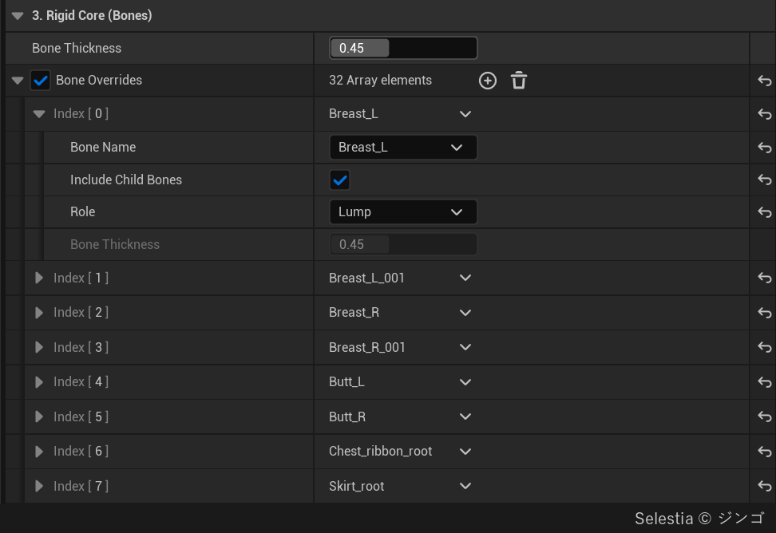
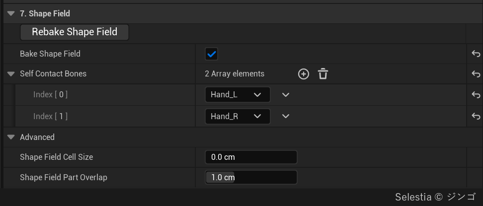
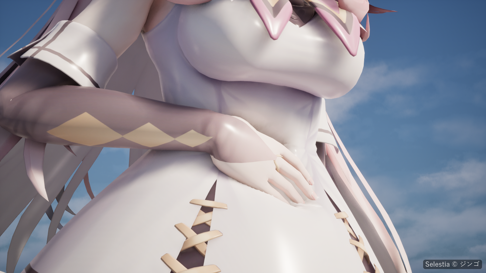
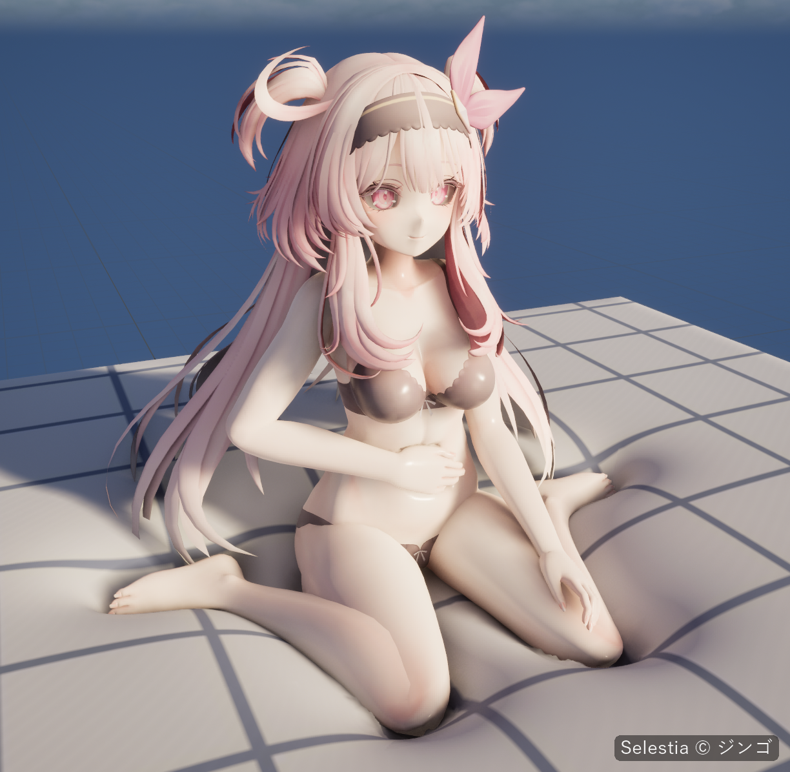

# 캐릭터

스켈레탈 메시도 소품처럼 베이크합니다([빠른 시작](Quick-Start)). 

## 베이크 전에 {#before-you-bake}

- 스켈레톤이 곧 단단한 코어입니다. 스킨 웨이트가 있는 본은 메시 안에 있어야 합니다. 베이크에는 피직스 에셋이 필요 없습니다.
- Softbody가 적용되는 영역은 [Softbody 슬롯](Concepts#softbody-slots), 곧 Softbody 머티리얼을 쓰는 머티리얼 슬롯입니다(**Create Softbody Material**을 켰다면 **Softbody Material Slots**). 단단한 코어와 [관성 그룹](Inertia#inertia-groups)도 Softbody 슬롯에 스키닝된 본으로만 정해집니다.
- 세컨더리 본(머리카락, 치마, 장신구)은 그 본이 움직이는 슬롯을 Softbody 슬롯에서 빼서 제외합니다. **Bone Overrides**는 Softbody 슬롯 안에서 본의 역할만 바꾸므로, Lump나 Accessory로 둔 본의 살도 변형됩니다. Softbody 슬롯에 함께 리깅된 리본이나 목걸이 본만 **Accessory**로 둡니다.
- 머티리얼을 직접 지정한다면 지정한 뒤에 **Run Bake**를 눌러야 합니다. Softbody 머티리얼을 쓰는 슬롯이 하나도 없으면 베이크는 메시 전체를 Softbody 슬롯으로 칩니다.
- 피부 위에 모델링한 몸에 붙는 옷(몸에 붙는 슈트, 레깅스)은 같은 메시에 그대로 두어도 됩니다. 옷과 같이 서로 밀착한 메시는 안쪽의 값을 같이 사용합니다. 
- 지글 본: 다른 시스템이 이미 움직이고 있다면(포스트 프로세스 애니메이션 블루프린트의 KawaiiPhysics 노드, 또는 시뮬레이션하는 피직스 바디) **Physics Driven Bones**에 넣으세요. 아니라면 **Bone Overrides**에서 그 본의 **Role**을 **Lump**로 두어, 그 영역을 Softbody 컴포넌트가 움직이는 덩어리로 만들 수 있습니다.

## 베이크 설정 {#bake-settings}

Softbody Authoring Data에서 스켈레탈 메시에 중요한 설정입니다. 기본값과 범위는 [베이크](Baking)에 있습니다.

| 설정 | 카테고리 | 캐릭터에서 |
|---|---|---|
| **Softbody Material Slots** | 5. Material | [Softbody 슬롯](Concepts#softbody-slots)이 될 슬롯입니다. 이 슬롯에 스키닝된 본만 코어와 관성 그룹이 됩니다. |
| [**Bone Thickness**](Baking#bone-thickness) | 3. Rigid Core (Bones) | 모든 본의 굵기입니다. 클수록 어디서나 살이 얇아져, 덜 출렁이고 눌린 자리가 좁아집니다. |
| [**Bone Overrides**](Baking#bone-overrides) | 3. Rigid Core (Bones) | Softbody 슬롯에 스키닝된 본의 역할입니다. 가슴이나 엉덩이 사슬의 맨 위 본은 **Role**을 **Lump**로, Softbody 슬롯에 리깅된 리본·목걸이·벨트 사슬은 **Accessory**로 둡니다. |
| [**Flesh Reach**](Baking#flesh-reach) | 3. Rigid Core (Bones) | 3 cm쯤으로 두면 Jiggle을 같은 밝기로 칠한 곳이 살 두께와 상관없이 비슷하게 출렁입니다. |
| **Max Inertia Groups** | 2. Bake | 따로 움직일 수 있는 본 그룹 수입니다. 모자라면 덩어리 본이 자기 그룹을 받지 못합니다. |
| [**Layer Max Gap**](Baking#layer-max-gap) | 2. Bake | 서로 밀착한 폴리곤의 감지 거리입니다. 두꺼운 겉옷이면 올리고, 0이면 끕니다. 함께 움직일 것인지는 접촉 맵이 정합니다. |
| **Physics Driven Bones** | 4. Paint | 이 본들(자식 본 포함)의 살에는 Softbody 관성을 적용하지 않습니다. |
| **Bake Shape Field** | 7. Shape Field | 앉은 캐릭터가 몸의 실제 모양으로 Softbody 소파를 누르고, Self Contact Bones가 자기 몸을 누를 수 있습니다. |
| **Self Contact Bones** | 7. Shape Field | 한 스켈레탈 메시 안에서 스스로의 다른 영역을 누를 수 있는 본을 지정합니다(일반적으로 양손). |
| **Shape Field Slots** | 7. Shape Field |  메시 영역들 중 다른 Softbody에 압력을 가할 수 있는 부분을 머티리얼 슬롯을 이용해 지정합니다. |
| [**Separated Pairs**](Baking#separated-pairs) | 6. Contact Map | 겉면은 이어졌지만 안쪽이 본으로 분리되어 있을 경우, 접촉과 관성 반응을 맞추기 위해 서로 분리되어야 하는 본들의 그룹을 지정할 수 있습니다. |
| **Shape Field Part Overlap** | 7. Shape Field | 다른 Softbody에 압력을 가할 시 개별 본의 영향 범위 스케일입니다. 손의 경우, 너무 작으면 눌린 자리에 손가락 마디가 끊겨 보일 수 있습니다. |

- **Bone Overrides**의 **Include Child Bones**가 켜져 있으면 사슬마다 항목 하나로 충분합니다. 끄면 그 본만 바뀝니다.
- **Flesh Reach**를 3 cm쯤으로 두면 두꺼운 흰 살이 **Inertia Amount**의 기준 살이 됩니다.
- 스켈레톤에 없는 뼈(갈비뼈, 골반, 두개골)는 찾지 못합니다. 원하는 살 두께는 Depth에 칠할 수 있습니다.
- 캐릭터에는 콘텐츠 브라우저 명령 **Softbody: Bake Shape Field**를 쓰지 마세요. Self Contact Bones 없이 베이크하므로 모든 본이 몸을 누르게 됩니다. 이미 그렇게 베이크했다면 Softbody Authoring Data의 **Rebake Shape Field**로 덮어쓸 수 있습니다.

베이크 메시지와 해결 방법은 [문제 해결](Troubleshooting)에 있습니다.

## 컴포넌트 설정 {#component-settings}

Softbody 컴포넌트에서 캐릭터에 중요한 설정입니다. 모든 설정은 [Softbody 컴포넌트](Softbody-Component)에 있습니다.

| 설정 | 카테고리 | 캐릭터에서 |
|---|---|---|
| **Self Contact** | Contact > Colliders | 기본으로 켜져 있습니다. Self Contact Bones가 캐릭터 자신의 배나 허벅지를 누를 수 있게 합니다. |
| **Lump Yield** | Inertia > Lumps | 눌린 덩어리가 얼마나 쉽게 비켜나는지입니다. |
| **Lump Grip** | Inertia > Lumps | 마찰력이 덩어리 전체를 이끄는 강도입니다. Contact Detail이 Full이어야 합니다. |
| **Squeeze Stiffening** | Inertia > Lumps | 눌린 정도에 따른 변형 저항 배수입니다. 높을수록 저항이 커집니다. |
| **Inertia Group Overrides** | Inertia | 개별 본 영향 범위에 적용되는 Amount Scale, Damping, Gravity Scale입니다. |
| **Inertia Amount** | Inertia | 기준 살이 1G에서 처지는 거리입니다.  |
| **Animation Motion Weight** | Inertia | 스켈레탈 애니메이션에 적용되는 관성 배율입니다. |

- **Self Contact**는 바인드 포즈에서 닿아 있는 살을 무시합니다. 꺼도 몸이 다른 Softbody 메시를 누르는 것은 막지 않습니다.
- **Lump Yield**: 배와 등처럼 스켈레톤 위에 있는 부위는 덩어리로 움직이지 않습니다.
- **Squeeze Stiffening**: 깊이 누를 때 덩어리가 너무 멀리 움직이면 이 값 대신 Lump Yield를 낮추세요.

## 온몸으로 누르기 {#pressing-with-the-whole-body}

베이크에는 피직스 에셋이 필요 없지만, 다른 Softbody 메시를 누르려면 필요합니다. 캐릭터에는 눌리는 메시의 **Collider Channel**(기본값 Visibility)을 막는 콜리전이 피직스 에셋으로 있어야 합니다. 셰이프 필드가 있으면 피직스 에셋의 캡슐 대신 실제 모양으로 누릅니다.

압력을 받는 물체에 `SoftbodyIgnore` 태그를 붙이거나 콜리전을 꺼서 한 쪽만 압력을 받도록 해야 합니다. 서로 압력을 주고받는 소프트바디는 현재 구현되지 않았습니다. 접촉 때문에 겹친 만큼 틈이 벌어질 수 있습니다([콜라이더](Colliders)).

애니메이션이 도는 캐릭터는 눌린 동안 멈춤 상태가 되지 않습니다. 
