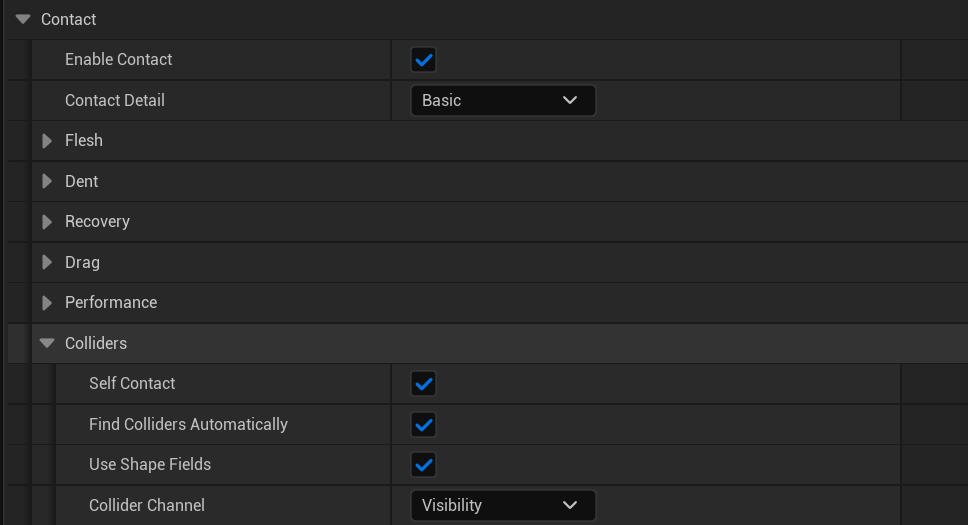
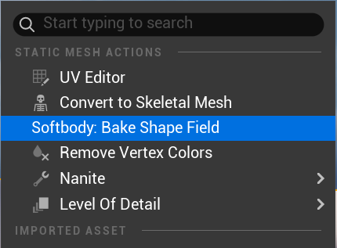
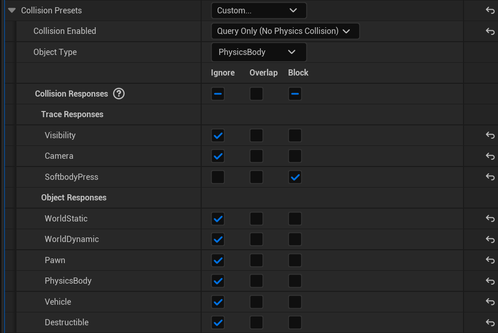

# 콜라이더

살을 누르는 것은 손, 소품, 바닥, 다른 캐릭터 무엇이든 콜라이더입니다. Softbody 컴포넌트는 매 프레임 콜라이더를 스스로 찾습니다.

## 살을 누를 수 있는 것 {#what-can-press-the-flesh}

콜라이더가 살을 누르는 조건은 다음과 같습니다.

1. 콜리전이 컴포넌트의 **Collider Channel**(기본값 **Visibility**)을 **막습니다**.
2. 콜리전이 쿼리용으로 켜져 있습니다. "No Collision"과 "Physics Only"는 건너뜁니다.
3. Softbody 컴포넌트 자신의 액터에 있지 않습니다. 캐릭터 자신의 손은 [자기 접촉](#self-contact)으로 누릅니다.
4. 컴포넌트에도, 그 액터에도 `SoftbodyIgnore` 태그가 없습니다.
5. 단순 콜리전 셰이프나 셰이프 필드가 있습니다.

| 콜라이더 | 누르는 데 쓰는 것 |
|---|---|
| 스태틱 메시, 셰이프 컴포넌트, 그 밖의 모든 프리미티브 | 단순 콜리전: 구, 캡슐, 박스, 컨벡스 헐. 테이퍼드 캡슐은 두 반지름 중 큰 쪽을 쓰는 캡슐로 칩니다. |
| 스켈레탈 메시 | 피직스 에셋의 모든 바디가 각자 자기 본을 따라 누릅니다. 피직스 에셋이 없으면 아무것도 누르지 않습니다. |
| 셰이프 필드를 베이크한 모든 메시 | **Use Shape Fields**가 켜져 있는 동안 단순 콜리전이나 피직스 에셋 대신 실제 모양으로, 조각마다 누릅니다. 셰이프 필드에 없는 부위는 누르지 않습니다. |
| 복합(트라이앵글 메시) 콜리전만 있음 | 아무것도 누르지 않고 로그에 한 줄 남깁니다. |

콜라이더는 메시 바운드를 **Max Contact Depth**만큼(최소 1 cm) 키운 상자 안에서 찾고, 메시가 화면에 보이고 **Min Screen Size**보다 작지 않을 때만 찾습니다.

## 설정 {#settings}

**Self Contact**, **Find Colliders Automatically**, **Use Shape Fields**, **Collider Channel**은 **Softbody > Contact > Colliders**에 있습니다([Softbody 컴포넌트](Softbody-Component)).

## 셰이프 필드 {#shape-fields}

셰이프 필드는 메시의 실제 모양을 베이크해 메시 에셋에 저장한 사본입니다. 셰이프 필드가 있으면 손은 단순 콜리전이 만드는 손가락 없는 매끈한 눌림 대신, 손가락 하나하나와 오목한 손바닥으로 누릅니다.

콘텐츠 브라우저에서 스태틱 메시나 스켈레탈 메시를 우클릭하고 **Softbody: Bake Shape Field**를 골라 베이크하며, 메시를 저장합니다. 로그에 `shape field baked (N parts)`가 나옵니다. 스켈레탈 메시는 본마다 조각이 하나씩 생겨 각자 자기 본을 따르고, 스태틱 메시는 조각이 하나입니다.

- 셰이프 필드는 콜라이더가 무엇으로 누르는지만 바꿉니다. 콜라이더는 여전히 콜리전으로 찾으므로, Collider Channel을 막는 콜리전이 있어야 합니다.
- 셰이프 필드는 누르는 쪽 메시 에셋에 저장되고, 그 메시가 누르는 모든 Softbody 메시에 똑같이 쓰입니다. 눌리는 쪽의 베이크 에셋과는 상관없고, 눌리는 쪽 컴포넌트는 **Use Shape Fields**로 쓸지 말지만 정합니다.
- 셰이프 필드가 있으면 피직스 에셋과 단순 콜리전으로는 누르지 않습니다. 메시를 고친 뒤에는 셰이프 필드를 다시 베이크해야 합니다.
- 엔진 콘텐츠는 베이크할 수 없습니다.
- 저장하지 않은 변경이 이미 있던 메시는 베이크만 하고 저장하지 않으므로, 직접 저장해야 합니다.
- 예전 플러그인 버전으로 베이크한 셰이프 필드는 오래된 것으로 보고 무시하므로, 다시 베이크해야 합니다.
- 이 명령은 메시 전체를 베이크합니다. 선택한 슬롯만 베이크하려면 **Softbody Authoring Data**의 **Shape Field Slots**를 사용합니다([베이크](Baking#_7-shape-field)).
- Softbody 캐릭터 자신의 스켈레탈 메시는 이 명령 대신 **Softbody Authoring Data**(**7. Shape Field**, **Self Contact Bones**)에서 셰이프 필드를 받습니다. [캐릭터](Characters)

## 자기 접촉 {#self-contact}

캐릭터는 자기 스켈레탈 메시의 셰이프 필드로만 자기 살을 누르고, 그중에서도 **Self Contact Bones** 아래의 조각만 누릅니다. 다른 Softbody 메시는 어느 쪽이든 온몸으로 누릅니다.

- **Self Contact Bones**는 한 스켈레탈 메시 안에서 스스로의 다른 영역을 누를 수 있는 본을 지정합니다(일반적으로 양손이며, 자식 본도 포함됩니다).
- 바인드 포즈에서 이미 닿아 있는 살은 무시합니다.
- 손끼리도 서로 누릅니다.
- Softbody 컴포넌트의 **Self Contact**를 끄면 캐릭터가 자기 몸을 누르지 않습니다.
- 베이크 뒤에 스켈레톤이 바뀌었으면, 본을 찾지 못해 자기 접촉 조각을 건너뛰었다는 로그가 나옵니다. 셰이프 필드를 다시 베이크해야 합니다.

## Softbody 메시끼리 누르기 {#softbody-meshes-pressing-each-other}

Softbody 메시는 다른 콜라이더처럼 다른 Softbody 메시를 누릅니다. 둘이 서로 누르면 각자 상대 모양대로 들어가서 둘 사이에 틈이 생깁니다([알려진 제한](Known-Limitations)). 눌리기만 하는 메시는 콜리전을 끄거나 `SoftbodyIgnore` 태그를 붙여 둘 수 있습니다.

## 닿지 않음과 쉼 {#out-of-reach-and-sleeping}

매 프레임, 찾은 콜라이더나 자기 접촉 조각 가운데 최소 2 cm 여유를 두고도 눌리는 살에 닿을 수 없는 것은 뺍니다. 남은 것이 없으면 눌린 자리가 서서히 돌아오고 접촉은 쉽니다([성능](Performance)).

자기 접촉 조각이 더는 접촉 맵과 맞지 않으면, **Rebake Contact Map**이나 **Rebake Shape Field**가 필요하다는 경고가 나옵니다.

## 프레임당 한도 {#per-frame-limits}

| 한도 | 메시당 프레임당 | 넘으면 |
|---|---|---|
| 단순 콜리전 셰이프 | 32 | 나머지는 건너뛰고, 로그를 한 번 남깁니다. |
| 컨벡스 헐 평면, 모든 셰이프 합계 | 2048 | 같음. |
| 셰이프 필드 조각, 바깥 콜라이더와 자기 접촉 조각 합계 | 512 | 한도를 넘게 될 콜라이더는 통째로 건너뛰고, 자기 접촉은 그 프레임만 건너뜁니다. 로그를 남깁니다. |

셰이프는 닿음 검사 뒤에 세므로, 메시마다 가까이 있는 것만 셉니다. 셰이프 필드가 있는 콜라이더는 자기 조각을 모두 512 한도에 넣어 셉니다.

## 누르는 손 설정 {#setting-up-a-hand-that-presses}

따로 된 액터인 손이나 다른 캐릭터의 손에 필요한 설정입니다.

1. **Collider Channel**을 막는 콜리전이 있어야 합니다(스켈레탈 손은 피직스 에셋, 스태틱 손은 단순 콜리전).
2. 손가락과 손바닥으로 누르려면 [셰이프 필드](#shape-fields)를 베이크할 수 있습니다.
3. Collider Channel이 프로젝트 트레이스 채널이면, 손의 콜리전에서 그 채널을 **Block**으로 둬야 합니다.

Softbody 메시 자신의 액터에 있는 손은 대신 [자기 접촉](#self-contact)으로 누릅니다.

## 권장 설정 {#recommended-setup}

기본 **Collider Channel**(**Visibility**)에서는 Visibility를 막는 바닥, 벽, 소품을 모두 찾습니다. 그중 눌리는 살에 닿을 수 있는 것은 매 프레임 셰이프 32개 중 하나를 차지하고, 메시가 쉬지 못하게 합니다. 다음 중 하나로 찾는 대상을 제한할 수 있습니다.

**프로젝트 트레이스 채널.** 트레이스 채널(예: `SoftbodyPress`)을 추가하고 **Default Response**를 **Ignore**로 둡니다. 모든 Softbody 컴포넌트의 **Collider Channel**에 이 채널을 지정하고, 눌러야 하는 콜라이더(손, 소품)마다 이 채널을 **Block**으로 둡니다. 나머지는 모두 이 채널을 무시하므로 누르지 않습니다.

**SoftbodyIgnore 태그.** Visibility를 그대로 두고 바닥과 벽 액터, 또는 컴포넌트 하나에 `SoftbodyIgnore` 태그를 붙입니다.
