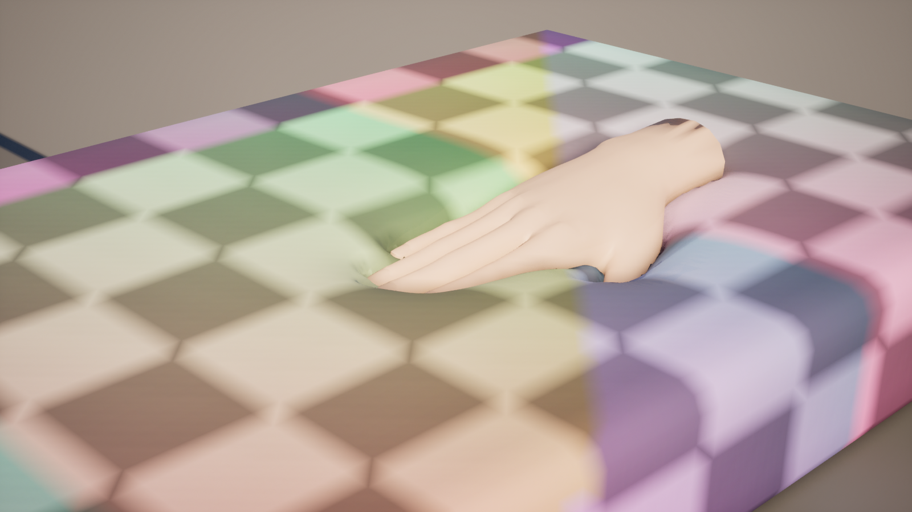
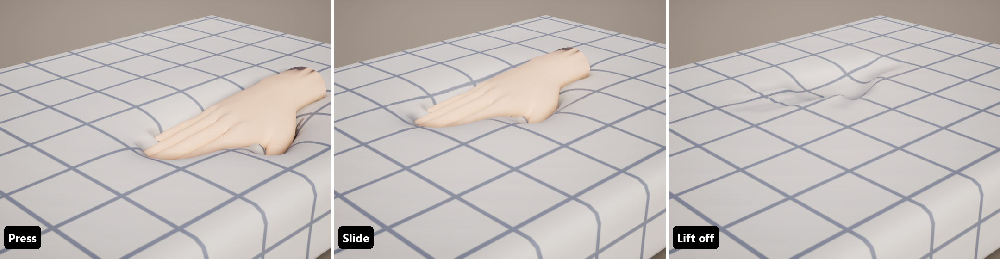
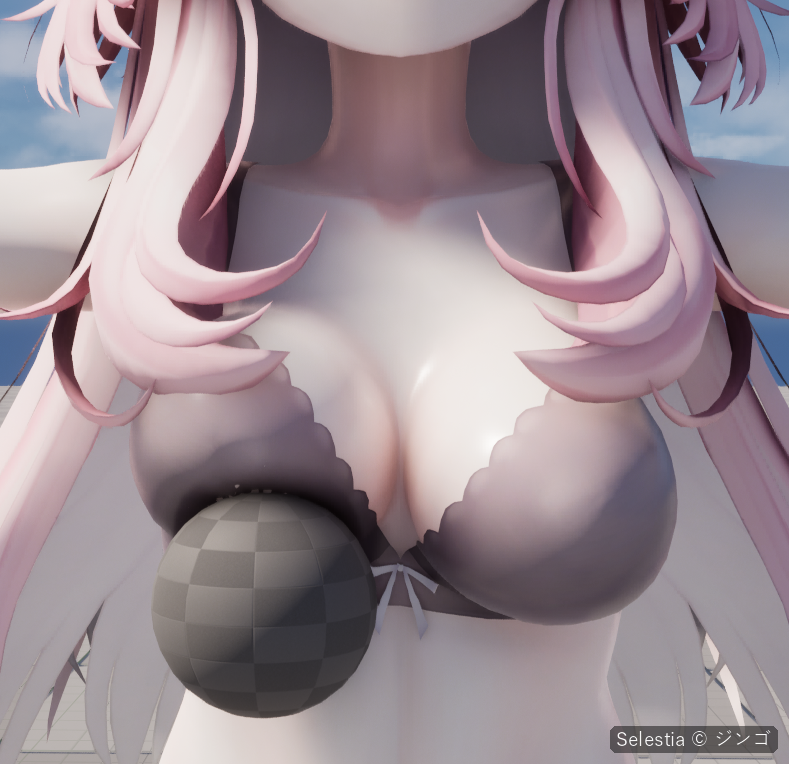
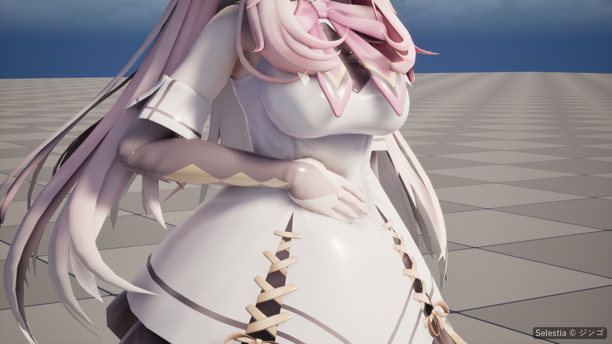

# 개념

이 문서 전체에서 쓰는 말입니다. 여기 나오는 설정은 [Softbody 컴포넌트](Softbody-Component)와 [베이크](Baking)에 기본값과 함께 있습니다.

## 접촉 맵 {#contact-map}

- **접촉**(contact)은 손과 물체가 표면에 하는 모든 일, 곧 눌림, 솟음, 끌림과 그 복원입니다.
- **접촉 맵**(contact map)은 눌리는 표면 위에 베이크한 격자로, 접촉은 여기서 계산합니다(**Bake Contact Map**). 베이크는 이를 위해 메시에 UV 채널을 하나 더하고, 머티리얼은 그 채널로 결과를 읽습니다. 
- **접촉 맵 칸**(contact map cell)은 격자의 네모 한 칸입니다. **Edge Smoothing**은 칸 단위로 잽니다.
- **Contact Map Seams**는 맵을 여러 조각으로 자르는 자리(이음매)를 정합니다. 기본으로는 메시의 UV0 이음매를 따라 자릅니다. 잘린 자리를 가로지르면 눌림이 조금 덜 정확합니다. **Debug View**를 켜면 **Debug View Mode** 2가 칸을 체커 무늬로 그립니다. 무늬가 끊기는 선이 이음매입니다.

## 눌림, 솟음, 끌림, 복원과 남는 자국 {#dent-bulge-drag-recovery-and-lasting-marks}

- **눌림**(dent)은 콜라이더 아래에서 표면이 들어가는 것입니다. 콜라이더가 파고든 만큼 들어가고, **Max Contact Depth**가 그 한계입니다.
- **솟음**(bulge)은 눌린 자리 둘레로 솟아오르는 살입니다. **Contact Detail**이 Full일 때만 있습니다. 얼마나 솟는지는 **Volume Preservation**이 정합니다. 살과 젤리는 솟고, 폼은 들어가기만 합니다([살의 재료](#flesh-material)).
- **끌림**(drag)은 마찰에 의해 표면이 끌려가는 것입니다. 피부는 살이 되당기는 힘이 **Drag Friction**보다 세질 때까지 따라가다가 미끄러집니다.
- **복원**(recovery)은 콜라이더가 떠난 뒤 표면이 **Recovery Rate**의 빠르기로 돌아오는 것입니다.
- **남는 자국**(lasting mark)은 메모리 폼처럼 뗀 뒤에도 남았다가 사라지는 눌린 자리입니다. **Memory Time**이 0보다 클 때만 생깁니다.

## 살 두께와 단단한 코어 {#flesh-thickness-and-the-rigid-core}

- **단단한 코어**(rigid core)는 전혀 움직이지 않는 부분입니다. 스켈레탈 메시에서는 본이며, 스켈레톤에서 바로 찾으므로 피직스 에셋은 필요 없습니다. 스태틱 메시에서는 **Core Placement**로 정합니다. 모양의 한가운데, 바닥, 또는 직접 놓은 구입니다.
- **살 두께**(flesh thickness)는 피부에서 단단한 코어까지의 거리로, 베이크가 잽니다. 눌린 자리와 그 솟음이 얼마나 넓은지, 끌림이 얼마나 멀리 미치는지를 살 두께가 정합니다. 살이 얼마나 출렁이는지도 살 두께를 따르며, **Jiggle** 칠과 **Flesh Reach**가 함께 정합니다.
- **바깥 표면**(outer surface)은 베이크가 두께를 잴 때 기준으로 삼는, 메시를 단순화한 표면입니다. 바깥 표면에서 5 cm보다 떨어진 버텍스(몸에서 떠 있는 헤어 카드나 장식)는 눌림을 덜 따라가고, 10 cm부터는 따라가지 않습니다.
- **볼륨 메시**(volume mesh)는 같은 자리에 모델링한 닫힌 스태틱 메시로, 열려 있거나 속이 빈 대상(막, 얇은 접시, 텐트)에 잴 수 있는 속을 줍니다.

## Softbody 슬롯 {#softbody-slots}

- **Softbody 슬롯**은 [Softbody 머티리얼](Materials)을 쓰는 머티리얼 슬롯이며, 메시에서 Softbody가 적용되는 영역입니다. 다른 슬롯은 변형되지 않습니다.
- 스켈레탈 메시의 단단한 코어와 [관성 그룹](Inertia#inertia-groups)은 Softbody 슬롯에 스키닝된 본으로만 정해집니다. 다른 슬롯만 움직이는 본(일반적으로 머리카락, 치마, 장신구)은 저절로 빠집니다.
- Softbody 머티리얼을 쓰는 슬롯이 하나도 없을 때 베이크하면 메시 전체를 Softbody 슬롯으로 칩니다.

## 눌리는 슬롯과 슬롯 페인트 {#pressable-slots-and-slot-mask-paint}

- **Pressable Slots**는 눌리는 머티리얼 슬롯입니다. 비어 있으면 Softbody 머티리얼을 쓰는 슬롯을 뜻합니다.
- **슬롯 페인트**(slot paint)는 머티리얼 슬롯마다 그 슬롯의 UV0에 맞춰 칠한 RGBA 텍스처(**Paint Texture**) 한 장입니다. 네 채널에 재료의 성질을 하나씩 담습니다. **Depth**(R, 피부에서 뼈까지 살이 얼마나 깊은지), **Jiggle**(G, 살이 얼마나 무른지), **Volume**(B, 눌린 살이 부피를 지키는지), **Flex**(A, 겉이 어떻게 휘는지)입니다. 흰색은 어느 채널이든 칠 안 함입니다. [페인트](Painting)

## 살의 재료 {#flesh-material}

콜라이더가 얼마나 깊이 들어가는지는 콜라이더의 애니메이션이나 물리가 정하고, 살이 정하지 않습니다. 그래서 살이 얼마나 단단한지는 눌린 자리 모양을 바꾸지 않습니다. 모양을 바꾸는 것은 다음과 같습니다.

| 성질 | 정하는 곳 | 바꾸는 것 |
|---|---|---|
| 살 두께 | 베이크: 단단한 코어가 놓이는 자리(Core Placement, Rigid Core Spheres, Bone Thickness), Max Flesh Thickness, Depth 칠 | 모든 모양의 크기입니다. 살이 두꺼우면 눌린 자리와 솟음이 넓고 완만하며, 얇으면 좁고 또렷합니다. |
| 압축성 | **Volume Preservation**(Softbody Authoring Data, 4. Paint) × Volume 칠, 플레이 중에는 **Volume Offset**(Softbody 컴포넌트)을 더함 | 1 = 살이나 젤리: 눌린 자리 둘레로 솟고, 통째로 밀린 덩어리는 옆으로 퍼집니다. 0 = 폼: 제자리에서 압축되므로 눌린 자리의 가장자리가 또렷하고 아무것도 솟지 않습니다. 그 사이 값은 일부만 압축되는 밀도 높은 폼처럼 움직입니다. |
| 겉껍질 | **Skin Tension**(Softbody 컴포넌트) | 메시 전체를 덮는 팽팽한 겉입니다. 0 = 맨살이나 젤리, 1보다 크면 북 가죽입니다(0~2). 겉껍질이 팽팽할수록 눌린 자리가 둥글고 넓어지고, 손가락 사이를 건너 덮으며, 누르는 물체의 모양이 흐려집니다. 살이 얇은 곳일수록 효과가 큽니다. |
| 겉 굽힘 | **Flex** 칠, 플레이 중에는 **Flex Offset**(Softbody 컴포넌트)을 더함 | 겉의 일부만 뻣뻣할 때입니다. 회색은 어두울수록 뻣뻣하게 휘어 누름이 넓고 둥글게 퍼집니다. 검은색은 통째로 가라앉고 기우는 **판**(plate)입니다. Contact Detail이 Full일 때만 듣습니다. |
| 시간 | **Recovery Rate**, **Memory Time**, **Memory Fade Time** | 눌린 자리가 얼마나 빨리 돌아오는지와 자국이 남는지입니다. |
| 마찰 | **Drag Friction** | 움직이는 손이 피부를 얼마나 끌고 가는지입니다. |
| 깊이 쥘 때 단단해짐 | **Squeeze Stiffening** | 깊이 쥘수록 살이 얼마나 더 세게 밀어내는지입니다. 끌림과 덩어리에 듭니다. |

재료를 바꾸지 않고 눌린 자리만 넓히는 설정은 없습니다. 더 넓고 완만한 눌림을 원하면 살을 두껍게 하거나, 겉껍질을 팽팽하게 하거나, Flex를 회색으로 칠합니다. 살 두께는 베이크 에셋 Preview의 [Flesh Thickness](Preview-and-Simulation#flesh-thickness) 보기로 확인합니다.

Volume Preservation은 메시 전체에 걸리는 값이고, 메시 일부만 다르면 Volume 칠이 그 값에 곱해집니다([페인트](Painting)). 

Skin Tension은 칠하지 않는 컴포넌트 값 하나이며, 컴포넌트마다 정하므로 같은 베이크를 쓰는 액터끼리도 겉껍질을 다르게 둘 수 있습니다. 플레이 중에 압축성을 시험해 보려면 Softbody 컴포넌트의 **Volume Offset**을 씁니다. 

스켈레탈 메시의 덩어리 전체가 퍼지는 모양은 그 결과를 베이크 에셋에 넣고 Run Bake를 누르기 전까지 베이크한 대로입니다. 

스태틱 메시에는 덩어리가 없으므로, 한 베이크를 쓰는 액터끼리도 Volume Offset으로 폼과 젤을 나눌 수 있습니다.

### 재료 예 {#recipes}

| 재료 | Volume Preservation | Skin Tension | 시간 | 살 두께 |
|---|---|---|---|---|
| 인체 피부 | 1 | 약 0.15 | 기본값 | 본에서 정해짐. 뼈가 피부 가까이 있는 곳은 Depth를 칠함 |
| 젤리 | 1 | 0 | 기본값 | 두껍게: Core Placement Bottom, 또는 작은 코어 |
| 슬라임 | 1 | 0 | Recovery Rate 1 | 두껍게 |
| 메모리 폼 | 0 | 0 | Recovery Rate 8, Memory Time 1.5 | Bottom에 Max Flesh Thickness |
| 스펀지 | 0 | 0 | 기본값 | Bottom에 Max Flesh Thickness |
| 고무 | 1 | 0 | 기본값 | 얇게: 피부 가까이 둔 코어(Rigid Core Spheres, 또는 Core Placement Center의 Bone Thickness), 또는 Max Flesh Thickness |
| 소시지 | 1 | 껍질만큼 조금 | 기본값 | Core Placement Center: 코어가 축을 따라 지남 |
| 가죽 | 속 재료대로 | 약 0.5 | 기본값 | 속 재료대로 |
| 북 가죽 | 속 재료대로 | 1~2 | 기본값 | 속 재료대로 |

기본값은 Recovery Rate 30, Memory Time 0입니다. 겉의 일부만 가죽이거나 단단한 장식이면 Skin Tension 대신 그 자리에 Flex를 칠합니다.

## 덩어리 {#lumps}

**덩어리**(lump)는 가슴이나 엉덩이처럼, 속에 단단한 것 없이 본에 매달린 살입니다. **Bone Overrides**에서 그 본의 **Role**을 **Lump**로 두어 만듭니다. 그 본과 그 아래 본들이 단단한 코어에서 빠집니다. 손끝으로 찌르면 대부분 눌림으로 끝나지만, 손바닥으로 넓고 깊게 밀면 덩어리 전체가 옆으로 밀리고, 떼면 흔들리며 돌아옵니다. 덩어리를 감싸 쥐거나 아래에서 들어 올리는 손은 덩어리를 함께 옮깁니다. **Lump Yield**, **Lump Grip**, **Squeeze Stiffening**으로 조절합니다. 배나 등처럼 스켈레톤 위에 붙은 부분과 스태틱 메시는 덩어리로 움직이는 일이 없습니다.

## 자기 접촉과 셰이프 필드 {#self-contact-and-shape-fields}

- **콜라이더**(collider)는 콜리전이 **Collider Channel**(Visibility)을 막는 모든 것입니다. 단순 콜리전이나 피직스 에셋으로 누릅니다. [콜라이더](Colliders)
- **셰이프 필드**(shape field)는 누르는 물체의 실제 모양을 베이크한 사본으로, 단순 콜리전 대신 씁니다. 손은 손가락과 손바닥의 오목한 곳으로 누릅니다. Softbody Authoring Data 에셋의 **Bake Shape Field**로 베이크하거나, 누르기만 하는 메시라면 **Softbody: Bake Shape Field**로 베이크합니다.
- **자기 접촉**(self contact)은 캐릭터가 자기 손으로 자기 배나 허벅지를 누르는 것입니다. 셰이프 필드가 필요하고, 캐릭터 자신을 누르는 것은 **Self Contact Bones**(자식 본 포함, 보통 hand_l과 hand_r)뿐입니다. 다른 Softbody 메시는 언제나 몸 전체가 누릅니다.

## 겹친 옷 {#layered-clothing}

**겹친 옷**(layered clothing)은 몸에 붙는 슈트나 레깅스처럼 피부 위에 놓인 옷입니다. 아래 살과 함께 눌리고 출렁이므로 살이 옷을 뚫고 나오지 않습니다. 옷은 아래 살의 Depth, Jiggle, Volume을 받고, Flex만 옷 슬롯 자신의 칠을 씁니다. 옷 바로 밑의 피부와 바깥 표면 안쪽에 가려진 피부는 바깥 옷과 함께 눌립니다.

## 관성과 관성 그룹 {#inertia-and-inertia-groups}

- **관성**(inertia)은 출렁임입니다. 메시가 빨라지거나, 돌거나, 멈추거나, 기울면 살이 뒤처졌다가 흔들리며 돌아옵니다(**Enable Inertia**). **Inertia Amount**는 살이 얼마나 무른지, **Inertia Damping**은 멈추기 전에 몇 번 넘어가는지, **Jiggle Speed**는 리듬을 정합니다. 관성은 접촉이 쉬는 동안에도, **Enable Inertia**가 켜져 있는 동안 계속 작동합니다.
- **측정 베이크**(measure bake)는 베이크의 첫 단계입니다. 부위마다 얼마나 부드러운지 재고 관성 그룹을 찾습니다.
- **관성 그룹**(inertia group)은 함께 출렁이는 본의 묶음으로, 베이크가 찾습니다(**Max Inertia Groups**까지). **Inertia Group Overrides**는 한 그룹에 그 그룹만의 양, 감쇠, 중력을 줍니다. 스태틱 메시는 그룹 하나입니다.

## 쉼과 멈춤 {#sleeping-and-still}

접촉은 무언가 일어나는 동안에만 GPU 시간을 씁니다.

- 닿을 수 있는 콜라이더가 없을 때, 모든 뷰 밖에 있을 때, **Min Screen Size**보다 작게 보일 때 메시는 **쉽니다**(sleeping). 눌린 자리는 뗀 것처럼 서서히 돌아오고, 그다음 접촉 계산이 멈춥니다. 그 뒤 처음 닿으면 같은 프레임에 갱신됩니다.
- 콜라이더와 본이 움직임을 멈추고 설정과 눌린 자리도 더 바뀌지 않으면 눌린 메시는 **멈춥니다**(still). 무언가 움직일 때까지 접촉 갱신을 건너뜁니다. 복원 중인 메시는 멈추지 않습니다.
- **갱신 예산**(update budget)은 한 프레임에 접촉을 갱신하는 메시의 최대 수입니다(월드당 4개). 나머지는 돌아가며 갱신합니다.
- **접촉 갱신 빈도 제한**(contact update rate limit)은 프레임 레이트와 상관없이 메시마다 갱신 빈도의 상한을 둡니다(Project Settings > Plugins > Softbody의 **Limit Contact Update Rate**).

[성능](Performance)

## 나나이트 테셀레이션 {#nanite-tessellation}

버텍스를 움직이는 것은 머티리얼이므로, 일반 메시에서는 메시의 삼각형보다 좁은 눌린 자리가 보이지 않습니다. **Set Up Nanite Tessellation**은 메시가 나나이트 테셀레이션으로 그려지도록 설정하므로, 밀도가 낮은 메시에서도 버텍스 사이에 손끝 눌림이 나타납니다. 메시와 그 슬롯 머티리얼이 모두 바뀝니다. [머티리얼](Materials)
