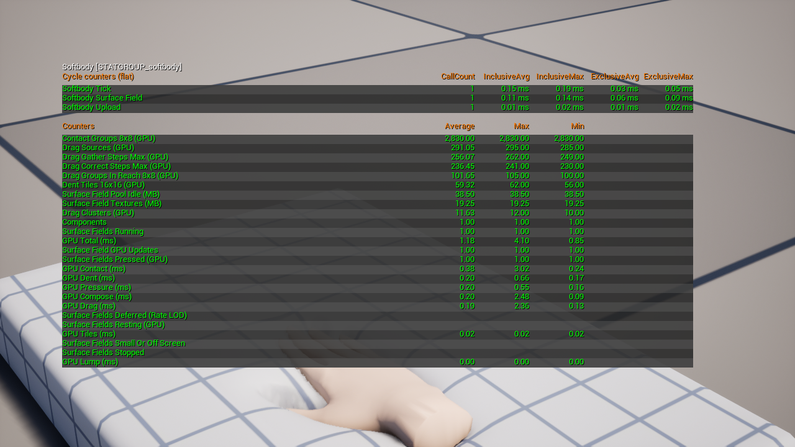
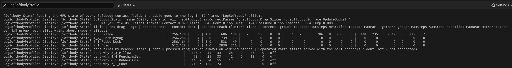

# 콘솔 레퍼런스

플러그인의 콘솔 변수, 콘솔 명령, `stat softbody` 줄입니다.

## 콘솔 변수 {#console-variables}

표의 `softbody.Surface.*` 변수는 모두 Scalability 플래그가 붙어 있어 품질 단계마다 따로 정할 수 있습니다. 거리 단위는 cm입니다. 접촉이 처음 시작되는 순간은 화면 크기나 갱신 빈도 제한과 상관없이 늘 바로 갱신됩니다.

| 변수 | 기본값 | 하는 일 |
|---|---|---|
| [`softbody.Surface.UpdateBudget`](#softbody-surface-updatebudget) | 4 | 월드마다 한 프레임에 접촉을 갱신하는 메시의 최대 수입니다. 0 = 제한 없음. |
| [`softbody.Surface.FullRateScreenSize`](#softbody-surface-fullratescreensize) | 0 | 화면에서 이 값보다 작은 메시는 매 프레임이 아니라 간격을 두고 갱신합니다. 0 = 매 프레임. |
| `softbody.Surface.MaxInterval` | 4 | 작은 메시의 갱신 사이 최대 간격(프레임 수)입니다. |
| [`softbody.Surface.MaxUpdateRate`](#softbody-surface-maxupdaterate) | -1 | 닿은 메시의 초당 최대 갱신 수입니다. -1 = Project Settings 값을 따름, 0 = 제한 없음. |
| [`softbody.Surface.TexturePool`](#softbody-surface-texturepool) | 2 | 월드마다 종류별로 남겨 두는 여분 접촉 텍스처 세트 수입니다. |
| [`softbody.Surface.CreateBudget`](#softbody-surface-createbudget) | 4 | 월드마다 한 프레임에 만들고 해제하는 접촉 텍스처의 최대 메모리(MB)입니다. 0 = 제한 없음. |
| [`softbody.Surface.ReleaseDelay`](#softbody-surface-releasedelay) | 10 | 접촉 텍스처 등을 마지막으로 쓴 뒤 메모리에 두는 시간(초)입니다. 0 = 바로 해제 시작. |
| [`softbody.Surface.LoadBudget`](#softbody-surface-loadbudget) | 2 | 월드마다 한꺼번에 불러오는 접촉 맵 데이터의 최대 양(MB)입니다. 0 = 제한 없음. |
| [`softbody.Surface.FirstUpdates`](#softbody-surface-firstupdates) | 2 | 월드마다 한 프레임에 첫 갱신을 하는 메시의 최대 수입니다. 0 = 제한 없음. |
| [`softbody.Surface.StillDistance`](#softbody-surface-stilldistance) | 0.1 | 콜라이더, 본, 설정이 이 값보다 적게 움직이면 갱신을 건너뜁니다. 0 = 건너뛰지 않음. |
| `softbody.Surface.StillChange` | 0.001 | `softbody.Surface.StillDistance`에 쓰는 기준. 변위 변화가 이 값보다 작으면 그 갱신은 아무것도 바꾸지 않은 것으로 칩니다. |
| [`softbody.Drag.CorrectPasses`](#softbody-drag-correctpasses) | 1 | 프로파일링: 갱신마다 도는 끌림 보정 패스 수, 0~4. |
| [`softbody.Drag.Slices`](#softbody-drag-slices) | 4 | 프로파일링: 두 끌림 패스에서 8x8 그룹 하나를 나누는 64스레드 조각 수, 4, 2, 1 중 하나. |
| `softbody.Scenario.Start` | (비어 있음) | 프로파일링: 플레이를 시작할 때 전환할 `Softbody.Scenario` 이름(`4_3`, `All`, `None` 등)입니다. 비어 있으면 모든 액터를 켠 채로 둡니다. |

### `softbody.Surface.UpdateBudget` {#softbody-surface-updatebudget}

예산에 들지 못한 메시는 차례를 기다립니다. 갱신하는 순서는 다음과 같습니다.

1. 막 닿은 메시
2. 화면에 보이고 닿는 거리에 콜라이더가 있는 메시
3. 복원 중인 메시
4. 화면 밖 메시

예산에 밀린 메시는 `softbody.Surface.MaxInterval`만큼 기다리면 맨 앞으로 갑니다.

### `softbody.Surface.FullRateScreenSize` {#softbody-surface-fullratescreensize}

화면 크기는 화면 높이에 대한 바운딩 구 지름이며 대략 0~1입니다. 이 값보다 작은 메시는 ceil(이 값 / 화면 크기) 프레임에 한 번만 갱신합니다. 간격은 최대 `softbody.Surface.MaxInterval`까지입니다.

### `softbody.Surface.MaxUpdateRate` {#softbody-surface-maxupdaterate}

프레임 레이트와 상관없이 닿은 메시의 초당 갱신 수를 제한합니다. -1이면 Project Settings의 **Limit Contact Update Rate**와 **Contact Updates Per Second**를 따릅니다.

### `softbody.Surface.TexturePool` {#softbody-surface-texturepool}

종류는 접촉 맵 해상도, 덩어리 있음과 없음, 거친 격자 크기로 나뉩니다. 그 종류를 쓰는 컴포넌트가 켜져 있는 동안 프레임마다 몇 장씩 만들어 두므로 처음 닿을 때 기다리지 않습니다. 이 수를 넘는 세트와, 켜진 컴포넌트가 더는 쓰지 않는 종류의 여분은 `softbody.Surface.ReleaseDelay` 뒤에 해제합니다.

### `softbody.Surface.CreateBudget` {#softbody-surface-createbudget}

텍스처 한 장은 적어도 0.5 MB로 셉니다. 여러 메시를 한꺼번에 켜거나 동시에 닿으면 여러 프레임에 나뉘며, 텍스처를 기다리는 메시는 몇 프레임 늦게 눌리기 시작합니다.

### `softbody.Surface.ReleaseDelay` {#softbody-surface-releasedelay}

접촉 텍스처, 접촉 맵, 끈 메시의 조회 표를 마지막으로 쓴 뒤 이 시간 동안 메모리에 둡니다. 이 안에 다시 켜면 아무것도 다시 만들지 않고, 지나면 프레임마다 조금씩 해제합니다. GPU 작업은 어느 쪽이든 바로 멈춥니다.

### `softbody.Surface.LoadBudget` {#softbody-surface-loadbudget}

텍스처 한 장은 적어도 0.5 MB로 셉니다.

### `softbody.Surface.FirstUpdates` {#softbody-surface-firstupdates}

첫 갱신은 켜기, 스폰, 스트리밍 뒤 처음, 렌더 스레드에 조회 표를 만드는 갱신입니다. 나머지 메시는 한두 프레임 뒤에 시작합니다. `softbody.Surface.ReleaseDelay` 안에 다시 켠 메시는 세지 않습니다.

### `softbody.Surface.StillDistance` {#softbody-surface-stilldistance}

눌린 메시의 콜라이더, 본, 설정이 마지막 갱신 뒤로 이 값보다 적게 움직였고, 마지막 갱신에서 바뀐 양이 `softbody.Surface.StillChange`보다 작으면, 무언가 움직일 때까지 갱신을 건너뜁니다. 회전은 바운딩 반지름 위의 점이 움직이는 거리로 셉니다.

### `softbody.Drag.CorrectPasses` {#softbody-drag-correctpasses}

0이면 가만히 누른 자리 아래 붙든 피부가 천천히 밀려납니다.

### `softbody.Drag.Slices` {#softbody-drag-slices}

조각이 많을수록 가장 긴 순회가 짧아지고, 결과는 반올림만큼만 다릅니다.

## 콘솔 명령 {#console-commands}

| 명령 | 인수 | 하는 일 |
|---|---|---|
| `Softbody.Stats` | 없음 | 프로파일링: `stat softbody` 없이도, 약 10프레임 뒤에 접촉 필드마다 한 줄씩 로그(LogSoftbodyProfile)에 씁니다. |
| [`Softbody.Profile`](#softbody-profile) | 없음 | 프로파일링: 이번 프레임에 `ProfileGPU`를 돌리고 `Softbody.Stats` 표를 씁니다. |
| [`Softbody.Scenario`](#softbody-scenario) | `[name]` | 프로파일링: 이 맵의 시나리오를 나열하거나, 이름을 주면 그 시나리오의 액터만 켜 둡니다. |
| [`Softbody.Scenario.Pause`](#softbody-scenario-pause) | `[0 or 1]` | 프로파일링: 시나리오 액터의 움직임을 멈추거나 다시 움직이게 합니다. |
| [`Softbody.HitchTest`](#softbody-hitchtest) | 없음 | 시험: 약 76초 동안 컴포넌트를 껐다 켜고 스폰하며 프레임 시간을 기록합니다. |
| [`Softbody.CaptureField`](#softbody-capturefield) | `[full] [part of an actor or component name]` | 디버그: 이번 프레임의 접촉 텍스처를 `Saved/SoftbodyCapture/` 아래에 저장합니다. |

### `Softbody.Profile` {#softbody-profile}

필드마다 패스가 `Softbody <actor name>` 아래에 묶입니다.

### `Softbody.Scenario` {#softbody-scenario}

플레이 중에만 됩니다. [프로파일링 (고급)](#profiling-advanced)

- 인수가 없으면 이 맵의 시나리오를 나열합니다.
- 이름을 주면 그 시나리오의 액터만 켜 둡니다. 나머지는 숨기고 콜리전, 틱, 물리를 끕니다.
- `All`은 모두 다시 켭니다.
- `None`은 태그가 붙은 액터를 모두 끕니다.

### `Softbody.Scenario.Pause` {#softbody-scenario-pause}

플레이 중에만 됩니다.

- `1`: 켜져 있는 시나리오 액터의 움직임을 멈추고, 그 Softbody 컴포넌트는 계속 돌게 둡니다.
- `0`: 다시 움직이게 합니다.
- 인수가 없으면 둘을 번갈아 바꿉니다.

### `Softbody.HitchTest` {#softbody-hitchtest}

레벨을 바꿉니다. 약 76초 동안 다음을 차례로 하며 프레임·게임·렌더·RHI·GPU 시간을 기록합니다.

- 모든 Softbody 컴포넌트를 끄고 켭니다.
- 가장 큰 것을 껐다 켜기를 되풀이합니다.
- `softbody.Surface.ReleaseDelay`가 지나도록 기다립니다.
- 전체 가비지 컬렉션을 돌립니다.
- 복사본을 스폰했다 지웁니다.
- **Enable Contact**를 끄고 켭니다.

단계별 요약은 로그(LogSoftbodyHitch)에, 프레임별 값은 `Saved/Profiling/SoftbodyHitch/`에 CSV로 씁니다. `softbody.HitchTest.Start 1`이면 플레이 첫 프레임부터 돌고, `softbody.HitchTest.Quit 1`이면 끝난 뒤 독립 실행 게임을 닫습니다.

### `Softbody.CaptureField` {#softbody-capturefield}

저장 폴더는 `Saved/SoftbodyCapture/<date_time>_f<frame>/`이고, 보통 다음 틱에 저장됩니다. [프로파일링 (고급)](#profiling-advanced)

## stat softbody {#stat-softbody}

Shipping 빌드에는 없습니다. (GPU) 표시가 붙은 줄은 통계를 띄워 두었거나 프로파일링 명령이 요청할 때만 GPU에서 읽어 오며, 몇 프레임 늦습니다. GPU 시간 줄은 GPU가 마지막으로 끝낸 프레임에서 접촉이 있는 모든 메시를 더한 값으로, `stat gpu`가 `Softbody` 이름 아래에 보여 주는 값과 같습니다. 그 프레임에 돌지 않은 단계는 0으로 나옵니다. 개수 줄은 틱마다 세며, 컴포넌트 하나가 여러 줄에 함께 들어갈 수 있습니다.

| 줄 | 보여 주는 것 |
|---|---|
| Softbody Tick | 모든 Softbody 컴포넌트 틱의 CPU 시간. |
| Softbody Upload | 이번 프레임의 결과(관성 데이터, 머티리얼 파라미터)를 머티리얼에 넘기는 CPU 시간. |
| Softbody Surface Field | 접촉 갱신을 준비하는 CPU 시간(콜라이더, 본, 요청). |
| GPU Total (ms) | 아래 GPU 줄 일곱 개의 합. |
| GPU Contact (ms) | 콜라이더가 어디를 누르는지 재는 단계. |
| GPU Tiles (ms) | 어느 접촉 맵 그룹에 일이 있는지 목록을 만드는 단계. |
| GPU Dent (ms) | 눌림 단계. |
| GPU Drag (ms) | 끌림 단계. |
| GPU Pressure (ms) | 눌린 자리 둘레의 솟음을 그리는 접촉 압력 단계(Contact Detail Full). |
| GPU Compose (ms) | 눌림, 솟음, 끌림을 머티리얼이 읽는 변위로 합치고, 노멀 기울기와 **Dent Darkening**도 만드는 단계. |
| GPU Lump (ms) | 덩어리 단계. |
| Components | 틱이 돈 Softbody 컴포넌트. |
| Surface Fields Running | 접촉이 켜져 있고 접촉 갱신을 요청한 컴포넌트. |
| Surface Fields Stopped | 접촉이 켜져 있지만 요청하지 않은 컴포넌트. 쉬는 중이거나 아직 준비되지 않았습니다. |
| Surface Fields Small Or Off Screen | 지난 프레임에 어느 뷰에도 보이지 않았거나 **Min Screen Size**보다 작음. |
| Surface Fields Nothing In Reach | 콜라이더를 찾았지만 닿는 거리 안에는 없음. |
| Surface Field GPU Updates | 갱신 예산을 거친 뒤 GPU에서 실제로 돈 갱신. |
| Surface Fields Deferred (Rate LOD) | 요청했지만 갱신 예산, 갱신 빈도 제한, 화면 크기 규칙에 밀려 미뤄짐. |
| Surface Fields Still (Pressed, No Change) | 눌려 있지만 움직인 것도 바뀐 것도 없어 갱신을 건너뜀. |
| Surface Fields Pressed (GPU) | 마지막으로 읽어 온 결과에 눌린 칸이 있던 필드. |
| Surface Fields Resting (GPU) | 눌린 칸이 없고 복원이 끝남. GPU는 접촉 단계 뒤의 단계를 모두 건너뜁니다. |
| Dent Tiles 16x16 (GPU) | 눌림을 푸는 접촉 맵의 16x16 칸 그룹. |
| Drag Sources (GPU) | 끌림을 위해 피부를 붙든 거친 격자 칸. 지금 눌렸거나, 앞서 눌린 뒤 아직 붙들고 있는 칸입니다. |
| Drag Groups In Reach 8x8 (GPU) | 끌림이 닿는 거친 격자 칸의 8x8 그룹. |
| Contact Groups 8x8 (GPU) | 접촉 단계가 도는 칸의 8x8 그룹. |
| Drag Clusters (GPU) | 끌림 원천이 들어 있는 8x8 그룹. |
| Drag Mixed Clusters (GPU) | 그중 접촉 맵의 여러 조각에 걸친 그룹. 원천을 하나로 묶지 않고 하나씩 더합니다. |
| Drag Correct Steps Max (GPU) | 끌림 보정 패스에서 8x8 그룹 하나가 도는 가장 긴 순회(모든 필드를 통틀어). |
| Drag Gather Steps Max (GPU) | 끌림 모으기 패스에서 8x8 그룹 하나가 도는 가장 긴 순회(모든 필드를 통틀어). |
| Surface Field Textures (MB) | 닿은 메시가 잡고 있는 접촉 텍스처 세트. |
| Surface Field Pool Idle (MB) | 풀에서 기다리는 여분 세트. |

## 프로파일링 (고급) {#profiling-advanced}

**Softbody.Stats**는 머리 줄(프레임, 켜진 시나리오, 현재 `softbody.Drag.CorrectPasses`, `softbody.Drag.Slices`, `softbody.Surface.UpdateBudget` 값), 단계별 GPU 시간 줄 하나, 그리고 필드마다 한 줄을 씁니다. 필드 줄은 끌림 순회가 가장 긴 것부터 나옵니다. 걸음 수는 8x8 그룹마다 세며, 조각 하나는 약 걸음 수 / `softbody.Drag.Slices`만큼 돕니다. 그 뒤 `dent tiles by reason` 머리 줄과 필드마다 `dent-why` 줄이 눌림 타일을 까닭별로 셉니다: 눌린 자리(pressed), 그 둘레(ring), 접촉 맵 이음매 건너편(linked), 늘 켜진 것(always-on), 넓힌 것(widened), Flex 판 조각(pieces), 그리고 **Separated Pairs** 채널로 푼 타일입니다. 이 명령은 30프레임 동안 GPU 읽어 오기를 켭니다.

**Softbody.Scenario**를 쓰면 맵 하나에 시험 장면을 여럿 둘 수 있습니다.

1. 한 장면의 모든 액터에 `SoftbodyScenario.<name>` 태그를 붙여야 합니다. 액터 하나가 여러 장면에 속해도 됩니다. 시나리오 태그가 없는 액터는 절대 건드리지 않습니다.
2. 같은 태그를 붙인 Camera Actor를 추가할 수 있습니다. 그 장면으로 전환하면 이 카메라로 보고, 전환을 되돌리면 플레이어 뷰로 돌아갑니다.
3. 플레이 중에 `Softbody.Scenario`는 장면마다 액터 수와 Softbody 수를 함께 나열하고, `Softbody.Scenario <name>`은 그 장면만 켜 둡니다.

**Softbody.CaptureField**는 접촉이 켜져 있고 준비된 Softbody 컴포넌트를 모두 캡처하거나, 인수를 주면 액터나 컴포넌트 이름에 그 인수가 들어 있는 것만 캡처합니다. 폴더에는 원래 값을 담은 EXR 파일(눌린 영역만, `full`이면 접촉 맵 전체), 눌린 영역을 확대한 PNG 미리 보기, 같은 순간의 화면인 `view.png`, 그 순간의 접촉 설정을 적은 `capture.txt`가 들어갑니다. 결과는 LogSoftbodyCapture로 로그에 남습니다.
