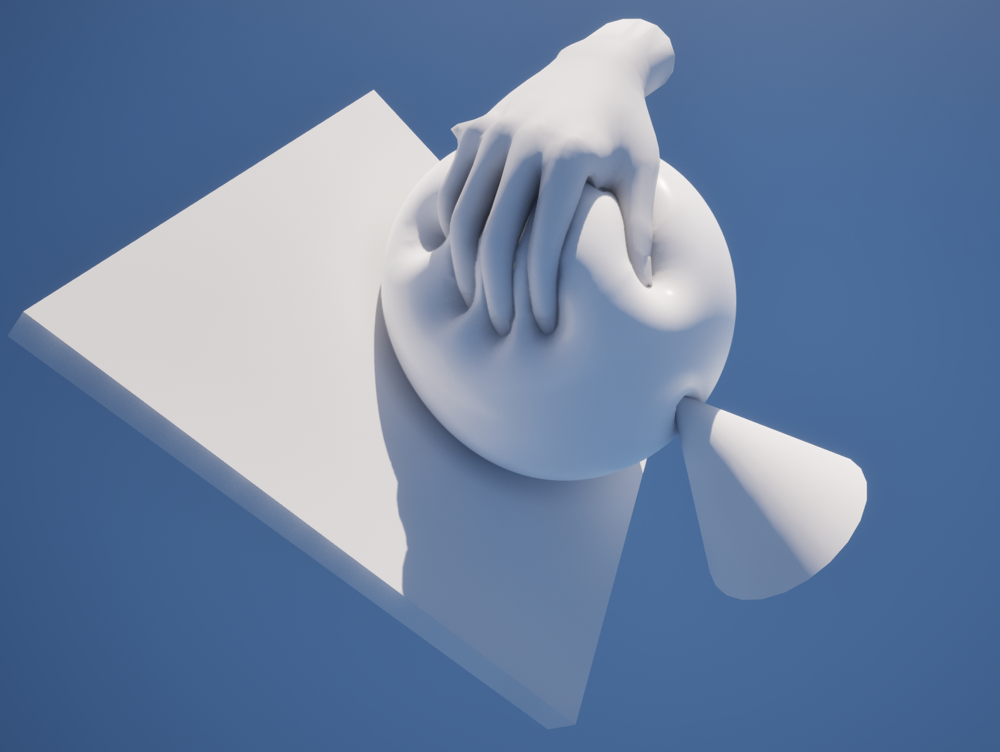

# 접촉

손과 물체가 살을 누르고, 끌고, 떠난 뒤 살이 돌아오는 동작입니다. 설정은 Softbody 컴포넌트의 **Contact** 카테고리에 있고, 기본값과 범위는 [Softbody 컴포넌트](Softbody-Component#contact)에 있습니다.

## 접촉이 하는 일 {#what-contact-does}

- **눌림**: 콜라이더 아래에서 표면이 들어갑니다. 콜라이더가 파고든 만큼 들어가고, 살이 얼마나 단단한지는 깊이를 바꾸지 않습니다.
- **솟음**: 눌린 자리 둘레로 살이 솟습니다. **Contact Detail**이 Full일 때만 있습니다.
- **끌림**: 마찰에 의해 표면이 끌려갑니다. Full일 때만 있습니다.
- **복원과 남는 자국**: 손이 떠나면 표면이 돌아오고, 메모리 폼처럼 자국이 남았다가 옅어지게 할 수 있습니다.
- **덩어리 밀림**: 가슴이나 엉덩이 같은 덩어리가 손에 밀려 통째로 비킵니다([관성](Inertia#lumps)).

접촉은 베이크한 접촉 맵 위에서 계산합니다. 접촉 맵 없이 베이크한 메시는 관성만 동작합니다. [개념](Concepts#dent-bulge-drag-recovery-and-lasting-marks)

## 무엇이 누르나 {#what-presses}

컴포넌트는 매 프레임 메시와 겹치는 콜라이더를 스스로 찾습니다. **Collider Channel**(기본값 Visibility)을 막는 콜리전이면 손, 소품, 바닥, 다른 캐릭터 무엇이든 누릅니다. 단순 콜리전이나 피직스 에셋의 바디로 누르고, [셰이프 필드](Colliders#shape-fields)를 베이크한 메시는 손가락 사이와 손바닥 오목한 곳까지 실제 모양으로 누릅니다. 캐릭터 자신의 손은 **Self Contact**로 누릅니다.

조건, 한도, 찾는 대상의 제한은 [콜라이더](Colliders)에 있습니다.

## 눌린 자리 모양 {#dent-shape}

| 보이는 것 | 정하는 것 |
|---|---|
| 눌린 자리와 솟음의 폭 | 베이크한 살 두께, **Skin Tension**, Full이면 **Flex** 칠 |
| 둘레가 솟는 양 | 베이크 에셋의 **Volume Preservation** × Volume 칠, 플레이 중에는 **Volume Offset**을 더함 |
| 깊이의 한계 | **Max Contact Depth** |
| 콜라이더 가장자리의 벽 | **Edge Smoothing**(Full), 나나이트 테셀레이션 |
| 깊고 좁은 자국의 어둡기 | **Dent Darkening** |
| 끌리는 정도 | **Drag Friction**(Full) |
| 돌아오는 빠르기와 자국 | **Recovery Rate**, **Memory Time**, **Memory Fade Time** |

재료를 바꾸지 않고 눌린 자리만 넓히는 설정은 없습니다. [Flesh Thickness](Preview-and-Simulation#flesh-thickness), [재료 예](Concepts#recipes)

## 조절 {#tuning}

- 넓고 완만하게: 살을 두껍게 하거나(단단한 코어를 옮기거나 Depth 칠), **Skin Tension**을 올리거나, Full에서 겉을 **Flex** 회색으로 칠할 수 있습니다.
- 둘레가 솟지 않게(폼): 베이크 에셋의 **Volume Preservation**을 0으로 두거나 Volume 칠을 어둡게 할 수 있습니다. 플레이 중에는 **Volume Offset**을 사용할 수 있습니다.
- 손끝 자국을 또렷하게: 베이크 에셋의 **Contact Map Resolution**을 올릴 수 있습니다. 밀도가 낮은 메시는 나나이트 테셀레이션도 켤 수 있습니다.
- 둥근 물체가 깊이 누른 자리의 계단: **Edge Smoothing**을 올릴 수 있습니다. 가는 손가락이 파묻혀 보이면 낮출 수 있습니다.
- 표면이 끌리는 정도: **Drag Friction**. 0이면 끌림이 없습니다.
- 자국이 남게(메모리 폼): **Memory Time**을 0보다 크게 두고, 자국이 옅어지는 빠르기는 **Memory Fade Time**으로 정합니다.
- 천천히 돌아오게: **Recovery Rate**를 낮출 수 있습니다.
- 콜리전이 피부보다 안쪽에 있을 때(일반적으로 몸 캡슐): **Max Contact Depth**를 그 간격으로 둘 수 있습니다.
- 덩어리 밀림: [관성의 덩어리](Inertia#lumps)

## 단계와 비용 {#detail-and-cost}

- **Contact Detail**: Basic(기본값)은 눌림과 덩어리 밀림만 계산합니다. 솟음, 끌림, Edge Smoothing, Flex 칠은 Full에서만 동작합니다.
- **Enable Contact**: 끄면 관성만 남고 접촉 비용이 모두 사라집니다.
- **Min Screen Size**: 화면에서 이 값보다 작게 보이는 메시는 눌림 계산을 멈춥니다.
- 아무것도 닿지 않으면 눌린 자리가 돌아온 뒤 접촉이 쉬어 GPU 작업이 멈춥니다([성능](Performance)).

## 눌리지 않을 때 {#when-nothing-dents}

- 누르는 물체가 Collider Channel을 막아야 하고, `SoftbodyIgnore` 태그가 없어야 합니다.
- 눌리는 슬롯이 Softbody 머티리얼을 써야 합니다. 머티리얼을 바꿨다면 **Rebake Contact Map**을 다시 눌러야 합니다.

[문제 해결](Troubleshooting#no-dents-checklist)
