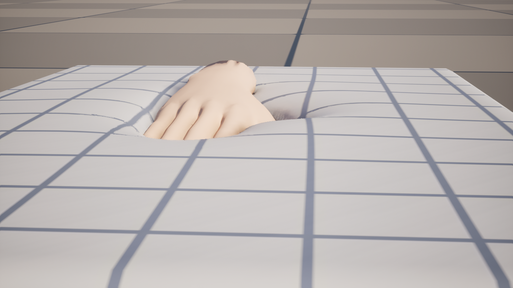
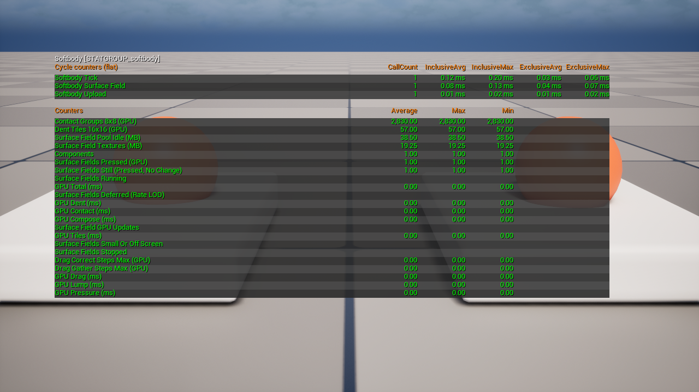

# 작동 원리

설정은 [Softbody 컴포넌트](Softbody-Component)에 있습니다.

베이크는 Softbody 메시마다 **접촉 맵**을 줍니다. 접촉 맵은 피부의 작은 영역마다 칸 하나를 둔 평평한 아틀라스이고, 칸마다 그 칸의 기준 위치, 바깥쪽 노멀, 살 두께, 스킨 웨이트를 담습니다. 게임이 도는 동안 깨어 있는 메시는 접촉 갱신마다 GPU 컴퓨트 패스 여러 개를 차례로 돌립니다(`SoftbodySurfaceField.usf`). 이 패스들이 변위 맵과 노멀 맵을 만들고, 머티리얼은 메시의 접촉 맵 UV 채널로 이 맵들을 읽습니다. 관성은 CPU와 버텍스 셰이더에서 도는 별도의 시스템입니다. [관성](Inertia)

## 세 층 {#three-layers}

| 층 | 내용 |
|---|---|
| 모델 | 누르는 동안 살은 단단한 코어 위에 베이크한 두께만큼 놓인 층으로 움직입니다. 피부를 콜라이더에 붙들어 두는 접촉 압력을 거친 격자에서 풉니다. 그 압력에 대한 살 층의 응답이 눌림과 솟음을 한 번에 그립니다. 콜라이더 바로 옆에서 좁게 꺼지는 몫과, 그 둘레에서 더 넓게 솟는 고리입니다. 모든 폭은 살 두께와 **Skin Tension**에서, 솟는 양은 **Volume Preservation**에서 나옵니다. 폼은 일정한 힘까지만 버팁니다. 그 너머에서는 콜라이더 밑에서 무너지므로 폼의 눌린 자리는 가장자리가 또렷합니다. 고운 눌림과 끌림은 저마다 살 층 방정식 x − ℓ²∇²x = f를 접촉 맵 위에서 풉니다. 눌림은 좁은 폭으로 피부를 콜라이더에 붙든 채, 끌림은 더 넓은 폭으로 풉니다. 시간은 비율 하나로만 들어옵니다. 지난 갱신에서 기억한 것은 모두 e−RΔt배로 줄고, R은 **Recovery Rate**입니다. 눌림은 기억해 둔 눌린 깊이에 피부를 고정한 것이고, 끌림은 기억해 둔 붙든 위치에 당기는 힘을 더한 것입니다. 덩어리(본에 매달린 살 한 덩이 전체)는 누르는 힘과 쥐는 힘이 균형을 이룰 때까지 옆으로 비킵니다. 힘 법칙 하나(**Squeeze Stiffening**)를 누름, 끌림 한도, 덩어리에 함께 씁니다. |
| 눈에 보이는 결함을 막는 규칙 | 눌린 자리의 벽은 칸 격자가 아니라 콜라이더의 가장자리를 따릅니다(나나이트 메시는 벽을 칸 사이에 세우되, 세울 벽이 없는 곳 — 가장자리에서 떠오르는 콜라이더, 두 칸보다 좁은 틈이나 가는 섬 — 에서는 그만큼 서서히 풀어 보통 보간으로 돌아갑니다. Full에서는 **Edge Smoothing**이 벽을 비탈로 다듬습니다). 묻힌 콜라이더는 옆면으로 파고들지 않습니다. 이음매 칸은 UV 이음매 건너편의 칸을 그대로 따라 하고, 아틀라스 이웃 검사가 아틀라스에서는 붙어 있지만 메시에서는 떨어진 칸들을 서로 떼어 놓습니다. 베이크한 표면 거리 한계와 방향 검사가 끌림과 솟음이 주름을 건너거나 다른 신체 부위로 새지 않게 막습니다. 손은 덩어리를 뚫고 지나가지 못합니다. 새로 눌린 칸은 끌림 한 걸음의 절반만 받습니다. 붙음과 미끄러짐은 덩어리 균형 안에서 판정합니다. |
| GPU 파이프라인 | 눌렸거나 아직 돌아오는 중인 8×8 칸 그룹만 계산하므로, 가만히 있는 메시는 비용이 거의 들지 않습니다. 접촉 압력, 끌림, 거친 단계의 눌림은 거친 격자 하나를 함께 씁니다. 접촉 맵은 월드마다 있는 풀에서 가져옵니다. 셰이더는 D3D11 규칙을 따릅니다. 패스마다 쓰기 가능한 출력은 최대 여덟 개이고, 배리어는 균일한 제어 흐름 안에만 둡니다. |

## 접촉 갱신 한 번 {#one-contact-update}

1. **접촉.** 칸마다 스키닝으로 지금 위치를 구하고, 콜라이더마다 파고든 깊이(셰이프, 본, 셰이프 필드 조각, 최대 **Max Contact Depth**까지)와 콜라이더 가장자리까지의 거리를 잽니다.
2. **활동.** "지금 눌림"과 "지난 갱신에서 남음"이 뒤의 모든 패스가 몇 개 그룹에서 돌지를 정합니다. 눌린 것도 남은 것도 없으면 0입니다.
3. **타일.** 풀어야 할 16×16 눌림 타일의 목록입니다. 눌렸거나 아직 눌린 자리가 남은 타일, 그 둘레 한 겹, 이음매 건너편의 짝 타일이 들어갑니다.
4. **덩어리.** 덩어리마다 누르는 힘을 받고, 쥐는 손이 있으면 **Drag Friction**으로 제한되는 스프링 힘이나 미끄러짐 힘도 받아 옆으로 비킵니다. CPU가 그 결과를 읽어 다음 프레임의 콜라이더를 옮깁니다.
5. **접촉 압력.** Contact Detail이 Full일 때만 돕니다. 눌린 칸을 거친 칸으로 모으고, 스레드 그룹 하나가 피부가 콜라이더에 닿도록 그 압력을 풉니다. 갱신마다 0에서 시작하고 상태를 남기지 않습니다. 그다음 살 두께의 약 여섯 배 안에 있는 거친 칸마다 그 압력이 올리는 고리를 더합니다. 거리는 베이크한 표면 거리 한계를 쓰므로 솟음이 주름을 건너거나 다른 신체 부위로 넘어가지 않습니다. 두 칸의 두께가 다르면 얇은 쪽이 응답을 정하므로, 솟음은 뼈 위의 얇은 살을 건너지 않습니다. [Depth](Painting#the-four-channels) 0으로 칠한 곳으로도 퍼지지 않습니다.
6. **눌림.** 먼저 거친 격자에서 풀고, 다음에 고운 타일에서 풉니다. 그래서 넓은 눌림(손바닥, 앉은 자리)도 갱신 한 번에 제 폭까지 퍼집니다. 눌린 깊이 기억은 e−RΔt배로 줄고, 더 깊이 누르면 그 깊이로 바뀝니다. 남는 자국은 **Memory Time**과 **Memory Fade Time**이 맡습니다. 테두리 폭은 칸마다 살 두께, Volume Preservation, Skin Tension에서 나옵니다. Contact Detail이 Basic이면 이 단계만 눌린 자리를 그립니다. 폼은 그대로 무너지고 팽팽한 겉껍질도 테두리를 둥글리지만, 솟는 것은 없습니다.
7. **끌림.** 눌린 칸은 붙든 위치를 콜라이더와 함께 옮기며 당김을 쌓고, 마찰 한도(**Drag Friction**에 누르는 힘을 곱한 값)를 넘으면 미끄러집니다. 그다음 살 칸마다 표면 거리에 따라 당김을 모아 더하고, 주름 건너편의 당김은 가립니다. 당김이 미치는 거리는 살 두께와 Skin Tension에서 나옵니다.
8. **합성.** 변위 맵을 만듭니다. 안쪽 노멀 방향으로 눌림에서 솟는 고리를 빼고, 표면 방향으로 끌림을 더합니다. 솟음은 콜라이더에서 멈추고 살 두께보다 높이 솟지 않습니다. 셰이딩 노멀은 변위된 이웃 칸에서 구한 만큼 돌리므로 노멀 맵이 그대로 남고, **Dent Darkening**도 기록합니다. 어느 곳이든 `softbody.Surface.StillChange`보다 많이 움직였으면 이 갱신에 "바뀜" 표시를 합니다.

머티리얼은 버텍스 셰이더에서 변위를 읽고(바깥 표면에서 5 cm 넘게 떨어진 버텍스는 덜 따라오고 10 cm에서 멈춥니다), 픽셀 셰이더에서 노멀 회전과 어두워짐을 읽습니다. 단계별 GPU 시간은 `stat softbody`의 GPU Contact, Tiles, Dent, Drag, Pressure, Compose, Lump 줄에 나옵니다.

## 갱신 사이 {#between-updates}

CPU에서 접촉이 켜진 Softbody 메시는 다음 상태를 거칩니다.

1. **쉼.** 어떤 콜라이더도 메시에 닿을 수 없습니다(본마다 베이크한 깨우기 상자로 검사합니다). 접촉 맵을 들고 있지 않고, 머티리얼의 접촉 스위치는 꺼져 있습니다.
2. **첫 닿음.** 메시가 월드 풀에서 접촉 맵 한 세트를 가져와 같은 프레임에 갱신합니다. 이 첫 갱신에는 손의 움직임이 보이지 않으므로 끌림을 더하지 않습니다.
3. **깨어 있음.** 메시는 틱마다 갱신을 신청하고, 어느 메시를 돌릴지는 월드가 고릅니다. 화면에 작게 보이는 메시는 몇 프레임에 한 번 돌고, 한 프레임에 최대 `softbody.Surface.UpdateBudget`개가 돌며, 접촉 갱신 빈도 제한이 초당 갱신 수를 묶습니다. 어느 뷰에도 보이지 않거나 **Min Screen Size**보다 작으면 닿을 수 없는 것으로 칩니다. 건너뛴 프레임의 시간은 다음 갱신에서 한 걸음에 풉니다.
4. **멈춤.** 눌려 있지만, 실제로 돈 마지막 갱신 뒤로 콜라이더, 본, 셰이프 필드 조각, 덩어리 목표, 설정이 `softbody.Surface.StillDistance`(0.1 cm)보다 적게 움직였고, 그 갱신에 눌림 표시는 있고 바뀜 표시는 없는 상태입니다. 메시는 갱신 신청을 멈춥니다. GPU 비용은 0이고 시간도 쌓이지 않습니다. 무엇이든 문턱보다 많이 움직이면 그 프레임에 바로 깨어납니다. 뗀 뒤 돌아오는 중인 메시는 멈춤 상태가 되지 않습니다.
5. **콜라이더 떠남.** 실제로 돈 갱신은 자기가 마친 복원만큼을 안정 카운터에 더합니다. 틱 수가 아니라 한 일만큼 세므로, 갱신 예산 때문에 건너뛴 메시가 일찍 비워지지 않습니다. 화면에 없는 메시는 틱으로 셉니다.
6. **복원 끝.** 카운터가 1에 닿으면 맵을 비워 풀에 돌려주고 접촉 스위치를 끕니다. 1번 상태로 돌아갑니다.

컴포넌트를 끄면(Deactivate 또는 Set Active false) 어느 상태에서든 바로 1번 상태로 가고 관성을 비웁니다. 켜면 속도 기록 없이 정지 상태에서 시작합니다.

