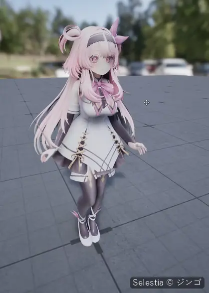
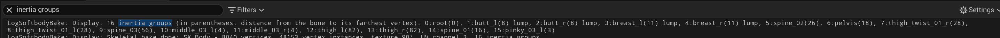

# 관성

설정은 Softbody 컴포넌트의 **Inertia** 카테고리에 있습니다. 기본값과 범위는 [Softbody 컴포넌트](Softbody-Component)에 있습니다.

## 살이 움직이는 곳 {#where-the-flesh-moves}

부위마다 얼마나 움직일지는 베이크에서 정해집니다. 본에서 먼 무른 살(**Jiggle** 칠에서 흰 곳)이 가장 많이 움직이고, 단단한 곳, 본에 가까운 곳, 어둡게 칠한 곳은 덜 움직이며, 단단한 코어는 움직이지 않습니다. 배나 덩어리 살은 전체가 한 조각으로 흔들리고, 밑동 쪽으로 갈수록 부드럽게 잦아듭니다.

플레이는 가만히 있는 상태에서 시작합니다. 첫 프레임에 살은 지금 포즈의 처짐을 떨어지는 과정 없이 그대로 받습니다.

컴포넌트 설정에 앞서 다음이 관성을 정합니다.

- **Bone Thickness**(베이크): 클수록 살이 얇아져 관성에 덜 반응합니다. 본마다 **Bone Overrides**에서 정할 수 있습니다.
- **Jiggle** 칠: 살의 굳기입니다. 단단한 살은 회색으로 칠할 수 있습니다. 검은색은 뼈만큼 단단한 살로, 관성은 없지만 눌리기는 합니다. 뼈 자체는 **Depth**에 칠합니다([페인트](Painting)).
- **Flesh Reach**(베이크): 두꺼운 살의 관성이 두께가 아니라 칠에 따르게 합니다.
- **Physics Driven Bones**: 다른 시스템(KawaiiPhysics 노드, 시뮬레이션하는 피직스 바디)이 이미 움직이는 본에 스키닝된 살에는 Softbody 관성을 적용하지 않습니다.

칠과 Flesh Reach는 **Run Bake**로, Physics Driven Bones는 **Reapply Paint**로 적용됩니다.

## 관성 그룹 {#inertia-groups}

베이크는 스켈레탈 메시의 관성 그룹을 스킨 웨이트에서 고르며, **Max Inertia Groups**(기본값 16, 최댓값도 16)까지 만듭니다.

1. 루트 본은 늘 그룹 0입니다.
2. 그다음은 Bone Overrides에서 **Lump**로 둔 체인마다 맨 위 본입니다. 버텍스 수와 상관없이 그룹을 받고, 그 아래의 덩어리 본은 이 그룹에 들어갑니다. 이것이 덩어리 그룹입니다. **Accessory**로 둔 본은 제 그룹을 받지 않고, 그 버텍스는 위쪽 그룹을 따릅니다.
3. 남은 그룹은 Softbody 머티리얼이 붙은 슬롯에서 버텍스를 가장 많이 가진 본에 돌아갑니다. 머리카락이나 치마처럼 다른 슬롯만 움직이는 본은 그룹을 받지 않습니다.
4. 나머지 본은 부모 체인을 따라 올라가며 처음 만나는 그룹 본의 그룹에 들어갑니다.

베이크 로그에 결과가 나오고(`N inertia groups (in parentheses: distance from the bone to its farthest vertex): ...`), 덩어리 그룹마다 뒤에 `lump`가 붙습니다.

## 조절 {#tuning}

**Inertia Amount**는 Jiggle을 흰색으로 칠한 두꺼운 살이 1 g에서 처지는 거리입니다. 부위마다 제 처짐에 맞는 빠르기로 흔들리므로 Inertia Amount가 클수록 크고 느리게 흔들립니다.

- 리듬만: **Jiggle Speed**. 크기는 그대로 두고 더 빠르게, 느리게 흔들리게 합니다.
- 크기만: **Actor Motion Weight**와 **Animation Motion Weight**. 같은 빠르기에서 더 크게 출렁이게 합니다.
- 튀는 횟수: **Inertia Damping**. 0.25면 두 번쯤, 0.4면 한 번쯤 튀고 멈춥니다.
- 몸을 따라 덩어리만 움직이게: 스켈레톤에 붙은 부위는 처지지 않습니다. 나머지 부위의 출렁임은 오버라이드나 **Jiggle** 칠로 낮출 수 있습니다.
- 한 부위를 처지게: **Inertia Group Overrides**에서 그 부위에 Gravity Scale을 줄 수 있습니다.
- 더 튀고 덜 흔들리게: **Inertia Direction Scale**에서 Z를 올리고 옆 축(메시가 보는 방향에 따라 X나 Y)을 낮출 수 있습니다.

### 한 부위만 {#one-body-part}

**Inertia Group Overrides**에 항목을 추가하고 본을 고릅니다. 드롭다운에는 베이크가 찾은 그룹만 나옵니다. 목록에 없는 본은 다른 그룹에 속해 있거나, **Max Inertia Groups**를 올리고 다시 베이크해야 합니다.

부위마다 관성을 다르게 줄 수 있습니다. **Amount Scale** 0이면 그 부위는 출렁이지 않습니다.

## 덩어리 {#lumps}

**Lump Yield**, **Lump Grip**, **Squeeze Stiffening**(Inertia > Lumps)은 누르는 손이 덩어리를 미는 정도입니다. 스켈레탈 메시에서 본을 **Lump**로 둔 뒤 베이크해야 하고, **Enable Contact**와 **Enable Inertia**가 켜져 있고 Inertia Amount가 0보다 커야 합니다. 스태틱 메시에는 덩어리가 없습니다.

## 아무것도 출렁이지 않을 때 {#when-nothing-jiggles}

- 덩어리가 통째로 움직이지 않고, 접촉 맵 로그에 `Lumps: skipped, no bone has the Lump role in Bone Overrides` 또는 `Lumps: skipped, the baked data has no flesh softness for inertia`가 나오면: 본을 **Lump**로 둔 뒤 **Run Bake**를 눌러야 합니다.
- `Inertia groups: the mesh has no skin weights, so no inertia groups are made.`: 측정 베이크에는 메시 안에 스킨 웨이트가 있는 본이 필요하므로, 그런 본이 없으면 아무것도 출렁이지 않습니다.
- KawaiiPhysics나 물리로 움직이는 본의 살이 출렁이지 않으면: **Physics Driven Bones** 때문입니다. Softbody가 움직여야 한다면 그 본을 목록에서 빼고 **Reapply Paint**를 눌러야 합니다.

[문제 해결](Troubleshooting)
