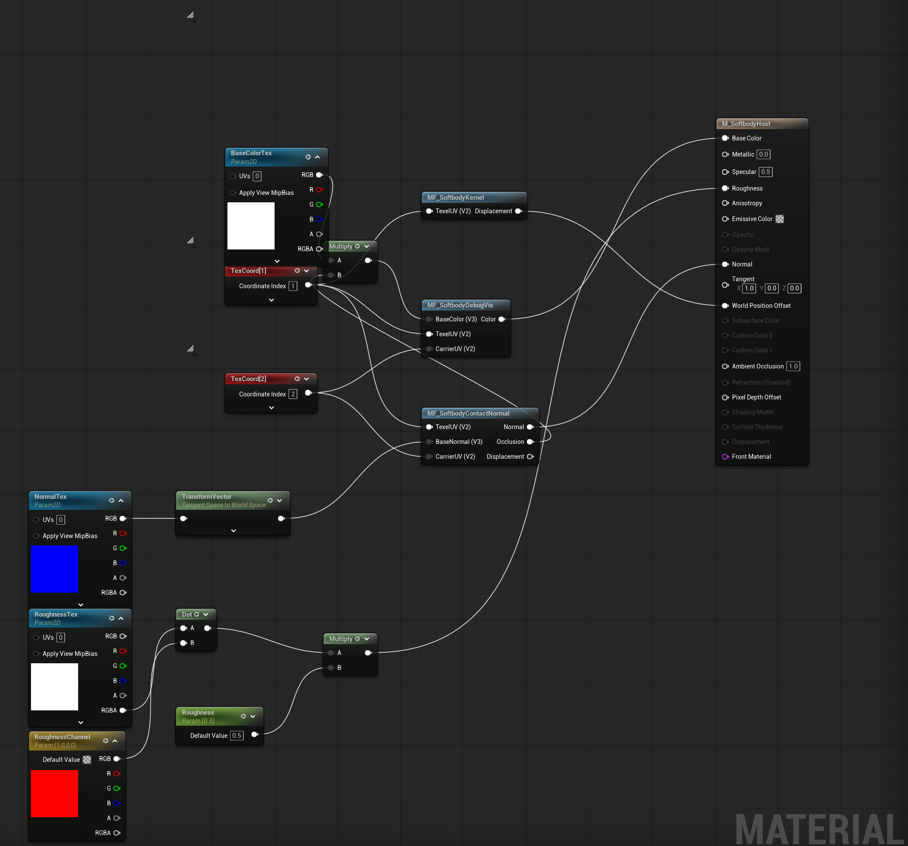
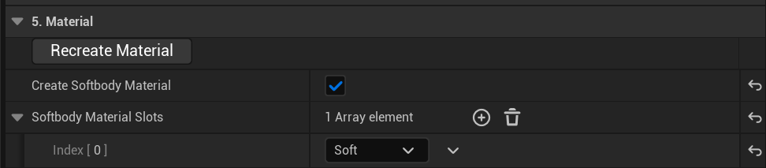
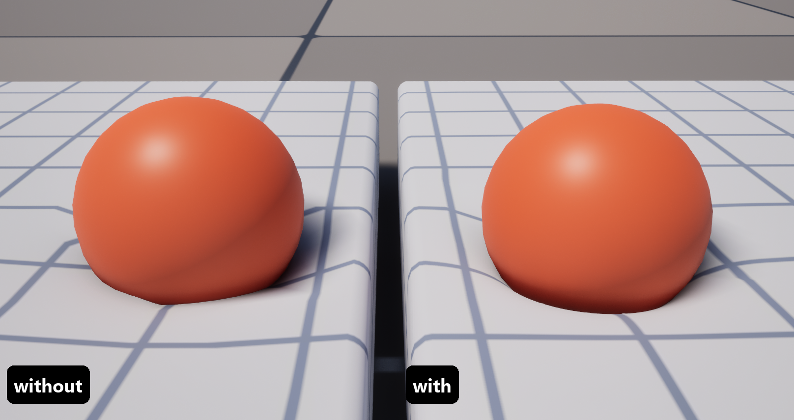
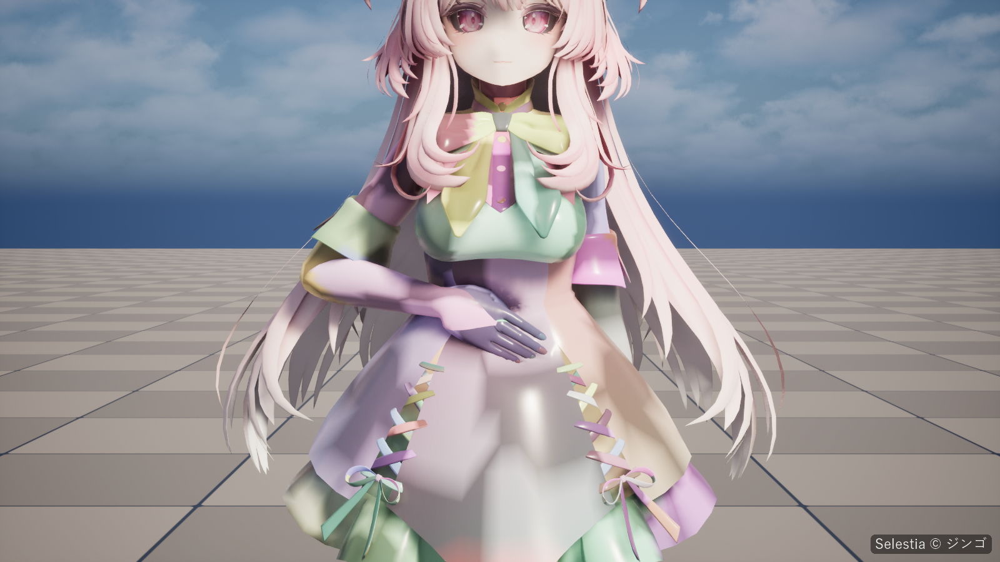

# 머티리얼

슬롯은 머티리얼에 플러그인의 Softbody 머티리얼 함수가 들어 있을 때만 변형됩니다([Softbody 슬롯](Concepts#softbody-slots)). 머티리얼을 베이크가 만들게 하거나, 마스터 머티리얼에 함수를 추가합니다.

## 세 머티리얼 함수 {#the-three-material-functions}

플러그인의 Content 폴더(`/SoftbodySystem`)에는 머티리얼 함수 셋과, 이들을 연결해 둔 예제 머티리얼 `M_SoftbodyHost`가 있습니다. 예제를 복제하거나 연결을 그대로 따라 만듭니다.

| 함수 | 입력 | 출력 | 연결할 곳 |
|---|---|---|---|
| `MF_SoftbodyKernel` | `TexelUV` | `Displacement` | **World Position Offset**(필수). 눌림, 솟음, 끌림, 출렁임으로 버텍스를 움직입니다. |
| [`MF_SoftbodyContactNormal`](#mf-softbodycontactnormal) | `TexelUV`, `CarrierUV`, `BaseNormal` | `Normal`, `Occlusion`, `Displacement` | `Normal`은 **Normal**에, `Occlusion`은 베이스 컬러에 곱하고, `Displacement`는 **Displacement** 핀에 연결합니다. |
| `MF_SoftbodyDebugVis` | `TexelUV`, `CarrierUV`, `BaseColor` | `Color` | **Base Color**. 내 베이스 컬러를 그대로 넘기고, Debug View를 켜면 디버그 색을 보여 줍니다. |

### MF_SoftbodyContactNormal {#mf-softbodycontactnormal}

- `BaseNormal`: 월드 스페이스 노멀입니다. 연결하지 않으면 버텍스 노멀을 씁니다.
- `Normal`: **Normal**에 연결합니다(월드 스페이스).
- `Occlusion`: 베이스 컬러에 곱합니다. 이것이 **Dent Darkening**이며, 1이면 그대로입니다.
- `Displacement`: **Displacement** 핀에 연결합니다. Set Up Nanite Tessellation이 연결해 줍니다.

### 입력과 파라미터 {#inputs-and-parameters}

`TexelUV`는 베이크가 버텍스별 데이터용으로 추가한 UV 채널(Baked Data 에셋의 **Texel UVChannel**)에 맞춘 Texture Coordinate 노드입니다. `CarrierUV`는 접촉 맵의 UV 채널(**Carrier UVChannel**)에 맞춘 Texture Coordinate 노드입니다.

플레이할 때 머티리얼에 `MF_SoftbodyKernel`이 든 슬롯마다 다이내믹 인스턴스가 만들어지고, 컴포넌트가 함수의 파라미터를 채웁니다. 

## 베이크로 머티리얼 만들기 {#let-the-bake-make-the-material}

1. Softbody Authoring Data 에셋의 **5. Material** 카테고리에서 **Create Softbody Material**을 켜고, 변형할 슬롯을 **Softbody Material Slots**에 넣습니다. 피부와 몸에 붙는 옷은 넣고, 얼굴이나 머리카락은 넣지 않습니다.
2. **Run Bake**를 누릅니다. 베이크는 접촉 맵보다 머티리얼을 먼저 만들므로, 접촉 맵은 처음부터 머티리얼에 연결되어 있습니다.
3. 출력 로그의 `slot '<slot>' now uses MI_<mesh>_<slot> ... Copied: ...` 줄에 복사한 텍스처가 나옵니다. `(not found)`로 나온 것은 인스턴스에서 직접 지정합니다: **BaseColorTex**, **NormalTex**, **RoughnessTex**.

베이크는 **Output Folder**에 `M_<mesh>_Softbody`(예제 머티리얼의 복사본으로, `TexelUV` 노드를 이 메시의 Texel UVChannel에 맞춘 것)와, 넣은 슬롯마다 인스턴스 `MI_<mesh>_<slot>`를 하나씩 만듭니다. 이미 있으면 있는 것을 씁니다. 이미 Softbody 머티리얼이 있는 슬롯은 그대로 둡니다.

슬롯의 원래 머티리얼에서는 아래 텍스처 셋만 가져옵니다. 그래프, 파라미터 값, 셰이딩 모델 같은 설정은 옮기지 않으므로 원래 룩을 지키려면 [내 마스터 머티리얼 쓰기](#use-your-own-master-material)를 따릅니다.

- 베이스 컬러: 이름에 `BaseColor`, `Albedo`, `Diffuse`, `_Col`, `_BC` 중 하나가 들어 있거나 `_D`로 끝나는 텍스처. 없으면 노멀 맵이 아닌 첫 sRGB 텍스처.
- 노멀 맵: 압축 설정이 노멀 맵인 첫 텍스처. 없으면 인스턴스는 엔진의 평평한 노멀을 그대로 씁니다.
- 러프니스: 이름에 `ORM`, `ARM`, `OcclusionRoughnessMetallic` 중 하나가 들어 있거나(초록 채널), `Rough`가 들어 있거나 `_R`로 끝나는(빨강 채널) sRGB가 아닌 텍스처. 찾으면 인스턴스에 **RoughnessTex**, **RoughnessChannel**, **Roughness** = 1을 설정합니다. 못 찾으면 로그에 `(not found, 0.5)`가 나오고 러프니스는 예제의 기본값 0.5로 남습니다.

**Recreate Material**(같은 카테고리)은 Softbody 머티리얼을 다시 만들어 지정합니다. Softbody Material Slots를 바꾼 뒤나 슬롯의 머티리얼을 갈아 끼운 뒤에 씁니다.

## 머티리얼을 바꾼 뒤: Rebake Contact Map {#after-changing-the-material-rebake-contact-map}

베이크 뒤에 메시에 Softbody 머티리얼을 연결하거나 바꿀 때마다 **Rebake Contact Map**(6. Contact Map 카테고리)을 누릅니다. 이 버튼은 슬롯마다 베이스 머티리얼의 `CarrierUV` 입력에 접촉 맵의 UV 채널을 연결하고(`Contact map UV channel`이라는 Texture Coordinate 노드로), **Pressable Slots**가 비어 있으면 접촉 맵을 Softbody 머티리얼을 쓰는 슬롯으로 한정합니다. 스켈레탈 메시에서 Softbody 머티리얼을 쓰는 슬롯이 늘거나 줄었다면 **Run Bake**를 누릅니다. 코어와 관성 그룹이 그 슬롯을 기준으로 정해지기 때문입니다.

UV 채널 번호는 인스턴스가 아니라 베이스 머티리얼의 그래프에 들어 있습니다. 다른 채널로 베이크한 다른 Softbody 메시가 같은 베이스 머티리얼을 쓰면, 베이크는 머티리얼을 바꾸지 않고 로그에 오류를 남깁니다. 이 메시에 머티리얼 복사본을 따로 주고(또는 Create Softbody Material을 켜고) 다시 베이크합니다.

## 내 마스터 머티리얼 쓰기 {#use-your-own-master-material}

1. 마스터 머티리얼에서 **Tangent Space Normal**을 끕니다. `MF_SoftbodyContactNormal`은 월드 스페이스 노멀을 내보냅니다.
2. 메시의 **Texel UVChannel**(Baked Data 에셋에 나옴)에 맞춘 Texture Coordinate 노드를 추가합니다. 이 노드를 `TexelUV`라 부릅니다.
3. `MF_SoftbodyKernel`을 추가하고 `TexelUV`를 연결한 뒤, `Displacement` 출력을 **World Position Offset**에 연결합니다. 이미 World Position Offset이 있으면 둘을 더합니다.
4. `MF_SoftbodyContactNormal`을 추가하고 `TexelUV`를 연결합니다. 내 노멀을 월드 스페이스로 변환해 `BaseNormal`에 연결합니다. 함수의 `Normal` 출력은 **Normal**에 연결합니다.
5. 베이스 컬러에 함수의 `Occlusion` 출력을 곱합니다.
6. `MF_SoftbodyDebugVis`를 추가하고 `TexelUV`를 연결한 뒤, 어둡게 한 베이스 컬러를 `BaseColor`에 넣고 `Color`를 **Base Color**에 연결합니다.
7. `CarrierUV` 입력은 연결하지 않고 둡니다. 머티리얼(또는 그 인스턴스)을 슬롯에 넣고 **Rebake Contact Map**을 누릅니다. 스켈레탈 메시는 대신 **Run Bake**를 누릅니다. 그래야 코어와 관성 그룹이 Softbody 머티리얼이 붙은 슬롯을 기준으로 다시 정해집니다.
8. **Create Softbody Material**은 끈 채로 둡니다.

베이크는 엔진 콘텐츠의 머티리얼을 바꿀 수 없습니다. 먼저 프로젝트의 Content 폴더로 복제하세요.

## 나나이트 테셀레이션 {#nanite-tessellation}

**8. Nanite Tessellation** 카테고리는 메시를 나나이트 테셀레이션으로 그리도록 설정해, 손가락 끝처럼 삼각형보다 좁은 눌림도 보이게 합니다. 이 카테고리의 설정은 [베이크](Baking)에 있습니다. **Reapply Nanite Tessellation**은 설정을 다시 적용합니다. 범위 설정을 바꾼 뒤나 새 Softbody 머티리얼을 지정한 뒤에 누릅니다.

바꾸는 것:

- 메시: 나나이트를 켜고, UV 보간(Lerp UVs)을 끄고, Max Edge Length Factor가 0이면 4로 두고, 나나이트 데이터를 빌드합니다. Max Edge Length Factor가 없으면 UV 보간을 끈 메시는 평평한 면을 가까이서도 크게 줄여 그려 무늬 텍스처가 톱니처럼 어긋납니다.
- 모든 슬롯 머티리얼: 나나이트 사용 플래그(스켈레탈 대상이면 Used with Skeletal Mesh도).
- Softbody 함수가 든 슬롯 머티리얼: `MF_SoftbodyContactNormal`의 `Displacement` 출력을 **Displacement** 핀에 연결하고, 테셀레이션을 켜고, Displacement Scaling Magnitude와 Center, Max World Position Offset Displacement를 세 범위 설정에서 정합니다.

이 기능에는 Softbody 머티리얼을 이미 쓰는 슬롯이 있어야 하고, 반투명 슬롯이 없어야 하며, Texel UVChannel이 UV0~UV3 안에 있어야 합니다. 나나이트는 채널을 넷만 읽기 때문입니다(그렇지 않으면 메시에서 쓰지 않는 UV 채널을 지우고 Run Bake를 다시 누릅니다). 나나이트 스키닝은 모프 타깃을 무시합니다. 스켈레탈 메시라면 프로젝트의 DefaultEngine.ini에서 `[SystemSettings]` 아래에 `r.Nanite.DicingRate=4` 이상을 설정합니다. 4보다 낮으면 스킨드 메시가 가까이서 조각조각 깨집니다. 메시 종류와 상관없이 카메라를 아주 가까이 대면 구멍이 날 수 있습니다([알려진 제한](Known-Limitations#nanite-tessellation)). 출력 로그는 이 하나하나를 경고하고, 틈이 벌어질 수 있는 하드 노멀도 경고합니다. [문제 해결](Troubleshooting)을 보세요.

## Debug View {#debug-view}

**Debug View**(Softbody 컴포넌트의 Debug 카테고리)는 셰이딩을 `MF_SoftbodyDebugVis`가 그리는 디버그 색으로 바꿉니다. 모드 목록은 [Softbody 컴포넌트](Softbody-Component)의 **Debug View Mode**에 있습니다. 머티리얼에 `MF_SoftbodyDebugVis`가 없는 슬롯은 어느 모드에서나 평소 셰이딩 그대로입니다. 베이크 에셋의 Preview는 플레이하지 않고도 마지막 베이크 결과를 같은 색으로 보여 줍니다([Last Bake 보기](Preview-and-Simulation#last-bake)).

