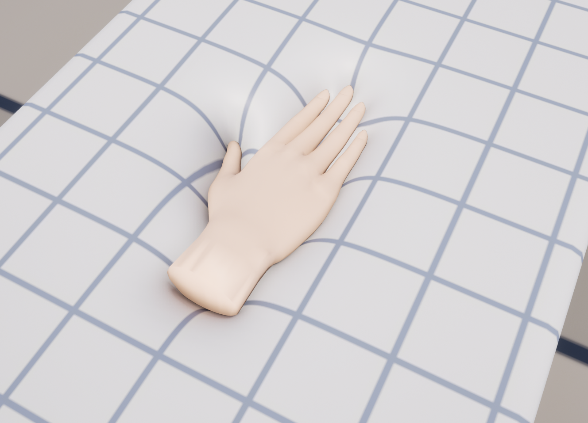

# 개요

MallangPhysics는 Unreal Engine 5.6~5.8에서 스켈레탈 메시와 스태틱 메시를 말랑하게 만듭니다. 손과 물체가 누른 자리는 들어가고 둘레의 살은 솟으며, 움직이는 손은 피부를 끌고 가고, 몸이 움직이면 살이 출렁입니다. 에디터에서 메시를 한 번 베이크하고 컴포넌트 하나를 붙이면, 변형은 GPU에서 계산됩니다.

## 에디터 속 이름 {#names-in-the-editor}

에디터 안의 컴포넌트와 에셋 이름은 작업 이름(Softbody)을 그대로 씁니다. 이 문서의 메뉴와 설정 이름은 영어 에디터 기준입니다.

| | 에디터에서의 이름 |
|---|---|
| 플러그인 | **MallangPhysics** |
| 컴포넌트 | **Softbody** |
| 베이크 에셋 | **Softbody Authoring Data** |
| 프로젝트 세팅 | Project Settings > Plugins > **Softbody** |

## 상태 {#status}

버전 1.0.0입니다. Windows의 Unreal Engine 5.6, 5.7, 5.8을 지원합니다. 화면 확인은 대부분 5.8의 D3D12와 D3D11에서 했습니다. [알려진 제한](Known-Limitations)
