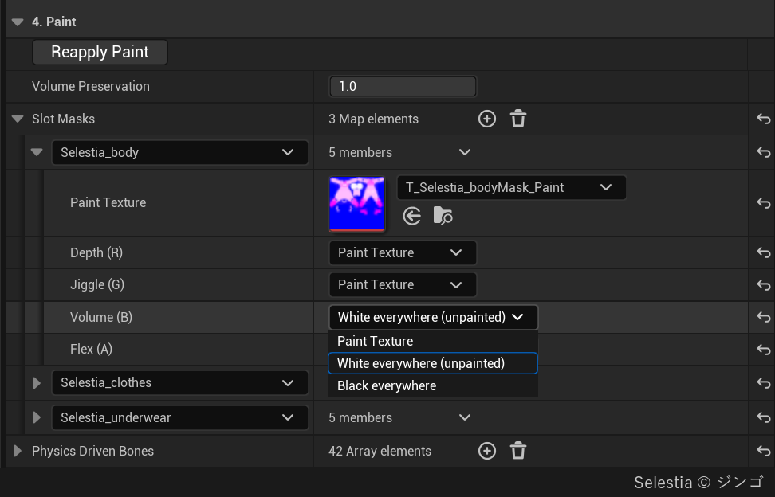

# 페인트

슬롯 페인트는 메시의 자리마다 재료가 어떻게 다른지 베이크에 알려 줍니다. 머티리얼 슬롯마다 RGBA 텍스처 한 장을 그 슬롯의 UV0 레이아웃에 맞춰 칠하고, 네 채널에 재료의 성질을 하나씩 담습니다. 흰색은 어느 채널이든 "칠 안 함"입니다. 칠하지 않은 메시는 어디나 흰색으로 칩니다.

## 네 채널 {#the-four-channels}

**Slot Masks**(카테고리 4. Paint)의 항목마다 **Paint Texture** 하나와 채널 넷이 있습니다. 채널 자리는 정해져 있습니다.

| 채널 | 칠한 밝기 | 쓰는 곳 |
|---|---|---|
| Depth (R) | 살이 눌릴 수 있는 깊이로, 흰색에 가까울수록 깊이 눌릴 수 있고 검은색에 가까울수록 살 두께가 얇아집니다. | 갈비뼈, 정강이, 머리처럼 스켈레톤의 본보다 뼈가 피부에 가까운 곳. 뼈는 이 채널에만 칠합니다. |
| Jiggle (G) | 관성에 반응하는 강도를 칠합니다. 높을수록 관성에 민감합니다. | 근육 위의 배와 무른 뱃살처럼 부위마다 굳기가 다른 살 |
| Volume (B) | 눌렸을 때 부피가 보존되는 정도, 값이 클수록 눌린 만큼 주변이 솟아오릅니다. | 폼 받침 위의 젤리 장난감처럼 일부만 다른 재료 |
| Flex (A) | 소재의 뻣뻣한 정도, 흰색이면 자유롭게 휘고 검은 색이면 강체가 됩니다. | 가죽, 몸에 붙는 슈트, 금속판, 보석, 버클, 말랑한 주사위의 눈 |

채널마다 읽는 곳을 고릅니다. **Paint Texture**(기본값)는 그 채널을 텍스처에서 읽고, <strong>White everywhere (unpainted)</strong>와 **Black everywhere**는 텍스처 없이 슬롯 전체를 한 값으로 둡니다. Paint Texture를 골랐는데 슬롯에 텍스처가 없으면 흰색입니다.

- Volume (B)는 저작 에셋의 **Volume Preservation**(4. Paint) 값에 곱합니다. 그 값이 0이면 Volume을 칠해도 효과가 없습니다.
- Flex는 **Contact Detail**이 Full일 때만 듣습니다. Basic이면 Flex를 칠한 자리도 맨살처럼 눌리고, 플레이를 시작할 때 출력 로그에 알립니다.
- 겉 전체가 같은 팽팽한 겉껍질이면 칠 대신 Softbody 컴포넌트의 **Skin Tension**을 씁니다. 겉의 일부만 뻣뻣하면 Flex를 칠합니다.
- 플레이 중에는 Softbody 컴포넌트의 **Volume Offset**과 **Flex Offset**으로 칠 위에 값을 더해 맞춰 봅니다([Softbody 컴포넌트](Softbody-Component#contact-flesh)).

네 채널은 모두 베이크가 살을 잴 때 읽으므로 **Run Bake**로 적용됩니다. **Reapply Paint**는 살을 잰 뒤에 칠이 바뀌었으면 Run Bake를 대신 돌립니다. 에셋에 Baked Data가 생긴 뒤에 Paint Texture를 다시 임포트하면 알림이 뜨고, 알림의 버튼(**Run Bake** 또는 **Reapply Paint**)이 새 칠을 적용합니다.

## 텍스처 만들기 {#making-the-paint-texture}

1. 텍스처는 **sRGB**를 끄고 임포트합니다. sRGB가 켜져 있으면 회색이 어둡게 읽힙니다(0.5가 0.21로). 
2. **Slot Masks**에 항목을 추가하고 키로 머티리얼 슬롯을 고릅니다.
3. **Paint Texture**를 지정합니다. 칠하지 않은 채널은 <strong>White everywhere (unpainted)</strong>로 둡니다.
4. 베이크 에셋 창 Preview의 [Paint (Current Slot Masks)](Preview-and-Simulation#paint-views) 보기로 베이크 전에 칠을 확인합니다.
5. **Run Bake**를 누릅니다.

텍스처를 읽는 방식은 다음과 같습니다.

- 페인트는 버텍스마다 한 번, 그 버텍스의 UV0 자리에서 읽습니다. 버텍스 간격보다 잘은 디테일은 보이지 않습니다. UV 아일랜드 바깥으로 칠을 번지게 해 둡니다.
- 알파 채널이 없는 텍스처는 Flex가 흰색(맨살)입니다.
- Flex를 알파에 담은 PNG는 임포트할 때 완전히 투명한 픽셀의 색이 이웃 픽셀 색으로 바뀌어, 판 위의 Depth, Jiggle, Volume이 달라질 수 있습니다. TGA로 내보내거나, Project Settings > Texture Import의 **PNG Infill**을 Never로 두고 다시 임포트합니다.
- 한 채널이 텍스처 전체에서 검은색이면 슬롯 전체가 뼈(Depth), 뼈만큼 단단한 살(Jiggle), 폼(Volume), 판 하나(Flex)가 됩니다. 그 채널을 쓰지 않는다면 White everywhere로 둡니다. 
- 임포트한 이미지처럼 텍스처에 소스 데이터가 남아 있어야 합니다. 픽셀을 읽지 못한 슬롯은 흰색으로 남고 경고가 나옵니다.
- 키가 Target Mesh의 머티리얼 슬롯이 아닌 항목은 경고를 남기고 건너뜁니다. 항목이 없는 슬롯은 칠하지 않은 것으로 칩니다.
- 피부에서 **Layer Max Gap**(2. Bake) 안에 붙은 옷은 Depth, Jiggle, Volume을 그 아래 살에서 가져옵니다. Flex만 옷 슬롯 자신의 칠을 읽습니다. 그래서 옷 위의 버클은 옷 슬롯의 Flex에 칠합니다.

## 판 {#plates}

Flex를 흰색보다 어둡게 칠한 이어진 자리 하나가 조각 하나입니다. 조각마다 다음 중 하나가 됩니다.

- **강체 판:** 휘지 않고 통째로 가라앉고 기울며 밑의 살을 밉니다. 검은색으로 칠한 조각은 크기와 상관없이 판입니다. 회색이어도 조각이 작으면 판이 됩니다. 칠한 뻣뻣함에 비해 조각이 작으면 질긴 가죽에 박힌 동전처럼 한 몸으로 움직이기 때문입니다.
- **휘는 조각:** 그 밖의 회색 조각은 칠대로 휩니다.

Flex Offset을 낮추면 판이 되는 조각이 늘고, -1이면 칠한 조각이 모두 판이 됩니다. 몸에 붙지 않은 따로 된 부품(보석처럼 표면에 얹힌 것)은 늘 판이며, 밑의 살에 얹혀 움직입니다.

- Depth 0과는 다릅니다. Depth 0인 곳은 제자리에 있고, 판은 밑의 살 위에서 움직입니다.
- 손가락으로 눌러도 모양을 지키는 부분만 검은색으로 칠합니다. 천으로 된 리본, 끈, 밴드는 회색으로 칠하거나 칠하지 않습니다. 피직스 본에 매달린 부분은 그 피직스로 움직입니다.

Preview의 [Plates](Preview-and-Simulation#plates-view) 보기가 마지막 베이크에서 조각마다 판이 되었는지, 되지 못했으면 왜인지 색으로 보여 줍니다. 출력 로그에는 조각마다 까닭이 적힙니다.

| 색 | 까닭 | 판으로 만들려면 |
|---|---|---|
| 빨강 | 몸을 둘러 감김(목을 두른 고리, 허벅지를 두른 밴드) | 칠에 가는 흰 틈을 두어 평평한 조각으로 나눕니다. |
| 흰색 | 밑에 누를 겉면이 없음 | — |
| 주황 | 조각이 너무 큼 | 가는 흰 틈을 두어 작은 조각으로 나눠 칠합니다. |
| 보라 | 접촉 맵의 가장자리에 걸림 | 다른 **Contact Map Resolution**으로 다시 굽습니다. |

## 출렁임 크기 {#how-much-it-jiggles}

Jiggle은 부위 사이의 차이를 정하고, 전체 크기는 Softbody 컴포넌트의 **Inertia Amount**가 정합니다. 베이크는 Jiggle을 흰색으로 칠한 3 cm보다 두꺼운 살(기준 살)이 1 g에서 정확히 Inertia Amount만큼 처지도록 출렁임의 눈금을 맞춥니다. 그래서 같은 Inertia Amount는 어느 메시에서나 같은 살입니다. 더 단단하거나 얇은 부위는 그보다 덜 움직입니다.

**Flesh Reach**(3. Rigid Core (Bones))가 0이면 깊은 살일수록 많이 출렁여서, 뼈 없는 배가 같은 밝기로 칠한 다른 부위보다 훨씬 더 출렁입니다. 사람 크기의 몸은 약 3으로 둡니다([베이크](Baking#_3-rigid-core-bones)). 베이크는 다음 두 경우에 경고합니다.

- Softbody 슬롯의 살이 거의 움직이지 않을 때: 무른 살 위의 Depth나 Jiggle이 검은색이 아닌지 확인합니다.
- 가장 깊은 살이 기준 살보다 몇 배 더 움직일 때: Flesh Reach를 약 3으로 정하고 Run Bake를 누릅니다.

## Physics Driven Bones {#physics-driven-bones}

**Physics Driven Bones**(4. Paint)에는 KawaiiPhysics 노드나 시뮬레이션하는 피직스 바디처럼, 다른 시스템이 이미 움직이는 본을 넣습니다. 그 본과 그 아래 본에 스킨된 살은 스킨 웨이트만큼 Softbody 출렁임을 잃습니다. 목록의 본에 웨이트가 절반 걸린 버텍스는 출렁임의 절반을 잃습니다. 이 처리는 위의 눈금 맞춤 뒤에 일어나므로, 지글 본을 넣어도 몸의 나머지가 더 출렁이지 않습니다.

- **Reapply Paint**만으로 적용됩니다(Run Bake가 필요 없습니다).
- 스켈레탈 메시의 LOD0 스킨 웨이트를 CPU에서 읽어야 합니다(Allow CPU Access for LOD0). 읽지 못하면 건너뛰고 출력 로그에 알립니다.

## 작업 순서와 예 {#workflow-and-examples}

페인트 없이 시작합니다. Run Bake를 누르고, 플레이에서 메시를 눌러 보고, 이상해 보이는 곳만 칠합니다.

- **캐릭터.** 손, 발, 머리처럼 뼈가 피부 가까이 있는 곳을 Depth에서 어둡게 칠합니다. 손이 **Self Contact**로 몸을 누른다면 손의 Depth를 0에 가깝게 칠합니다. 근육 위의 배와 허벅지처럼 단단한 살은 Jiggle을 회색으로 칠합니다. 갈비뼈 본이나 골반 본이 없는 스켈레톤은 몸통 전체를 척추에 매달린 두꺼운 살로 다루고, 여기에는 **Bone Thickness**도 도움이 되지 않습니다. 그 부위를 Depth에서 어둡게 칠하고, Flesh Reach를 약 3으로 정한 뒤 Run Bake를 누릅니다.
- **옷과 장식 슬롯.** 몸에 쓰는 규칙으로 Depth를 칠하지 않습니다. 옷이나 장식의 Depth를 0으로 칠하면 그 부분이 뼈가 됩니다. 이런 슬롯은 항목을 두지 않거나 White everywhere로 두고, 버클과 보석만 Flex를 검은색으로 칠합니다.
- **몸에 붙는 슈트나 레깅스.** 칠할 것이 없습니다. 옷 버텍스는 아래 살의 Depth, Jiggle, Volume을 그대로 받습니다.
- **폼 블록이나 스펀지.** 칠할 것이 없습니다. **Volume Preservation**(4. Paint)을 0으로 둡니다.
- **메시 일부만 다른 재료**(폼 받침 위의 젤리 장난감, 반으로 자른 달걀의 노른자와 흰자). 폼 쪽 슬롯의 Volume (B)를 Black everywhere로 둡니다. 텍스처는 필요 없습니다.
- **겉의 일부만 뻣뻣함**(덧댄 가죽, 말랑한 주사위의 눈). 그 자리만 Flex를 칠합니다. 휘는 가죽은 회색, 단단한 눈은 검은색입니다. Contact Detail을 Full로 둡니다.
- **Volume Mesh 위의 얇은 막**(트램펄린, 접시). 얇은 피부가 솟지 않도록 Volume Preservation을 0으로 둡니다.

페인트가 아무 효과도 없어 보이면 [문제 해결](Troubleshooting)을 보세요.
