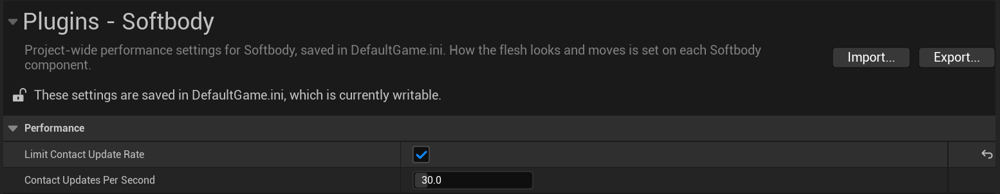
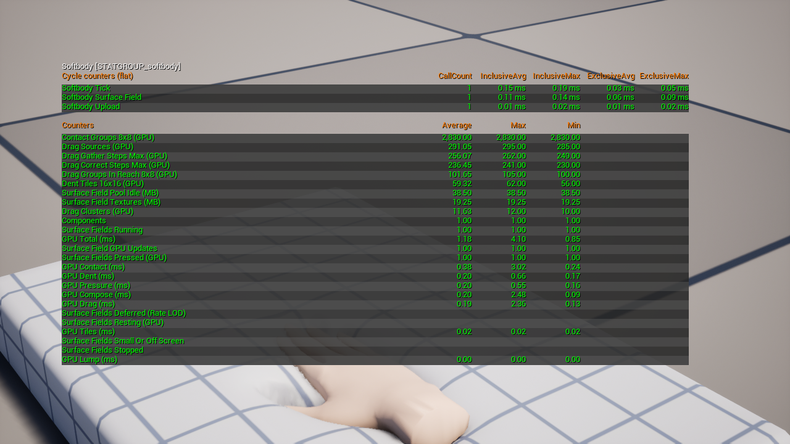

# 성능

접촉(눌림, 솟음, 끌림)은 닿아 있는 메시에서만 GPU 시간과 메모리를 씁니다. `stat softbody`로 측정할 수 있습니다.

## 비용이 드는 곳 {#where-the-cost-goes}

| 비용 | 내용 | 드는 때 |
|---|---|---|
| GPU 시간 | 접촉 갱신 한 번 | 닿은 메시마다, 아래 제한이 건너뛰지 않으면 매 프레임 |
| CPU 시간 | 컴포넌트 틱: 콜라이더 찾기, 관성, 갱신 요청 | 활성 컴포넌트마다 매 틱(작음) |
| 메모리 | 접촉 텍스처 한 세트. 크기는 **Contact Map Resolution**에 따름 | 닿은 메시마다, 처음 닿을 때부터 완전히 복원될 때까지 |

출렁임(관성)은 따로입니다. 메시가 닿았든 아니든 컴포넌트마다 작은 CPU 계산이 들고, 머티리얼의 버텍스 셰이더에서도 작업이 듭니다.

## 수명 주기 {#life-cycle}

1. **쉼.** 눌리는 표면 가까이에 콜라이더가 없습니다. 텍스처 세트도 GPU 작업도 없습니다. **Find Colliders Automatically**를 켜 두면, 메시가 화면에 보이고 **Min Screen Size**보다 클 때는 그래도 틱마다 오버랩 쿼리 하나가 콜라이더를 찾습니다.
2. **첫 접촉.** 메시가 풀에서 텍스처 세트를 받아 그 프레임에 바로 갱신합니다. 접촉 갱신 빈도 제한과 작은 메시의 갱신 간격(`softbody.Surface.FullRateScreenSize`)은 적용되지 않고, 갱신 예산에서도 맨 앞 차례입니다.
3. **눌림.** 프레임마다 한 번 갱신합니다. 아래 제한이 걸리면 그보다 적게 갱신합니다.
4. **멈춤.** 콜라이더, 본, 설정이 지난 갱신 뒤로 0.1 cm 미만으로 움직였고, 그 갱신에서 0.001 cm보다 크게 바뀐 변위가 없으면 갱신이 멈추고 GPU 비용은 0이 됩니다. 그보다 크게 움직이는 것이 있으면 같은 프레임에 메시가 깨어납니다. 애니메이션 중인 캐릭터는 본이 움직이는 동안 멈추지 않습니다. 두 문턱은 콘솔 변수입니다.
5. **복원 중.** 손을 떼면 눌린 자리와 끌림이 **Recovery Rate**에 따라 돌아오는 동안 갱신이 이어집니다. 복원 중인 메시는 멈추지 않습니다.
6. **복원 끝.** 닿을 거리에 아무것도 없으면 텍스처 세트를 비워 풀에 돌려주고, 메시는 다시 쉽니다.

## 비용을 줄이는 설정 {#what-makes-it-cheaper}

| 설정 | 위치 | 효과 |
|---|---|---|
| [**Enable Contact**](Softbody-Component#enable-contact) 끔 | Softbody 컴포넌트, Contact | 접촉 비용을 모두 없애고 관성은 남깁니다. 플레이 중에도 바꿀 수 있습니다. |
| [**Contact Detail**](Softbody-Component#contact-detail) Basic(기본값) | Softbody 컴포넌트, Contact | 솟음, 피부 끌림, Edge Smoothing, Flex 칠을 빼서 Full보다 GPU 시간이 덜 듭니다(시연 장면에서 Full은 약 1.6배). |
| **Contact Map Resolution** | Softbody Authoring Data, 6. Contact Map | 모든 갱신과 텍스처 세트의 크기를 정하며, 다시 베이크해야 합니다. |
| **Pressable Slots** | Softbody Authoring Data, 6. Contact Map | 눌리지 않는 슬롯을 빼면 맵의 칸이 나머지에 돌아갑니다. |
| [**Min Screen Size**](Softbody-Component#min-screen-size) | Softbody 컴포넌트, Contact, Performance | 메시가 화면에서 이 값보다 작게 보이거나 어느 뷰에도 없으면 눌림 계산을 멈춥니다. 기본값 0.15는 1080p에서 키 약 140픽셀인 사람입니다. |
| [**Limit Contact Update Rate**](Softbody-Component#limit-contact-update-rate)와 **Contact Updates Per Second** | Project Settings, Plugins, Softbody | 닿은 메시마다 초당 갱신 수를 제한합니다. 120 fps에서 초당 30번이면 GPU 시간이 4분의 1, 60 fps에서는 절반입니다. |
| `softbody.Surface.UpdateBudget` | 콘솔([콘솔 레퍼런스](Console-Reference)) | 월드마다 한 프레임에 갱신하는 메시 수를 제한합니다. 나머지는 돌아가며 갱신합니다. |
| **Self Contact Bones** | Softbody Authoring Data, 7. Shape Field | 목록에 넣은 본은 모두 갱신마다 캐릭터 자신의 살과 검사합니다. |
| **Self Contact** 끔 | Softbody 컴포넌트, Contact, Colliders | 캐릭터 자신의 셰이프 필드 부위를 건너뜁니다. |
| **Collider Channel** | Softbody 컴포넌트, Contact, Colliders | 손과 소품만 막는 채널을 쓰면 콜라이더 목록이 짧아집니다([콜라이더](Colliders#recommended-setup)). |
| `SoftbodyIgnore` 태그 | 모든 액터나 컴포넌트 | 메시와 겹치지만 누르면 안 되는 것에 붙입니다. |
| **Find Colliders Automatically** 끔 | Softbody 컴포넌트, Contact, Colliders | 오버랩 쿼리도, 바깥 콜라이더도 없습니다. Self Contact만 남습니다. |

Deactivate를 호출하거나 Set Active로 끄면 컴포넌트는 텍스처를 돌려주고, 관성을 비우고, 틱을 멈추고, 메시의 World Position Offset을 끕니다. 다시 활성화할 때까지 CPU 비용도 GPU 비용도 없고, 접촉 메모리는 `softbody.Surface.ReleaseDelay` 뒤에 해제됩니다([컴포넌트 끄고 켜기](Softbody-Component#turning-the-component-off-and-on)).

## stat softbody 읽기 {#reading-stat-softbody}

GPU 줄은 닿은 메시 모두를 더한 값입니다. [콘솔 레퍼런스](Console-Reference#stat-softbody)

GPU Total (ms)은 아래 GPU 줄을 더한 값입니다. Surface Field GPU Updates는 갱신한 메시 수, Dent Tiles 16x16 (GPU)는 눌림 타일 수입니다(상용 캐릭터에서는 눌린 자리보다 이음매 건너편 타일이 더 많을 수 있습니다. 까닭별 수는 [Softbody.Stats](Console-Reference#profiling-advanced)의 `dent-why` 줄에 나옵니다).

- GPU Contact는 콜라이더와 셰이프 필드 부위가 많을수록, 그리고 메시마다 정해져 있는 Contact Groups 8x8 (GPU)가 클수록 커집니다.
- GPU Dent와 GPU Pressure는 눌린 넓이에 따라 커집니다.
- GPU Drag는 눌린 넓이가 아니라 8x8 그룹 하나가 도는 가장 긴 걸음(Drag Correct Steps Max와 Drag Gather Steps Max)을 따릅니다. Drag Mixed Clusters가 많으면 이음매를 건너는 끌림이 많다는 뜻입니다. Drag Sources가 0이면 끌림 작업이 최소라는 뜻입니다. **Drag Friction**이 0이거나 **Contact Detail**이 Basic이면 끌림이 아예 돌지 않습니다. Basic이면 접촉 압력도 돌지 않습니다.
- GPU Tiles와 GPU Compose는 메시마다 거의 일정합니다. GPU Lump는 덩어리가 없는 메시(모든 스태틱 메시 포함)에서 0입니다.

눈에 띄게 닿은 것이 없는데 Surface Fields Running이 높으면, 메시가 복원 중이거나 **Collider Channel**을 막는 무언가가 콜라이더로 모이고 있는 것입니다.

메시별 내역은 `Softbody.Stats`나 `Softbody.Profile`로 보고, 장면을 하나씩 재려면 `Softbody.Scenario`를 씁니다.

## 메모리 {#memory}

텍스처 세트 하나는 덩어리가 있는 1024x1024 캐릭터에서 약 70 MB, 256x256 소품에서 약 3.9 MB입니다. **Contact Map Resolution**을 낮추면 줄어듭니다. 메모리는 배치한 메시 수가 아니라 한꺼번에 닿은 메시 수에 따라 늘어납니다. 함몰·솟음·끌림이 쓰는 거친 격자 텍스처는 세트와 함께 잡고 돌려줍니다. 임시 자원은 월드마다 한 세트를 함께 씁니다.

Mesh Data의 접촉 맵 텍스처(256x256 소품 약 5 MB, 512x512 약 20 MB, 덩어리가 있는 1024x1024 캐릭터 약 90 MB)는 그것을 쓰는 컴포넌트가 접촉을 켠 채 처음 켜질 때 백그라운드에서 몇 장씩(`softbody.Surface.LoadBudget`) 불러오고, `softbody.Surface.ReleaseDelay` 동안 어떤 컴포넌트도 쓰지 않으면 다음 가비지 컬렉션 때 내려갑니다.

컴포넌트를 끄고 켜거나 스폰하거나 스트리밍해도 그 프레임에는 무거운 일을 하지 않습니다. 텍스처는 프레임마다 몇 장씩 만들고(`softbody.Surface.CreateBudget`), 풀(`softbody.Surface.TexturePool`)은 켜진 컴포넌트가 쓰는 종류마다 여분을 준비해 두므로 처음 닿을 때 기다리지 않습니다. 풀을 0으로 하면 여분을 두지 않습니다(첫 접촉이 몇 프레임 늦게 시작함).

끈 컴포넌트가 쓰던 것은 `softbody.Surface.ReleaseDelay` 동안 남아 있어 다시 켜도 아무것도 다시 만들지 않고, 그 뒤 프레임마다 조금씩 해제됩니다. Surface Field Textures (MB)는 깨어 있는 메시가 가진 양을, Surface Field Pool Idle (MB)는 여분과 준비 중인 세트를 보여 줍니다. `Softbody.HitchTest`로 직접 만든 레벨에서 이 모두를 잴 수 있습니다.
