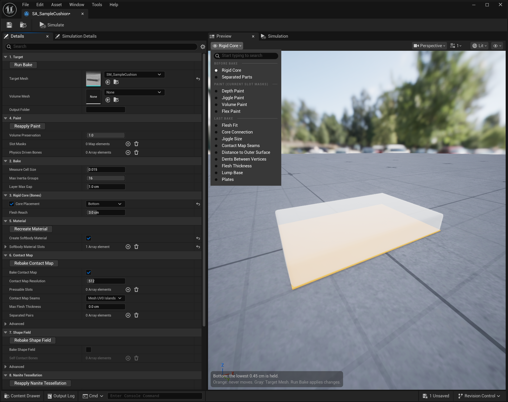
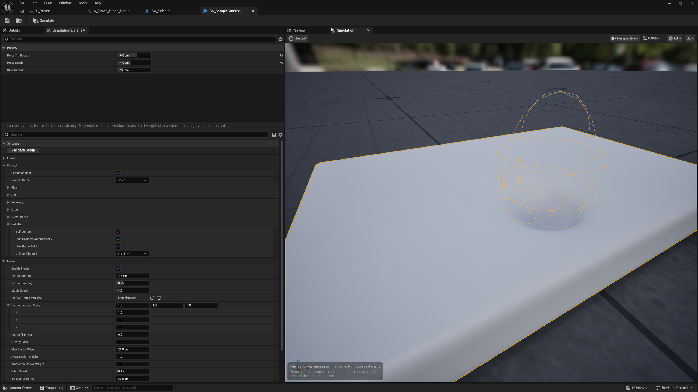

# 미리보기와 시뮬레이션

베이크 에셋(Softbody Authoring Data)을 더블클릭하면 탭 넷이 있는 창이 열립니다. 레벨에 놓지 않고도 이 창에서 베이크 전 값, 칠, 마지막 베이크 결과를 메시 위에 색으로 보고, 마지막 베이크를 눌러 보거나 흔들어 볼 수 있습니다.

| 탭 | 하는 일 |
|---|---|
| **Details** | 베이크 설정과 베이크 버튼입니다([베이크](Baking)). |
| **Preview** | 메뉴에서 고른 보기를 메시 위에 색으로 그립니다([아래](#preview)). |
| **Simulation** | 마지막 베이크를 게임처럼 돌려, 눌러 보고 흔들어 봅니다([아래](#simulation-tab)). |
| **Simulation Details** | Simulation 탭에서 누르는 손가락, 잡는 원과 컴포넌트 값입니다. |

도구 막대의 **Simulate**는 Simulation과 Simulation Details 탭을 앞으로 가져옵니다.

## Preview {#preview}

왼쪽 위 메뉴에서 보기를 고릅니다. 메뉴는 세 칸이며, 칸마다 보기가 다시 그려지는 때가 다릅니다.

| 칸 | 보여 주는 것 | 다시 그리는 때 |
|---|---|---|
| [**Before Bake**](#before-bake) | 지금 설정으로 베이크가 만들 것 | 값을 고칠 때마다 |
| [**Paint (Current Slot Masks)**](#paint-views) | Slot Masks에 지정한 지금 칠 | 칠이나 Slot Masks를 고칠 때마다 |
| [**Last Bake**](#last-bake) | 마지막 베이크 결과 | 다시 베이크할 때 |

왼쪽 아래 첫 줄은 지금 보기의 상태입니다. 문제가 있으면 빨간 글자로 바뀌고, 무엇을 누르거나 고칠지 적습니다. 그 아래 흐린 줄이 색 설명입니다. 오른쪽 위 메뉴(카메라, 보기 모드, 표시)는 다른 UE 뷰포트와 같습니다.

### Before Bake {#before-bake}

| 보기 | 보여 주는 것 | 확인할 것 |
|---|---|---|
| [**Rigid Core**](#rigid-core) | 베이크가 움직이지 않게 붙들 부분(주황)입니다. | 주황이 살갗 가까이 나와 있으면 그 자리 살이 얇아집니다. |
| [**Separated Parts**](#separated-parts-view) | [Separated Pairs](Baking#separated-pairs)가 떼어 둘 두 쪽입니다. | 두 부위가 맞닿는 곳에서 주황과 파랑이 갈리는지 봅니다. |

#### Rigid Core {#rigid-core}

Target Mesh를 비치는 회색으로, 베이크가 붙들 단단한 코어를 주황 구로, Volume Mesh를 파란 선으로 그립니다. 주황은 움직이지 않고, 주황에서 멀수록 살이 두꺼워 더 출렁이고 눌린 자리가 넓습니다. 가는 본은 측정 칸 크기에 맞춰 굵게 그립니다. 베이크도 같은 굵기를 씁니다.

- **스켈레탈 메시:** 본을 따라 놓인 구입니다. 굵기는 [Bone Thickness](Baking#bone-thickness)와 [Bone Overrides](Baking#bone-overrides)가 정합니다. 리본이나 목걸이 본이 살갗 바로 밑에 주황 구를 만들면 그 본의 Role을 Accessory로 둡니다.
- **스태틱 메시:** [Core Placement](Baking#core-placement)대로 보입니다. Center는 모양 한가운데를 지나는 구, Bottom은 맨 아래 얇은 층, Custom Spheres는 직접 놓은 구입니다.

왼쪽 아래 줄은 구의 수를 나타냅니다. 다음 경우에는 빨간 글자로 바뀝니다.

- 메시 안에 든 본이 없습니다. 이대로 베이크하면 출렁임이 없습니다.
- Custom Spheres인데 구가 없습니다. 이대로는 베이크가 멈춥니다.
- 메시(또는 Volume Mesh)에 닫힌 속이 없어 코어를 놓을 수 없습니다.
- 마지막 베이크가 지금과 다른 Bone Overrides, Bone Thickness, Softbody 머티리얼 슬롯으로 구워졌습니다. 지금 출렁임과 접촉은 이 미리보기와 다르므로 Run Bake를 눌러야 합니다.

#### Separated Parts {#separated-parts-view}

[Separated Pairs](Baking#separated-pairs)의 쌍마다 한쪽을 주황, 다른 쪽을 파랑으로 칠합니다. 두 쪽에 다 스킨된 버텍스는 두 색이 섞이고, 어느 쌍에도 들지 않은 곳은 회색입니다. 좌우 한 쌍의 두 쪽처럼 두 부위가 맞닿는 곳에서 색이 갈리는지 봅니다. 고친 값은 Rebake Contact Map을 눌러야 베이크에 들어갑니다.

스켈레탈 메시에서만 쓸 수 있습니다. 다음 쌍은 쓰이지 않고 왼쪽 아래에 빨간 글자로 나옵니다.

- 메시에 없는 본이 든 쌍, 한쪽이 빈 쌍, 같은 본이 양쪽에 든 쌍.
- 위의 쌍들과 부딪는 쌍. 접촉 맵은 두 묶음만 떼어 둘 수 있는데, 이 쌍까지 넣으면 세 묶음이 필요합니다.

### Paint (Current Slot Masks) {#paint-views}

[4. Paint](Baking#_4-paint)의 Slot Masks가 지금 주는 칠을 베이크 전에 봅니다. 채널의 뜻은 [페인트](Painting#the-four-channels)에 있습니다.

**Depth Paint**, **Jiggle Paint**, **Volume Paint**는 그 채널을 흑백으로 칠합니다. 흰색이 1, 검은색이 0입니다. 

하늘색은 그 슬롯에 칠이 없다는 뜻이며 1로 셉니다. 칠했다고 생각한 곳이 하늘색이면 그 슬롯이 Slot Masks에 없거나, 채널이 White everywhere (unpainted)로 되어 있다는 의미입니다.

칠 텍스처가 고른 대로 읽히지 않으면 왼쪽 아래에 빨간 글자로 나옵니다. 텍스처에 소스 픽셀이 없거나, sRGB가 켜져 있거나, Flex를 알파에 담은 PNG인 경우입니다. 고치는 방법은 [문제 해결](Troubleshooting)에 있습니다.

#### Flex Paint {#flex-paint}

Flex를 흰색보다 어둡게 칠한 조각을 조각마다 다른 색으로 칠합니다. 검은 조각은 강체 판이 되고, 회색 조각은 칠대로 휩니다([판](Painting#plates)). 진회색은 칠한 조각이 아닙니다. 색 설명은 조각 수와, 그 가운데 보석처럼 표면에 얹힌 따로 된 부품의 수를 셉니다. 베이크한 뒤 실제로 판이 되었는지는 Last Bake의 [Plates](#plates-view)에서 봅니다.

### Last Bake {#last-bake}

마지막 베이크 결과입니다. Flesh Fit부터 Dents Between Vertices까지 여섯 보기는 Softbody 컴포넌트의 **Debug View**와 같은 색이라, 플레이 중에도 [Debug View Mode](Softbody-Component#debug-view-mode)로 같은 것을 볼 수 있습니다. 이 여섯은 머티리얼에 `MF_SoftbodyDebugVis`가 있어야 하며, 없는 슬롯은 비치는 회색으로 그립니다. **Create Softbody Material**이 만든 머티리얼에는 들어 있습니다. 나머지 셋은 이 창에만 있는 보기입니다.

| 보기 | 보여 주는 것 | 확인할 것 |
|---|---|---|
| [**Flesh Fit**](#flesh-fit) | 버텍스가 측정한 살 안에 들었는지 보여 줍니다. | 출렁여야 할 곳이 빨강이면 그 버텍스는 제자리에 남습니다. |
| [**Core Connection**](#core-connection) | 살이 단단한 코어까지 이어졌는지 보여 줍니다. | 자홍인 살은 출렁이지 않습니다. |
| [**Jiggle Size**](#jiggle-size) | 이 메시 안에서 버텍스마다 얼마나 출렁이는지 보여 줍니다. | 칠과 본 설정대로 출렁임이 나뉘었는지 봅니다. |
| [**Contact Map Seams**](#contact-map-seams-view) | 접촉 맵을 체커 무늬로 보여 줍니다. | 자주 눌리는 곳을 이음매가 가로지르는지 봅니다. |
| [**Distance to Outer Surface**](#distance-to-outer-surface) | 버텍스에서 바깥 표면까지의 거리입니다. | 눌림을 따라가야 할 옷이 진한 색인지 봅니다. |
| [**Dents Between Vertices**](#dents-between-vertices) | 삼각형 안에서도 눌림을 읽는 곳입니다. | 손끝 눌림이 버텍스 사이에 보여야 할 곳이 초록인지 봅니다. |
| [**Flesh Thickness**](#flesh-thickness) | 접촉이 쓰는 살 두께입니다. | 눌린 자리가 너무 넓거나 좁으면 먼저 여기를 봅니다. |
| [**Lump Base**](#lump-base) | 덩어리가 놓인 면입니다. | 덩어리마다 받침이 덩어리 밑동에서 끝나는지 봅니다. |
| [**Plates**](#plates-view) | Flex 조각 가운데 강체 판이 된 것입니다. | 판이어야 할 조각이 빨강, 흰색, 주황, 보라인지 봅니다. |

Contact Map Seams부터는 접촉 맵을 읽으므로, **Bake Contact Map**을 끄고 구웠으면 보이지 않습니다. 마지막 베이크가 다른 메시를 구운 것이거나 이 보기보다 오래되었으면 왼쪽 아래에 누를 버튼이 나옵니다.

#### Flesh Fit {#flesh-fit}

베이크는 메시의 속을 Measure Cell Size 크기의 칸으로 채워 살을 재고, 버텍스마다 그 칸에서 출렁임을 읽습니다.

- **초록:** 측정한 살 안에 듭니다.
- **노랑:** 살 겉면 바로 바깥이라 가장 가까운 칸 가장자리의 값을 씁니다. 칸이 겉면에 꼭 맞지 않으므로 겉면에 노랑이 섞이는 것은 보통입니다.
- **빨강:** 둘레에 살이 없어 출렁임 값을 받지 못했습니다. 출렁일 때 그 버텍스만 제자리에 남습니다.

출렁여야 할 곳이 빨강이면, 칸보다 가는 부분은 [Measure Cell Size](Baking#_2-bake)를 낮추고, 열려 있거나 속이 빈 메시는 [Volume Mesh](Baking#volume-mesh)로 속을 채웁니다. [Validate](Baking#validate)를 누르면 출력 로그의 `CoverageStats` 줄에 초록(inside), 노랑(extrapolated), 빨강(not embedded)의 비율이 나옵니다.

#### Core Connection {#core-connection}

- **청록:** 살이 단단한 코어까지 이어져 있습니다.
- **자홍:** 코어와 이어지지 않은 살 덩이입니다. 베이크가 통째로 붙들어 출렁이지 않습니다. Flesh Fit에서 빨강인 버텍스도 자홍입니다.

몸에서 떨어진 부품이 출렁일 필요가 없으면 자홍이어도 됩니다. 출렁여야 하면 그 덩이 안에 코어가 있어야 합니다. 스켈레탈 메시는 그 안을 지나는 본의 Role을 Rigid Core로 두고, 스태틱 메시는 [Core Placement](Baking#core-placement)나 [Rigid Core Spheres](Baking#rigid-core-spheres)로 코어를 놓습니다. 베이크 로그에는 `grid points not connected to the rigid core will not jiggle` 줄이 나옵니다.

#### Jiggle Size {#jiggle-size}

남색은 움직이지 않고, 초록을 지나 빨강으로 갈수록 많이 출렁입니다. 실제로 출렁이는 크기는 컴포넌트의 [관성](Inertia) 설정이 정합니다. 이 분포는 [Jiggle과 Depth 칠](Painting#the-four-channels), [Bone Thickness](Baking#bone-thickness), [Flesh Reach](Baking#flesh-reach)가 정합니다.

자홍은 당긴 쪽과 반대로 밀리는 버텍스로, 베이크 결함입니다.

#### Contact Map Seams {#contact-map-seams-view}

접촉 맵의 자리를 체커 무늬로 칠합니다. 밑의 피부와 같은 무늬인 옷과 단추는 피부와 함께 눌립니다. 무늬가 끊기는 선은 접촉 맵이 나뉜 이음매로, 이음매를 가로지르는 눌림은 조금 덜 정확해서 선이나 계단이 보일 수 있습니다. 회색은 접촉 맵에 들지 않아 눌리지 않는 곳입니다.

배처럼 자주 눌리는 곳을 이음매가 가로지르면, [Contact Map Seams](Baking#contact-map-seams)를 바꾸거나 메시의 UV0 이음매를 옮깁니다. 기본값 Mesh UV0 Islands는 UV0 이음매를 따라 나눕니다.

#### Distance to Outer Surface {#distance-to-outer-surface}

바깥 표면은 베이크가 메시 전체를 감싸 만든 겉입니다. 초록은 바깥 표면 위, 빨강은 그 바깥으로 멀리, 파랑은 안쪽으로 깊이 있는 버텍스입니다. 색은 10 cm에서 가장 진합니다.

버텍스는 5 cm(색이 반쯤 섞인 곳)까지 눌림을 그대로 따라가고, 10 cm(가장 진한 색)에서는 따라가지 않습니다. 거리는 액터 스케일을 곱하기 전의 메시 단위입니다.

#### Dents Between Vertices {#dents-between-vertices}

- **초록:** 삼각형 안에서도 눌림을 읽습니다(나나이트 테셀레이션의 버텍스와 픽셀 음영).
- **빨강:** 버텍스에서만 읽습니다.
- **회색:** 눌리지 않는 곳입니다.

눌림이 버텍스 사이에 보이려면 그 자리가 초록이고 [Set Up Nanite Tessellation](Materials#nanite-tessellation)이 켜져 있어야 합니다.

#### Flesh Thickness {#flesh-thickness}

버텍스마다 그 밑에서 단단한 코어까지의 살 두께를 칠합니다. 보라는 가장 얇은 곳(코어가 겉면에 닿은 곳), 청록은 중간, 노랑은 살이 있는 곳 가운데 가장 두꺼운 10%입니다. 색 설명에 각 색의 cm 값이 나옵니다(배율 1). 회색은 눌리지 않거나 Depth를 0으로 칠한 곳입니다.

살이 두꺼우면 눌린 자리와 그 둘레 솟음이 넓게 퍼집니다. 살 두께보다 깊이 누르면 살갗이 코어 너머로 들어갑니다. 두께를 바꾸는 것은 다음과 같습니다.

- 코어: [Core Placement](Baking#core-placement), [Rigid Core Spheres](Baking#rigid-core-spheres), [Bone Thickness](Baking#bone-thickness), [Bone Overrides](Baking#bone-overrides).
- Max Flesh Thickness([6. Contact Map](Baking#_6-contact-map)).
- [Depth 칠](Painting#the-four-channels).

코어가 바닥에만 있는 물체는 옆면이 노랑(아주 두꺼움)으로 나오고, 윗면을 누르면 옆면도 들어갑니다. 이때는 Max Flesh Thickness를 씁니다. 덩어리의 살은 [Lump Base](#lump-base)까지 잽니다.

#### Lump Base {#lump-base}

[Bone Overrides](Baking#bone-overrides)에서 Role이 Lump인 본마다, 덩어리가 없다고 칠 때의 몸(덩어리가 놓인 면)을 색 입힌 면으로 그립니다. 색은 그 위 살갗까지의 높이로, 가장자리가 보라, 가장 높은 곳이 노랑입니다(그 cm 값은 색 설명에). 회색은 Target Mesh입니다. 

왼쪽 아래에는 덩어리마다 꼭대기가 받침에서 몇 cm 위인지, 받침 아래 살이 몇 cm인지 나옵니다. 받침을 찾지 못한 덩어리는 `no base`와 그 까닭이 나오고, 그 덩어리의 살은 본까지 잽니다. 본의 스킨 웨이트가 메시 조각 전체를 덮었거나, 베이크가 메시 모양에서 덩어리가 끝나는 곳을 찾지 못한 경우입니다. 이 보기는 Rebake Contact Map을 누르면 바뀝니다.

#### Plates {#plates-view}

마지막 베이크에서 Flex를 칠한 조각마다 어떻게 되었는지 보여 줍니다([판](Painting#plates)). 색 설명은 색마다 조각 수를 셉니다.

| 색 | 뜻 | 판이어야 하면 |
|---|---|---|
| 조각마다 다른 색 | 강체 판입니다. 통째로 가라앉고 기웁니다. | |
| 연파랑 | 회색 조각으로, 칠이 어두울수록 뻣뻣하게 휩니다. | 컴포넌트의 Flex Offset을 음수로 둡니다. |
| 빨강 | 몸을 둘러 감긴 조각이라 칠대로 휩니다. | 가는 흰 틈을 두어 평평한 조각으로 나눕니다. |
| 흰색 | 밑에 눌리는 겉면이 없어 판이 되지 않습니다. | 밑의 슬롯을 Pressable Slots에 넣거나 장식을 피부 가까이 둡니다. |
| 주황 | 거친 칸을 너무 많이 덮어 칠대로 휩니다. | 가는 흰 틈을 두어 작은 조각으로 나눕니다. |
| 보라 | 접촉 맵 가장자리에 걸려 칠대로 휩니다. | 다른 Contact Map Resolution으로 다시 베이크합니다. |
| 진회색 | 칠한 조각이 아닙니다. 회색으로 칠한 곳은 칠대로 휘고, 흰색은 맨살입니다. | |

출력 로그에는 조각마다 까닭이 나옵니다([문제 해결](Troubleshooting)).

## Simulation 탭 {#simulation-tab}

마지막 베이크를 게임처럼 돌립니다. 탭을 처음 볼 때 시작하고, 탭이 보이고 에디터가 앞에 있을 때만 돕니다. 탭을 닫으면 쓰던 것을 모두 놓습니다. Run Bake 같은 베이크 버튼이 끝나면 저절로 다시 시작합니다.

- **Ctrl + 좌클릭 끌기:** 손가락으로 누릅니다. 둥근 끝은 커서 아래 겉에 붙어 그 면을 따라 들어가고, 반대편 겉은 넘지 않습니다. 누른 채 마우스 휠을 돌리면 더 깊게, 얕게 누릅니다. 왼쪽 아래에 지금 깊이와 끝 크기가 나옵니다.
- **Ctrl + 우클릭 끌기:** 커서 아래 Grab Radius 원 안의 살갗을 잡아 끕니다. 잡은 자리는 Grab Radius와 그 자리 살 두께 가운데 작은 것의 1.3배까지 움직이고, 더 끌어도 놓지 않고 그 끝에 머뭅니다. 누른 채 마우스 휠을 돌리면 가깝게, 멀게 끕니다. Basic은 바깥으로만 당기고 Full은 옆으로도 늘입니다.
- **Ctrl + Shift + 우클릭 끌기:** 메시 전체를 잡아 끌며 출렁임을 봅니다(Physics Asset Editor의 잡기와 같습니다). 마우스 휠로 가깝게, 멀게 옮기고, 놓은 자리에 멈춥니다.
- **클릭:** 메시를 클릭하면 기즈모가 나오고, 빈 곳을 클릭하면 사라집니다. **W**, **E**로 이동과 회전을 바꿉니다.
- **Restart**(왼쪽 위): 정지 상태부터 다시 시작하고 메시를 처음 자리에 둡니다.

끌기와 기즈모는 손으로 움직이는 대로라 같은 출렁임을 되풀이하기 어렵습니다. in-place 애니메이션은 앞으로 나아가지 않아 게임보다 덜 출렁입니다.

Softbody 머티리얼을 쓰는 슬롯이 없으면 메시가 움직이지 않고, 접촉 맵 없이 구웠으면 눌리지 않습니다. 이때는 왼쪽 아래에 빨간 글자로 나옵니다.

### Simulation Details {#simulation-details}

맨 위 **Preview** 칸은 이 창에만 있는 값입니다.

| 설정 | 기본값 | 하는 일 |
|---|---|---|
| **Animation** | None | 스켈레탈 메시에서 반복 재생할 애니메이션입니다. 이 메시의 스켈레톤에 맞는 것만 보입니다. |
| **Press Tip Radius** | 1 cm | Ctrl + 좌클릭이 누르는 둥근 끝의 반지름입니다. 손끝은 약 1 cm, 손바닥은 약 4 cm입니다. |
| **Press Depth** | 1 cm | 커서 아래 겉에서 들어가는 깊이입니다. 누르는 동안 마우스 휠로 바꿉니다. |
| **Grab Radius** | 2 cm | Ctrl + 우클릭이 잡는 살갗 원의 반지름(월드 cm)입니다. 약 1 cm는 꼬집기, 4 cm는 한 움큼입니다. 메시 위에서 Ctrl + 마우스 휠이나 [, ]로 바꿉니다. |

그 아래는 Softbody 컴포넌트 값입니다([Softbody 컴포넌트](Softbody-Component)). 이 미리보기에만 쓰이며, 창을 닫을 때까지 남고 닫으면 초기화됩니다.

레벨로 옮기려면 값(또는 카테고리 이름)에서 Shift + 우클릭으로 복사하고, 레벨 컴포넌트의 같은 줄에서 Shift + 좌클릭으로 붙여넣습니다. 카테고리를 붙여넣으면 여기서 건드리지 않은 값도 함께 들어가므로, 레벨 컴포넌트에 이미 바꾼 값이 있으면 그 카테고리를 먼저 미리보기로 가져옵니다.
