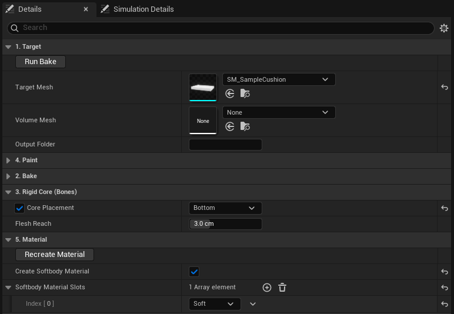
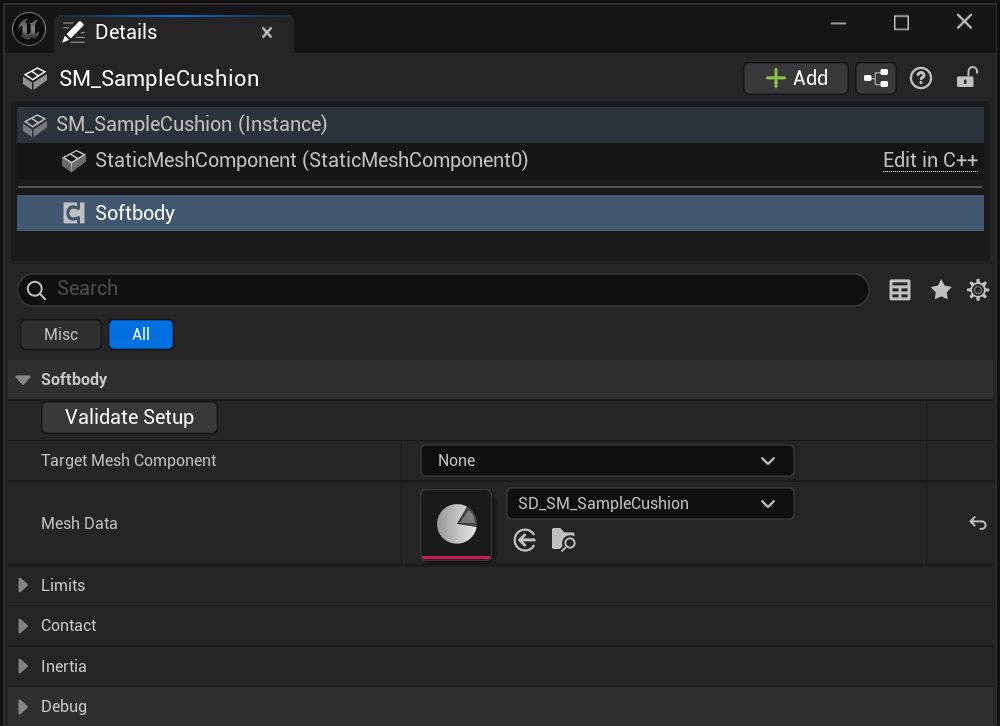
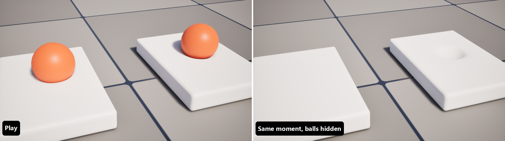

# 빠른 시작

플러그인에 들어 있는 샘플 방석을 베이크하고 그 위에 공을 떨어뜨려 봅니다.

## 1. 샘플 복사 {#_1-copy-the-sample}

플러그인의 `Samples` 폴더에서 `SM_SampleCushion`을 내 프로젝트의 Content로 복사하고 복사본을 씁니다. 베이크는 대상 메시에 직접 쓰고, 엔진 폴더 아래의 메시는 받지 않습니다.

## 2. 베이크 설정 {#_2-set-up-the-bake}

콘텐츠 브라우저에서 **Softbody > Softbody Authoring Data**를 만들고, 열어서 다음처럼 설정합니다.

| 설정 | 카테고리 | 값 |
|---|---|---|
| **Target Mesh** | 1. Target | 복사한 `SM_SampleCushion` |
| **Core Placement** | 3. Rigid Core (Bones) | Bottom |
| **Create Softbody Material** | 5. Material | 켬 |
| **Softbody Material Slots** | 5. Material | `Soft` |

Bottom은 바닥에 닿는 방석 밑면만 붙들고, 나머지는 살이 됩니다.

## 3. 베이크 {#_3-bake}

**Run Bake**를 눌러야 합니다. 베이크 에셋 옆에 `SD_` 에셋이 생기고, `Soft` 슬롯용 머티리얼도 만들어집니다. 로그에 텍스처를 찾지 못했다는 줄과 라이트맵 UV를 3번 채널로 옮겼다는 줄이 나오는데, 이 샘플에서는 둘 다 정상입니다.

## 4. 에셋 창에서 눌러 보기 {#_4-press-it-in-the-asset-window}

베이크 에셋 창 도구 막대의 **Simulate**를 누르고, [Simulation 탭](Preview-and-Simulation#simulation-tab)에서 Ctrl을 누른 채 좌클릭으로 끌며 방석을 눌러 봅니다.

## 5. 컴포넌트 추가 {#_5-add-the-component}

방석을 레벨에 놓고 **Softbody** 컴포넌트를 추가한 뒤 **Mesh Data**에 `SD_` 에셋을 지정합니다.

## 6. 플레이 {#_6-play}

**Simulate Physics**를 켠 구를 방석 위에 놓고 플레이합니다. 공이 파고들고, 공이 굴러 나가면 눌린 자리가 돌아옵니다.

콜리전이 **Visibility** 채널을 막는 것은 모두 살을 누릅니다. [콜라이더](Colliders)

## 해 볼 것 {#things-to-try}

Softbody 컴포넌트(또는 베이크 에셋 창의 Simulation Details)에서:

| 설정 | 기본값 | 바꿔 볼 값 | |
|---|---|---|---|
| **Recovery Rate** | 30 | 8 | 눌린 자리가 돌아오는 데 0.5초쯤 걸립니다. |
| **Memory Time** | 0 s | 1.5 | 메모리 폼: 공이 떠난 뒤에도 자국이 남았다가 사라집니다. |
| **Contact Detail** | Basic | Full | 눌린 자리 둘레로 살이 솟습니다. |
| **Skin Tension** | 0 | 0.5 | 가죽: 눌린 자리가 더 둥글고 넓어집니다. |

Softbody Authoring Data에서(4. Paint, Contact Detail은 Full). 눌린 자리가 바로 바뀝니다.

| 설정 | 기본값 | 바꿔 볼 값 | |
|---|---|---|---|
| **Volume Preservation** | 1 | 0 | 폼: 아무것도 솟지 않고 눌린 자리의 가장자리가 또렷합니다. |

## 다음 {#next}

- 내 메시 [베이크](Baking)
- 스켈레탈 메시는 [캐릭터](Characters)
- 모든 설정은 [Softbody 컴포넌트](Softbody-Component)
