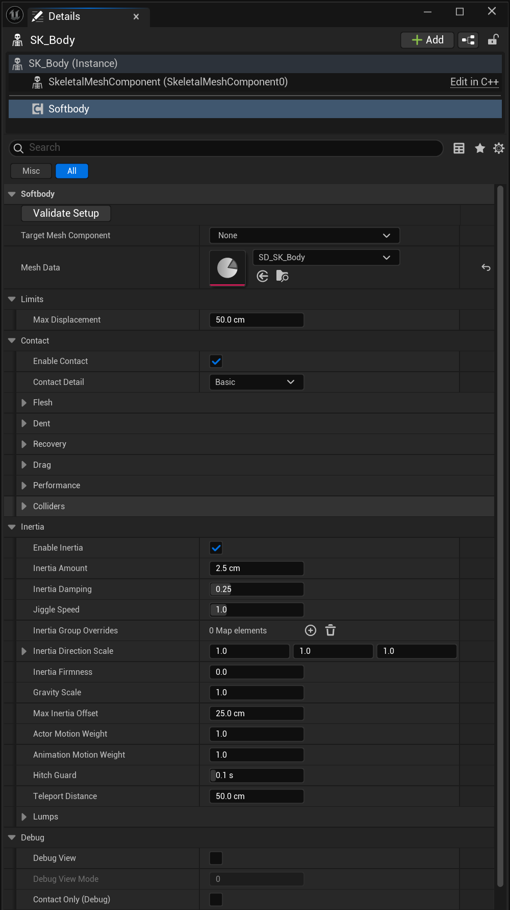
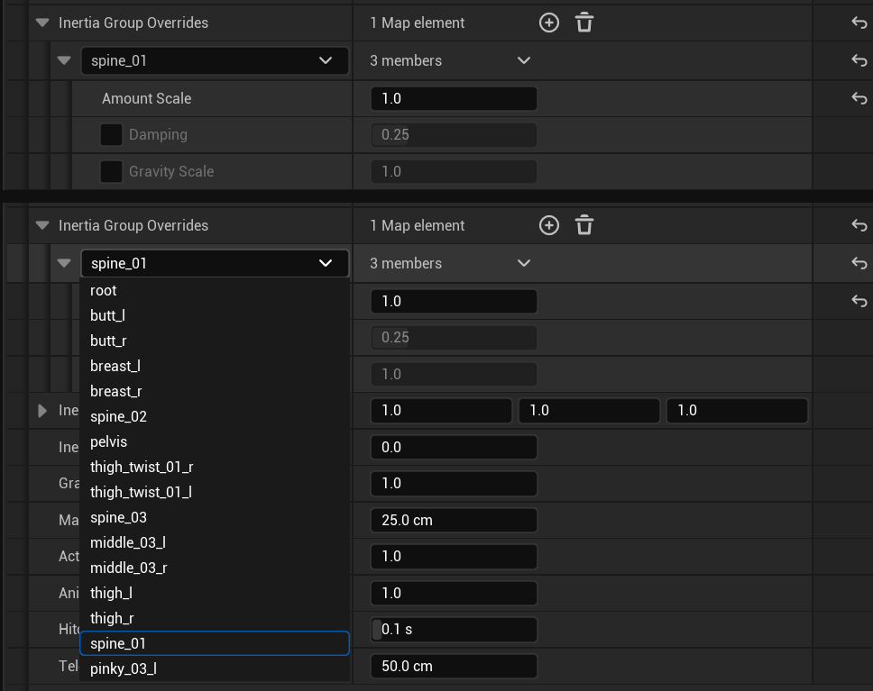
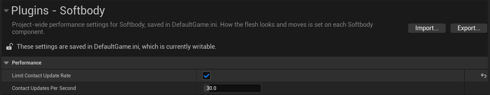

# Softbody 컴포넌트

**Softbody** 컴포넌트는 메시 하나에 하나만 추가해야 합니다. **Mesh Data**에는 그 메시용 Softbody Authoring Data의 Baked Data를 지정해야 합니다([베이크](Baking)). 메시의 머티리얼에는 Softbody 머티리얼 함수가 들어 있어야 합니다([머티리얼](Materials)). 레벨에 놓지 않고 이 값들을 시험할 수 있는 곳은 베이크 에셋 창의 [Simulation 탭](Preview-and-Simulation#simulation-tab)입니다.

## 설정 {#settings}

단위는 cm와 초입니다. "0~1": 이 범위로 제한됩니다. "최소 0, 슬라이더 2까지": 0 아래로 내려갈 수 없고, 슬라이더는 2에서 멈추지만 더 큰 값을 직접 입력할 수 있습니다.

### Softbody {#softbody}

| 설정 | 기본값 | 설명 |
|---|---|---|
| **Validate Setup** (버튼) | — | 설정을 검사하고 문제를 출력 로그에 씁니다. [Validate Setup](#validate-setup) |
| [**Target Mesh Component**](#target-mesh-component) | 비어 있음 | 이 컴포넌트가 변형하는 메시입니다. 비어 있으면 자동으로 고릅니다. |
| **Mesh Data** | 비어 있음 | 대상 메시용 Softbody Authoring Data의 Baked Data입니다. |

#### Target Mesh Component {#target-mesh-component}

비어 있으면 이 액터의 메시 컴포넌트 가운데 Mesh Data를 베이크한 메시를 쓰는 것을 고릅니다. 맞는 것이 없으면 `SoftbodyIgnore` 컴포넌트 태그가 없는 첫 메시 컴포넌트를 고릅니다.

### Limits {#limits}

| 설정 | 기본값 | 설명 |
|---|---|---|
| [**Max Displacement**](#max-displacement) | 50 cm | 눌림과 출렁임을 합쳐 버텍스가 모델링된 위치에서 움직일 수 있는 가장 먼 거리입니다. 최소 0. |

#### Max Displacement {#max-displacement}

한계의 70%까지는 움직임이 그대로이고, 그 너머에서 한계에 부드럽게 다가갑니다.

### Contact {#contact}

| 설정 | 기본값 | 설명 |
|---|---|---|
| [**Enable Contact**](#enable-contact) | 켬 | 눌림, 솟음, 끌림을 켭니다. |
| [**Contact Detail**](#contact-detail) | Basic | Basic은 눌림과 덩어리 밀림만, Full은 모든 접촉 효과를 계산합니다. |

[접촉](Contact)

#### Enable Contact {#enable-contact}

끄면 접촉 비용이 모두 사라지고 관성만 남으며, 덩어리도 더는 밀리지 않습니다. 나나이트 테셀레이션에는 영향이 없습니다.

#### Contact Detail {#contact-detail}

- **Basic**: 눌림과 덩어리 밀림만 돕니다. 솟음, 피부 끌림(그래서 누르는 손의 Lump Grip도), Edge Smoothing, Flex 칠(휘는 겉과 판)이 꺼지고 그 GPU 작업도 건너뜁니다. Flex를 칠한 자리는 맨살처럼 눌립니다. Basic에서도 Volume Preservation과 Skin Tension은 눌린 자리 모양을 바꿉니다.
- **Full**: 모든 접촉 효과입니다. 나나이트 메시에서는 움직이는 손 가장자리의 함몰 벽도 덜 자글거립니다. Basic보다 GPU 시간이 더 듭니다.

꺼진 효과의 설정 값은 그대로 남습니다. 눌린 채 바꾸면 솟음과 끌린 피부가 한 번에 사라지거나 나타납니다.

### Contact > Flesh {#contact-flesh}

| 설정 | 기본값 | 설명 |
|---|---|---|
| [**Skin Tension**](#skin-tension) | 0 | 살을 덮은 팽팽한 겉껍질의 강도입니다. 0~2. |
| [**Volume Offset**](#volume-offset) | 0 | 모든 자리의 부피 보존률(Volume)에 더하는 값입니다. 클수록 눌린 자리 둘레가 더 솟습니다. -1~1. |
| [**Flex Offset**](#flex-offset) | 0 | Flex 칠에 더하는 값입니다. 아직 완성되지 않아 불안정합니다. -1~1. |

눌린 자리와 그 둘레 솟음의 폭은 베이크한 살 두께와 **Skin Tension**이 정합니다. 얼마나 솟는지는 베이크 에셋의 **Volume Preservation**에 Volume 칠을 곱하고 Volume Offset을 더한 값이 정합니다. Contact Detail이 Full이면 Flex 칠도 폭을 넓힙니다. [살의 재료](Concepts#flesh-material)

#### Skin Tension {#skin-tension}

- 값: 0 = 맨살이나 젤리, 1보다 크면 두꺼운 살 위의 북 가죽입니다.
- 팽팽할수록 눌린 자리가 둥글고 넓어지고, 손가락 사이를 건너 덮으며, 누르는 물체의 모양이 흐려집니다. 살이 얇은 곳일수록 효과가 큽니다.
- 같은 값은 어느 메시에서나 같은 겉이고, Depth 칠이 바꾸지 않습니다.
- 당겨진 겉껍질이지 단단한 껍데기가 아니므로, 뻣뻣한 자리도 판처럼 기울지 않고 평평하게 가라앉습니다.
- 메시 전체에 걸리는 값입니다. 겉의 일부에는 Flex 칠을 쓸 수 있습니다([페인트](Painting)).

#### Volume Offset {#volume-offset}

모든 자리의 Volume(베이크 에셋의 **Volume Preservation** × Volume 칠)에 더하므로, 무엇을 칠했든 한 칸에 같은 만큼 바뀝니다. -1이면 모두 폼처럼, +1이면 모두 살처럼 움직입니다. 더한 값은 0(폼)과 1(살)에서 멈춥니다. 살로만 된 메시에서는 양수가 아무것도 바꾸지 않습니다.

통째로 밀린 덩어리가 퍼지는 모양은 베이크한 값 그대로입니다. 베이크 에셋에 결과를 넣고 Run Bake를 눌러야 바뀝니다.

#### Flex Offset {#flex-offset}

**아직 완성되지 않은 기능이라 불안정합니다. 주의해서 쓰세요.**

Flex 칠에 더하므로, 음수면 칠하지 않은 피부도 휩니다. -1이면 칠한 조각이 모두 강체 판이 되고, +1이면 모두 맨살입니다. Contact Detail이 Full이어야 합니다.

### Contact > Dent {#contact-dent}

| 설정 | 기본값 | 설명 |
|---|---|---|
| [**Max Contact Depth**](#max-contact-depth) | 15 cm | 콜라이더가 표면을 밀어 넣는 깊이의 한계입니다. 최소 0. |
| [**Edge Smoothing**](#edge-smoothing) | 0.5 | Contact Detail이 Full일 때 콜라이더 가장자리의 눌림 벽을 매끄럽게 합니다. 0 = 끔. 최소 0, 슬라이더 3까지. |
| [**Dent Darkening**](#dent-darkening) | 0.6 | 깊고 좁은 눌림(일반적으로 손끝 자국, 손가락 사이 틈)이 얼마나 어두워지는지 정합니다. 0~1. |

#### Max Contact Depth {#max-contact-depth}

이 깊이까지는 누른 깊이가 그대로이고, 그 너머는 부드럽게 줄어 이 값의 1.3배에서 멈춥니다. 그보다 깊이 들어간 콜라이더는 피부 밖으로 보입니다. 몸의 자기 접촉은 이 값과 관계없이 살 두께에서 멈춥니다.

#### Edge Smoothing {#edge-smoothing}

단위는 접촉 맵 칸입니다. 가파른 벽만 매끄럽게 하고, 평평하거나 가볍게 누른 자리는 깊이가 그대로입니다. 이 폭의 두 배보다 가는 물체는 덜 깊이 누릅니다.

#### Dent Darkening {#dent-darkening}

깊고 좁은 눌림(손끝 자국, 손가락 사이 틈, 눌림 벽)을 어둡게 하고, 넓게 누른 자리와 얕게 눌린 자리는 거의 그대로입니다. 베이스 컬러에 MF_SoftbodyContactNormal의 Occlusion 출력을 곱하는 머티리얼이 필요합니다.

### Contact > Drag {#contact-drag}

| 설정 | 기본값 | 설명 |
|---|---|---|
| [**Drag Friction**](#drag-friction) | 0.5 | Contact Detail이 Full일 때 움직이는 콜라이더와 피부 사이의 마찰을 정합니다. 0 = 끔. 최소 0, 슬라이더 2까지. |

#### Drag Friction {#drag-friction}

누르는 세기의 배수입니다. 피부는 손과 함께 움직이다가, 살이 당기는 힘이 이보다 커지면 미끄러집니다. 멈춘 손은 피부를 붙잡고 있습니다. 같은 거리를 빠르게 쓸든 느리게 쓸든 끌리는 정도는 같습니다.

쥔 손이 덩어리를 얼마나 세게 끌고 가는지도 제한합니다(Lump Grip).

### Contact > Recovery {#contact-recovery}

| 설정 | 기본값 | 설명 |
|---|---|---|
| [**Recovery Rate**](#recovery-rate) | 30 | 콜라이더가 떠난 뒤 눌린 자리와 끌린 피부가 돌아오는 빠르기(초당)입니다. 최소 0.1, 슬라이더 40까지. |
| [**Memory Time**](#memory-time) | 0 s | 오래 누른 살에 메모리 폼처럼 자국이 남게 하는 시간입니다. 0 = 자국 없음. 최소 0, 슬라이더 10까지. |
| [**Memory Fade Time**](#memory-fade-time) | 1.5 s | Memory Time이 0보다 클 때 자국이 절반으로 옅어지는 시간입니다. 최소 0.05, 슬라이더 10까지. |

#### Recovery Rate {#recovery-rate}

눌림 크기와 상관없이 같습니다. 높을수록 빨리 돌아오고, 낮을수록 빠른 손이 지나간 자리에 흔적이 남습니다. 누른 자리 둘레의 살은 이 값과 상관없이 바로 모양을 잡습니다. 눌린 자리의 폭은 바꾸지 않습니다.

#### Memory Time {#memory-time}

누르는 동안 이 초마다 눌린 모양과의 남은 차이를 절반씩 좁힙니다. 잠깐 닿으면 거의 남지 않고, 미끄러지는 손은 옅은 흔적을 남깁니다. 자국이 남아 있는 동안에는 천천히 떼는 손과 피부 사이에 작은 틈이 보일 수 있습니다.

#### Memory Fade Time {#memory-fade-time}

자국은 이 초마다 절반으로 옅어지고, 누르고 있는 동안에도 옅어집니다. 그래서 이 값이 Memory Time보다 짧으면 오래 눌러도 얕은 자국만 남습니다. GPU는 자국이 다 옅어질 때까지(이 값의 약 열 배) 계속 일합니다.

### Contact > Colliders {#contact-colliders}

| 설정 | 기본값 | 설명 |
|---|---|---|
| [**Self Contact**](Colliders#self-contact) | 켬 | 스켈레탈 메시 안에서 스스로의 다른 영역을 누르게 합니다(일반적으로 손이 배나 허벅지). 셰이프 필드가 필요합니다. |
| [**Find Colliders Automatically**](Colliders#what-can-press-the-flesh) | 켬 | 매 프레임 메시와 겹치는 콜라이더를 찾아 누르게 합니다. 끔 = 바깥 콜라이더를 무시합니다(Self Contact은 따로입니다). |
| [**Use Shape Fields**](Colliders#shape-fields) | 켬 | 셰이프 필드를 베이크한 메시는 실제 모양으로 누릅니다. 끔 = 비교용으로 단순 콜리전을 씁니다. |
| **Collider Channel** | Visibility | 콜라이더를 찾는 데 쓰는 콜리전 채널입니다. 이 채널을 막는 콜리전은 모두 살을 누릅니다. |

[콜라이더](Colliders)

### Contact > Performance {#contact-performance}

| 설정 | 기본값 | 설명 |
|---|---|---|
| [**Min Screen Size**](#min-screen-size) | 0.15 | 멀리 보이는 메시의 눌림 계산을 멈춰 GPU 시간을 아끼는 값입니다. 최소 0, 슬라이더 1까지. |

#### Min Screen Size {#min-screen-size}

메시가 화면에서 이 값보다 작게 보이는 동안 눌림 계산을 멈춥니다. 눌린 자리는 뗀 것처럼 부드럽게 돌아오고, 그다음 GPU 작업이 멈춥니다. 메시가 이 값보다 약 20% 크게 보이면 다시 계산합니다. 출렁임에는 영향이 없습니다.

- 단위는 LOD Screen Size와 같고, 에디터 뷰포트를 포함한 모든 뷰 가운데 가장 큰 값을 씁니다.
- 메시 전체를 재므로 작은 메시일수록 일찍 멈춥니다.
- 0 = 크기 때문에 멈추지 않습니다.

### Inertia {#inertia}

| 설정 | 기본값 | 설명 |
|---|---|---|
| **Enable Inertia** | 켬 | 관성을 켭니다. |
| [**Inertia Amount**](#inertia-amount) | 2.5 cm | 살이 얼마나 무른지 정합니다. 최소 0. |
| **Inertia Damping** | 0.25 | 출렁임이 멈추기 전에 넘어가는 횟수를 정합니다. 0.25면 두 번쯤, 0.4면 한 번쯤, 0.1 가까이면 일곱 번쯤 튑니다. 빠르기는 바꾸지 않습니다. 0.01~0.99. |
| [**Jiggle Speed**](#jiggle-speed) | 1 | 크기는 그대로 두고 출렁임의 리듬만 바꿉니다. 최소 0.1, 슬라이더 0.25~4. |
| [**Inertia Group Overrides**](#inertia-group-overrides-entry) | 비어 있음 | 관성 그룹 하나(본 하나)의 양, 감쇠, 중력을 따로 정합니다. 필드는 아래 표에 있습니다. |
| **Inertia Direction Scale** | 1, 1, 1 | 메시의 모델링 축(Z가 위)을 따라 출렁임의 크기를 조절합니다. 회전 움직임에는 적용되지 않습니다. |
| [**Inertia Firmness**](#inertia-firmness) | 0 | 뛰다가 멈추는 몸처럼 큰 움직임에서 살을 단단하게 조입니다. 0 = 끔. 최소 0. |
| [**Gravity Scale**](#gravity-scale) | 1 | 덩어리(Lump 본에 매달린 살)를 당기는 중력의 세기입니다(0 = 끔). 최소 0. |
| [**Max Inertia Offset**](#max-inertia-offset) | 25 cm | 출렁임이 버텍스를 움직일 수 있는 거리의 안전 한계로, 관성 그룹마다 적용됩니다. 최소 0. |
| **Actor Motion Weight** | 1 | 액터의 이동과 회전에 적용되는 관성 배율입니다. 기울기 처짐에는 곱하지 않습니다. 최소 0. |
| **Animation Motion Weight** | 1 | 애니메이션이 본을 움직일 때 적용되는 관성 배율입니다. 최소 0. |
| **Hitch Guard** | 0.1 s | 이보다 긴 프레임은 히치로 보고 그 가속도를 무시합니다. 0.01~1. |
| [**Teleport Distance**](#teleport-distance) | 50 cm | 한 프레임에 지금 속도로 갈 수 있는 거리보다 이만큼 더 움직이면 텔레포트로 보고 살을 출렁이게 하지 않습니다. 최소 0. |

#### Inertia Amount {#inertia-amount}

Jiggle을 흰색으로 칠한 두꺼운 살(기준 살)이 1 g로 꾸준히 밀릴 때 처지는 거리이며, 어느 캐릭터에서나 같은 살을 뜻합니다. 더 단단하거나 얇은 곳은 베이크와 Jiggle 칠에 따라 덜 움직입니다.

부위마다 제 처짐에 맞는 빠르기로 출렁이며, 처짐이 클수록 느립니다.

#### Jiggle Speed {#jiggle-speed}

2면 두 배 빠르게 출렁이고 절반 시간에 자리를 잡으며, 0.5면 절반 빠르기입니다. 착지나 급정지에서 튀는 높이와 몸이 기울 때의 처짐은 그대로입니다. 넘어가는 횟수는 여전히 Damping이 정합니다.

#### Inertia Firmness {#inertia-firmness}

높을수록 일찍 조입니다. 1이면 중력만큼(1 g) 미는 힘에서, 2면 그 절반에서 출렁임이 절반이 됩니다. 출렁임은 Inertia Amount ÷ 이 값(cm)을 넘지 않습니다. 작은 움직임은 느슨한 그대로입니다. 0이면 꺼져서 출렁임이 움직임만큼 커집니다.

#### Gravity Scale {#gravity-scale}

메시는 똑바로 선 자세(+Z 위)로 모델링되었고, 서 있을 때의 처짐이 이미 모양에 들어 있다고 봅니다. 그래서 1에서는 몸이 기울거나 누울 때만 처집니다. 1보다 크면 서 있을 때도 늘어난 중력만큼 더 처지고, 1보다 작으면 기울 때의 처짐만 줄어듭니다. 덩어리와 스태틱 메시가 이 값을 따릅니다.

몸통과 팔다리처럼 스켈레톤에 붙은 부분은 처지지 않습니다. Inertia Group Overrides에서 Gravity Scale을 주면 그런 부위 하나를 처지게 할 수 있습니다. 비스듬히 놓은 스태틱 메시는 그 각도만큼 계속 처져 있습니다.

#### Max Inertia Offset {#max-inertia-offset}

스태틱 메시는 메시 전체에 적용됩니다. 그려지는 것만 잘라 내므로, 한계에 닿으면 움직임의 꼭대기가 툭 튀지 않고 납작해집니다.

#### Teleport Distance {#teleport-distance}

지금 회전 속도보다 45도 넘게 더 돌아도 텔레포트로 봅니다. 텔레포트 플래그 없이 부른 SetActorLocation, 리스폰, 애니메이션 컷이 여기에 들어갑니다. 착지처럼 갑자기 멈추는 것은 그대로 출렁입니다. 0이면 텔레포트 플래그가 붙은 이동만 텔레포트로 봅니다.

#### Inertia Group Overrides 항목 {#inertia-group-overrides-entry}

본 이름으로 구분합니다. 체크 박스가 있는 필드는 체크했을 때만 씁니다. 그룹은 베이크가 찾은 그룹의 드롭다운에서 고릅니다. 목록에 없는 부분과 체크하지 않은 필드는 위의 값을 씁니다.

| 설정 | 기본값 | 설명 |
|---|---|---|
| **Amount Scale** | 1 | 이 부분의 Inertia Amount에 곱합니다. 더 많이 움직이는 부분은 더 느리게 출렁입니다. 0 = 출렁이지 않음. 최소 0. |
| **Damping** (체크해야 사용) | 0.25 | 이 부분의 Inertia Damping, 곧 멈추기 전에 넘어가는 횟수입니다. 0.01~0.99. |
| **Gravity Scale** (체크해야 사용) | 1 | 이 부분을 당기는 중력의 세기입니다(0 = 없음, 1보다 크면 서 있을 때도 더 처짐). 이 부분에서는 Gravity Scale을 대신하므로, 스켈레톤에 붙은 부분도 처지게 할 수 있습니다. 최소 0. |

[관성](Inertia)

### Inertia > Lumps {#inertia-lumps}

| 설정 | 기본값 | 설명 |
|---|---|---|
| [**Lump Yield**](#lump-yield) | 1 | 덩어리를 누를 때 덩어리 전체가 옆으로 밀리는 정도입니다. 0 = 눌리기만 합니다. 최소 0, 슬라이더 4까지. |
| [**Lump Grip**](#lump-grip) | 1 | 마찰력이 덩어리 전체를 이끄는 강도입니다. 0 = 끔. 최소 0, 슬라이더 4까지. |
| [**Squeeze Stiffening**](#squeeze-stiffening) | 3 | 눌린 정도에 따른 변형 저항 배수입니다. 높을수록 저항이 커집니다. 0 = 깊이에 비례합니다. 최소 0, 슬라이더 6까지. |

덩어리는 스켈레탈 메시를 베이크할 때 Bone Overrides에서 **Lump**로 둔 본에만 생깁니다([베이크](Baking)). 스태틱 메시에는 덩어리가 없습니다.

#### Lump Yield {#lump-yield}

손끝으로 찌르면 대부분 눌리기만 하고, 손바닥으로 넓고 깊게 밀면 덩어리가 움직이며, 살 두께보다 깊이 들어온 손(둘레를 쥐거나 아래에서 들어 올리는 손)은 덩어리를 들고 갑니다. 1 = 베이크한 무른 정도가 허락하는 만큼 움직이고, 높을수록 더 쉽게 움직입니다. 스켈레톤에 붙은 부분(배, 등)과 스태틱 메시는 덩어리로 움직이지 않습니다. Enable Contact와 Enable Inertia가 켜져 있고 Inertia Amount가 0보다 커야 합니다.

#### Lump Grip {#lump-grip}

손끝으로 가볍게 쥐면 피부가 미끄러지고, 넓고 깊게 쥐면 그 아래 살이 마찰보다 세게 당길 때까지 덩어리를 끌고 가다가 미끄러집니다. 1 = 살이 누름에 버티는 만큼 단단히 끌고, 높을수록 더 세게 끕니다. [미리보기](Preview-and-Simulation#simulation-tab)의 살갗 잡기(Ctrl + 우클릭)는 Contact Detail과 상관없이 덩어리를 끕니다. 누르는 손은 Contact Detail이 Full이고 Drag Friction이 0보다 클 때만 끕니다. Lump Yield가 0보다 크고 Enable Inertia가 켜져 있어야 합니다.

#### Squeeze Stiffening {#squeeze-stiffening}

3 = 살 두께의 절반에서 약 2.3배, 살 두께만큼에서 6배 단단합니다. 5 = 약 4배와 30배입니다. 얕게 누를 때는 거의 영향이 없습니다. 밀리는 덩어리와 피부 끌림(Contact Detail Full, Drag Friction이 0보다 클 때)에만 듣습니다.

### Debug {#debug}

| 설정 | 기본값 | 설명 |
|---|---|---|
| **Debug View** | 끔 | MF_SoftbodyDebugVis를 쓰는 머티리얼에서 보통 셰이딩 대신 디버그 색(Debug View Mode)을 보여 줍니다. |
| [**Debug View Mode**](#debug-view-mode) | 0 | 디버그 색이 보여 주는 것을 고릅니다. Debug View가 켜져 있을 때만 바꿀 수 있습니다. 0~5. |
| **Contact Only (Debug)** | 끔 | 모든 출렁임을 끄고 접촉만 봅니다. 출시용이 아닙니다. |

#### Debug View Mode {#debug-view-mode}

베이크 에셋 창 Preview의 Last Bake 보기와 같은 색입니다. [Last Bake](Preview-and-Simulation#last-bake)

- 0: 각 버텍스가 측정한 살 안에 얼마나 잘 들어앉았는지(초록은 안, 노랑은 추정, 빨강은 실패).
- 1: 단단한 코어와의 연결(청록은 연결됨, 자홍은 연결 안 됨).
- 2: 접촉 맵 체커. 아래 피부와 같은 무늬인 겹친 옷과 단추는 피부와 함께 눌립니다. 무늬가 끊기는 선은 이음매입니다.
- 3: 바깥 표면까지의 거리(초록은 표면 위, 빨강은 바깥으로 멀리, 파랑은 안쪽 깊이; 10 cm에서 색이 가장 진함).
- 4: 베이크한 무른 정도(남색은 움직이지 않음, 그다음 초록, 빨강이 가장 무름; 자홍은 반대 방향으로 움직임).
- 5: 버텍스 사이의 눌림(초록은 삼각형 안의 눌림까지 읽음, 빨강은 이음매를 따라 버텍스에서만 읽음).

### Events {#events}

| 이벤트 | 설명 |
|---|---|
| **On Softbody Updated** | 눌림과 출렁임을 갱신해 머티리얼로 보낸 뒤, 매 프레임 한 번 불립니다. |

## 컴포넌트 끄고 켜기 {#turning-the-component-off-and-on}

**Deactivate**, **Activate**, **Set Active**, **Toggle Active**, **Auto Activate**(기본값 켬)는 컴포넌트를 완전히 끄고 켭니다.

- 끄면: 틱, 콜라이더 찾기, GPU 작업이 모두 멈춥니다. 출렁임 상태와 끌림 기록을 지우며, 메시는 모델링된 모양으로 보입니다. 메시의 World Position Offset을 꺼서 Softbody 머티리얼의 정점 작업도 없습니다. 같은 머티리얼에 있는 바람 같은 다른 World Position Offset 효과도 함께 멈춥니다. 꺼진 동안 메시의 Evaluate World Position Offset을 바꾸면, 켤 때 끄기 전 값으로 돌아갑니다. 접촉 텍스처, 접촉 맵, 조회 표는 `softbody.Surface.ReleaseDelay`(10초) 동안 메모리에 남았다가 프레임마다 조금씩 해제됩니다.
- 켜면: 정지 상태에서 시작하므로, 꺼져 있는 동안 액터나 콜라이더가 움직였어도 살이 덜컥 튀거나 피부가 끌리지 않습니다. 끄든 켜든 그 프레임에 무거운 일은 하지 않습니다. 해제 유예 안이면 아무것도 다시 만들지 않고, 지난 뒤면 접촉 맵을 불러오고 텍스처를 프레임마다 몇 장씩 만들므로 몇 프레임 동안(여럿을 한꺼번에 켜면 1초 안팎) 메시는 출렁이기만 하고 눌리지 않습니다.
- 이미 켜진 컴포넌트에서 Reset을 체크하고 Activate를 부르면 출렁임 상태와 끌림 기록을 지웁니다. 눌린 자리는 그대로 남습니다.
- Auto Activate를 끄면: Activate를 부를 때까지 아무 일도 하지 않습니다. 설정 검사는 플레이를 시작할 때 그대로 실행됩니다.

**Enable Contact**를 끄면 관성은 두고 접촉만 끕니다.

## Validate Setup {#validate-setup}

출력 로그의 `LogSoftbodyRuntime` 아래에 쓰고, 고칠 것이 없으면 true를 반환합니다. 플레이할 때도 같은 검사를 합니다. 이 메시에서 아무 일도 하지 않는 설정(스태틱 메시의 Lump Yield, Basic에서의 Flex 칠, 끝에서 잘리는 Volume Offset과 Flex Offset 등)도 알려 줍니다. Validate Setup은 모두 적고, 플레이는 기본값에서 바꾼 것만 적습니다. [문제 해결](Troubleshooting)

## Project Settings > Plugins > Softbody {#project-settings-plugins-softbody}

| 설정 | 기본값 | 설명 |
|---|---|---|
| [**Limit Contact Update Rate**](#limit-contact-update-rate) | 끔 | 닿은 물체마다 눌림을 초당 Contact Updates Per Second번까지만 다시 계산합니다. |
| **Contact Updates Per Second** | 30 | Limit Contact Update Rate가 켜져 있을 때의 초당 갱신 횟수입니다. 5~240이며, 슬라이더는 15~120입니다. |

콘솔에서 덮어쓰기: `softbody.Surface.MaxUpdateRate`([콘솔 레퍼런스](Console-Reference)).

#### Limit Contact Update Rate {#limit-contact-update-rate}

프레임 레이트와 상관없이 적용됩니다. 갱신 사이에는 눌림이 마지막 모양을 유지한 채 메시와 함께 움직이므로, 빠른 손은 최대 갱신 간격 하나 동안 손자국을 뒤에 남길 수 있습니다. 처음 닿는 순간은 언제나 바로 갱신합니다.

## 블루프린트와 C++ {#blueprint-and-c}

- 위의 컴포넌트 설정은 Inertia Group Overrides 필드까지 모두 블루프린트에서 읽고 쓸 수 있습니다(프로젝트 세팅은 안 됩니다). Enable Contact와 Debug View는 플레이 중에 바꿀 수 있습니다. 플레이 중에 Target Mesh Component나 Mesh Data를 바꾸면 다음 프레임에 컴포넌트를 다시 설정합니다. 다른 값은 다음 갱신에 반영됩니다.
- **Validate Setup**: `ValidateSetup()`. 설정이 올바르면 true를 반환합니다.
- **On Softbody Updated**: 바인딩할 수 있는 이벤트입니다.
- C++: `SoftbodyComponent.h`의 `USoftbodyComponent`. `GetTargetMeshComponent()`는 지정했든 자동으로 찾았든 변형 중인 메시를 반환합니다.
- Post Physics에서 대상 메시보다 나중에 틱하므로, 물리로 움직이는 본은 최종 포즈에 있습니다.
