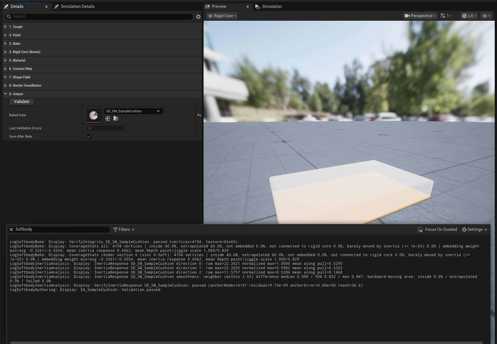
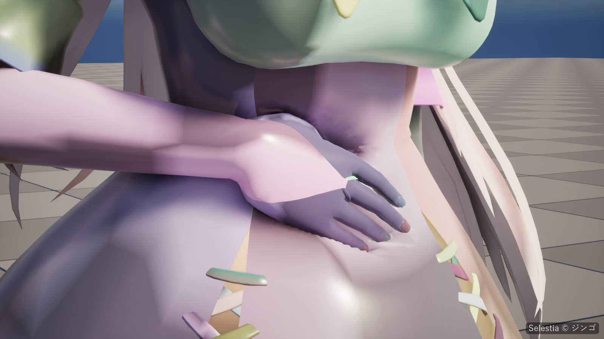

# 문제 해결

메시지는 바뀌지 않는 부분만 인용합니다. 출력 로그는 `Softbody`로 필터링합니다. Softbody Authoring Data의 **Validate**와 Softbody 컴포넌트의 **Validate Setup**은 누를 때마다 검사를 실행하고, 플레이할 때도 **Validate Setup**이 실행됩니다. 에셋의 **Last Validation Errors**: 0 = 문제 없음, -1 = 마지막 베이크 뒤로 검사하지 않음.

## 플레이: 아무것도 눌리지 않을 때 {#playing-nothing-dents}

| 메시지 | 원인 | 해결 |
|---|---|---|
| `Contact is OFF for every Softbody component: it needs Shader Model 5` | 렌더러가 Shader Model 5보다 낮습니다(모바일 프리뷰, ES3.1). | 데스크톱 렌더러를 씁니다. D3D11과 D3D12에서 확인했습니다. 출렁임은 그대로 작동합니다. |
| `Contact is OFF for every Softbody component: this GPU or driver` | GPU나 드라이버가 쓰기용으로 바인딩한 4채널 float 텍스처를 읽지 못합니다. | 더 새 GPU 드라이버에서는 켜질 수 있습니다. 출렁임은 그대로 작동합니다. |
| `Contact is off for ...: its contact map was baked with an older plugin` | **Mesh Data**를 이전 버전 플러그인으로 베이크했습니다. | 그 **Mesh Data**의 Softbody Authoring Data에서 **Rebake Contact Map**을 누릅니다. |
| `contact is off, inertia still runs` | 접촉 맵이 없습니다. **Bake Contact Map**이 꺼져 있었거나 접촉 맵 베이크가 실패했습니다. | **Bake Contact Map**을 켜고 **Rebake Contact Map**(또는 **Run Bake**)을 누릅니다. |
| `The rise around presses and drag are off for` | 지원하는 형식의 솟음 거리 표가 없거나, 표의 픽셀 포맷이 맞지 않습니다. | **Rebake Contact Map**을 누릅니다. 눌림은 그대로 작동합니다. |
| `Drag is off for ...: its bulge grid is ... cells per side` | 메시가 약 10 m 이상이라 끌림 격자의 한 변 1024칸을 넘습니다. | 없습니다. 눌림과 솟음은 그대로 작동합니다. |
| `MeshData is not assigned.` | **Mesh Data**가 비어 있습니다. | 메시의 Softbody Authoring Data에 있는 **Baked Data**를 지정합니다. |
| `no target mesh component` 또는 `found no mesh component to deform` | 액터에 스켈레탈 메시나 스태틱 메시 컴포넌트가 없고, **Target Mesh Component**도 비어 있습니다. | 메시가 있는 액터에 컴포넌트를 붙이거나, **Target Mesh Component**를 지정합니다. |
| `target mesh does not match MeshData source` | **Mesh Data**를 다른 메시에서 베이크했습니다. | **Mesh Data**가 이 메시의 베이크를 가리키게 하거나, 이 메시를 베이크합니다. |
| `has no material slot containing the Softbody material function parameters` | Softbody 머티리얼을 쓰는 슬롯이 없습니다. | [베이크로 머티리얼을 만들거나](Materials#let-the-bake-make-the-material) [마스터 머티리얼에 MF_SoftbodyKernel을 추가](Materials#use-your-own-master-material)합니다. |
| `also deforms ... Keep one Softbody component per mesh` | 한 메시에 Softbody 컴포넌트가 둘 있어, 같은 머티리얼 값을 서로 덮어씁니다. | 컴포넌트를 하나만 남깁니다. |

## 플레이: 콜라이더가 누르지 않을 때 {#playing-a-collider-does-not-press}

| 메시지 | 원인 | 해결 |
|---|---|---|
| `has no simple collision shapes and no baked shape field` | 복합(삼각형 메시) 콜리전만 있습니다. 누를 수 있는 것은 구, 캡슐, 박스, 컨벡스 셰이프뿐입니다. | 단순 콜리전이나 피직스 에셋을 추가하거나, 셰이프 필드를 베이크합니다(메시를 우클릭하고 **Softbody: Bake Shape Field**). |
| `Contact skipped ... collision shape(s) over the per-frame budget` | 한 프레임에 메시와 겹친 셰이프가 32개(컨벡스 평면은 2048개)를 넘었거나, 평면이 없는 컨벡스 셰이프가 있습니다. | 한 번에 닿는 콜라이더를 줄입니다. 누르지 않아야 할 콜라이더에는 `SoftbodyIgnore` 태그를 붙입니다. |
| `shape field of ... skipped` | 한 프레임에 셰이프 필드 파트가 512개를 넘었거나, 셰이프 필드를 베이크한 뒤 누르는 메시의 본이 바뀌었습니다. | 한 번에 누르는 메시를 줄이거나, 누르는 메시의 셰이프 필드를 다시 베이크합니다. |
| `self contact skipped this frame` | 캐릭터 자신의 파트까지 세어 같은 512개 파트 예산이 찼습니다. | 한 번에 누르는 메시를 줄입니다. |
| `self contact part ... skipped — bone not found` | 셰이프 필드를 베이크한 뒤 스켈레톤이 바뀌었습니다. | **Rebake Shape Field**를 누릅니다. |
| `self contact parts differ from the wake boxes baked into` | 접촉 맵을 베이크한 뒤 **Self Contact Bones**가 바뀌어서, 손이 떨어져 있는 동안에도 메시가 쉬지 못합니다. | **Rebake Contact Map**(또는 **Rebake Shape Field**)을 누릅니다. |
| 메시지 없음, 콜라이더의 일부(예: 캐릭터의 발)가 박히기만 하고 누르지 않음 | 누르는 메시에 셰이프 필드가 있으면 피직스 에셋 대신 셰이프 필드로만 누르고, 셰이프 필드에 없는 부위는 누르지 않습니다. | 누르는 메시의 셰이프 필드를 다시 베이크합니다. Softbody 캐릭터는 자기 Softbody Authoring Data의 **Rebake Shape Field**로, 손과 소품은 **Softbody: Bake Shape Field**로 합니다. |
| 메시지 없음, 메시가 전혀 눌리지 않음 | | [체크리스트](#no-dents-checklist)를 위에서부터 차례로 확인합니다. |

## 베이크가 멈추거나 실패할 때 {#bake-stops-or-fails}

| 메시지 | 원인 | 해결 |
|---|---|---|
| `Target Mesh is not set to a skeletal or static mesh` | **Target Mesh**가 비어 있거나 다른 타입입니다. | **Target Mesh**를 지정합니다. |
| `Core Placement is Custom Spheres but Rigid Core Spheres has no sphere` | Custom Spheres에는 구가 하나 이상 있어야 합니다. | 구를 추가하거나 **Core Placement**를 Center나 Bottom으로 바꿉니다([베이크](Baking)). |
| `Could not place the rigid core` | Center와 Bottom은 메시의 속을 읽는데, 이 메시에는 속이 없습니다. | 닫힌 메시를 쓰거나, **Volume Mesh**를 정하거나, Custom Spheres를 씁니다. |
| `is engine content, and baking writes into the mesh` | 메시가 엔진 폴더(플러그인 또는 엔진 콘텐츠) 아래에 있습니다. | 프로젝트의 Content에 복제하고 복제본을 베이크합니다. |
| `has no LOD0 source geometry` | 메시를 소스 데이터 없이 임포트했습니다. | 소스 데이터와 함께 다시 임포트합니다. |
| `The mesh already uses all ... UV channels` | 베이크에는 UV 채널이 하나 더 필요합니다. | 쓰지 않는 UV 채널을 지우고 다시 베이크합니다. |
| `Could not measure the flesh: the mesh encloses no volume` 또는 `Could not build the outer surface: it came out empty` | 메시가 닫혀 있지 않습니다(한 면짜리 시트, 열린 튜브). | **Volume Mesh**에 같은 자리에 놓인, 닫히고 속이 찬 메시를 지정합니다. |
| `Bake stopped: the contact map normals point inward` | 면이 안쪽을 향합니다. | 메시를 닫고 면이 바깥을 향하게 한 뒤 **Rebake Contact Map**을 누릅니다. |
| `No rigid core` | 스킨 웨이트가 있는 본이 메시 안에 하나도 없습니다. 베이크는 출렁임 없이 계속됩니다. | 스켈레톤의 본이 메시 안에 있는지 확인합니다. |
| `Inertia bake failed: the rigid core holds too few grid points` | 코어가 측정 격자에 비해 너무 얇습니다. | **Bone Thickness**를 올리거나, **Rigid Core Spheres**(Custom Spheres)를 추가하거나, **Measure Cell Size**를 낮춥니다. |
| `Inertia bake failed: no surface vertex can jiggle` | 단단한 코어나 뼈로 칠한 살이 메시 전체를 덮습니다. | **Bone Thickness**를 낮추거나, 무른 살 위의 **Depth**와 **Jiggle**이 검은색이 아닌지 확인합니다. |
| `Could not fit ... contact map islands into one contact map` | 해상도에 비해 아일랜드가 너무 많습니다. | **Contact Map Resolution**을 올립니다. |
| `Could not use the mesh's UV0 islands for the contact map` | UV0를 쓸 수 없어서(이유는 메시지에 나옵니다) 아일랜드를 자동으로 만들었습니다. | UV0를 고치거나, **Contact Map Seams**를 Automatic (XAtlas)로 설정합니다. |
| `The mesh already has ... UV channels, so the contact map UV channel could not be added` | 빈 UV 채널이 없습니다(나나이트와 스켈레탈 메시는 UV0부터 UV3까지 읽습니다). | 쓰지 않는 UV 채널을 지우고 **Rebake Contact Map**을 누릅니다. |
| `is shared with other Softbody meshes that read a different UV channel` | 베이크한 두 메시가 마스터 머티리얼 하나를 함께 쓰는데, 필요한 UV 채널이 서로 다릅니다. | 이 메시에 머티리얼 사본을 따로 주고(또는 **Create Softbody Material**을 켜고) **Rebake Contact Map**을 누릅니다. |
| `Some packages could not be saved` 또는 `already had unsaved changes before the bake` | 베이크는 저장하지 않은 변경이 이미 있던 패키지를 저장하지 않습니다. | 직접 저장합니다. |
| `holds the bake of ..., another mesh with the same name` | 다른 폴더에 있는 같은 이름의 메시를 같은 출력 폴더에 베이크하려 했습니다. 그대로 두면 서로의 베이크를 덮어씁니다. | **Output Folder**를 다른 폴더로 정합니다. |
| `bulge distance table would be ... texels tall` | 큰 메시를 높은 해상도로 베이크해서 솟음 거리 표가 텍스처 한 장에 들어가지 않습니다. | **Contact Map Resolution**을 낮춥니다. |

## Validate가 문제를 알릴 때 {#validate-reports-problems}

`Validation passed`가 나와도 그 위에 Softbody 머티리얼 경고가 있을 수 있습니다.

| 메시지 | 원인 | 해결 |
|---|---|---|
| `Nothing to validate - Baked Data is empty` | 아직 베이크하지 않았습니다. | **Run Bake**를 누릅니다. |
| `Baked Data was baked from a different mesh than Target Mesh` | 베이크한 뒤 **Target Mesh**가 바뀌었습니다. | **Run Bake**를 누릅니다. |
| `Volume Mesh differs from the one Baked Data was baked with` | 베이크한 뒤 **Volume Mesh**가 바뀌었습니다. | **Run Bake**를 누릅니다. |
| `The flesh softness bake is missing or out of date, so nothing jiggles` | 출렁임 데이터가 없습니다. 스켈레탈 메시는 메시 안에 스킨 웨이트가 있는 본이, 스태틱 메시는 **Core Placement**로 정한 단단한 코어가 필요합니다. | 그것을 갖춘 뒤 **Run Bake**를 누릅니다. |
| `There is no contact map, so nothing dents` | **Bake Contact Map**은 켜져 있지만 접촉 맵이 없습니다. | **Rebake Contact Map**(또는 **Run Bake**)을 누릅니다. |
| `No slot uses a Softbody material, so the mesh will not deform` | 아직 메시에 Softbody 머티리얼이 없습니다. | 머티리얼을 지정한 뒤 **Rebake Contact Map**을 누릅니다. |
| `feeds ... from UV channel ..., but this mesh's bake uses channel` | 머티리얼이 엉뚱한 UV 채널을 읽습니다. 보통 다른 Softbody 메시가 그 머티리얼을 함께 쓰기 때문입니다. | 이 메시에 머티리얼 사본을 따로 주고 **Rebake Contact Map**을 누릅니다. TexelUV에 쓰는 Texture Coordinate 노드도 맞는 채널로 설정합니다. |
| `has no shape field` | **Bake Shape Field**는 켜져 있지만 메시에 셰이프 필드가 없습니다. | **Rebake Shape Field**(또는 **Run Bake**)를 누릅니다. |
| `Shape Field Slots changed since the shape field bake` | 셰이프 필드를 베이크한 뒤 **Shape Field Slots**를 바꿨거나, 콘텐츠 브라우저 명령으로 메시 전체를 다시 베이크했습니다. | **Rebake Shape Field**를 누릅니다. |
| `Volume Preservation is ... but the flesh was measured with` | 베이크한 뒤 **Volume Preservation**을 바꿨습니다. 눌린 자리는 이미 새 값을 씁니다. | **Run Bake**를 누릅니다. |
| `the slot paint changed since the flesh was measured` | 마지막 Run Bake 뒤에 칠을 바꿔서, 출렁임과 접촉이 서로 다른 칠을 읽습니다. | **Run Bake**를 누릅니다. |
| `VerifyIntegrity <Baked Data>: ...` | 베이크한 텍스처, 표 또는 UV 채널이 더는 메시와 맞지 않습니다(베이크 뒤에 메시를 편집했거나 다시 임포트함). | **Run Bake**를 누릅니다. |
| `VerifySkeletal: ...` (missing input, could not read the texture source, no render data, render data has no UV channel N) | 스켈레탈 메시의 렌더 데이터나 베이크한 관성 그룹 텍스처가 더는 베이크와 맞지 않습니다. | **Run Bake**를 누릅니다. 텍스처 소스를 읽지 못한다면 프로젝트를 저장하고 다시 베이크합니다. |

## 페인트, 셰이프 필드, 나나이트 {#paint-shape-field-nanite}

| 메시지 | 원인 | 해결 |
|---|---|---|
| `Could not read the slot paint, so Depth and Volume are baked as 1 everywhere` | 접촉 맵을 베이크할 때 칠을 읽지 못했습니다. | **Run Bake**를 누릅니다. |
| `Paint: could not read the pixels of mask texture` 또는 `its Paint Texture has no source pixels` | Paint Texture에 소스 데이터가 없어, 그 슬롯은 칠하지 않은 것(흰색)으로 남습니다. Flex는 판이 없어집니다. | 텍스처를 다시 임포트하거나, 그 채널을 **White everywhere**나 **Black everywhere**로 둡니다. |
| `has sRGB on, so the bake reads it as a color` | Paint Texture의 sRGB가 켜져 있어 회색이 어둡게 읽힙니다(0.5가 0.21로). | 텍스처 설정에서 sRGB를 끕니다. |
| `is a PNG with Flex in its alpha` | PNG 임포트가 완전히 투명한 픽셀의 색을 이웃 색으로 바꿔, 판 위의 Depth, Jiggle, Volume이 달라질 수 있습니다. | TGA로 내보내거나, Project Settings > Texture Import의 **PNG Infill**을 Never로 두고 다시 임포트합니다. |
| `which is black everywhere, so the whole slot becomes` | 한 채널이 텍스처 전체에서 검은색이라 슬롯 전체가 뼈, 단단한 살, 폼, 판 하나 중 하나가 됩니다. | 그 채널을 쓰지 않는다면 **White everywhere**로 둡니다. |
| `Paint: the flesh on the Softbody material slots barely moves` | 출렁여야 할 살이 거의 움직이지 않습니다. | 무른 살 위의 **Depth**와 **Jiggle**이 검은색이 아닌지 확인합니다. |
| `Paint: the deepest flesh moves ...x as far as the reference flesh` | 깊은 살이 기준 살보다 훨씬 많이 움직여, Inertia Amount가 그만큼 더 흔듭니다. | 사람 크기의 몸이면 **Flesh Reach**를 약 3으로 두고 **Run Bake**를 누릅니다. |
| `Paint: the jiggle amount (after Physics Driven Bones) changes sharply over a narrow strip` | **Physics Driven Bones** 때문에 출렁임이 좁은 띠 안에서 급하게 바뀝니다. 그 자리는 출렁일 때 찢어지거나 접혀 보일 수 있습니다. 메시지에 메시 위치가 나옵니다. | 그 본들의 스킨 웨이트를 넓고 완만하게 줄어들게 합니다. |
| `The Flex paint dents like bare skin because Contact Detail is Basic` (플레이, Validate Setup) | Flex는 Contact Detail Full에서만 듣습니다. | 판이나 휘는 겉이 필요한 메시는 **Contact Detail**을 Full로 둡니다. |
| `Flex plates: ... painted pieces wrap around the body` | 몸을 둘러 감긴 조각은 판이 되지 못하고 칠대로 휩니다(Plates 보기에서 빨강). | 칠에 가는 흰 틈을 두어 평평한 조각으로 나눕니다. |
| `Flex plates: ... painted pieces have no contact map cells under them` | 조각이 눌리는 슬롯 밖에 있거나, 떠 있는 조각 밑에 눌릴 겉면이 없습니다(Plates 보기에서 흰색). | 밑의 슬롯을 **Pressable Slots**에 넣거나, 장식을 피부 가까이 둡니다. |
| `Flex plates: ... painted pieces cover more than` | 조각이 너무 커서 판이 되지 못하고 칠대로 휩니다(Plates 보기에서 주황). | 가는 흰 틈을 두어 작은 조각으로 나눠 칠합니다. |
| `Flex plates: ... painted pieces sit at the very edge of the contact map` | 조각이 접촉 맵 가장자리에 걸려 판으로 읽을 수 없습니다(Plates 보기에서 보라). | 다른 **Contact Map Resolution**으로 다시 베이크합니다. |
| `Flex: more than ... plates` | 따로 칠한 판이 너무 많아, 넘친 것은 칠대로 휩니다. | 따로 칠한 판의 수를 줄입니다. |
| `Paint: Physics Driven Bones were skipped` | LOD0 스킨 웨이트를 CPU에서 읽을 수 없거나, 메시에 베이크한 UV 채널이 없습니다. | 스켈레탈 메시의 Allow CPU Access for LOD0를 켜고(또는 **Run Bake**를 다시 누르고) **Reapply Paint**를 누릅니다. |
| `in Physics Driven Bones is not in the skeleton` | **Physics Driven Bones**의 본 이름에 오타가 있습니다. | 이름을 고칩니다. |
| `Inertia groups: all ... groups are taken, so lump bone ... gets no group of its own` | 출렁이는 본이 **Max Inertia Groups**가 허용하는 수보다 많습니다. | **Max Inertia Groups**를 올립니다(최대 16). |
| `has no bone named ...; check Self Contact Bones` | **Self Contact Bones**의 본 이름에 오타가 있습니다. | 이름을 고칩니다. |
| `none of the Self Contact Bones (or their child bones) is the main skin weight inside the mesh, so self contact is off` | 목록의 본이 움직이는 살이 없습니다. | 실제로 손을 움직이는 본을 넣습니다. |
| `has no material slot named ...; check Shape Field Slots` | **Shape Field Slots**의 슬롯이 메시에 없습니다(이름이 바뀌었거나 다시 임포트함). 그 슬롯은 빠진 채 베이크됩니다. | 목록에서 슬롯을 다시 고르고 **Rebake Shape Field**를 누릅니다. |
| `none of the Shape Field Slots has any triangles` | 고른 슬롯에 삼각형이 하나도 없어 베이크하지 않았습니다. | 몸 슬롯을 고르거나 **Shape Field Slots**를 비웁니다. |
| `has no material slot names in its source geometry` | 메시 원본에 슬롯 이름이 없어 **Shape Field Slots**를 쓸 수 없습니다. | 메시를 다시 임포트하거나 **Shape Field Slots**를 비웁니다. |
| `Self Contact Bones is empty, so every part presses the mesh itself` | 몸의 모든 파트가 몸을 누릅니다. | 몸이라면 `Hand_L`, `Hand_R`처럼 손만 넣습니다. |
| `no bone is the main skin weight inside the mesh` | 셰이프 필드 베이크가 메시 안쪽을 어느 본에도 나눠 주지 못했습니다. | 스킨 웨이트를 확인합니다. |
| `owns N cell(s) of flesh, too few to be its own part` | 본이 움직이는 살이 너무 적어 셰이프 필드 파트가 되지 못하고, 부모 본 중에도 파트인 본이 없어서 그 살은 셰이프 필드에서 빠집니다. | 스킨 웨이트를 확인합니다. |
| `On a static mesh the whole mesh presses, so Self Contact Bones is ignored` | 스태틱 메시에서는 정상입니다. | 할 일이 없습니다. |
| `uses translucent material ..., so the whole mesh cannot render as Nanite` | 나나이트는 모든 슬롯에 불투명 또는 마스크드 머티리얼이 필요합니다. | 그 슬롯에 Opaque 또는 Masked 머티리얼을 씁니다. |
| `The mesh has ... morph targets, and Nanite skinning ignores them` | 나나이트 스키닝은 모프 타깃을 재생하지 않습니다. | 표정은 별도의 머리 메시에 두고, 관절 보정에는 헬퍼 본을 씁니다. |
| `vertices with hard normals; tessellation can open cracks there` | Softbody 슬롯에 하드 노멀이 있습니다. | DCC 툴에서 그 노멀을 부드럽게 합니다. |
| `r.Nanite.DicingRate is ..., so skinned meshes break into pieces up close` | 스킨드 메시에 쓰기에는 다이싱 레이트가 너무 낮습니다. | DefaultEngine.ini의 `[SystemSettings]` 아래에 `r.Nanite.DicingRate`를 메시지에 나온 값 이상으로 설정합니다. |
| `no material slot uses a softbody material (one that reads the contact map)` | 나나이트 테셀레이션은 Softbody 머티리얼 안에 설정되는데, 그 머티리얼을 쓰는 슬롯이 없습니다. | **Recreate Material**을 누르거나 Softbody 머티리얼을 지정한 뒤 **Reapply Nanite Tessellation**을 누릅니다. |
| `Nanite tessellation with Displacement Center 0` | 머티리얼의 나나이트 변위 Center가 0이라 버텍스 사이의 눌림이 잘립니다. 머티리얼을 직접 설정했을 때 생깁니다. | 머티리얼 디테일의 Nanite > Displacement에서 Center를 0.75 정도로 올립니다. 또는 Softbody Authoring Data의 **Nanite Displacement Center**를 정하고 **Reapply Nanite Tessellation**을 누릅니다. |

## 눌리지 않나요? 체크리스트 {#no-dents-checklist}

Softbody 컴포넌트와 메시의 Softbody Authoring Data에서:

1. **Enable Contact**가 켜져 있습니다.
2. **Mesh Data**가 이 메시의 **Baked Data**입니다. **Validate Setup**을 누르면 로그에 `setup valid`와 `contact=surface field`가 나와야 합니다. `contact=off (...)`이면 괄호 안에 이유가 나옵니다.
3. 메시를 **Bake Contact Map**을 켠 채 베이크했고, **Validate**를 통과합니다.
4. 누르는 물체가 **Collider Channel**(기본값 Visibility)을 막고, 콜리전 쿼리가 켜져 있고, 단순 콜리전이나 피직스 에셋이나 셰이프 필드가 있습니다. 그 물체에도, 그 액터에도 `SoftbodyIgnore` 태그가 없고, Softbody 컴포넌트 자신의 액터에 속하지 않습니다.
5. **Find Colliders Automatically**가 켜져 있습니다.
6. **Min Screen Size**(기본값 0.15): 에디터 뷰포트를 포함한 모든 뷰에서 메시가 이 값보다 작게 보이는 동안에는 눌림이 멈춥니다.
7. 눌리는 슬롯이 Softbody 머티리얼을 씁니다. 머티리얼을 바꾼 뒤에는 **Rebake Contact Map**을 한 번 더 눌러 머티리얼을 접촉 맵에 연결합니다.
8. 두 Softbody 메시 사이에서는 한쪽만 누릅니다. 눌리기만 하는 쪽의 콜리전을 끕니다([콜라이더](Colliders)).

## 눌림이 이상해 보일 때 {#dents-look-wrong}

- **표면을 가로지르는 선이나 계단.** 접촉 맵이 나뉜 곳을 가로지르는 눌림은 조금 덜 정확합니다. 기본적으로 **Contact Map Seams**는 메시의 UV0 이음매에서 나눕니다. **Debug View**를 켜고 **Debug View Mode**를 2로 두면 나뉜 곳이 체커가 끊기는 선으로 보입니다. 베이크가 `the contact map UV channel could not be added` 경고를 냈다면, UV 아일랜드 경계를 가로지르는 눌림은 덜 세밀합니다.
- **손끝이 눌린 자리 대신 흐릿하게 번집니다.** **Contact Map Resolution**을 올립니다. 밀도가 낮은 메시에서 버텍스 사이의 좁은 눌림에는 **Set Up Nanite Tessellation**이 필요합니다. **Debug View Mode** 5는 삼각형 안에서 눌림을 읽는 곳을 초록색으로, 이음매를 따라 버텍스만 움직이는 곳을 빨간색으로 보여 줍니다.
- **눌림이 덜 들어가거나, 콜라이더가 눌림 없이 파고듭니다.** **Max Contact Depth**(기본값 15 cm)까지는 누른 깊이를 그대로 그리고, 그 너머는 부드럽게 줄어 1.3배에서 멈춥니다. 콜리전이 보이는 피부보다 몇 cm 안쪽에 있다면(몸 캡슐), **Max Contact Depth**를 그 간격으로 설정합니다.
- **눌린 자리와 솟음이 너무 넓거나 좁습니다.** 폭은 살 두께와 Softbody 컴포넌트의 **Skin Tension**, 그리고 Contact Detail이 Full이면 **Flex** 칠이 정합니다([살의 재료](Concepts#flesh-material)). **Flesh Thickness** 보기로 두께를 확인한 뒤, 단단한 코어를 옮기거나(Core Placement, Rigid Core Spheres, Bone Thickness) Max Flesh Thickness나 Depth 칠을 바꿉니다.
- **위를 누르면 옆도 눌립니다.** 단단한 코어가 바닥에만 있으면 옆면은 아주 두꺼운 살로 측정됩니다. **Max Flesh Thickness**를 가장 깊은 누름보다 조금 크고 물체 폭의 1/4보다 작게 설정합니다.
- **눌림이 옆으로 밀리거나 엉뚱한 방향으로 밀립니다.** 볼륨 메시가 피부 자리에 있지 않습니다. 베이크 로그에 `Volume mesh check: ... only ...% are inside volume mesh`가 나옵니다. 볼륨 메시의 바깥면은 대상 메시의 표면에 맞닿아야 합니다.
- **테셀레이션하면 금이 갑니다.** Softbody 슬롯의 하드 노멀을 부드럽게 합니다.

## 출렁임이 이상할 때 {#jiggle-wrong}

- **아무것도 출렁이지 않습니다.** **Enable Inertia**를 확인합니다. 베이크에 출렁임 데이터가 없으면 **Validate Setup**이 `inertia is enabled but MeshData has no inertia softness bake`를 알립니다.
- **일부가 출렁이지 않습니다.** `inertia group bones were not found on the mesh's skeleton; those groups will not jiggle`은 베이크한 뒤 스켈레톤이 바뀌었다는 뜻입니다. **Run Bake**를 다시 누릅니다.
- **프레임이 떨어지면 살이 튑니다.** **Hitch Guard**(기본값 0.1초)보다 긴 프레임은 히치로 보고 그 가속도를 무시합니다. 그래도 튄다면 값을 낮춥니다.
- **리스폰이나 카메라 컷에서 살이 튑니다.** 현재 속도로 갈 수 있는 거리에 **Teleport Distance**(기본값 50 cm)를 더한 것보다 멀리 움직이면 텔레포트로 보고 출렁이지 않습니다. 텔레포트 플래그가 붙은 이동은 언제나 텔레포트로 봅니다. 값을 낮추거나, 텔레포트 플래그를 켜고 액터를 옮깁니다. 빠른 움직임에서 출렁임이 사라진다면 값을 올립니다.
- **큰 덩어리가 가장 크게 출렁일 때 납작해집니다.** **Max Inertia Offset**(기본값 25 cm)이 화면에 그리는 움직임을 자릅니다. 값을 올립니다.

## 빠른 시작 뒤 머티리얼이 흰색일 때 {#material-is-white-after-quick-start}

**Create Softbody Material**은 슬롯의 원래 머티리얼에서 베이스 컬러, 노멀 맵, 러프니스 텍스처를 복사하는데, 샘플 방석에는 셋 다 없어서 `Copied: base color (not found), normal map (not found), roughness (not found, 0.5)`가 나옵니다. 머티리얼 인스턴스에서 BaseColorTex, NormalTex, RoughnessTex를 직접 설정합니다.

## 질문 {#questions}

**콜라이더 목록을 컴포넌트에 직접 줄 수 있나요?** 아니요. 그런 목록도, 블루프린트 함수도 없습니다. **Find Colliders Automatically**를 끄면 바깥 콜라이더는 메시를 누르지 않습니다. 무엇이 누를지는 **Collider Channel**과 `SoftbodyIgnore` 태그로 정합니다([콜라이더](Colliders)).

**플레이를 누르지 않아도 레벨 에디터 뷰포트에서 눌림이 보이나요?** 아니요. 컴포넌트는 게임이 실행되는 동안에만 작동합니다. 에디터에서 플레이하는 동안에도 **Min Screen Size**는 에디터 뷰포트를 뷰로 셉니다.

**메시에서 Softbody를 빼려면 어떻게 하나요?** Softbody 컴포넌트를 지우고 슬롯에 원래 머티리얼을 다시 넣습니다. 베이크한 에셋과 베이크가 추가한 UV 채널은 남겨도 되고 지워도 됩니다. 컴포넌트가 없으면 아무 일도 하지 않습니다.

**플러그인을 업데이트한 뒤에는 무엇을 다시 베이크하나요?** Validate나 Validate Setup이 이전 플러그인으로 베이크했다고 알리면, 그 메시지가 말하는 버튼(**Run Bake**, **Rebake Contact Map**, **Rebake Shape Field**, **Reapply Paint**)을 누릅니다. 알림이 없으면 다시 베이크하지 않아도 됩니다.
