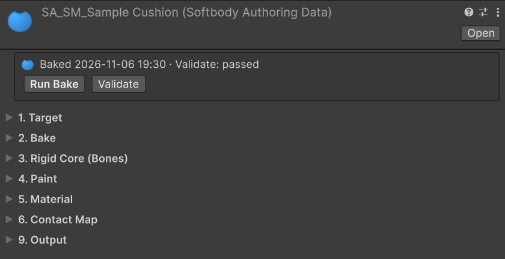
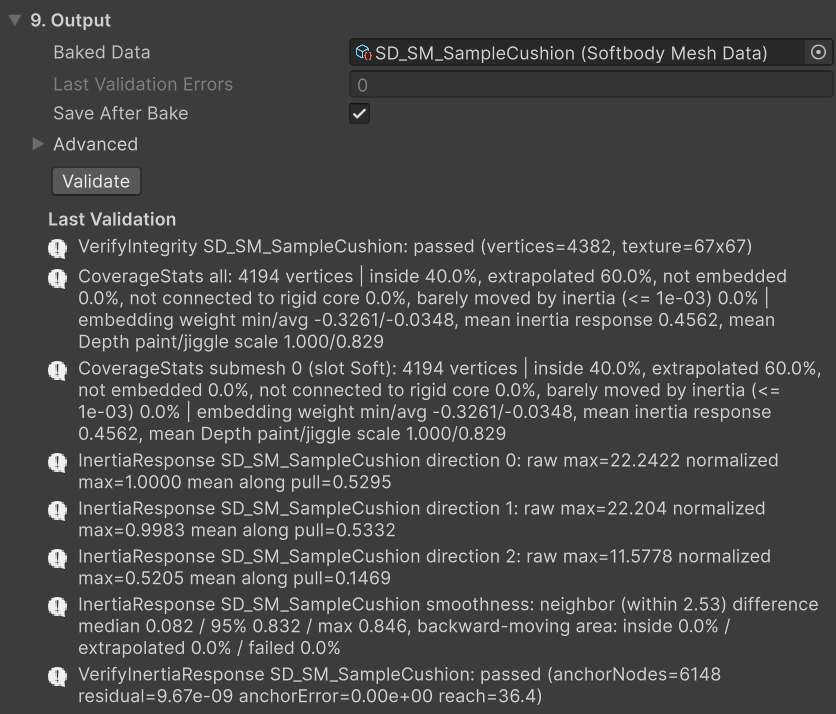
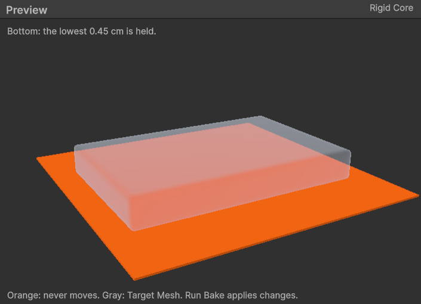

# 베이크

베이크 에셋은 **Assets > Create > Softbody > Softbody Authoring Data**로 만듭니다. 또는 Project 창에서 모델이나 프리팹을 고르고 **Assets > Softbody > Create Authoring Data**를 누릅니다. 그러면 그 옆에 `SA_<메시 이름>`이 생기고 **Target Mesh**가 채워집니다. 메시가 여럿인 모델은 말랑하게 만들 메시마다 베이크 에셋을 하나씩 만듭니다.

**Target Mesh**를 정하고 **Run Bake**를 누릅니다. 결과는 Softbody 컴포넌트의 **Mesh Data**에 넣을 **Baked Data** 에셋입니다. 베이크 에셋 자체는 에디터 전용이라 빌드에 들어가지 않습니다. 스킨 메시는 [캐릭터](./Characters)도 보세요.

## Run Bake가 하는 일 {#what-run-bake-does}

Run Bake는 [빠른 시작](./Quick-Start)의 방석에서 15~20초, 캐릭터에서 몇 분 걸립니다. 베이크는 백그라운드에서 돌고, 인스펙터 맨 위 상태 상자에 진행 막대와 **Cancel**이 나옵니다. **Cancel**을 누르면 아무것도 바뀌지 않습니다. 베이크에는 실행 취소(Undo)가 없습니다. 에디터 전체에서 한 번에 하나만 돌고, Play 모드에 들어가면 취소됩니다.

첫 단계가 실패하면 베이크가 멈춥니다. 그 뒤 단계가 실패하면 남은 단계는 그대로 실행됩니다.

| 단계 | 실행 조건 | 하는 일 |
|---|---|---|
| 1. Measuring the flesh | 항상 | 칠과 Volume Preservation을 읽어 살을 재고, **Output Folder**에 `SD_<메시 이름>`과 `SD_<메시 이름>_Bake`를 만듭니다. |
| 2. Converting the slot mask paint | 항상 | 칠을 접촉과 출렁임에 쓸 값으로 바꾸고, **Physics Driven Bones**를 적용하고, Flex를 칠한 조각을 찾습니다. |
| 3. Creating the Softbody material | **Create Softbody Material**이 켜져 있을 때 | 슬롯마다 Softbody 머티리얼을 만들어 렌더러에 입힙니다. |
| 4. Baking the contact map | **Bake Contact Map**이 켜져 있을 때 | 접촉 맵을 베이크합니다. 판(Flex를 칠한 조각)의 칸과 **Separated Pairs**로 나눈 부위도 여기서 구워집니다. |
| 5. Saving | **Save After Bake**가 켜져 있을 때 | 이번 베이크가 바꾼 것과 베이크 에셋 자신을 저장합니다. |

메시지는 Console 창에 `<베이크 에셋 이름>: ` 꼴로 나옵니다. 단계가 실패하면 그 이유는 바로 위 줄에 있습니다. 고치는 방법은 [문제 해결](./Troubleshooting)에 있습니다.

### 베이크가 바꾸는 것 {#what-the-bake-changes}

- **메시는 바꾸지 않습니다.** 모델을 다시 임포트해도 베이크는 남습니다. 다시 임포트해서 버텍스가 바뀌었으면 [Validate](#validate)가 알려 주고, 그때 Run Bake를 누릅니다.
- **1단계**: `SD_<메시 이름>`은 Baked Data로, 빌드에 들어갑니다. `SD_<메시 이름>_Bake`는 **Bake Cache**로, 에디터에서만 씁니다.
- **3단계**: Softbody/Lit 셰이더를 쓰는 `M_<메시 이름>_Softbody`와, **Softbody Material Slots**의 슬롯마다 그 머티리얼의 변형 `MI_<메시 이름>_<슬롯>`을 만듭니다. 원래 머티리얼의 베이스 컬러와 노멀 맵을 복사하고(URP Lit이면 맞는 다른 설정도), 이미 Softbody 머티리얼을 쓰는 슬롯은 건드리지 않습니다. 찾지 못한 텍스처는 변형에서 직접 지정합니다.
  - 모델은 임포트 설정의 머티리얼 리맵으로 입힙니다. 리맵은 모델 전체에서 그 머티리얼을 바꾸므로, 같은 머티리얼을 쓰는 다른 슬롯이나 렌더러도 함께 바뀝니다(Console에 경고가 나옵니다). 그런 슬롯은 3D 툴에서 다른 머티리얼을 주거나, 프리팹에서 직접 입힙니다.
  - 프리팹은 프리팹 안의 렌더러에 입히고 프리팹을 저장합니다.
  - 패키지 안의 모델은 바꿀 수 없습니다. Assets 폴더로 복사하고 복사본을 베이크합니다.
- **Slot Names**의 빈 칸을 이번 베이크의 머티리얼 이름으로 채웁니다.
- **5단계**: 베이크 에셋, Baked Data, Bake Cache는 늘 저장합니다. 베이크 전부터 저장하지 않은 변경이 있던 다른 에셋은 저장하지 않고 Console에 그 목록을 남깁니다.

## 1. Target {#_1-target}

| 설정 | 기본값 | 하는 일 |
|---|---|---|
| **Target Mesh** | None | 말랑하게 만들 Skinned Mesh Renderer나 Mesh Renderer입니다. 모델이나 프리팹 에셋 안의 것만 고를 수 있고, 장면의 오브젝트는 고르지 못합니다. |
| **Output Folder** | 비어 있음 | 베이크한 에셋을 쓰는 폴더입니다(비어 있으면 이 에셋의 폴더). Assets 폴더(또는 임베디드·로컬 패키지) 안이어야 하며, 옆의 **…** 버튼으로 고릅니다. |
| **Slot Names** (Advanced) | 비어 있음 | 서브메시마다의 슬롯 이름입니다. Slot Masks, Softbody Material Slots, Pressable Slots가 이 이름으로 슬롯을 고릅니다. 빈 칸은 베이크할 때 모델의 머티리얼 이름으로 채워지므로, 나중에 머티리얼을 바꿔 끼워도 슬롯 이름은 그대로입니다. |

## 2. Bake {#_2-bake}

| 설정 | 기본값 | 하는 일 |
|---|---|---|
| **Measure Cell Size** | 0.015 | 살을 재는 칸 크기를 메시의 가장 긴 변에 대한 비율로 정합니다(사람 크기에서 약 2.7 cm). 작을수록 세밀하지만 느립니다. 0.005~0.1. |
| **Max Inertia Groups** | 16 | 스킨 메시에서 따로 출렁일 수 있는 본 그룹의 수로, 그룹마다 컴포넌트의 **Inertia Group Overrides**에 항목이 생깁니다([관성](./Inertia)). 스태틱 메시에서는 흐리게 보입니다. 1~16. |
| [**Layer Max Gap**](#layer-max-gap) | 1.0 cm | 피부 위에 붙은 옷이 그 아래 살의 칠과 출렁임을 따르는 거리입니다. 0 = 끔, 최대 10 cm. |

### Layer Max Gap {#layer-max-gap}

몸에 붙는 슈트나 레깅스처럼 피부 위에 붙은 옷에 씁니다. 옷 버텍스에서 안쪽으로 이 거리 안에 피부가 있으면, 그 옷은 아래 살의 Depth, Jiggle, Volume 칠을 받고 살과 함께 출렁입니다. 이 거리의 절반보다 멀리 떨어진 옷은 덜 따라갑니다. 두꺼운 겉옷이 몸과 함께 출렁이게 하려면 올립니다. 옷은 몸과 같은 메시에 있어야 합니다. 따로 된 렌더러의 옷은 다른 메시라 따라가지 않습니다.

함께 눌리는 것은 이 값과 상관없이 접촉 맵이 정합니다. 옷 바로 밑의 피부와 바깥 표면 안쪽에 가려진 피부는 바깥 옷과 함께 눌립니다.

## 3. Rigid Core (Bones) {#_3-rigid-core-bones}

단단한 코어에서 먼 살일수록 더 출렁이고, 눌린 자리가 더 넓게 퍼집니다. 코어는 인스펙터 아래 미리보기 칸의 **Rigid Core** 보기로 봅니다([미리보기](#preview)).

이 카테고리의 칸은 대상에 따라 숨습니다. Core Placement는 스태틱 메시에서만, Rigid Core Spheres는 그중 Custom Spheres일 때만, Bone Overrides는 스킨 메시에서만 보입니다. Bone Thickness는 스킨 메시와 Core Placement Center에서 보입니다.

| 설정 | 기본값 | 하는 일 |
|---|---|---|
| [**Core Placement**](#core-placement) | Center | 스태틱 메시에서 움직이지 않는 부분을 어디에 둘지 고릅니다. |
| [**Rigid Core Spheres**](#rigid-core-spheres) | 비어 있음 | Core Placement가 Custom Spheres일 때 움직이지 않는 부분을 구로 직접 놓습니다. |
| [**Bone Thickness**](#bone-thickness) | 0.45 | 본이나 코어의 굵기입니다. 클수록 살이 얇아져 덜 출렁이고 눌린 자리가 좁아집니다. 0.05~1. |
| [**Bone Overrides**](#bone-overrides) | 비어 있음 | 본마다 역할(뼈, 덩어리, 장신구)과 굵기를 따로 정합니다. |
| [**Flesh Reach**](#flesh-reach) | 3 cm | 두꺼운 살이 두께가 아니라 칠대로 출렁이게 합니다. 사람 크기 몸이면 3쯤입니다. |

마지막 베이크가 지금과 다른 Bone Overrides, Bone Thickness, Softbody 머티리얼 슬롯으로 구워졌으면 이 카테고리 끝(Flesh Reach 아래)에 경고가 나옵니다. 그때는 Run Bake를 누릅니다.

### Core Placement {#core-placement}

스태틱 메시에서 씁니다.

- **Center**: 모양의 한가운데(판의 가운데 면, 공의 중심, 소시지의 축)를 뼈처럼 지나는 코어이고, 굵기는 **Bone Thickness**를 따릅니다. 공이나 장난감처럼 가운데가 단단한 물체에 씁니다.
- **Bottom**: 메시의 바닥만 붙듭니다. 방석이나 푸딩처럼 바닥이나 자리에 놓이는 물체에 씁니다.
- **Custom Spheres**: [Rigid Core Spheres](#rigid-core-spheres)에 직접 놓은 구를 씁니다. 구가 하나도 없으면 이 줄에 빨간 알림이 나오고 Run Bake가 시작하지 않습니다.

Center는 겉이 코어 위의 살만큼만 들어가므로, 깊이 눌리는 판이나 방석은 Bottom이 맞습니다. Center와 Bottom은 닫힌 메시가 필요합니다.

### Rigid Core Spheres {#rigid-core-spheres}

구마다 **Center**와 **Radius**를 cm로 넣습니다. Center는 메시 로컬 좌표에 100을 곱한 값이고, Radius 기본값은 10 cm입니다. 하나 이상은 메시 안에 있어야 합니다. 구 안의 살은 움직이지 않으므로, 구의 경계가 보이는 면을 가로지르면 출렁임과 덩어리 밀림이 그 선에서 꺾입니다. 평평한 받침은 아주 큰 구의 윗부분으로 만듭니다.

### Bone Thickness {#bone-thickness}

스킨 메시와 Core Placement Center에서 씁니다. 본이나 코어의 굵기를 피부까지 거리에 대한 비율로 정합니다. 본은 스켈레톤에서 가져오므로 콜라이더는 필요 없습니다. 스켈레톤에 없는 뼈(갈비뼈, 골반, 두개골)는 찾지 못합니다. 그런 부분은 [Depth](./Painting#the-four-channels)를 어둡게 칠합니다.

### Bone Overrides {#bone-overrides}

본마다 항목 하나를 넣습니다.

- **Bone Name**: 대상 스켈레톤의 본입니다. 드롭다운에 스켈레톤의 모든 본이 나옵니다.
- **Include Child Bones**(켬): 아래 본들도 자기 항목이 없으면 이 항목을 따릅니다. 사슬이나 팔다리 하나를 항목 하나로 정합니다.
- **Role**(Rigid Core): 아래 셋 중 하나입니다.
- **Bone Thickness**(0.45): Role이 Rigid Core일 때만 켜집니다.

Role:

- **Rigid Core**: 본을 단단한 코어로 씁니다.
- **Lump**: 본을 스켈레톤에서 뺍니다. 그러면 그 살은 눌릴 때 통째로 비켜나는 덩어리가 됩니다. 가슴과 엉덩이 본에 씁니다.
- **Accessory**: 몸에 리깅된 리본, 목걸이, 벨트 본에 씁니다. 단단한 코어도 덩어리도 아니고, 그 본이 움직이는 부분은 밑의 살을 따라 흔들립니다. 이런 본을 Rigid Core로 두면 살갗 바로 밑의 뼈로 쳐져 그 자리 살이 얇아집니다.

### Flesh Reach {#flesh-reach}

이보다 두꺼운 살은 두껍다고 더 출렁이지 않으므로, Jiggle을 같은 밝기로 칠한 부분은 비슷하게 출렁입니다. 팔뚝이나 정강이처럼 얇은 살은 덜 출렁입니다. 두꺼운 살을 더 크게 출렁이게 하고 덩어리 밑동을 더 무르게 하려면 올립니다.

0이면 꺼집니다. 그러면 안에 본이 없는 배가 같은 밝기로 칠한 다른 부위보다 훨씬 더 출렁입니다.

## 4. Paint {#_4-paint}

칠하는 방법: [페인트](./Painting). Volume Preservation이 하는 일: [살의 재료](./Concepts#flesh-material).

| 설정 | 기본값 | 하는 일 |
|---|---|---|
| **Volume Preservation** | 1 | 메시의 재료입니다. 살이나 젤리는 1, 폼이나 스펀지는 0이고, 그 사이는 일부만 압축되는 밀도 높은 폼입니다. 바꾸면 베이크하지 않아도 눌린 자리에 바로 들어가고, 덩어리 전체가 퍼지는 모양은 Run Bake 뒤에 바뀝니다. 0~1. |
| [**Slot Masks**](./Painting#the-four-channels) | 비어 있음 | 머티리얼 슬롯마다 칠 텍스처 한 장과, 네 채널(Depth, Jiggle, Volume, Flex)을 어디서 읽을지 정합니다. |
| [**Physics Driven Bones**](./Painting#physics-driven-bones) | 비어 있음 | 스프링 본, 천, 물리 컴포넌트처럼 다른 출렁임 시스템이 이미 움직이는 본입니다. 그 살은 Softbody 출렁임을 받지 않습니다. |

## 5. Material {#_5-material}

| 설정 | 기본값 | 하는 일 |
|---|---|---|
| **Create Softbody Material** | 끔 | Run Bake가 메시용 Softbody 머티리얼을 만듭니다(3단계). 내 셰이더에 Softbody 버텍스 함수를 넣어 쓸 때는 끈 채로 둡니다([머티리얼](./Materials)). |
| **Softbody Material Slots** | 비어 있음 | Softbody 머티리얼을 받을 슬롯입니다(피부와 몸에 붙는 옷, 얼굴과 머리카락은 빼고). Create Softbody Material이 켜져 있을 때만 쓰며, 그때는 비워 둘 수 없습니다. |
| [**Tessellation**](./Materials#tessellation) | 끔 | 가까이서 보는 피부에 켭니다. 베이크가 머티리얼을 **Softbody/Lit (Tessellated)**로 만들어, 손가락 끝 같은 좁은 눌림도 모양으로 보입니다. GPU 시간이 늡니다. 이미 만든 머티리얼은 **Run Bake**나 **Recreate Material**이 셰이더만 바꿉니다. |

## 6. Contact Map {#_6-contact-map}

**Bake Contact Map**을 끄면 아래 칸은 흐리게 보입니다.

| 설정 | 기본값 | 하는 일 |
|---|---|---|
| **Bake Contact Map** | 켬 | 끄면 접촉이 전혀 없고 메시는 출렁이기만 합니다. |
| **Contact Map Resolution** | 512 | 접촉 맵 한 변의 칸 수(2의 거듭제곱, 64~2048)입니다. 높을수록 작은 눌린 자리가 또렷하지만 GPU 시간과 메모리가 더 듭니다. 사람 크기 캐릭터는 512, 가까이서 보이면 1024. |
| **Pressable Slots** | 비어 있음 | 눌릴 수 있는 슬롯입니다(비어 있으면 Softbody 머티리얼 슬롯, 그것도 없으면 메시 전체). 얼굴이나 머리카락을 빼면 나머지가 더 세밀해집니다. |
| [**Contact Map Seams**](#contact-map-seams) | Mesh UV0 Islands | 접촉 맵을 조각으로 나눌 곳을 고릅니다. |
| **Max Flesh Thickness** | 0 cm | 표면에서 이보다 깊은 곳은 단단한 것으로 칩니다. 0 = 제한 없음. 코어가 바닥에만 있는 상자와 방석에 씁니다. 이 값이 없으면 윗면을 누를 때 옆면도 들어갑니다. 가장 깊이 누르는 깊이보다 조금 크게, 물체 폭의 4분의 1보다 작게 잡습니다. |
| [**Separated Pairs**](#separated-pairs) | 비어 있음 | 스킨 메시에서 겉면은 이어져 있지만 밑의 살은 따로인 두 부위(예: 좌우 한 쌍의 덩어리)를 떼어 둡니다. |
| **Envelope Cell Size** (Advanced) | 0 cm | 메시의 바깥 표면을 찾을 때 쓰는 칸 크기입니다. 0 = 자동(가장 긴 변 / 256). |
| **Envelope Triangles** (Advanced) | 40000 | 단순화한 바깥 표면의 삼각형 수입니다. 넓은 곡면에서 살 두께가 계단처럼 보이면 올립니다. 1000~400000. |

Console의 "Contact map finished - resolution N, cell X cm" 줄에 칸 하나의 평균 표면 길이가 나옵니다.

### Contact Map Seams {#contact-map-seams}

나뉜 곳에 걸친 눌림은 조금 덜 정확합니다.

- **Mesh UV0 Islands**: 이음매가 UV0 이음매를 따르고, 아일랜드마다 칸 크기가 고르도록 다시 펼칩니다. 그래서 텍스처링 때문에 늘려 둔 UV0 영역에서도 눌린 자리 테두리의 폭이 그대로입니다. UV0과 머티리얼 텍스처는 바뀌지 않습니다. 좌우나 판의 앞뒷면이 거울처럼 같은 UV를 쓰는 아일랜드는 거울이 뒤집히는 선에서 자릅니다. UV0의 넓이가 0이거나 UV가 접혀 있으면 베이크가 이유를 알리고 멈춥니다. 그때는 메시의 UV0을 고칩니다.
- **Automatic (XAtlas)**: 아직 쓸 수 없습니다. 고르면 이 줄에 빨간 알림이 나오고 베이크가 멈춥니다.
- **Mesh UV0 Islands (As Is)**: 비교용으로 UV0 아일랜드를 배치된 그대로 씁니다. 칸 크기와 눌린 자리 테두리의 폭이 UV0의 늘어남을 따릅니다.

### Separated Pairs {#separated-pairs}

옷 한 장이 이어 덮은 좌우 한 쌍의 덩어리처럼, 겉면은 이어져 있지만 밑의 살은 따로인 부위에 씁니다. 떼어 둘 두 부위마다 쌍 하나를 넣고 **Side A**와 **Side B**에 각 부위의 맨 위 본을 고릅니다(자식 본 포함). 한 부위가 여러 본 사슬로 나뉜 리그는 사슬마다 맨 위 본을 넣습니다. **Rebake Contact Map**으로 적용됩니다.

그러면 한쪽을 눌러도 다른 쪽이 솟거나 꺼지거나 끌려가지 않습니다. 두 부위에 웨이트가 걸린 옷은 본 웨이트대로 나뉩니다. 에디터나 빌드가 D3D11·Metal로 돌면 나눈 부위가 함께 눌립니다([알려진 제한](./Known-Limitations#contact-detail)).

나뉜 결과는 Console에서 봅니다(미리보기에는 나뉜 부위를 보는 보기가 없습니다). "Separated Pairs baked" 줄에 쓰인 쌍의 수와, 한쪽에만 든 칸과 양쪽에 걸친 칸의 수가 나옵니다. 쓰이지 않은 쌍은 "Separated Pairs on <메시>:" 경고로 나옵니다.

- 메시에 없는 본이 든 쌍, 한쪽이 빈 쌍, 같은 본이 양쪽에 든 쌍.
- 위의 쌍들과 부딪는 쌍. 접촉 맵은 두 묶음만 떼어 둘 수 있는데, 이 쌍까지 넣으면 세 묶음이 필요합니다.

쌍들이 메시에서 맞닿아, 쌍으로 묶지 않은 살까지 떨어지는 곳이 생기면 그것도 경고로 나옵니다. 떼는 본을 줄이거나 그 둘도 쌍으로 묶습니다.

## 9. Output {#_9-output}

| 설정 | 기본값 | 하는 일 |
|---|---|---|
| **Baked Data** | None | 컴포넌트의 Mesh Data에 넣을 베이크 결과로, Run Bake가 채웁니다(이미 있는 베이크를 가리켜도 됩니다). |
| **Bake Cache** (Advanced) | None | Baked Data 옆에 두는 베이크 전용 데이터입니다. Validate, Reapply Paint, Rebake Contact Map이 읽고, 빌드에는 들어가지 않습니다. Run Bake가 채웁니다. |
| **Last Validation Errors** | -1 | 마지막 Validate가 찾은 문제 수입니다. 0 = 문제 없음. -1 = 마지막 베이크 뒤로 검사하지 않음. |
| **Save After Bake** | 켬 | 베이크가 끝나자마자 바뀐 것을 저장합니다(5단계). |

## 버튼 {#buttons}

인스펙터 맨 위 상태 상자에 마지막 베이크 시각과 Validate 결과가 나옵니다(예: `Baked 2026-11-04 14:20 · Validate: passed`).

| 버튼 | 자리 | 시간 | 하는 일 |
|---|---|---|---|
| **Run Bake** | 상태 상자 | 몇 분 | 위 순서대로 전부 합니다. |
| **Validate** | 상태 상자, 9. Output | | 다시 베이크하지 않고 베이크를 메시와 대조합니다. |
| **Reapply Paint** | 4. Paint | 몇 초~수십 초 | 2단계와 접촉 맵을 다시 돌립니다. 마지막 Run Bake 뒤에 칠이 바뀌었으면 Run Bake를 대신 돌립니다(몇 분). |
| **Recreate Material** | 5. Material | 몇 초~수십 초 | Softbody 머티리얼을 다시 만들어 입히고, 접촉 맵을 다시 베이크합니다. |
| **Rebake Contact Map** | 6. Contact Map | 몇 초~수십 초 | 접촉 맵만 다시 베이크합니다. |
| **Cancel** | 상태 상자(베이크 중) | | 베이크를 멈춥니다. 아무것도 바뀌지 않습니다. |

Reapply Paint, Recreate Material, Rebake Contact Map은 Baked Data가 있어야 하고, Target Mesh가 베이크했던 그 렌더러여야 합니다. Save After Bake가 켜져 있으면 끝난 뒤 저장합니다.

### 바꾼 것에 따라 누를 버튼 {#which-button-after-which-change}

| 바꾼 것 | 누를 버튼 |
|---|---|
| Target Mesh, Measure Cell Size, Max Inertia Groups, Layer Max Gap | Run Bake |
| Core Placement, Rigid Core Spheres, Bone Thickness, Bone Overrides, Flesh Reach | Run Bake |
| Slot Masks의 Paint Texture나 채널 | Run Bake(Reapply Paint를 눌러도 Run Bake가 돕니다) |
| Volume Preservation 값 | 눌린 자리는 누를 것 없음, 덩어리 전체가 퍼지는 모양은 Run Bake(그때까지 Validate가 알려 줌) |
| Physics Driven Bones | Reapply Paint |
| Paint Texture 파일을 저장하거나 임포트 설정을 바꿈 | 누를 것 없음. 페인트가 자동으로 다시 적용됩니다(칠이 바뀌었으면 Run Bake가 돕니다) |
| Softbody Material Slots, 또는 만든 머티리얼과 변형을 다시 만들고 싶을 때 | Recreate Material |
| Softbody 머티리얼을 직접 입히거나 바꿈 | Rebake Contact Map |
| Contact Map Resolution, Pressable Slots, Contact Map Seams, Max Flesh Thickness, Separated Pairs, Envelope Cell Size, Envelope Triangles | Rebake Contact Map |
| 베이크한 뒤에 Bake Contact Map을 켬 | Rebake Contact Map |
| 모델을 다시 내보내거나 임포트 설정을 바꿔 버텍스가 바뀜 | Run Bake(Validate가 알려 줌) |

## Validate {#validate}

**Validate**는 다시 베이크하지 않고, 베이크한 데이터와 메시, 메시의 머티리얼이 아직 서로 맞는지 검사합니다. 문제 수는 **Last Validation Errors**에, 메시지는 Console과 9. Output 아래 **Last Validation** 목록에 나옵니다. 목록의 줄마다 고치는 버튼(Run Bake, Reapply Paint, Recreate Material, Rebake Contact Map, Select)이 붙고, 글을 클릭하면 관련 에셋을 고릅니다. 목록은 저장되지 않으므로 에디터를 다시 열면 Validate를 다시 누릅니다. Run Bake와 Rebake Contact Map은 문제 수를 -1로 되돌립니다.

칠과 재료에 관한 검사는 다음과 같습니다. 모든 메시지와 고치는 방법: [문제 해결](./Troubleshooting).

| 메시지 | 뜻 | 할 일 |
|---|---|---|
| `Volume Preservation is X but the flesh was measured with Y` | 눌린 자리는 이미 새 값을 쓰지만, 덩어리 전체가 퍼지는 모양은 옛 값으로 구워져 있습니다. | Run Bake |
| `the contact map holds an older plate layout` | 접촉 맵에 구운 판(Flex를 칠한 조각) 배치가 옛 것이라, 판이 살처럼 눌립니다. 이 검사는 오류입니다. | Run Bake |
| `the slot paint changed since the flesh was measured` | 살을 잰 뒤에 칠이 바뀌어, 출렁임과 접촉이 다른 칠을 읽습니다. | Run Bake |
| `has sRGB on`, `which is black everywhere`, `has no source pixels` | 칠 텍스처가 고른 대로 읽히지 않습니다(경고). | [칠이 고른 대로 읽히지 않을 때](./Painting#paint-texture-problems) |

## 미리보기 {#preview}

베이크 에셋 하나를 고르면 인스펙터 아래 미리보기 칸(**Preview**)이 **Rigid Core**를 보여 줍니다. 보기를 고르는 칸은 없습니다. 지금 설정으로 베이크가 움직이지 않게 붙들 부분을 베이크 전에 봅니다. 끌면 돌고, 휠로 가까이, 멀리 봅니다.

Target Mesh를 비치는 회색으로, 단단한 코어를 주황으로 그립니다. 주황은 움직이지 않고, 주황에서 멀수록 살이 두꺼워 더 출렁이고 눌린 자리가 넓습니다. 주황이 살갗 가까이 나와 있으면 그 자리 살이 얇아집니다. 가는 본은 측정 칸 크기에 맞춰 굵게 그리며, 베이크도 같은 굵기를 씁니다. 값을 바꾸고 0.3초가 지나면, 그리고 베이크가 끝나면 다시 그립니다.

- **스킨 메시:** 기본 자세의 메시에 본을 따라 놓인 구입니다. 굵기는 [Bone Thickness](#bone-thickness)와 [Bone Overrides](#bone-overrides)가 정합니다. 리본이나 목걸이 본이 살갗 바로 밑에 주황 구를 만들면 그 본의 Role을 Accessory로 둡니다.
- **스태틱 메시:** [Core Placement](#core-placement)대로 보입니다. Center는 모양 한가운데를 지나는 구, Bottom은 맨 아래 얇은 판, Custom Spheres는 직접 놓은 구입니다.

맨 위 줄은 구의 수를 셉니다. 다음 경우에는 빨간 글자로 바뀝니다.

- 메시 안에 든 본이 없습니다. 이대로 베이크하면 출렁임이 없습니다.
- Custom Spheres인데 구가 없습니다. 이대로는 베이크가 시작하지 않습니다.
- 메시에 닫힌 속이 없어 코어를 놓을 수 없습니다.
- 마지막 베이크가 지금과 다른 Bone Overrides, Bone Thickness, Softbody 머티리얼 슬롯으로 구워졌습니다. 지금 출렁임과 접촉은 이 미리보기와 다르므로 Run Bake를 누릅니다.

마지막 베이크 결과(살에 든 버텍스, 코어와 이어진 살, 접촉 맵 이음매 등)는 Play 중에 Softbody 컴포넌트의 **Debug View**로 봅니다([Debug View Mode](./Softbody-Component#debug-view-mode)).

