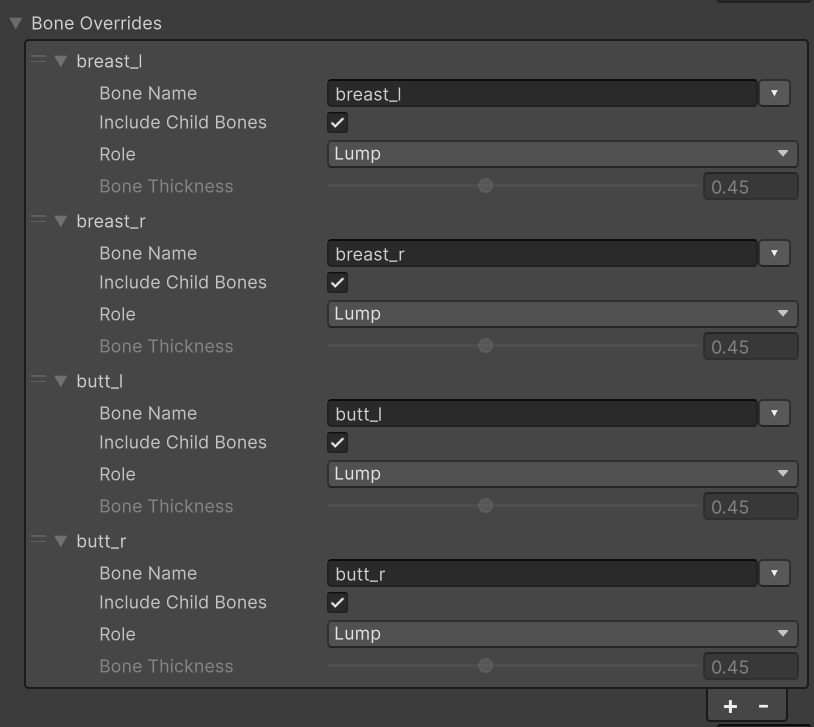
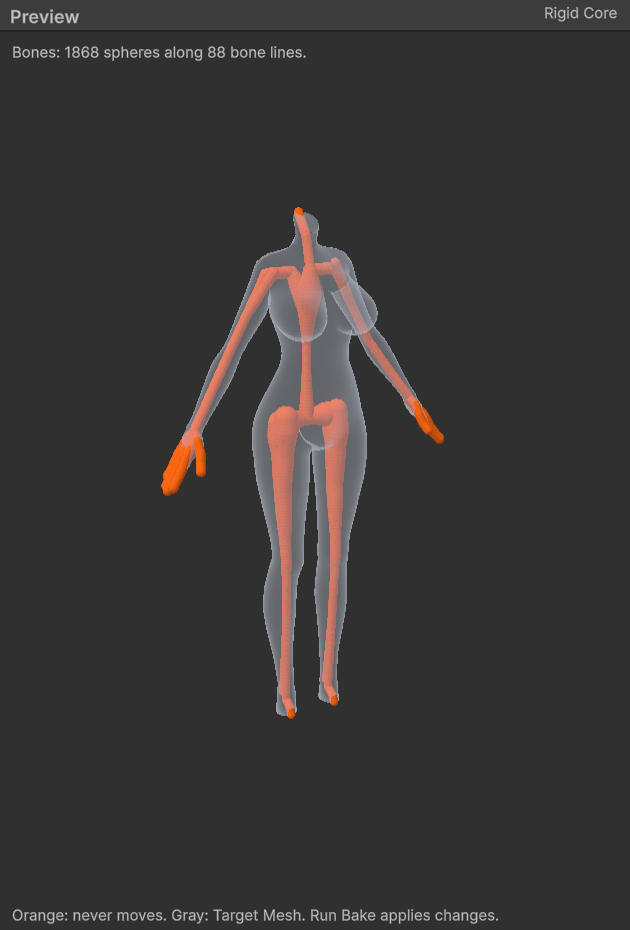

# 캐릭터

Skinned Mesh Renderer도 소품처럼 베이크합니다([빠른 시작](./Quick-Start)). 이 페이지는 다른 점만 다룹니다.

## 베이크 전에 {#before-you-bake}

- **Target Mesh**는 모델(FBX)이나 프리팹 에셋 안의 Skinned Mesh Renderer입니다. 몸, 옷, 머리카락이 렌더러 여럿으로 나뉜 모델은 말랑하게 만들 렌더러마다 베이크 에셋을 하나씩 만듭니다. **Assets > Softbody > Create Authoring Data**는 모델의 첫 Skinned Mesh Renderer를 고르고, 다른 메시가 있으면 Console에 알립니다.
- 모델 임포트 설정 Rig 탭의 **Skin Weights**가 Standard면 버텍스마다 본 웨이트를 4개까지만 받습니다. **Custom**으로 두고 **Max Bones/Vertex**를 32로 올린 뒤 베이크합니다. Validate가 이것을 알려 줍니다.
- 스킨 웨이트가 있는 본은 메시 안에 있어야 합니다. 스켈레톤이 곧 단단한 코어입니다. Softbody 머티리얼이 붙은 슬롯을 움직이는 본만 코어가 되므로, 제 본이 있는 머리카락 가닥이나 장식이 그 위에 얹힌 살을 붙잡지 않습니다. 베이크에는 콜라이더가 필요 없습니다.
- 얼굴과 머리카락에는 머티리얼 슬롯을 따로 주고, 피부와 다른 머티리얼을 쓰게 합니다. **Create Softbody Material**은 모델의 머티리얼 리맵으로 입히므로, 피부와 같은 머티리얼을 쓰는 슬롯은 함께 Softbody 머티리얼로 바뀝니다([베이크](./Baking#what-the-bake-changes)).
- 피부 위에 모델링한 몸에 붙는 옷(몸에 붙는 슈트, 레깅스)은 몸과 같은 렌더러의 슬롯으로 두면 아래 살과 함께 들어가고 출렁이므로, 살이 옷을 뚫고 나오지 않습니다. 따로 된 렌더러의 옷은 다른 메시라 따라가지 않습니다. 옷과 장식 슬롯에는 몸에 쓰는 규칙으로 Depth를 칠하지 마세요. Depth 0은 그 부분을 뼈로 만듭니다.
- 지글 본: 스프링 본, 천, 물리 컴포넌트처럼 다른 시스템이 이미 움직이고 있다면 **Physics Driven Bones**에 넣으세요. 아니면 **Bone Overrides**에서 그 본의 **Role**을 **Lump**로 두어, 그 살이 Softbody 컴포넌트가 움직이는 덩어리가 되게 하세요.
- LOD Group 안의 렌더러는 LOD0만 눌리고 출렁입니다.

## 부위는 스킨 웨이트로 정합니다 {#body-parts-come-from-skin-weights}

부위를 고르는 마스크를 따로 칠하지 않습니다. 다음 설정은 모두 본의 스킨 웨이트를 그 부위의 마스크로 씁니다.

- **Role Lump**: 그 본 사슬에 스킨된 살이 덩어리입니다.
- **관성 그룹**: 버텍스마다 웨이트가 큰 그룹의 움직임을 웨이트대로 섞어 출렁입니다([관성](./Inertia)).
- **Separated Pairs**: 두 부위에 웨이트가 걸린 옷은 웨이트대로 나뉩니다.
- **Physics Driven Bones**: 웨이트만큼 출렁임을 잃습니다.

그래서 살 덩어리가 끝나는 자리 같은 부위의 경계를 옮기려면 3D 툴에서 웨이트를 고치고 Run Bake를 누릅니다. 웨이트가 좁은 띠 안에서 급하게 바뀌면 출렁일 때 그 자리가 찢어지거나 접혀 보일 수 있으므로 넓고 완만하게 줄어들게 합니다. 웨이트로 나타낼 수 없는 것(뼈가 피부에 가까운 곳, 더 단단한 살, 다른 재료)만 [칠합니다](./Painting).

## 베이크 설정 {#bake-settings}

베이크 에셋에서 스킨 메시에 중요한 설정입니다. 기본값과 범위는 [베이크](./Baking)에 있습니다. 스킨 메시에서는 Core Placement와 Rigid Core Spheres가 숨습니다. 코어는 스켈레톤에서 오기 때문입니다.

| 설정 | 카테고리 | 캐릭터에서 |
|---|---|---|
| [**Bone Thickness**](./Baking#bone-thickness) | 3. Rigid Core (Bones) | 모든 본의 굵기입니다. 클수록 어디서나 살이 얇아져, 덜 출렁이고 눌린 자리가 좁아집니다. |
| [**Bone Overrides**](./Baking#bone-overrides) | 3. Rigid Core (Bones) | 가슴이나 엉덩이 사슬의 맨 위 본은 **Role**을 **Lump**로, 몸통에 리깅된 리본·목걸이·벨트 사슬은 **Accessory**로 둡니다. |
| [**Flesh Reach**](./Baking#flesh-reach) | 3. Rigid Core (Bones) | 3 cm쯤으로 두면 Jiggle을 같은 밝기로 칠한 곳이 살 두께와 상관없이 비슷하게 출렁입니다. |
| **Max Inertia Groups** | 2. Bake | 따로 출렁일 수 있는 본 그룹 수입니다. 모자라면 덩어리 본이 자기 그룹을 받지 못합니다. |
| [**Layer Max Gap**](./Baking#layer-max-gap) | 2. Bake | 옷 버텍스가 아래 살의 칠과 출렁임을 따르는 거리입니다. 두꺼운 겉옷이면 올리고, 0이면 끕니다. 함께 눌리는 것은 접촉 맵이 정합니다. |
| **Physics Driven Bones** | 4. Paint | 이 본들(자식 본 포함)의 살에는 Softbody 출렁임을 주지 않으므로, 같은 살이 두 번 흔들리지 않습니다. |
| **Softbody Material Slots** | 5. Material | 피부와 몸에 붙는 옷 슬롯입니다. 얼굴과 머리카락은 넣지 않습니다. |
| **Pressable Slots** | 6. Contact Map | 비워 두면 Softbody 머티리얼 슬롯이 눌립니다. 눌리지 않는 슬롯을 빼면 나머지가 더 세밀해집니다. |
| [**Separated Pairs**](#separated-pairs) | 6. Contact Map | 겉면은 이어졌지만 밑의 살이 따로인 두 부위를 쌍으로 떼어 둡니다. |

- **Bone Overrides**의 **Include Child Bones**가 켜져 있으면 사슬마다 항목 하나로 충분합니다. 끄면 그 본만 바뀝니다.
- **Flesh Reach**를 3 cm쯤으로 두면 두꺼운 흰 살이 **Inertia Amount**의 기준 살이 됩니다.
- 스켈레톤에 없는 뼈(갈비뼈, 골반, 두개골)는 찾지 못합니다. 그 부위는 Depth에 어둡게 칠하세요([페인트](./Painting)).
- 코어는 베이크 에셋의 [Rigid Core 미리보기](./Baking#preview)에서 본을 따라 놓인 주황 구로 보입니다. 리본이나 목걸이 본이 살갗 바로 밑에 주황 구를 만들면 그 본을 Accessory로 둡니다.
- 덩어리 본이 그룹을 받지 못하면 Console에 `Inertia groups: all N groups are taken, so lump bone X gets no group of its own.`가 나옵니다. Max Inertia Groups를 올립니다.

### Separated Pairs {#separated-pairs}

옷 한 장이 이어 덮은 좌우 한 쌍의 덩어리처럼 겉면은 이어졌지만 밑의 살은 따로인 부위에 씁니다. 쌍마다 **Side A**와 **Side B**에 각 부위의 맨 위 본을 넣습니다. MMD 모델처럼 한쪽 덩어리가 본 사슬 여럿으로 나뉜 리그는 사슬마다 맨 위 본을 넣습니다. 한쪽을 눌러도 다른 쪽이 솟거나 꺼지거나 끌려가지 않습니다. 나뉜 결과는 Rebake Contact Map 뒤 Console에서 봅니다([베이크](./Baking#separated-pairs)). D3D11과 Metal에서는 듣지 않습니다([알려진 제한](./Known-Limitations#contact-detail)).

## 컴포넌트 설정 {#component-settings}

Softbody 컴포넌트에서 캐릭터에 중요한 설정입니다. 모든 설정은 [Softbody 컴포넌트](./Softbody-Component)에 있습니다.

| 설정 | 카테고리 | 캐릭터에서 |
|---|---|---|
| **Lump Yield** | Inertia > Lumps | 눌린 덩어리가 통째로 얼마나 쉽게 비켜나는지입니다(0 = 눌림만). |
| **Lump Grip** | Inertia > Lumps | 덩어리의 피부를 붙든 손(Drag Friction)이 덩어리를 얼마나 단단히 끌고 가는지입니다. Contact Detail이 Full이어야 합니다. |
| **Squeeze Stiffening** | Inertia > Lumps | 깊이 짓눌릴 때 살이 얼마나 더 세게 밀어내는지입니다. |
| **Inertia Group Overrides** | Inertia | 신체 부위 하나만의 Amount Scale, Damping, Gravity Scale입니다. |
| **Inertia Amount** | Inertia | 기준 살(Jiggle을 흰색으로 칠한 두꺼운 살)이 1 g에서 처지는 거리입니다. 크게 출렁이는 덩어리 살은 10~20쯤입니다. |
| **Animation Motion Weight** | Inertia | 본을 움직이는 애니메이션이 살을 얼마나 출렁이게 하는지입니다. 1 = 실제 가속도. |

- **Lump Yield**: 배와 등처럼 스켈레톤 위에 있는 부위는 덩어리로 움직이지 않습니다. Enable Contact, Enable Inertia가 켜져 있고 Inertia Amount가 0보다 커야 합니다.
- **Squeeze Stiffening**: 깊이 누를 때 덩어리가 너무 멀리 움직이면 이 값 대신 Lump Yield를 낮추세요.
- **Inertia Group Overrides**: 같은 캐릭터에 크고 느린 덩어리와 작고 빠른 배를 둘 수 있습니다. 본 드롭다운에는 베이크가 찾은 관성 그룹이 나옵니다([관성](./Inertia)).
- **Inertia Amount**는 기준 살이 정해져 있어 캐릭터마다 같은 살을 뜻합니다.

## 온몸으로 누르기 {#pressing-with-the-whole-body}

캐릭터가 다른 Softbody 메시를 몸으로 누르려면 본마다 콜라이더가 있어야 합니다. 장면(또는 프리팹 편집 모드)의 캐릭터를 고르고 **GameObject > Softbody > Create Bone Colliders**를 누릅니다. Softbody 컴포넌트 인스펙터 맨 아래 **Pressing**의 **Create Bone Colliders**나, Skinned Mesh Renderer 컴포넌트의 메뉴 **Softbody: Create Bone Colliders**로도 됩니다. 본마다 그 본의 자식 `<본 이름>_SoftbodyCollider`가 렌더러와 같은 레이어로 생기고, 캡슐 콜라이더(맨 위 본은 상자)를 받습니다. 다시 누르면 이 도구가 만든 것만 새로 만들고, Edit > Undo로 되돌릴 수 있습니다.

- 눌리는 메시의 **Collider Channel**에 그 레이어가 들어 있어야 합니다.
- 캐릭터 자신의 Softbody 메시는 **Ignore Root**(비어 있으면 가장 가까운 Animator 부모) 아래의 콜라이더를 무시하므로, 자기 본 콜라이더에 눌리지 않습니다.
- 한쪽만 누르게 하세요. Softbody 소파라면 소파의 콜라이더에 **Softbody Ignore** 컴포넌트를 붙여, 소파가 캐릭터를 누르지 않게 합니다. 그러지 않으면 접촉 때문에 겹친 만큼 틈이 벌어집니다([콜라이더](./Colliders)).
