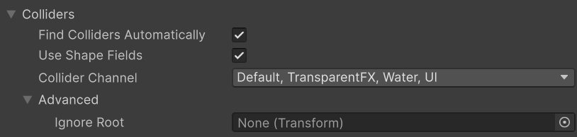
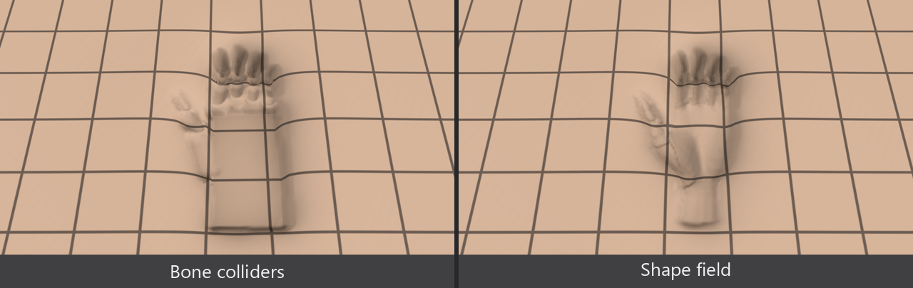
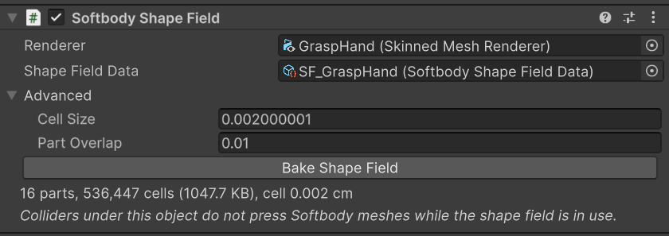

# 콜라이더

살을 누르는 것은 손, 소품, 바닥, 다른 캐릭터 무엇이든 Unity 콜라이더이거나, 누르는 메시의 실제 모양을 베이크한 [셰이프 필드](#shape-fields)입니다. Softbody 컴포넌트는 매 프레임 메시 둘레에서 둘 다 스스로 찾습니다.

## 살을 누를 수 있는 것 {#what-can-press-the-flesh}

콜라이더가 살을 누르는 조건은 다음과 같습니다.

1. 콜라이더의 레이어가 컴포넌트의 **Collider Channel**에 들어 있습니다. 기본값은 Ignore Raycast를 뺀 모든 레이어입니다.
2. 콜라이더가 켜져 있고 트리거가 아닙니다.
3. **Ignore Root** 아래에 있지 않습니다. 비워 두면 가장 가까운 부모 Animator(없으면 Softbody 컴포넌트가 붙은 오브젝트)이므로, 캐릭터 자신의 콜라이더는 제 살을 누르지 않습니다.
4. 콜라이더의 오브젝트와 그 부모 어디에도 [Softbody Ignore](#softbody-ignore) 컴포넌트가 없습니다.
5. 아래 표의 콜라이더입니다.

| 콜라이더 | 누르는 모양 |
|---|---|
| Sphere Collider | 구 |
| Capsule Collider | 캡슐 |
| Box Collider | 박스 |
| Mesh Collider(**Convex** 켬) | 컨벡스 헐 |
| Character Controller | 오브젝트 회전과 상관없이 늘 위로 선 캡슐. Skin Width는 넣지 않습니다. |
| **Softbody Shape Field**를 붙인 오브젝트 아래의 콜라이더 | **Use Shape Fields**가 켜져 있는 동안 누르지 않고, [셰이프 필드](#shape-fields)가 실제 모양으로 대신 누릅니다. |
| Mesh Collider(Convex 끔), Terrain Collider, Wheel Collider | 누르지 않고 Console에 `has no simple collision shape and no shape field`를 한 번 남깁니다. |

기본 Plane 오브젝트는 Convex가 꺼진 Mesh Collider라서 누르지 않습니다. 눌러야 하는 바닥에는 Box Collider를 씁니다.

콜라이더는 메시 바운드를 **Max Contact Depth**(최소 1 cm)와 이번 프레임에 움직인 거리만큼 키운 상자 안에서 찾습니다. 메시가 어느 카메라에도 보이지 않거나 **Min Screen Size**보다 작게 보이면 찾지 않습니다. 모양의 자리는 물리 장면이 아니라 콜라이더의 Transform에서 읽으므로, 애니메이션이나 스크립트가 이번 프레임에 옮긴 콜라이더도 옮긴 자리에서 누릅니다.

## 설정 {#settings}

**Find Colliders Automatically**, **Use Shape Fields**, **Collider Channel**, **Ignore Root**(Advanced)는 Softbody 컴포넌트의 **Contact > Colliders**에 있습니다([Softbody 컴포넌트](./Softbody-Component#contact-colliders)).

## 셰이프 필드 {#shape-fields}

셰이프 필드는 누르는 메시의 실제 모양을 베이크한 에셋입니다. 셰이프 필드가 있으면 손은 콜라이더가 만드는 매끈한 눌림(손바닥 상자의 네모난 자국 같은) 대신, 손가락 하나하나와 오목한 손바닥으로 누릅니다. 누르는 손과 소품에 쓰세요.

편집 모드에서 장면(또는 프리팹 편집 모드)의 누르는 메시를 고르고 **GameObject > Softbody > Bake Shape Field**를 누릅니다. Skinned Mesh Renderer나 Mesh Renderer의 ⋮ 메뉴 **Softbody: Bake Shape Field**로도 됩니다. 손 하나에 1초쯤 걸립니다.

- 메시 에셋의 폴더(FBX 안의 메시면 FBX 폴더, 패키지처럼 고칠 수 없는 곳이면 `Assets`)에 `<메시 이름>_ShapeField.asset`이 생깁니다. 이미 있으면 그 에셋에 다시 베이크합니다.
- 렌더러의 가장 가까운 부모 Animator(없으면 렌더러의 오브젝트)에 **Softbody Shape Field** 컴포넌트가 붙고, **Renderer**와 **Shape Field Data**가 채워집니다. Edit > Undo로 되돌릴 수 있습니다.
- Console에 `Shape field bake: <메시 이름> - ... N parts`가 나옵니다. 스킨드 메시는 본마다 조각이 하나씩 생겨 각자 자기 본을 따르고, 스태틱 메시는 조각이 하나입니다.
- Project 창의 프리팹 에셋 안에서 베이크하면 에셋만 만들고 컴포넌트는 붙이지 않습니다. 프리팹을 열어 다시 누릅니다.

셰이프 필드가 누르는 방식은 다음과 같습니다.

- 콜라이더가 없어도 누릅니다. 조건은 [콜라이더와 같고](#what-can-press-the-flesh), 레이어는 **Renderer**의 레이어를 봅니다.
- **Use Shape Fields**가 켜져 있는 동안, 컴포넌트가 붙은 오브젝트와 그 자식의 콜라이더는 누르지 않습니다. 콜라이더는 물리용으로 그대로 둡니다. 셰이프 필드가 조건에 걸려 누르지 못하면 그 콜라이더가 대신 누릅니다.
- 컴포넌트를 렌더러의 오브젝트에 직접 붙이면, 그 밖에 있는 본 콜라이더(**Create Bone Colliders**가 본 아래에 만든 것)는 빠지지 않고 셰이프 필드와 함께 누릅니다. 메뉴는 Animator에 붙이므로 이런 일이 없습니다.
- 캐릭터 자신의 손을 베이크해도 그 캐릭터의 살은 누르지 않습니다. 컴포넌트가 그 캐릭터의 **Ignore Root** 아래에 있기 때문입니다(자기 접촉은 [베타에 없습니다](./Known-Limitations#not-in-the-beta)). 다른 Softbody 메시는 누릅니다.
- 베이크한 뒤 메시를 바꿨으면 Softbody Shape Field 인스펙터가 `The mesh changed since the bake` 경고를 냅니다. 인스펙터의 **Bake Shape Field** 버튼으로 다시 베이크합니다. 예전 플러그인 버전으로 베이크한 셰이프 필드는 쓰지 않고, 인스펙터가 다시 베이크하라고 알립니다.

인스펙터의 Advanced에는 베이크 설정 둘이 있습니다. 둘 다 Shape Field Data 에셋에 저장되고 다음 베이크부터 듣습니다.

| 설정 | 기본값 | 설명 |
|---|---|---|
| **Cell Size** | 0(자동) | 가는 손가락이 뭉툭하게 눌리거나 베이크가 오래 걸리면 바꿉니다. 베이크한 모양의 칸 하나 크기이고, 0은 손가락에 맞게 고릅니다. |
| **Part Overlap** | 1 | 굽힌 손가락 관절이 눌린 자리에 홈을 남기면 올립니다. 조각이 본 사슬을 따라 이웃 조각 안으로 들어가는 길이입니다. |

두 값은 메시 자신의 좌표로 잰 cm입니다. 모델 안에서 메시 오브젝트에 크기가 걸려 있으면(예: 100) 실제 길이와 그만큼 다르고, 그때는 베이크가 Console에 경고합니다.

## Softbody Ignore {#softbody-ignore}

**Softbody Ignore** 컴포넌트(Add Component > Softbody > Softbody Ignore)를 붙인 오브젝트와 그 자식의 콜라이더와 셰이프 필드는 어떤 Softbody 메시도 누르지 않습니다.

이 컴포넌트가 붙은 오브젝트의 렌더러는 Softbody 컴포넌트가 대상으로 자동으로 고르지도 않습니다. 렌더러와 콜라이더가 한 오브젝트에 있는 Softbody 메시에 붙이면, 그 컴포넌트의 **Target Mesh Component**를 직접 지정하거나 콜라이더를 자식 오브젝트로 옮겨 그쪽에 붙입니다.

## 덩어리를 미는 손 크기 {#presser-size}

[덩어리](./Concepts#lumps)가 통째로 밀리는 정도는 누르는 콜라이더가 피부에서 보이는 넓이로 정해집니다. 손끝처럼 좁게 찌르면 대부분 눌리기만 하고, 손바닥처럼 넓게 밀면 덩어리가 비킵니다.

| 콜라이더 | 넓이로 보는 것 |
|---|---|
| 구 | 반지름 |
| 캡슐 | 끝으로 찌르면 반지름, 눕혀 누르면 길이까지 |
| 박스 | 피부 쪽에서 본 넓이 |
| 컨벡스 Mesh Collider | 메시 로컬 축으로 감싼 상자 |

그래서 손 전체를 컨벡스 Mesh Collider 하나로 만들면 손가락 하나로 눌러도 손바닥처럼 덩어리를 밉니다. 손가락 마디와 손바닥에 콜라이더를 따로 줍니다. 미는 정도 자체는 **Lump Yield**로 조절합니다([Softbody 컴포넌트](./Softbody-Component#lump-yield)).

## Softbody 메시끼리 누르기 {#softbody-meshes-pressing-each-other}

Softbody 메시는 제 콜라이더로만 다른 Softbody 메시를 누릅니다. 캐릭터가 몸으로 누르게 하려면 본마다 콜라이더를 만듭니다.

- Softbody 컴포넌트 인스펙터 맨 아래 **Pressing** 묶음의 **Create Bone Colliders**, 또는 **GameObject > Softbody > Create Bone Colliders**, 또는 Skinned Mesh Renderer의 ⋮ 메뉴 **Softbody: Create Bone Colliders**.
- 본마다 자식 오브젝트 `<본 이름>_SoftbodyCollider`에 Capsule Collider(맨 위 본은 Box Collider)와 Kinematic Rigidbody를 붙입니다. 레이어는 렌더러의 레이어입니다.
- 캐릭터를 바인드 포즈로 두고 편집 모드에서 장면(또는 프리팹 편집 모드)의 오브젝트에 씁니다. 다시 누르면 이 도구가 만든 콜라이더만 지우고 새로 만들며, Undo로 되돌릴 수 있습니다.
- 이 콜라이더는 캐릭터의 Animator 아래에 있으므로 Ignore Root에 걸려 제 살은 누르지 않습니다.

한쪽만 누르게 하세요. 둘이 서로 누르면 각자 상대 모양대로 들어가서 둘 사이에 틈이 생깁니다. 캐릭터가 앉는 방석이라면 방석의 콜라이더를 캐릭터의 Collider Channel에 없는 레이어로 옮기거나 [Softbody Ignore](#softbody-ignore)를 붙여, 방석은 눌리기만 하게 합니다.

## 닿지 않음과 쉼 {#out-of-reach-and-sleeping}

매 프레임, 찾은 콜라이더 가운데 최소 2 cm 여유를 두고도 눌리는 살에 닿을 수 없는 것은 뺍니다. 남은 것이 없으면 눌린 자리가 서서히 돌아오고 접촉은 쉽니다([성능](./Performance)).

옛 버전으로 베이크한 접촉 맵에는 이 검사에 쓰는 데이터가 없어, 콜라이더가 바운드 가까이 있는 동안 접촉이 쉬지 않습니다. 그때 Console에 `has no sleep boxes`가 나옵니다. **Rebake Contact Map**을 누릅니다.

## 프레임당 한도 {#per-frame-limits}

| 한도 | 메시당 프레임당 | 넘으면 |
|---|---|---|
| 콜라이더 모양 | 32 | 나머지는 건너뛰고 Console에 `contact skipped ... over the per-frame budget`을 한 번 남깁니다. |
| 컨벡스 헐 평면, 모든 Mesh Collider 합계 | 2048 | 같음. 콜라이더마다 한 줄씩 더 셉니다. |
| 셰이프 필드 조각 | 512 | 넘게 만드는 셰이프 필드는 통째로 건너뛰고 Console에 `shape field of ... skipped`를 한 번 남깁니다. |

닿음 검사 뒤에 세므로, 메시마다 가까이 있는 것만 셉니다.

## 누르는 손 설정 {#setting-up-a-hand-that-presses}

따로 된 오브젝트인 손이나 다른 캐릭터의 손은 다음처럼 설정합니다.

1. 손에 [셰이프 필드](#shape-fields)를 베이크합니다. 손가락 사이와 손바닥 모양대로 누릅니다.
2. 물리가 필요하면 손가락 마디와 손바닥에 콜라이더도 줍니다. 스킨드 손이면 **Create Bone Colliders**가 본마다 만들어 줍니다. 셰이프 필드를 쓰지 않으면 이 콜라이더가 누릅니다.
3. 손 렌더러와 콜라이더의 레이어를 눌릴 메시의 **Collider Channel**에 넣습니다.
4. 눌릴 메시의 Ignore Root 아래에 두지 않습니다. 같은 Animator 아래의 손은 그 캐릭터의 살을 누르지 않습니다.

## 권장 설정 {#recommended-setup}

기본 **Collider Channel**(Ignore Raycast를 뺀 모든 레이어)에서는 바닥, 벽, 소품을 모두 찾습니다. 그중 눌리는 살에 닿을 수 있는 것은 매 프레임 모양 32개 중 하나를 차지하고, 메시가 쉬지 못하게 합니다. 대신 다음 중 하나를 쓰세요.

**전용 레이어(권장).** 레이어(예: `SoftbodyPress`)를 하나 추가합니다. 모든 Softbody 컴포넌트의 **Collider Channel**을 이 레이어만으로 두고, 눌러야 하는 콜라이더(손, 소품)를 이 레이어에 둡니다. 레이어는 물리 충돌도 정하므로 Physics 설정의 Layer Collision Matrix에서 이 레이어가 무엇과 부딪힐지 확인합니다. Create Bone Colliders는 렌더러의 레이어로 만들므로, 만든 뒤 레이어를 옮깁니다. 셰이프 필드는 렌더러의 레이어로 보므로 손 렌더러도 이 레이어에 둡니다.

**Softbody Ignore.** Collider Channel을 그대로 두고 바닥과 벽 오브젝트(또는 그 부모)에 [Softbody Ignore](#softbody-ignore)를 붙입니다. 작은 장면에서는 이쪽이 빠릅니다. 새로 놓은 콜라이더는 기본으로 누르므로, 규모가 커지면 전용 레이어가 낫습니다.
