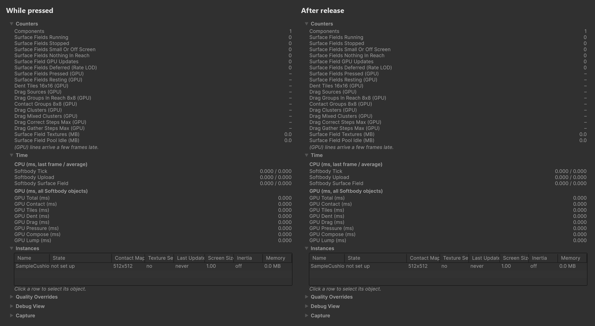

# 작동 원리

패키지 안에서 돌아가는 일을 짧게 정리합니다. 설정은 [Softbody 컴포넌트](./Softbody-Component)에서 설명합니다.

## 베이크가 만드는 것 {#what-the-bake-makes}

**Run Bake**는 메시마다 **Baked Data**(`SD_<메시 이름>`)를 만듭니다. 메시는 바꾸지 않고, 버텍스마다 필요한 값은 버텍스 번호로 찾는 표 텍스처에 담습니다.

| 데이터 | 내용 | 쓰는 곳 |
|---|---|---|
| 살의 무름 | 살 속을 사면체로 채워, 몸이 세 방향으로 밀릴 때 버텍스마다 얼마나 처지는지 잽니다. | 출렁임 |
| 관성 그룹 | 함께 출렁이는 본 묶음과, 버텍스마다 그 묶음을 따르는 몫입니다. | 출렁임 |
| 칠 | Depth, Jiggle, Volume, Flex를 버텍스와 칸의 값으로 바꾼 것입니다. Flex는 칸의 휨 값과, 판이 되는 조각의 표(판 표)로 바뀝니다. | 출렁임, 접촉 |
| 접촉 맵 | 피부의 작은 영역마다 칸 하나를 둔 평평한 아틀라스입니다. 칸마다 기준 위치, 바깥쪽 노멀, 살 두께, 스킨 웨이트를 담고, 버텍스마다 자기 칸의 자리를 담습니다. 이음매 건너편 칸과 이웃 칸의 표도 함께 굽습니다. | 접촉 |
| 깨우기 상자 | 본마다 눌리는 살을 감싸는 상자입니다. 콜라이더가 살에 닿을 수 있는지 CPU가 싸게 확인합니다. | 쉼 |
| 덩어리 | 통째로 비키는 덩어리마다, 밀릴 때 버티는 세기와 밀린 모양입니다. | 덩어리 |

## 세 층 {#three-layers}

| 층 | 내용 |
|---|---|
| 모델 | 누르는 동안 살은 단단한 코어 위에 베이크한 두께만큼 놓인 층으로 움직입니다. 눌림은 살 층 방정식 x − ℓ²∇²x = f를 접촉 맵 위에서, 피부를 콜라이더에 붙든 채 풉니다. 폭 ℓ은 살 두께와 **Skin Tension**에서 나옵니다. 폼(Volume 0)은 일정한 힘까지만 버팁니다. 그 너머에서는 콜라이더 밑에서 무너지므로 폼의 눌린 자리는 가장자리가 또렷합니다. 시간은 비율 하나로만 들어옵니다. 지난 갱신에서 기억한 눌린 깊이는 e−RΔt배로 줄고, R은 **Recovery Rate**입니다. 덩어리(본에 매달린 살 한 덩이 전체)는 누르는 힘과 버티는 힘이 균형을 이룰 때까지 옆으로 비킵니다. 깊이 누를수록 세게 버티는 정도는 **Squeeze Stiffening**이 정합니다. Contact Detail이 Full이면 피부를 콜라이더에 붙들어 두는 접촉 압력을 거친 격자에서 풀어, 그 압력이 눌림 둘레의 솟음을 그리고, 끌림은 더 넓은 폭으로 같은 방정식을 풉니다. Flex를 검게 칠한 조각은 휘지 않는 판으로, 판 표에 든 위치와 기울기로 움직이며 밑의 살을 밉니다(Full). |
| 눈에 보이는 결함을 막는 규칙 | 눌린 자리의 벽은 칸 격자가 아니라 콜라이더의 가장자리를 따릅니다. 칸마다 콜라이더가 어느 쪽에서 들어왔는지 기억해, 묻힌 콜라이더는 옆면으로 파고들지 않습니다. 이음매 칸은 UV 이음매 건너편의 칸을 그대로 따라 하고, 아틀라스 이웃 검사가 아틀라스에서는 붙어 있지만 메시에서는 떨어진 칸들을 서로 떼어 놓습니다. 손은 덩어리를 뚫고 지나가지 못합니다. Full에서는 베이크한 표면 거리 한계가 끌림과 솟음이 주름을 건너거나 다른 신체 부위로 새지 않게 막고, 새로 눌린 칸은 끌림 한 걸음의 절반만 받습니다. Separated Pairs로 떼어 둔 두 부위는 서로 눌림도 솟음도 끌림도 건너가지 않습니다. |
| GPU 파이프라인 | 눌렸거나 아직 돌아오는 중인 8×8 칸 그룹만 계산하므로, 가만히 있는 메시는 비용이 거의 들지 않습니다. 넓은 눌림과 덩어리는 거친 격자 하나를 함께 씁니다. 접촉 텍스처는 모든 Softbody 메시가 함께 쓰는 풀에서 가져옵니다. 컴퓨트 셰이더는 Basic용 `SoftbodySurfaceField.compute`와 Full용 `SoftbodySurfaceFieldFull.compute`로 나뉩니다. D3D11과 Metal은 FXC로, D3D12와 Vulkan은 DXC로 컴파일한 사본(`…Dxc.compute`)을 씁니다. 그래서 첫 컴파일 시간이 API마다 다릅니다. |

## 접촉 갱신 한 번 {#one-contact-update}

1. **접촉.** 칸마다 스키닝으로 지금 위치를 구하고, 콜라이더마다(구, 캡슐, 박스, 컨벡스) 파고든 깊이(최대 **Max Contact Depth**까지)와 콜라이더 가장자리까지의 거리를 잽니다.
2. **활동.** "지금 눌림"과 "지난 갱신에서 남음"이 뒤의 모든 패스가 몇 개 그룹에서 돌지를 정합니다. 눌린 것도 남은 것도 없으면 0입니다.
3. **타일.** 풀어야 할 16×16 눌림 타일의 목록입니다. 눌렸거나 아직 눌린 자리가 남은 타일, 그 둘레 한 겹, 이음매 건너편의 짝 타일이 들어갑니다.
4. **덩어리.** 덩어리마다 누르는 힘을 받아 옆으로 비킵니다. CPU는 그 결과를 GPU에서 비동기로 읽어 출렁임의 덩어리 자리로 씁니다. Full에서는 쥐는 손이 **Drag Friction**으로 제한되는 힘으로 덩어리를 끌고 갑니다(**Lump Grip**).
5. **접촉 압력.** Contact Detail이 Full일 때만 돕니다. 눌린 칸을 거친 칸으로 모아, 피부가 콜라이더에 닿도록 그 압력을 풉니다. 갱신마다 0에서 시작하고 상태를 남기지 않습니다. 그다음 거친 칸마다 그 압력이 올리는 솟음을 더합니다. 판은 이 풀이에서 밑의 살 위에 얹혀 움직이는 한 덩이로 다룹니다.
6. **눌림.** 먼저 거친 격자에서 풀고, 다음에 고운 타일에서 풉니다. 그래서 넓은 눌림(손바닥, 앉은 자리)도 갱신 한 번에 제 폭까지 퍼집니다. 눌린 깊이 기억은 e−RΔt배로 줄고, 더 깊이 누르면 그 깊이로 바뀝니다. 남는 자국은 **Memory Time**과 **Memory Fade Time**이 맡습니다. 테두리 폭은 칸마다 살 두께, Volume Preservation, Skin Tension에서 나옵니다. Contact Detail이 Basic이면 이 단계만 눌린 자리를 그립니다. 폼은 그대로 무너지고 팽팽한 겉껍질도 테두리를 둥글리지만, 솟는 것과 판은 없습니다.
7. **끌림.** Contact Detail이 Full일 때만 돕니다. 눌린 칸은 붙든 위치를 콜라이더와 함께 옮기며 당김을 쌓고, 마찰 한도(**Drag Friction**에 누르는 힘을 곱한 값)를 넘으면 미끄러집니다.
8. **합성.** 변위 맵을 만들고, 이음매 칸에 건너편 값을 옮기고, 셰이딩 노멀을 변위된 이웃 칸에서 구한 만큼 돌려 노멀 맵을 만듭니다. **Dent Darkening**도 기록합니다.

머티리얼은 버텍스 셰이더에서 버텍스 번호로 자기 칸을 찾아 변위를 읽고(바깥 표면에서 5 cm 넘게 떨어진 버텍스는 덜 따라오고 10 cm에서 멈춥니다), 픽셀 셰이더에서 노멀 회전과 어두워짐을 읽습니다. 그래서 노멀 맵은 그대로 남습니다. 단계별 GPU 시간은 **Window > Softbody > Debugger**의 GPU Contact, Tiles, Dent, Drag, Pressure, Compose, Lump 줄과, Unity Profiler의 `Softbody Contact` 같은 GPU 구간에 나옵니다.

## 갱신 사이 {#between-updates}

Play 중에 접촉이 켜진 Softbody 메시는 다음 상태를 거칩니다.

1. **쉼.** 어떤 콜라이더도 메시에 닿을 수 없습니다(본마다 베이크한 깨우기 상자로 검사합니다). 접촉 텍스처를 들고 있지 않고, 머티리얼의 접촉 스위치는 꺼져 있습니다.
2. **첫 닿음.** 메시가 풀에서 접촉 텍스처 한 세트를 받아 같은 프레임에 갱신합니다. 풀에 준비된 세트가 없으면 세트가 만들어질 때까지 몇 프레임 기다립니다.
3. **깨어 있음.** 메시는 LateUpdate마다 갱신을 신청하고, 어느 메시를 돌릴지는 프레임 끝에 한꺼번에 고릅니다. **Full Rate Screen Size**를 정하면 화면에 작게 보이는 메시는 몇 프레임에 한 번 돕니다. 한 프레임에는 최대 **Update Budget**개가 돌고, 접촉 갱신 빈도 제한이 초당 갱신 수를 묶습니다. 어느 카메라에도 보이지 않거나 **Min Screen Size**보다 작으면 닿을 수 없는 것으로 칩니다. 건너뛴 프레임의 시간은 다음 갱신에서 한 걸음에 풉니다. 눌린 채 아무것도 움직이지 않아도 갱신을 건너뛰지 않습니다.
4. **콜라이더 떠남.** 실제로 돈 갱신은 자기가 마친 복원만큼을 안정 카운터에 더합니다. 프레임 수가 아니라 한 일만큼 세므로, 갱신 예산 때문에 건너뛴 메시가 일찍 비워지지 않습니다. 화면에 없는 메시는 프레임으로 셉니다.
5. **복원 끝.** 카운터가 1에 닿으면 텍스처를 비워 풀에 돌려주고 접촉 스위치를 끕니다. 1번 상태로 돌아갑니다. 풀에 남는 세트는 **Texture Pool**을 넘으면 **Release Delay** 뒤에 놓습니다.

컴포넌트나 게임 오브젝트를 끄면 어느 상태에서든 바로 1번 상태로 가고 관성을 비웁니다. 켜면 속도 기록 없이 정지 상태에서 시작합니다. [성능](./Performance#life-cycle)을 보세요.

## 출렁임 {#jiggle}

출렁임은 접촉과 따로 돌며, 접촉이 쉬거나 꺼져 있어도 돕니다. 컴포넌트는 LateUpdate마다 관성 그룹(스태틱 메시는 메시 전체)의 가속과 회전을 읽어, 그룹마다 감쇠 진동 한 걸음을 정확한 식으로 풉니다. 그래서 흔들림은 프레임 레이트에 따라 달라지지 않습니다. 그 결과를 작은 텍스처 하나로 올리면, Softbody 셰이더의 버텍스 단계가 버텍스마다 베이크한 무름과 그룹 몫으로 흔들림을 섞어 버텍스를 옮기고 음영을 기울입니다. 덩어리는 눌릴 때 접촉이 구한 자리로 밀린 뒤, 손이 떠나면 흔들리며 돌아옵니다. [관성](./Inertia)을 보세요.
