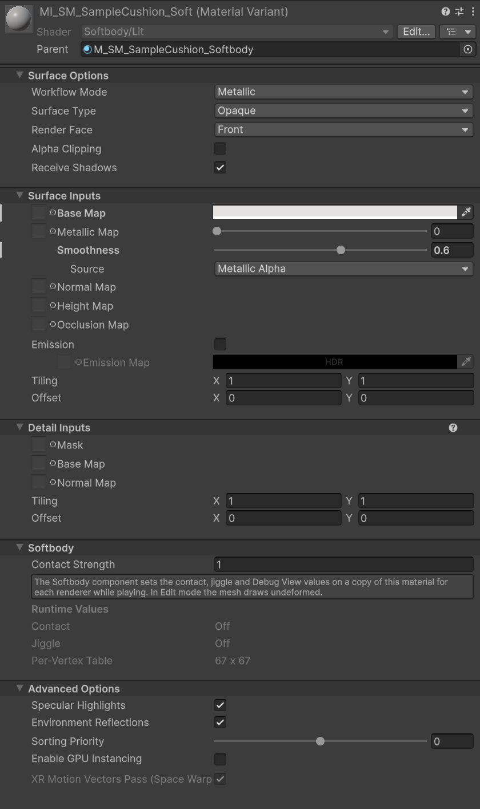
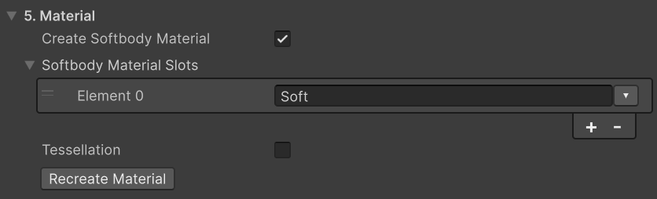
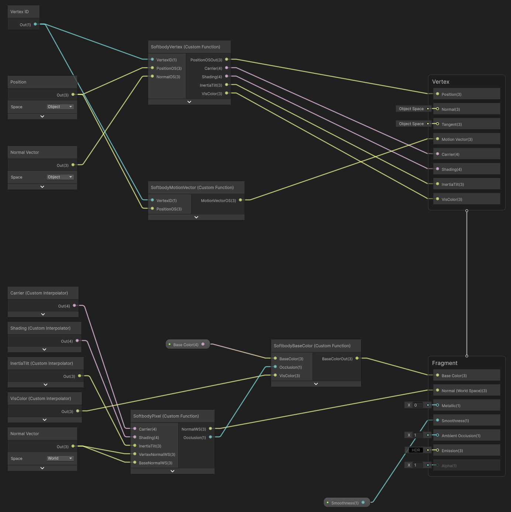
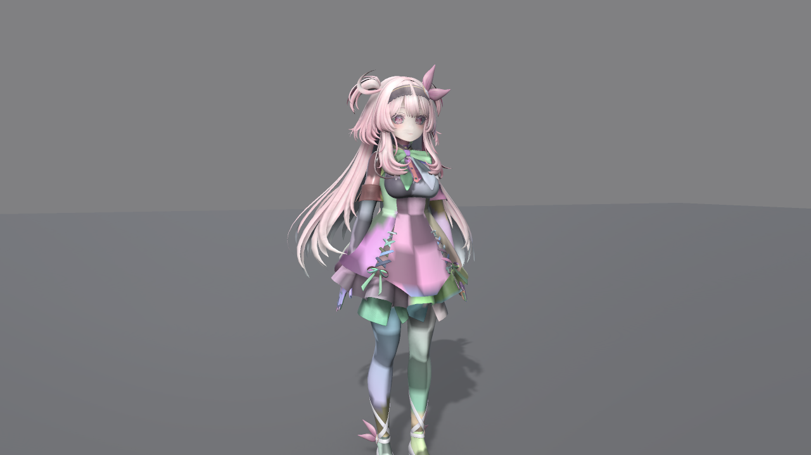

# 머티리얼

슬롯은 머티리얼이 Softbody 셰이더일 때만 변형됩니다. 패키지의 **Softbody/Lit**을 쓰거나(베이크가 머티리얼을 만들어 줍니다), 내 URP 셰이더에 Softbody 함수를 넣습니다.

## Softbody/Lit {#softbody-lit}

**Softbody/Lit**은 URP Lit에 눌림과 출렁임을 더한 셰이더입니다. 셰이더 그래프가 아니라 직접 짠 셰이더이며, URP Lit의 프로퍼티를 모두 같은 이름으로 가집니다. 그래서 URP Lit 머티리얼의 **Shader**만 Softbody/Lit으로 바꾸면 값이 그대로 옮겨집니다. 인스펙터도 URP Lit과 같고, 끝에 **Softbody** 묶음이 붙습니다.

| 칸 | 설명 |
|---|---|
| **Contact Strength** | 이 머티리얼이 눌림을 따르는 정도입니다. 1 = 살이 계산한 그대로, 0 = 접촉을 무시합니다(출렁임은 그대로). |
| **Runtime Values** | 읽기 전용. 컴포넌트가 넣은 값의 상태(**Contact**, **Jiggle**, **Per-Vertex Table**)입니다. Play 중에 렌더러의 사본 머티리얼을 고르면 보입니다. |

나머지 Softbody 값은 Softbody 컴포넌트가 채웁니다. Play를 시작하면 컴포넌트가 Softbody 셰이더 슬롯마다 머티리얼 사본(이름 끝 `(Softbody)`)을 만들어 렌더러에 걸고, 그 사본에 값을 넣습니다.

- 편집 모드에서는 메시가 변형되지 않은 채 그려집니다.
- Play 중에 원래 머티리얼 에셋에서 바꾼 값은 다음 Play부터 보입니다.
- 컴포넌트를 지우거나 Play를 끝내면 렌더러는 원래 머티리얼로 돌아갑니다.

그림자, 깊이, 모션 벡터도 같은 변형을 따릅니다. 라이트맵 베이크는 변형하지 않은 메시를 씁니다.

## Softbody/Lit (Tessellated) {#tessellation}

**Softbody/Lit (Tessellated)**는 Softbody/Lit에 테셀레이션을 더한 셰이더입니다. 눌릴 수 있는 슬롯의 삼각형을 화면 크기에 맞춰 잘게 쪼개 그려서, 손가락 끝처럼 삼각형보다 좁은 눌림도 음영이 아니라 모양으로 보입니다. 프로퍼티가 Softbody/Lit과 같으므로 **Shader**만 바꾸면 값이 그대로 옮겨집니다. 베이크가 이 셰이더로 머티리얼을 만들게 하려면 **5. Material**의 **Tessellation**을 켭니다([베이크](./Baking#_5-material)).

인스펙터의 **Softbody** 묶음에 **Tessellation** 칸이 더 붙습니다.

| 칸 | 기본값 | 설명 |
|---|---|---|
| **Edge Length** | 8 | 쪼갠 변 하나가 화면에서 차지할 길이(픽셀)입니다. 작을수록 좁은 눌림이 또렷해지고 GPU 시간이 늡니다. |
| **Max Splits** | 16 | 삼각형 변 하나를 나누는 최대 조각 수(1~64)입니다. 가까이서 보는 큰 삼각형에는 올립니다. |
| **Phong Strength** | 0.75 | 쪼갠 삼각형이 눌린 면을 따라 휘는 정도입니다. 0이면 평평하고 1이면 다 휩니다. |

- 쪼개는 삼각형은 눌릴 수 있는 버텍스가 낀 것뿐이고, 접촉이 꺼진 렌더러는 쪼개지 않습니다. 눌리지 않은 동안에도 쪼개므로, 가까이서 보지 않는 메시에는 Softbody/Lit을 씁니다.
- 노멀이 갈라진 모서리(하드 엣지)에서는 눌릴 때 작은 틈이 벌어질 수 있습니다. **Validate**가 알려 줍니다. DCC 툴에서 그 슬롯의 노멀을 부드럽게 합니다.
- 테셀레이션을 지원하지 않는 그래픽 장치에서는 Softbody/Lit으로 그립니다.
- 셰이더 그래프와 내 셰이더에는 테셀레이션이 없습니다.

## 베이크로 머티리얼 만들기 {#let-the-bake-make-the-material}

1. Softbody Authoring Data의 **5. Material**에서 **Create Softbody Material**을 켜고, 변형할 슬롯을 **Softbody Material Slots**에 넣습니다. 피부와 몸에 붙는 옷은 넣고, 얼굴이나 머리카락은 넣지 않습니다.
2. **Run Bake**를 누릅니다. 베이크는 접촉 맵보다 머티리얼을 먼저 정하므로, **Pressable Slots**가 비어 있으면 이 슬롯들은 첫 베이크부터 눌리는 슬롯이 됩니다.
3. Console의 `slot '<slot>' now uses MI_<mesh>_<slot> ... Copied: ...` 줄에 옮긴 텍스처가 나옵니다. `(not found)`로 나온 것은 변형 머티리얼에서 직접 지정합니다(**Base Map**, **Normal Map**).

베이크는 **Output Folder**(비우면 베이크 에셋이 있는 폴더)에 `M_<mesh>_Softbody`(Softbody/Lit 머티리얼)와, 넣은 슬롯마다 그 머티리얼 변형(Material Variant) `MI_<mesh>_<slot>`을 하나씩 만듭니다. 이미 있으면 있는 것을 씁니다. 이미 Softbody 머티리얼인 슬롯은 그대로 둡니다.

값은 슬롯의 원래 머티리얼에서 가져옵니다.

- URP Lit이나 Complex Lit: 같은 이름의 값을 모두 옮깁니다(Smoothness, Metallic, 디테일 맵 포함).
- 그 밖의 셰이더: 베이스 컬러와 노멀 맵만 옮기고, Smoothness는 기본값으로 남습니다.
  - 베이스 컬러: `_BaseMap`, `_MainTex`, `_BaseColorMap` 순서로 찾습니다. 없으면 이름에 `BaseColor`, `Albedo`, `Diffuse`, `_Col`, `_BC` 중 하나가 들어 있거나 `_D`로 끝나는 텍스처, 그것도 없으면 노멀 맵이 아닌 첫 sRGB 텍스처입니다.
  - 노멀 맵: Texture Type이 Normal map인 첫 텍스처입니다.

변형을 메시에 거는 곳은 대상 메시가 어디 있느냐에 따라 다릅니다.

- 모델(FBX 등): 모델 Import Settings의 머티리얼 바꿔 끼우기(Remapped Materials)에 넣고 다시 임포트합니다. 바꿔 끼우기는 모델 안의 같은 원래 머티리얼을 모두 바꾸므로, 같은 머티리얼을 쓰는 다른 렌더러나 넣지 않은 슬롯도 Softbody 변형이 되고 Console에 경고가 나옵니다. 막으려면 3D 툴에서 머티리얼을 나누거나, 프리팹에서 그 렌더러에 Softbody 머티리얼을 직접 겁니다.
- 프리팹: 프리팹의 렌더러에 걸고 프리팹을 저장합니다.

패키지 안의 모델은 바꿀 수 없습니다. Package Manager에서 샘플을 가져오거나 모델을 Assets 폴더로 복사해 그것을 베이크합니다. Output Folder에 다른 메시의 같은 이름 변형이 있으면 베이크는 머티리얼을 바꾸지 않고 오류를 남깁니다. Output Folder를 바꿉니다.

**Recreate Material**(같은 카테고리)은 Softbody 머티리얼을 다시 만들어 걸고 접촉 맵도 다시 베이크합니다. Baked Data가 있어야 합니다. Softbody Material Slots를 바꾼 뒤나 슬롯의 머티리얼을 갈아 끼운 뒤에 씁니다.

## 머티리얼을 바꾼 뒤: Rebake Contact Map {#after-changing-the-material-rebake-contact-map}

베이크 뒤에 메시에 Softbody 머티리얼을 걸거나 바꿀 때마다 **Rebake Contact Map**(6. Contact Map 카테고리)을 누릅니다. **Pressable Slots**가 비어 있으면 접촉 맵은 Softbody 머티리얼을 쓰는 슬롯만 담기 때문입니다.

Softbody 컴포넌트의 Setup 상자는 `<N> of <M> material slots use a Softbody shader` 줄로 Softbody 셰이더 슬롯 수를 보여 줍니다. 장면의 렌더러가 모델과 다른 머티리얼을 써서 변형 머티리얼이 빠진 슬롯이 있으면, 이 줄에 **Use Softbody Materials** 버튼이 붙습니다. 이 버튼은 Output Folder의 `MI_<mesh>_<slot>`을 그 렌더러의 같은 슬롯에 넣습니다.

## 내 셰이더 쓰기 {#use-your-own-shader}

**Create Softbody Material**은 끈 채로 둡니다. 직접 짠 URP 셰이더도, 셰이더 그래프도 패키지의 `Shaders/Include/` 함수로 Softbody/Lit과 똑같이 변형할 수 있습니다. 복사할 프로퍼티 블록과 예제 셰이더는 같은 폴더의 `README.md`에 있습니다.

모든 Softbody 셰이더가 지킬 것:

1. 프로퍼티 이름과 기본값은 Softbody/Lit과 똑같이 둡니다(텍스처는 검정, `_SoftbodyPaintTex`만 흰색). 컴포넌트는 이름으로 값을 넣고, 텍스처 `_SoftbodyContactData`, `_SoftbodyInertiaResponseTex`, `_SoftbodySurfaceDispTex`가 모두 있는 슬롯만 변형합니다. 베이크는 `_SoftbodyCarrierUVTex`가 있는 슬롯을 Softbody 머티리얼 슬롯으로 봅니다.
2. 위치를 내는 모든 패스(포워드, 디퍼드, 그림자, 깊이, 깊이·노멀, 모션 벡터, 장면 선택)가 같은 함수로 버텍스를 옮깁니다. `SoftbodyDisplacedPositionOS`와 `SoftbodyDisplacedPositionWS` 중 하나만 골라 모든 패스에 씁니다. 섞으면 깊이가 조금 어긋나 깊이 프리패스와 모션 벡터에서 픽셀이 빠집니다.
3. 버텍스별 표는 버텍스 셰이더에서 버텍스 번호(`SV_VertexID`)로 읽고, 결과를 보간기로 넘깁니다.
4. 노멀을 바꿔 넣지 않고 `SoftbodyPixelNormalWS`로 내 노멀(노멀 맵 포함)을 돌립니다.
5. 눌린 자리 어둡게 하기(**Dent Darkening**)는 앰비언트 오클루전이 아니라 베이스 컬러에 곱합니다(`SoftbodyBaseColor`). Debug View 색도 이 함수가 냅니다.
6. `DOTS_INSTANCING_ON` 변종을 만들지 않습니다. GPU Resident Drawer가 버텍스 번호를 바꿔 그리기 때문입니다.
7. SubShader에 `"AlwaysRenderMotionVectors" = "true"` 태그를 둡니다. 그래야 움직이지 않는 렌더러에서도 출렁임과 눌림의 모션 벡터가 그려집니다.

### 셰이더 그래프 {#shader-graph}

패키지 Samples 탭의 **Shader Graph**를 가져오면 아래 노드를 모두 이어 둔 URP Lit 그래프(`Softbody Lit Graph`)가 `Assets/Samples/MallangPhysics/<버전>/Shader Graph/`에 복사됩니다. 블랙보드 프로퍼티를 하나하나 넣는 수고를 덜려면 이 그래프를 복사해 표면(텍스처, 색)만 고칩니다. 아래는 그 그래프가 어떻게 이어져 있는지, 처음부터 만들 때 어떻게 하는지입니다.

- URP 에셋의 **GPU Resident Drawer**를 **Disabled**로 둡니다. 셰이더 그래프는 모든 패스에 `DOTS_INSTANCING_ON` 변종을 더하므로, 켜 두면 표를 엉뚱한 버텍스로 읽습니다.
- Graph Settings의 **Precision**을 **Single**로 둡니다. 아래 노드는 `SoftbodyBaseColor`를 빼면 Single에만 있고, Half면 `undeclared identifier 'SoftbodyVertex_half'` 같은 오류로 멈춥니다.
- 블랙보드에 Softbody 프로퍼티를 모두 같은 **Reference**로 넣고 **Exposed**를 켭니다(텍스처는 Texture2D, 숫자는 Float, 벡터는 Vector4). 하나라도 빠지면 `undeclared identifier`로 컴파일이 멈춥니다.

Custom Function 노드는 Type **File**, Source `Packages/com.wjsekrud.mallangphysics/Shaders/Include/SoftbodyShaderGraph.hlsl`로 둡니다.

| Name | 입력 | 출력 → 연결할 곳 |
|---|---|---|
| `SoftbodyVertex` | `VertexID`(Vertex ID 노드), `PositionOS`, `NormalOS`(Object 공간) | `PositionOSOut` → Vertex 블록 **Position**. `Carrier`, `Shading`, `InertiaTilt`, `VisColor` → Custom Interpolator 넷 |
| `SoftbodyPixel` | `Carrier`, `Shading`, `InertiaTilt`(보간기), `VertexNormalWS`(World 공간 Normal Vector), `BaseNormalWS`(월드로 바꾼 내 노멀 맵, 없으면 같은 노멀) | `NormalWS` → Fragment 블록 **Normal**(Fragment Normal Space = **World**), `Occlusion` |
| `SoftbodyBaseColor` | `BaseColor`, `Occlusion`, `VisColor` | `BaseColorOut` → **Base Color** |
| `SoftbodyMotionVector` | `VertexID`, `PositionOS` | `MotionVectorOS` → Vertex 블록 **Motion Vector**(Graph Settings의 Additional Motion Vectors = **Custom**) |

셰이더 그래프는 지난 프레임의 버텍스 위치를 모르므로, 본이 빠르게 돌 때 출렁임의 모션 벡터가 조금 어긋납니다. 렌더러가 통째로 움직이는 것은 맞게 나옵니다. Softbody/Lit에는 이 어긋남이 없습니다.

## 지원하지 않는 셰이더 {#unsupported-shaders}

Softbody 셰이더가 아닌 슬롯은 원래대로 그려집니다. 눌리지도 출렁이지도 않으며, 컴포넌트는 그 슬롯의 사본을 만들지 않습니다. 얼굴이나 머리카락처럼 일부러 뺀 슬롯은 이대로 둡니다.

Softbody 셰이더 슬롯이 하나도 없으면 메시 전체가 변형되지 않고, Validate Setup이 오류를 냅니다: `target <renderer> has no material slot with a Softbody shader.`

Softbody 셰이더는 베이크한 표를 버텍스 번호로 읽으므로, 버텍스 순서를 바꾸는 그리기 방식(정적 배칭, GPU Resident Drawer)과 함께 쓰지 않습니다([설치](./Installation#after-installing)). LOD Group 안의 메시는 LOD0만 베이크하고 변형합니다.

## Debug View {#debug-view}

**Debug View**(Softbody 컴포넌트의 Debug 묶음)는 Play 중에 셰이딩을 디버그 색으로 바꿉니다. Softbody/Lit과 `SoftbodyBaseColor`를 쓰는 셰이더에서만 보입니다. 모드 목록은 [Softbody 컴포넌트](./Softbody-Component#debug-view-mode)의 **Debug View Mode**에 있습니다. [Softbody Debugger](./Project-Settings#debug-view)의 Debug View 묶음에서도 고른 컴포넌트의 Debug View를 바꿀 수 있습니다.

