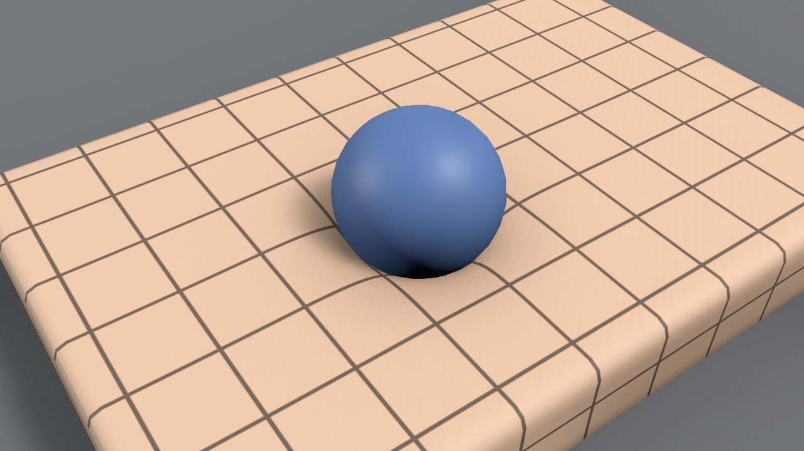

# 개요

MallangPhysics는 Unity 6.3의 URP에서 스킨드 메시와 스태틱 메시를 말랑하게 만듭니다. 손과 물체가 누른 자리는 들어가고, 본에 매달린 살 덩어리는 넓게 밀면 통째로 비켜나며, 몸이 움직이면 살이 출렁입니다. 에디터에서 메시를 한 번 베이크하고 컴포넌트 하나를 붙이면, 변형은 GPU에서 계산됩니다.

## 에디터 속 이름 {#names-in-the-editor}

에디터 안에서는 플러그인의 작업 이름을 그대로 씁니다. 이 문서의 메뉴와 설정 이름은 영어 에디터 기준입니다.

| | 에디터에서의 이름 |
|---|---|
| 패키지 | **MallangPhysics** (`com.wjsekrud.mallangphysics`) |
| 컴포넌트 | **Softbody** |
| 베이크 에셋 | **Softbody Authoring Data** |
| 베이크 결과 | **Baked Data** (`SD_` 에셋) |
| 셰이더 | **Softbody/Lit** |
| 프로젝트 세팅 | Project Settings > **Softbody** |

## 베타에 든 것 {#whats-in-the-beta}

| | |
|---|---|
| 베이크 | **Run Bake** 한 번으로 살 측정, 페인트, 머티리얼, 접촉 맵까지 |
| 눌림 | **Contact Detail** Basic: 눌림, 복원, 남는 자국, 겉껍질, 덩어리 밀림 |
| 솟음과 끌림 | **Contact Detail** Full: 눌린 자리 둘레의 솟음, 손에 끌려가는 피부, Edge Smoothing, 쥔 손이 끄는 덩어리(Lump Grip) |
| 하드 서피스 | Flex 칠: 겉이 뻣뻣하게 휘거나, 보석과 버클이 판처럼 가라앉고 기웁니다(Full) |
| 부위 나누기 | Separated Pairs: 겉면은 이어졌지만 밑의 살이 따로인 두 부위를 따로 누릅니다 |
| 관성 | 출렁임과 부위별 출렁임(관성 그룹) |
| 테셀레이션 | Softbody/Lit (Tessellated): 손가락 끝 같은 좁은 눌림도 모양으로 |
| 셰이프 필드 | 손과 소품이 콜라이더 대신 베이크한 실제 모양(손가락 사이, 오목한 손바닥)으로 누릅니다 |

빠진 것: 캐릭터가 자기 손으로 자기 몸을 누르는 자기 접촉, 속이 빈 대상에 속을 주는 볼륨 메시, 접촉 맵 이음매 자동 배치, 손으로 피부를 잡아당기는 Softbody Grabber. 자세한 목록은 [알려진 제한](./Known-Limitations)에 있습니다.

## 상태 {#status}

버전 0.1.0-beta.1입니다. C# 소스 없이 컴파일된 어셈블리(DLL)로 배포하고, 셰이더는 소스로 들어 있습니다. Unity 6.3(6000.3.26f1)과 URP 17.3에서, Windows의 D3D12, D3D11, Vulkan으로 확인했습니다. Metal은 확인하지 못했습니다.
