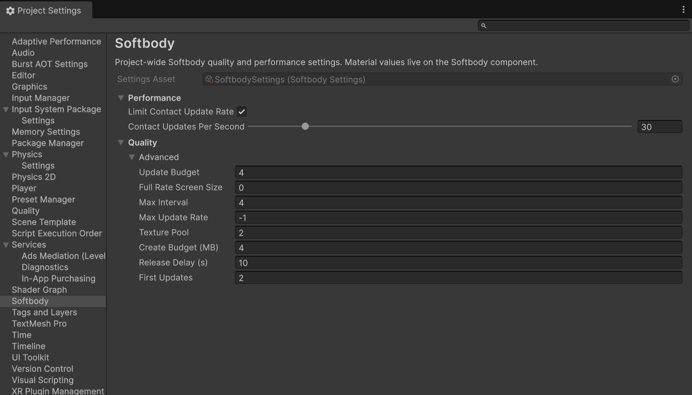
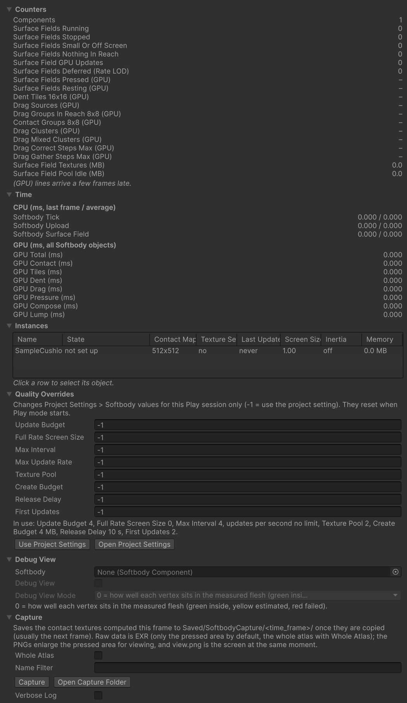

# 성능

접촉은 닿아 있는 메시에서만 GPU 시간과 메모리를 씁니다. 내 장면은 [Softbody Debugger](./Project-Settings#softbody-debugger)와 Unity Profiler로 직접 재 보세요.

## 비용이 드는 곳 {#where-the-cost-goes}

| 비용 | 내용 | 드는 때 |
|---|---|---|
| GPU 시간 | 접촉 갱신 한 번 | 닿은 메시마다, 아래 제한이 건너뛰지 않으면 매 프레임 |
| CPU 시간 | 컴포넌트의 LateUpdate: 콜라이더 찾기, 관성, 갱신 요청 | 켜진 컴포넌트마다 매 프레임(작음) |
| 메모리 | 접촉 텍스처 한 세트. 크기는 **Contact Map Resolution**을 따름 | 닿은 메시마다, 처음 닿을 때부터 완전히 복원될 때까지 |
| 메모리 | Mesh Data의 접촉 맵 텍스처 | Mesh Data가 메모리에 있는 동안 늘 |

출렁임(관성)은 따로입니다. 메시가 닿았든 아니든 컴포넌트마다 작은 CPU 계산이 들고, Softbody 셰이더의 버텍스 단계에서도 작업이 듭니다.

## 수명 주기 {#life-cycle}

1. **쉼.** 눌리는 표면 가까이에 콜라이더가 없습니다. 텍스처 세트도 GPU 작업도 없습니다. **Find Colliders Automatically**를 켜 두면, 메시가 화면에 보이고 **Min Screen Size**보다 클 때는 그래도 프레임마다 겹침 검사 하나가 콜라이더를 찾습니다.
2. **첫 접촉.** 메시가 풀에서 텍스처 세트를 받아 그 프레임에 바로 갱신합니다. 갱신 빈도 제한과 작은 메시의 갱신 간격(**Full Rate Screen Size**)은 적용되지 않고, **Update Budget**에서도 맨 앞 차례입니다. 풀에 준비된 세트가 없으면 몇 프레임 늦게 시작합니다.
3. **눌림.** 프레임마다 한 번 갱신합니다. 아래 제한이 걸리면 그보다 적게 갱신합니다. 눌린 채 아무것도 움직이지 않아도 갱신이 멈추지 않습니다.
4. **복원 중.** 손을 떼면 눌린 자리가 **Recovery Rate**에 따라 돌아오는 동안 갱신이 이어집니다. **Memory Time**을 쓰면 자국이 사라질 때까지(**Memory Fade Time**의 약 10배) 이어집니다.
5. **복원 끝.** 닿을 거리에 아무것도 없으면 텍스처 세트를 비워 풀에 돌려주고, 메시는 다시 쉽니다. 화면 밖 메시는 갱신 차례를 기다리지 않고 시간이 지나면 복원이 끝난 것으로 칩니다.

## 비용을 줄이는 설정 {#what-makes-it-cheaper}

| 설정 | 위치 | 효과 |
|---|---|---|
| [**Enable Contact**](./Softbody-Component#enable-contact) 끔 | Softbody 컴포넌트, Contact | 군중처럼 아무도 만지지 않는 캐릭터의 접촉 비용(GPU 작업, 메모리, 콜라이더 찾기)을 모두 없애고 출렁임은 남깁니다. Play 중에도 바꿀 수 있습니다. |
| **Contact Map Resolution** | Softbody Authoring Data, 6. Contact Map | 모든 갱신과 텍스처 세트의 크기를 정하며, **Rebake Contact Map**을 눌러야 적용됩니다. 사람 크기 캐릭터는 512, 가까이서 보일 때만 1024, 작은 소품은 256. |
| **Pressable Slots** | Softbody Authoring Data, 6. Contact Map | 눌리지 않는 슬롯(얼굴, 머리카락)을 빼면 맵의 칸이 나머지에 돌아가, 해상도를 낮춰도 똑같이 선명해 보일 수 있습니다. |
| [**Min Screen Size**](./Softbody-Component#min-screen-size) | Softbody 컴포넌트, Contact > Performance | 메시가 화면에서 이 값보다 작게 보이거나 어느 카메라에도 없으면 눌림 계산을 멈춥니다. 기본값 0.15에서는 가로 시야 90°일 때 사람 크기 캐릭터가 약 12 m에서 멈춥니다. Play 중에는 Scene 뷰도 카메라로 셉니다. |
| **Limit Contact Update Rate**와 **Contact Updates Per Second** | Project Settings > Softbody, Performance | 닿은 메시마다 초당 갱신 수를 제한합니다. 120 fps에서 초당 30번이면 GPU 시간이 4분의 1, 60 fps에서는 절반입니다. |
| **Update Budget** | Project Settings > Softbody, Quality > Advanced | 한 프레임에 갱신하는 메시 수를 제한합니다(기본값 4). 나머지는 돌아가며 갱신합니다([프로젝트 설정](./Project-Settings#update-budget)). |
| **Full Rate Screen Size** | Project Settings > Softbody, Quality > Advanced | 화면에서 작게 보이는 메시를 몇 프레임에 한 번만 갱신합니다. 기본값 0은 끔입니다. |
| **Collider Channel** | Softbody 컴포넌트, Contact > Colliders | 손과 소품이 있는 레이어만 고르면 콜라이더 후보가 줄어듭니다([콜라이더](./Colliders)). |
| **Softbody Ignore** 컴포넌트 | 아무 게임 오브젝트 | 메시와 겹치지만 누르면 안 되는 것에 붙입니다. 그 오브젝트와 자식의 콜라이더를 건너뜁니다. |
| [**Tessellation**](./Materials#tessellation) 끔, 또는 **Edge Length** 크게 | 머티리얼 | 테셀레이션은 눌릴 수 있는 삼각형을 눌리지 않은 동안에도 쪼개 그리므로 그리기 비용이 늡니다. 가까이서 보지 않는 메시는 Softbody/Lit을 씁니다. |
| [**Contact Detail**](./Softbody-Component#contact-detail) Basic(기본값) | Softbody 컴포넌트, Contact | 솟음, 피부 끌림, Edge Smoothing, Flex 칠을 빼서 Full보다 GPU 시간이 덜 듭니다. 가까이서 보이는 메시만 Full로 둡니다. |

컴포넌트나 게임 오브젝트를 끄면 텍스처 세트를 풀에 돌려주고, 출렁임과 갱신을 멈춥니다. 다시 켤 때까지 CPU 비용도 GPU 접촉 비용도 없고, 머티리얼이 꺼진 값으로 남아 Softbody 셰이더의 버텍스 단계에 작은 작업만 남습니다. 돌려준 세트는 **Release Delay**(기본값 10초) 뒤에 해제되고, Mesh Data의 접촉 맵은 그대로 메모리에 남습니다.

## 그래픽 API {#graphics-apis}

| API | 접촉 셰이더 첫 컴파일 | 비고 |
|---|---|---|
| Direct3D 12 | 수 초 | 에디터에 권장합니다. |
| Vulkan | 수 초 | |
| Direct3D 11 | 약 15분(빠른 PC 기준) | 한 번 컴파일한 결과는 프로젝트의 Library 폴더에 남아, Library를 지우기 전까지는 다시 기다리지 않습니다. |
| Metal | 확인하지 않음 | **Contact Detail** Full은 Basic으로 돕니다. |

이 넷 밖의 API(OpenGL, OpenGL ES, WebGL)와 컴퓨트 셰이더가 없는 기기에서는 접촉이 꺼지고 출렁임만 돕니다. 그때 Console에 `Contact is OFF for every Softbody component: ...` 경고가 까닭과 함께 나옵니다.

## Debugger와 Profiler로 재기 {#measuring}

줄마다의 설명은 [프로젝트 설정](./Project-Settings#softbody-debugger)에 있습니다. GPU 줄은 닿은 메시 모두를 더한 값입니다.

Debugger의 Time 칸에서 **GPU Total (ms)**부터 봅니다. 높으면 Counters 칸에서 갱신한 메시 수인 **Surface Field GPU Updates**와 눌림을 푸는 칸 그룹 수인 **Dent Tiles 16x16 (GPU)**를 보고, 그다음 더해서 GPU Total이 되는 GPU 줄을 봅니다.

- GPU Contact는 콜라이더와 [셰이프 필드](./Colliders#shape-fields) 조각이 많을수록, 그리고 메시마다 정해져 있는 Contact Groups 8x8 (GPU)가 클수록 커집니다.
- GPU Dent는 눌린 넓이에 따라 커집니다.
- GPU Tiles와 GPU Compose는 메시마다 거의 일정합니다. GPU Lump는 덩어리가 없는 메시(모든 스태틱 메시 포함)에서 0입니다.
- GPU Drag와 GPU Pressure는 **Contact Detail** Full에서만 돕니다. Basic이거나 **Drag Friction**이 0이면 GPU Drag와 Drag 줄은 0입니다.

눈에 띄게 닿은 것이 없는데 Surface Fields Running이 높으면, 메시가 복원 중이거나 **Collider Channel** 레이어의 무언가가 콜라이더로 모이고 있는 것입니다. Instances 목록의 State 열에서 어느 메시인지 봅니다.

Unity Profiler에서는 다음 이름으로 보입니다.

- CPU 모듈(Scripts): **Softbody Tick**은 컴포넌트마다 LateUpdate 전체이고, 그 안에 **Softbody Surface Field**(접촉 갱신 준비: 콜라이더, 본, 요청)와 **Softbody Upload**(관성 데이터와 머티리얼 값 넘기기)가 있습니다.
- GPU 모듈: **Softbody Contact**, **Softbody Tiles**, **Softbody Dent**, **Softbody Compose**, **Softbody Lump**, 그리고 Full에서 **Softbody Drag**, **Softbody Pressure**입니다. Debugger의 GPU 줄과 같은 구간입니다.
- 모든 메시의 GPU 갱신은 PostLateUpdate 맨 앞의 `SoftbodyFlush` 단계에서 프레임마다 한 번 보냅니다.

Debugger를 열어 두거나 Profiler가 기록하는 동안에는 (GPU) 줄을 채우려고 접촉 상태를 몇 프레임 늦게 읽어 오는 작은 일이 더해집니다.

## 메모리 {#memory}

텍스처 세트 하나의 크기는 **Contact Map Resolution**과 덩어리 유무를 따릅니다. Debugger의 Instances 목록 **Memory** 열은 메시마다, **Surface Field Textures (MB)**는 닿은 메시 전체를, **Surface Field Pool Idle (MB)**는 풀의 여분과 준비 중인 세트를 보여 줍니다. Vulkan에서는 일부 접촉 텍스처를 더 큰 형식으로 만들어, 같은 메시도 메모리가 더 듭니다. 메모리는 배치한 메시 수가 아니라 한꺼번에 닿은 메시 수에 따라 늘어납니다.

[셰이프 필드](./Colliders#shape-fields)의 베이크한 모양은 그 셰이프 필드가 누른 메시마다 GPU에 한 벌씩 올라갑니다. 0.2 cm 칸으로 베이크한 손 하나가 약 1 MB입니다. 눌린 메시가 텍스처 세트를 풀에 돌려줄 때 함께 놓습니다.

Mesh Data의 접촉 맵 텍스처는 Mesh Data 안에 들어 있어, Mesh Data를 쓰는 씬이나 프리팹이 메모리에 있는 동안 늘 올라와 있습니다. 컴포넌트를 꺼도 내려가지 않습니다.

컴포넌트를 끄고 켜거나 생성하거나 씬을 불러와도 그 프레임에는 무거운 일을 하지 않습니다. 텍스처는 프레임마다 **Create Budget**만큼 만들고, 풀은 켜진 컴포넌트가 쓰는 종류마다 **Texture Pool** 수만큼 여분을 준비해 두므로 처음 닿을 때 기다리지 않습니다. 끈 컴포넌트가 쓰던 것은 **Release Delay** 동안 남아 있어 다시 켜도 아무것도 다시 만들지 않고, 그 뒤 프레임마다 조금씩 해제됩니다. Texture Pool을 0으로 하면 여분을 두지 않고(첫 접촉이 몇 프레임 늦게 시작함), 여러 메시가 동시에 닿는다면 값을 올립니다. 세 값은 [프로젝트 설정](./Project-Settings#quality)에 있습니다.
