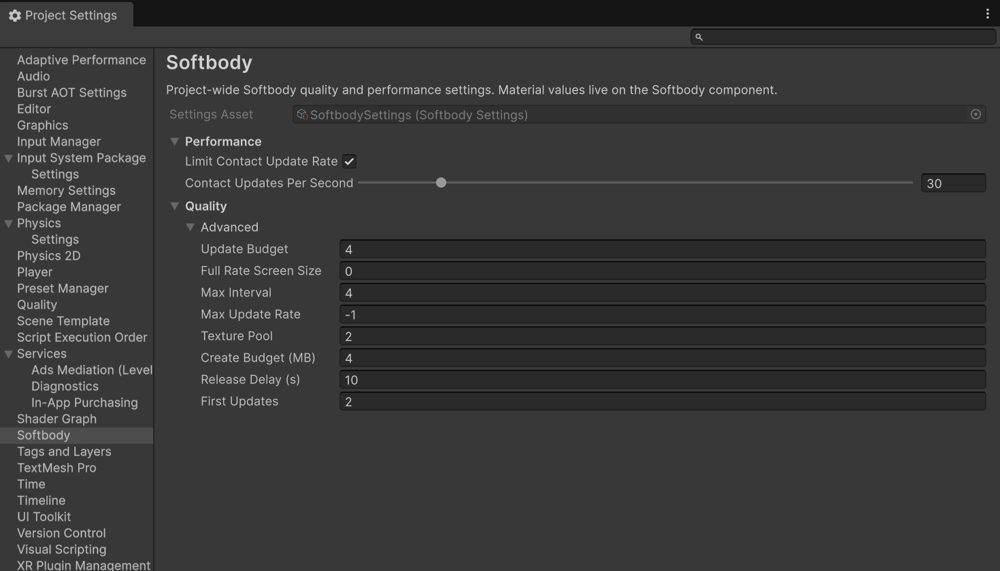
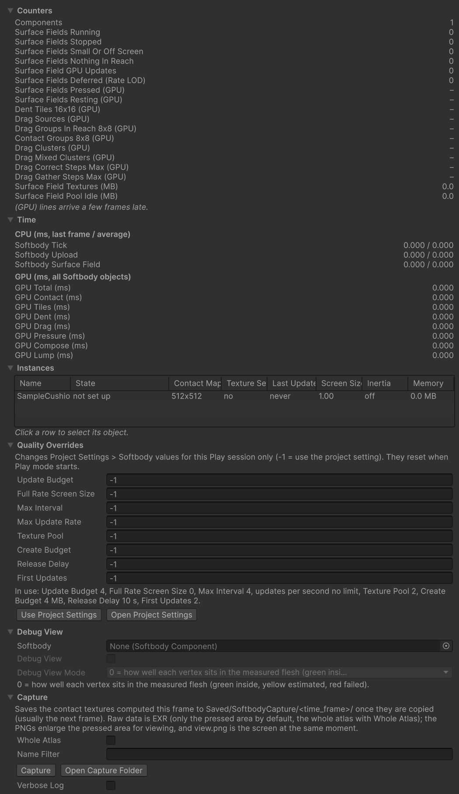
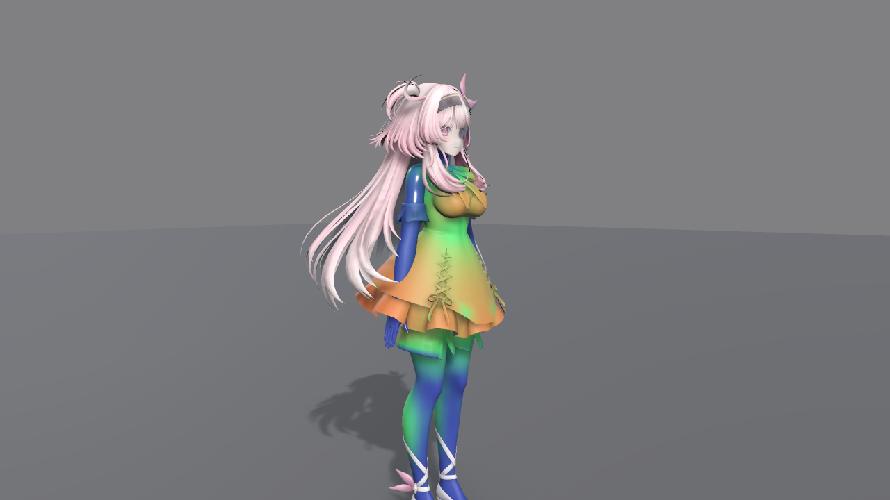

# 프로젝트 설정

Project Settings > Softbody의 칸, Softbody Debugger 창, 디버그 보기, 로그입니다. 무엇부터 볼지는 [성능](./Performance#measuring)에 있습니다.

## Project Settings > Softbody {#project-settings}

프로젝트 전체의 품질과 성능 설정입니다. 재료값은 여기가 아니라 [Softbody 컴포넌트](./Softbody-Component)에 있습니다.

값은 `Resources` 폴더의 `SoftbodySettings` 에셋에 저장됩니다. 에셋이 없으면 기본값으로 돌고 칸이 흐리게 보입니다. **Create Settings Asset**을 누르면 `Assets/Resources/SoftbodySettings.asset`을 만듭니다. 빌드에 들어가려면 에셋이 `Resources` 폴더 안에 있고 이름이 `SoftbodySettings`여야 합니다. 다른 이름이나 자리의 설정 에셋을 고르면 인스펙터에 쓰이지 않는 에셋이라는 경고가 나옵니다.

바꾼 값은 이 화면을 떠날 때 저장됩니다. Play 중에 바꿔도 바로 듣고 에셋에 남습니다. 이번 Play에서만 시험하려면 Debugger의 [Quality Overrides](#quality-overrides)를 씁니다.



### Performance {#performance}

| 칸 | 기본값 | 하는 일 |
|---|---|---|
| **Limit Contact Update Rate** | 끔 | 닿은 메시마다 프레임 레이트와 상관없이 초당 **Contact Updates Per Second**번까지만 눌림을 다시 계산합니다. 갱신 사이에는 눌린 자리가 마지막 모양을 지키며 메시와 함께 움직이므로, 빠른 손은 한 갱신 간격만큼 자국을 남길 수 있습니다. |
| **Contact Updates Per Second** | 30 | Limit Contact Update Rate가 켜져 있을 때 초당 갱신 수입니다. 5~240. |

### Quality {#quality}

모두 Quality 칸의 **Advanced** 아래에 있습니다. 접촉이 처음 시작되는 순간은 화면 크기나 갱신 빈도 제한과 상관없이 늘 바로 갱신됩니다.

| 칸 | 기본값 | 하는 일 |
|---|---|---|
| [**Update Budget**](#update-budget) | 4 | 한 프레임에 접촉을 갱신하는 메시의 최대 수입니다. 0 = 제한 없음. |
| [**Full Rate Screen Size**](#full-rate-screen-size) | 0 | 화면에서 이 값보다 작은 메시는 매 프레임이 아니라 간격을 두고 갱신합니다. 0 = 매 프레임. |
| **Max Interval** | 4 | 작은 메시의 갱신 사이 최대 간격(프레임 수)입니다. 기본값이면 60 fps에서 15 Hz입니다. |
| [**Max Update Rate**](#max-update-rate) | -1 | 닿은 메시의 초당 최대 갱신 수입니다. -1 = Limit Contact Update Rate를 따름, 0 = 제한 없음. |
| [**Texture Pool**](#texture-pool) | 2 | 종류마다 남겨 두는 여분 접촉 텍스처 세트 수입니다. |
| [**Create Budget**](#create-budget) | 4 MB | 한 프레임에 만들고 해제하는 접촉 텍스처의 최대 메모리입니다. 0 = 제한 없음. |
| [**Release Delay**](#release-delay) | 10 s | 접촉 텍스처 등을 마지막으로 쓴 뒤 메모리에 두는 시간입니다. 0 = 바로 해제 시작. |
| [**First Updates**](#first-updates) | 2 | 한 프레임에 첫 갱신을 하는 메시의 최대 수입니다. 0 = 제한 없음. |

#### Update Budget {#update-budget}

예산에 들지 못한 메시는 차례를 기다리고, 다음 갱신에서 그동안의 움직임을 한 번에 따라잡습니다. 갱신하는 순서는 다음과 같습니다.

1. 막 닿은 메시
2. 화면에 보이고 닿는 거리에 콜라이더가 있는 메시, 또는 **Max Interval** 프레임만큼 기다린 메시
3. 화면에 보이고 손을 뗀 뒤 복원 중인 메시
4. 화면 밖 메시

같은 차례 안에서는 화면에 크게 보이고 오래 기다린 메시가 먼저입니다.

#### Full Rate Screen Size {#full-rate-screen-size}

화면 크기는 화면 높이에 대한 바운딩 구 지름이며 대략 0~1입니다. 이 값보다 작은 메시는 ceil(이 값 / 화면 크기) 프레임에 한 번만 갱신합니다. 간격은 최대 **Max Interval**까지입니다.

#### Max Update Rate {#max-update-rate}

-1이 아니면 위의 Limit Contact Update Rate와 Contact Updates Per Second보다 앞섭니다. 예를 들어 120 fps에서 30이면 메시마다 네 프레임에 한 번 갱신합니다.

#### Texture Pool {#texture-pool}

종류는 접촉 맵 해상도, 덩어리 있음과 없음, 거친 격자(접촉 맵 칸 여러 개를 한 칸으로 묶은 격자) 크기로 나뉩니다. 메시는 처음 닿을 때 세트를 받고, 닿는 콜라이더 없이 완전히 복원되면 비워서 돌려줍니다. 그 종류를 쓰는 컴포넌트가 켜져 있는 동안 여분을 프레임마다 조금씩(**Create Budget**) 만들어 두므로 처음 닿을 때 기다리지 않습니다. 이 수를 넘는 세트와, 켜진 컴포넌트가 더는 쓰지 않는 종류의 여분은 **Release Delay** 뒤에 해제합니다.

#### Create Budget {#create-budget}

텍스처 한 장은 적어도 0.5 MB로 세고, 프레임마다 적어도 한 장은 만듭니다. 여러 메시를 한꺼번에 켜거나 동시에 닿아도 끊기지 않고 여러 프레임에 나뉩니다. 텍스처를 기다리는 메시는 몇 프레임 늦게 눌리기 시작하고, 출렁임은 바로 돕니다.

#### Release Delay {#release-delay}

접촉 텍스처와, 끈 메시의 조회 표(첫 갱신이 만드는 메시별 표)를 마지막으로 쓴 뒤 이 시간 동안 메모리에 둡니다. 이 안에 다시 켜면 아무것도 다시 만들지 않고, 지나면 프레임마다 조금씩 해제합니다. GPU 작업은 어느 쪽이든 바로 멈춥니다. 실제 시간으로 세므로 일시 정지나 Time Scale 0에서도 흐릅니다.

#### First Updates {#first-updates}

첫 갱신은 켜기, 생성, 씬 불러오기 뒤 처음 하는 갱신으로, 메시의 조회 표를 만듭니다. 나머지 메시는 한두 프레임 뒤에 시작합니다. **Release Delay** 안에 다시 켠 메시는 표가 남아 있어 세지 않습니다.

## 품질 단계 {#quality-levels}

Project Settings > Softbody의 값은 모든 Quality 단계에 하나입니다. 단계마다 다르게 하려면 코드에서 `SoftbodySystem.Overrides`를 바꿉니다. Quality 칸 여덟과 이름이 같고, -1이면 설정값을 쓰며 0 이상이면 설정값보다 앞섭니다. 앱이 시작할 때(에디터에서는 Play를 시작할 때) 모두 -1로 돌아가므로, 시작한 뒤와 Quality 단계를 바꿀 때 다시 넣습니다.

```csharp
using Softbody;
using UnityEngine;

// 가장 낮은 Quality 단계에서는 한 프레임에 두 메시까지, 메시마다 초당 30번까지만 갱신한다.
bool low = QualitySettings.GetQualityLevel() == 0;
SoftbodySystem.Overrides.UpdateBudget = low ? 2 : -1;
SoftbodySystem.Overrides.MaxUpdateRate = low ? 30f : -1f;
```

메시마다의 품질은 컴포넌트의 **Contact Detail**과 **Min Screen Size**, Softbody Authoring Data의 **Contact Map Resolution**으로 정합니다([성능](./Performance#what-makes-it-cheaper)).

## Softbody Debugger {#softbody-debugger}

**Window > Softbody > Debugger**로 엽니다. 값은 Play 중에만 나오고, 0.25초마다 새로 그립니다. 칸은 Counters, Time, Instances, Quality Overrides, Debug View, Capture입니다.



### Counters {#counters}

(GPU)가 붙은 줄은 이 창이 열려 있거나 Profiler가 기록하는 동안에만 GPU에서 읽어 오며, 몇 프레임 늦습니다. 읽은 값이 아직 없으면 `–`로 나옵니다. 나머지 줄은 프레임마다 세며, 컴포넌트 하나가 여러 줄에 함께 들어갈 수 있습니다. 상태를 아직 알릴 수 없는 컴포넌트가 있으면 `N of M Softbody components cannot report their state yet` 줄이 위에 나옵니다.

| 줄 | 보여 주는 것 |
|---|---|
| Components | 켜진 Softbody 컴포넌트. |
| Surface Fields Running | 접촉이 켜져 있고 이번 프레임에 접촉 갱신을 요청한 컴포넌트. |
| Surface Fields Stopped | 접촉이 켜져 있지만 요청하지 않은 컴포넌트. 쉬는 중이거나 아직 준비되지 않았습니다. |
| Surface Fields Small Or Off Screen | 지난 프레임에 어느 카메라(Game, Scene 뷰, VR)에도 보이지 않았거나 **Min Screen Size**보다 작음. |
| Surface Fields Nothing In Reach | 콜라이더를 찾았지만 닿는 거리 안에는 없음. |
| Surface Field GPU Updates | **Update Budget**을 거친 뒤 GPU에서 실제로 돈 갱신. |
| Surface Fields Deferred (Rate LOD) | 요청했지만 Update Budget, 갱신 빈도 제한, 화면 크기 규칙에 밀려 미뤄짐. |
| Surface Fields Pressed (GPU) | 마지막으로 읽어 온 결과에 눌린 칸이 있던 메시. |
| Surface Fields Resting (GPU) | 눌린 칸이 없고 복원이 끝남. GPU는 Contact 단계 뒤의 단계를 모두 건너뜁니다. |
| Dent Tiles 16x16 (GPU) | 눌림을 푸는 접촉 맵의 16x16 칸 그룹. |
| Drag Sources (GPU) | 끌림을 위해 피부를 붙든 칸. 0일 때 가장 쌉니다. |
| Drag Groups In Reach 8x8 (GPU) | 끌림이 닿는 칸의 8x8 그룹. |
| Contact Groups 8x8 (GPU) | Contact 단계가 도는 칸의 8x8 그룹. |
| Drag Clusters (GPU) | 끌림 원천이 들어 있는 8x8 그룹. |
| Drag Mixed Clusters (GPU) | 그중 접촉 맵의 여러 조각에 걸친 그룹. 이음매를 건너는 끌림이 많다는 뜻입니다. |
| Drag Correct Steps Max (GPU) | 끌림 보정 단계에서 8x8 그룹 하나가 도는 가장 긴 순회(모든 메시를 통틀어). |
| Drag Gather Steps Max (GPU) | 끌림 모으기 단계에서 8x8 그룹 하나가 도는 가장 긴 순회(모든 메시를 통틀어). |
| Surface Field Textures (MB) | 닿은 메시가 잡고 있는 접촉 텍스처 세트. |
| Surface Field Pool Idle (MB) | 풀에서 기다리는 여분과 만드는 중인 세트. |

Drag 줄은 **Contact Detail** Full에서 **Drag Friction**이 0보다 클 때만 0이 아닙니다.

### Time {#time}

CPU 줄은 지난 프레임 값 / 30프레임 평균(ms)입니다. GPU 줄은 GPU가 마지막으로 끝낸 프레임에서 모든 Softbody 메시를 더한 값이며, 0.5초 넘게 돌지 않은 단계는 0으로 나옵니다. 이름은 Unity Profiler의 표지와 같습니다.

| 줄 | 보여 주는 것 |
|---|---|
| Softbody Tick | 모든 Softbody 컴포넌트 LateUpdate의 CPU 시간. 아래 두 줄을 포함합니다. |
| Softbody Upload | 이번 프레임의 결과(관성 데이터, 머티리얼 값)를 머티리얼에 넘기는 CPU 시간. |
| Softbody Surface Field | 접촉 갱신을 준비하는 CPU 시간(콜라이더, 본, 요청). |
| GPU Total (ms) | 아래 GPU 줄 일곱 개의 합. |
| GPU Contact (ms) | 콜라이더가 어디를 누르는지 재는 단계. |
| GPU Tiles (ms) | 어느 접촉 맵 그룹에 일이 있는지 목록을 만드는 단계. |
| GPU Dent (ms) | 눌림 단계. |
| GPU Drag (ms) | 끌림 단계(Contact Detail Full). |
| GPU Pressure (ms) | 눌린 자리 둘레의 솟음을 그리는 접촉 압력 단계(Contact Detail Full). |
| GPU Compose (ms) | 눌림과 덩어리 밀림을 머티리얼이 읽는 변위로 합치고, 노멀 기울기와 **Dent Darkening**도 만드는 단계. |
| GPU Lump (ms) | 덩어리 단계. |

### Instances {#instances}

켜진 Softbody 컴포넌트마다 한 줄입니다. 줄을 누르면 그 오브젝트를 고릅니다.

| 열 | 보여 주는 것 |
|---|---|
| Name | 계층 경로와 `(Softbody)`. |
| State | `not set up`(대상 메시나 Mesh Data가 맞지 않아 돌지 않음), `contact off`(접촉이 꺼짐, 접촉 맵 없음, 또는 이 GPU에서 못 돌림), `sleeping`(갱신을 요청하지 않음), `deferred`(요청했지만 이번 프레임에 밀림), `running`(이번 프레임에 GPU에서 갱신). 뒤에 `(small or off screen)`이나 `(nothing in reach)`가 붙을 수 있습니다. |
| Contact Map | 접촉 맵 해상도. 없으면 `none`. |
| Texture Set | 접촉 텍스처 세트를 지금 쥐고 있는지. |
| Last Update | 마지막으로 GPU에서 갱신한 프레임 번호. 아직 없으면 `never`. |
| Screen Size | 화면 높이에 대한 바운딩 구 지름. |
| Inertia | `off`, `on`, 또는 관성 그룹 수. |
| Memory | 이 메시가 쥔 접촉 텍스처 메모리. |

### Quality Overrides {#quality-overrides}

[Quality](#quality) 칸 여덟을 이번 Play 동안만 바꿉니다. -1이면 Project Settings 값을 씁니다. 저장하지 않으며 Play를 시작할 때 -1로 돌아갑니다. 아래 `In use:` 줄이 지금 쓰는 값입니다. **Use Project Settings**는 모두 -1로 되돌리고, **Open Project Settings**는 설정 화면을 엽니다. 코드의 `SoftbodySystem.Overrides`와 같은 값입니다([품질 단계](#quality-levels)).

### Debug View {#debug-view}

**Softbody** 칸에 넣은 컴포넌트의 **Debug View**와 **Debug View Mode**를 바꿉니다. 계층에서 Softbody 컴포넌트가 있는 오브젝트를 고르면 따라 바뀝니다. 컴포넌트 인스펙터의 Debug 칸과 같은 값입니다.

Debug View는 Play 중에 Softbody 머티리얼(Softbody/Lit, 또는 Softbody 셰이더 함수를 쓰는 셰이더)에서 보통 셰이딩 대신 디버그 색을 보여 줍니다. Debug View Mode는 Debug View가 켜져 있을 때만 바꿀 수 있습니다.

- 0: 각 버텍스가 측정한 살 안에 얼마나 잘 들어앉았는지(초록은 안, 노랑은 추정, 빨강은 실패).
- 1: 단단한 코어와의 연결(청록은 연결됨, 자홍은 연결 안 됨).
- 2: 접촉 맵 체커. 아래 피부와 같은 무늬인 겹친 옷과 단추는 피부와 함께 눌립니다. 무늬가 끊기는 선은 이음매입니다.
- 3: 바깥 표면까지의 거리(초록은 표면 위, 빨강은 바깥으로 멀리, 파랑은 안쪽 깊이, 10 cm에서 색이 가장 진함).
- 4: 베이크한 무른 정도(남색은 움직이지 않음, 그다음 초록, 빨강이 가장 무름, 자홍은 반대 방향으로 움직임).
- 5: 버텍스 사이의 눌림(초록은 삼각형 안의 눌림까지 읽음, 빨강은 이음매를 따라 버텍스에서만 읽음).



컴포넌트의 **Contact Only (Debug)**는 모든 출렁임을 끄고 접촉만 봅니다. 출시용이 아닙니다.

### Capture {#capture}

이번 프레임의 접촉 텍스처를 `<프로젝트>/Saved/SoftbodyCapture/<날짜_시각>_f<프레임>/`에 저장합니다. 복사가 끝나는 대로, 보통 다음 프레임에 저장되며 Play 중에만 됩니다.

- **Whole Atlas**: 눌린 영역 대신 접촉 맵 전체를 저장합니다.
- **Name Filter**: 오브젝트나 컴포넌트 이름에 이 글이 든 것만 캡처합니다. 비우면 접촉이 켜진 모두입니다.
- **Capture**: 캡처합니다. **Open Capture Folder**: 저장 폴더를 엽니다.
- **Verbose Log**: [로그](#logs)를 보세요.

폴더에는 원래 값을 담은 EXR 파일(눌린 영역만, Whole Atlas면 접촉 맵 전체), 눌린 영역을 확대한 PNG 미리 보기, 같은 순간의 화면인 `view.png`, 그 순간의 접촉 설정을 적은 `capture.txt`가 들어갑니다. 결과는 Console에 남습니다. 빌드에서는 코드로 `SoftbodyComponent.RequestCaptureAll()`이나 컴포넌트 하나의 `RequestCapture()`를 부르며, 파일은 `Application.persistentDataPath` 아래 `Saved/SoftbodyCapture/`에 저장됩니다.

## 로그 {#logs}

Softbody의 메시지는 모두 Console에 `[Softbody]`로 시작합니다. 컴포넌트가 낸 메시지를 누르면 그 컴포넌트가 골라집니다. Console 검색 칸에 `[Softbody]`를 넣으면 이 플러그인의 메시지만 남습니다.

- 정보: 베이크 결과(관성 그룹, 덩어리 등), Play를 시작할 때 컴포넌트마다 `setup valid (...)` 한 줄, 이 메시에서 효과가 없는 값(`... has no effect because ...`, Play에서는 기본값에서 바꾼 것만), GPU 판정 한 줄(`Contact is available on this GPU (...)`).
- 경고: 고칠 것이 있는 설정입니다. Play 중에 되풀이되는 문제는 Play마다 한 번만 나옵니다.
- 오류: 베이크나 설정이 돌 수 없을 때입니다.
- `Contact is OFF for every Softbody component: ...` 경고: 이 GPU나 그래픽 API에서 접촉을 돌릴 수 없습니다. 출렁임은 돕니다([성능](./Performance#graphics-apis)).
- `Contact Detail Full cannot run on this graphics device, so this mesh runs as Basic`: Full을 고른 메시가 Basic으로 돕니다. Full이 안 되는 GPU(Metal 포함)에서만 나옵니다.

**Verbose Log**(Debugger의 Capture 칸)를 켜면 출렁임이 처음 움직였을 때 같은 자세한 메시지를 Play 동안 더 씁니다. 창이 열려 있는 동안 Play마다 다시 켜집니다.

컴포넌트 인스펙터의 **Validate Setup** 단추(컴포넌트 메뉴에도 있음)는 Play 없이 같은 검사를 돌리고, 이 메시에서 효과가 없는 값을 기본값과 상관없이 모두 적습니다.
