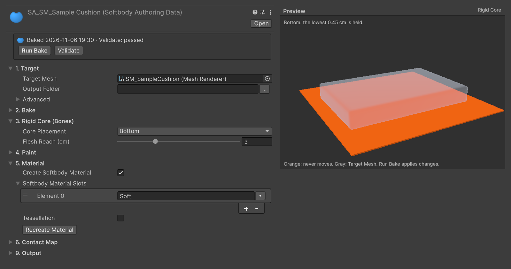
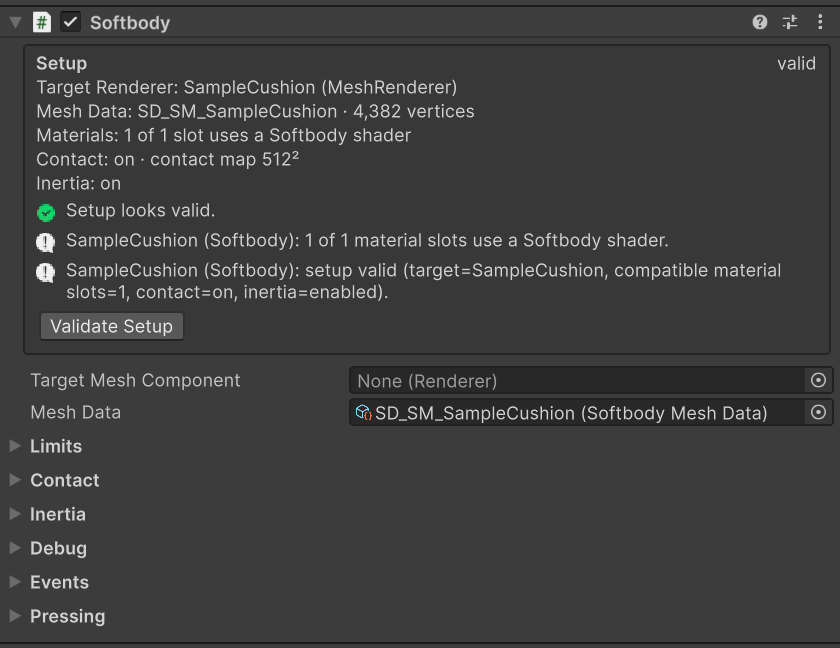

# 빠른 시작

패키지에 들어 있는 견본 방석을 베이크하고 그 위에 공을 떨어뜨려 봅니다.

## 1. 견본 가져오기 {#_1-import-the-sample}

Package Manager에서 **MallangPhysics**의 Samples 탭을 열고 **Quick Start**를 Import합니다. `Assets/Samples/MallangPhysics/<버전>/Quick Start/`에 다음이 복사됩니다.

| 파일 | |
|---|---|
| `SM_SampleCushion.fbx` | 60 × 40 × 8 cm 방석, 머티리얼 슬롯 `Soft` 하나 |
| `SampleCushion.prefab` | 방석과, 바닥부터 윗면 2 cm 아래까지 닿는 Box Collider |
| `QuickStart.unity` | 바닥 위의 방석, Rigidbody를 단 공, 빛, 카메라 |

Box Collider가 윗면보다 2 cm 낮아서, 떨어진 공이 2 cm 가라앉으며 바로 자국이 납니다.

## 2. 베이크 설정 {#_2-set-up-the-bake}

Project 창에서 `SM_SampleCushion.fbx`를 고르고 **Assets > Softbody > Create Authoring Data**를 누릅니다. 모델 옆에 `SA_SM_SampleCushion`이 생기고 **Target Mesh**가 방석으로 채워집니다. 그 에셋을 다음처럼 설정합니다.

| 설정 | 카테고리 | 값 |
|---|---|---|
| **Target Mesh** | 1. Target | `SM_SampleCushion`(채워져 있음) |
| **Core Placement** | 3. Rigid Core (Bones) | Bottom |
| **Create Softbody Material** | 5. Material | 켬 |
| **Softbody Material Slots** | 5. Material | `Soft` |

Bottom은 바닥에 닿는 방석 밑면만 붙들고, 나머지는 살이 됩니다. 인스펙터 아래 Preview 칸에서 주황색으로 그려진 곳이 움직이지 않는 부분입니다.

**Assets > Create > Softbody > Softbody Authoring Data**로 만들었다면 **Target Mesh**에 `SM_SampleCushion.fbx`를 끌어다 놓습니다.

## 3. 베이크 {#_3-bake}

**Run Bake**를 누릅니다(견본은 약 15초). 끝나면 **Validate**를 눌러 오류가 없는지 봅니다. 베이크 에셋 옆에 다음이 생깁니다.

- `SD_SM_SampleCushion`: 베이크 결과입니다. 베이크 에셋의 **Baked Data**(9. Output)에 들어갑니다.
- `M_SM_SampleCushion_Softbody`, `MI_SM_SampleCushion_Soft`: Softbody/Lit 머티리얼과 `Soft` 슬롯용 변형입니다. 변형은 모델의 `Soft` 슬롯에 바로 입혀집니다.

베이크는 메시를 고치지 않습니다. 견본 방석에는 텍스처가 없어서 머티리얼이 흰색입니다.

## 4. 컴포넌트 추가 {#_4-add-the-component}

`QuickStart.unity`를 열고 `SampleCushion`에 **Softbody** 컴포넌트를 추가한 뒤 **Mesh Data**에 `SD_SM_SampleCushion`을 지정합니다. **Target Mesh Component**는 비워 둡니다. 비어 있으면 이 오브젝트와 그 자식 가운데 Mesh Data를 구운 렌더러를 씁니다.

## 5. 플레이 {#_5-play}

Play를 누릅니다. 공이 떨어져 방석을 누릅니다. Scene 뷰에서 공을 끌어 옮기면 자국이 따라가고, 떠난 자리는 돌아옵니다. 눌림과 출렁임은 Play 중에만 보입니다.

**Collider Channel**의 레이어(기본: Ignore Raycast를 뺀 모든 레이어)에 있는 콜라이더는 모두 살을 누르고, 트리거는 누르지 않습니다. 방석 자신의 Box Collider는 **Ignore Root**(Animator가 없으면 컴포넌트를 단 오브젝트) 아래에 있어서 누르지 않습니다. 바꾸려면 [콜라이더](./Colliders)를 보세요.

## 해 볼 것 {#things-to-try}

Softbody 컴포넌트에서(Play 중에 바꾸면 바로 보입니다):

| 설정 | 기본값 | 바꿔 볼 값 | |
|---|---|---|---|
| **Recovery Rate** | 30 | 8 | 눌린 자리가 돌아오는 데 0.5초쯤 걸립니다. |
| **Memory Time** | 0 s | 1.5 | 메모리 폼: 공이 떠난 뒤에도 자국이 남았다가 사라집니다. |
| **Skin Tension** | 0 | 0.5 | 가죽: 눌린 자리가 더 둥글고 넓어집니다. |

Softbody Authoring Data에서(4. Paint). 다시 베이크하지 않아도 눌린 자리가 바로 바뀝니다.

| 설정 | 기본값 | 바꿔 볼 값 | |
|---|---|---|---|
| **Volume Preservation** | 1 | 0 | 폼: 아무것도 솟지 않고 눌린 자리의 가장자리가 또렷합니다. |

## 다음 {#next}

- 내 메시 [베이크](./Baking)
- 스킨드 메시는 [캐릭터](./Characters)
- 모든 설정은 [Softbody 컴포넌트](./Softbody-Component)
