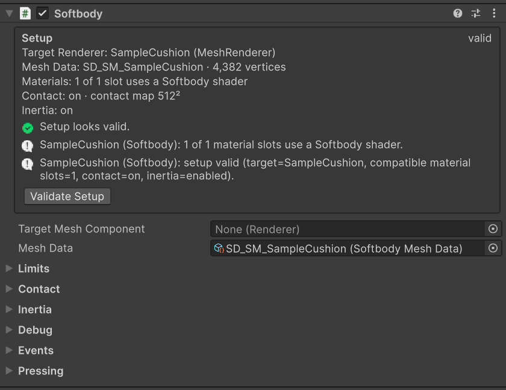
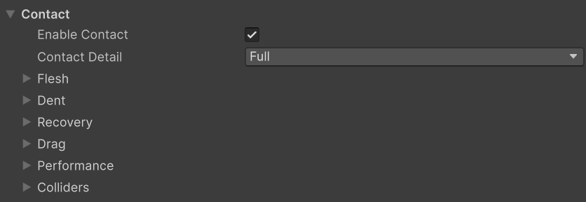
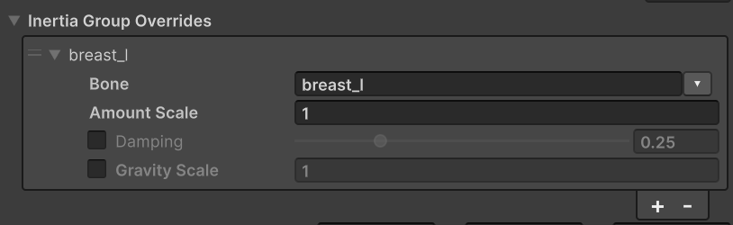

# Softbody 컴포넌트

메시마다 **Softbody** 컴포넌트를 하나씩 두고, **Mesh Data**에 그 메시용 Softbody Authoring Data의 Baked Data를 지정합니다([베이크](./Baking)). 메시의 머티리얼은 Softbody 셰이더여야 합니다([머티리얼](./Materials)). 컴포넌트는 Play 모드에서만 돕니다. 편집 모드에서는 메시가 변형되지 않은 채 그려집니다.

## 설정 {#settings}

단위는 cm와 초이고, 칸 이름 끝에 `(cm)`, `(s)`처럼 붙습니다. "0~1": 이 범위로 제한됩니다. "최소 0, 슬라이더 2까지": 0 아래로 내려갈 수 없고, 슬라이더는 2에서 멈추지만 더 큰 값을 직접 넣을 수 있습니다. (Advanced): 그 묶음의 Advanced 접힘 안에 있습니다. 조건이 맞지 않는 칸은 흐려지고, 값은 그대로 남습니다.

### Setup 상자 {#setup}

인스펙터 맨 위 상자는 이 컴포넌트가 무엇을 변형할지 보여 줍니다.

- **Target Renderer**, **Mesh Data**, **Materials**(Softbody 셰이더 슬롯 수), **Contact**(켜짐과 접촉 맵 해상도, 또는 꺼진 까닭), **Inertia**(켜짐과 관성 그룹 수, 또는 꺼진 까닭). Play 중에는 지금 실행 상태 줄이 더 나옵니다.
- 그 아래에 설정의 문제가 줄마다 나오고, 고칠 수 있는 줄에는 버튼이 붙습니다(대상 렌더러를 찾는 **Find**, **Find Baked Data**, **Use Softbody Materials**, 베이크 에셋을 여는 **Open Authoring**, 문제의 오브젝트를 고르는 **Select**).
- **Validate Setup** 버튼은 설정을 검사해 Console에 씁니다. [Validate Setup](#validate-setup)을 보세요.

### Softbody {#softbody}

| 설정 | 기본값 | 설명 |
|---|---|---|
| [**Target Mesh Component**](#target-mesh-component) | 비어 있음 | 이 컴포넌트가 변형하는 렌더러입니다. 비어 있으면 자동으로 고릅니다. |
| **Mesh Data** | 비어 있음 | 대상 메시용 Softbody Authoring Data의 Baked Data입니다. |

#### Target Mesh Component {#target-mesh-component}

Skinned Mesh Renderer나 Mesh Renderer만 받습니다. 비어 있으면 이 오브젝트와 그 자식의 렌더러 가운데, [Softbody Ignore](./Colliders#softbody-ignore)가 붙지 않았고 Mesh Data를 베이크한 메시를 쓰는 것을 고릅니다. 맞는 것이 없으면 첫 렌더러를 고릅니다.

렌더러 하나는 Softbody 컴포넌트 하나만 변형합니다. 두 번째 컴포넌트는 경고를 남기고, 첫 컴포넌트가 꺼질 때까지 쉽니다.

### Limits {#limits}

| 설정 | 기본값 | 설명 |
|---|---|---|
| [**Max Displacement**](#max-displacement) | 50 cm | 눌림과 출렁임을 합쳐 버텍스가 모델링된 위치에서 움직일 수 있는 가장 먼 거리입니다. 안전장치이므로 아주 큰 메시에서만 올립니다. 최소 0. |

#### Max Displacement {#max-displacement}

한계의 70%까지는 움직임이 그대로이고, 그 너머에서 한계에 부드럽게 다가갑니다.

### Contact {#contact}

| 설정 | 기본값 | 설명 |
|---|---|---|
| [**Enable Contact**](#enable-contact) | 켬 | 눌림을 켭니다. 아무도 만지지 않는 캐릭터에서는 끕니다. |
| [**Contact Detail**](#contact-detail) | Basic | Basic은 눌림과 덩어리 밀림만, Full은 솟음, 끌림, Edge Smoothing, Flex 칠까지 모든 접촉 효과를 계산합니다. Enable Contact가 켜져 있을 때만 바꿀 수 있습니다. |

#### Enable Contact {#enable-contact}

끄면 접촉 비용(GPU 작업, 메모리, 콜라이더 찾기)이 모두 사라지고 출렁임만 남으며, 덩어리도 더는 밀리지 않습니다. Play 중에 바꿀 수 있습니다.

#### Contact Detail {#contact-detail}

- **Basic**: 눌림과 덩어리 밀림만 돕니다. 솟음, 피부 끌림(그래서 누르는 손의 Lump Grip도), Edge Smoothing, Flex 칠(휘는 겉과 판)이 꺼지고 그 GPU 작업도 건너뜁니다. Flex를 칠한 자리는 맨살처럼 눌리고, Play를 시작할 때 Console에 알립니다. Basic에서도 Volume Preservation과 Skin Tension은 눌린 자리 모양을 바꿉니다.
- **Full**: Basic에 솟음, 피부 끌림, Edge Smoothing, Flex 칠을 더합니다. 솟음과 끌린 피부, 판이 보이는 가까이서 보는 메시에 켭니다.

이 GPU가 Full을 돌리지 못하면(Metal 포함) Full로 둔 메시도 Basic으로 돌고, Console에 `Contact Detail Full cannot run on this graphics device, so this mesh runs as Basic`이 나옵니다. 꺼진 효과의 설정 값은 그대로 남습니다.

### Contact > Flesh {#contact-flesh}

| 설정 | 기본값 | 설명 |
|---|---|---|
| [**Skin Tension**](#skin-tension) | 0 | 가죽이나 말랑한 주사위의 눈처럼 살이 팽팽한 겉껍질에 덮여 있을 때 씁니다. 0~2. |
| [**Volume Offset**](#volume-offset) | 0 | Play 중에 눌린 자리 둘레가 솟는 정도를 맞춰 볼 때 씁니다. -1~1. |
| [**Flex Offset**](#flex-offset) | 0 | 플레이 중에 Flex를 칠한 겉의 뻣뻣함을 맞춰 볼 때 씁니다. 아직 완성되지 않아 불안정합니다. -1~1. |

눌린 자리의 폭은 베이크한 살 두께와 **Skin Tension**이 정합니다. 얼마나 솟는지는 베이크 에셋의 **Volume Preservation**에 Volume 칠을 곱하고 Volume Offset을 더한 값이 정합니다. [살의 재료](./Concepts#flesh-material)를 보세요.

#### Skin Tension {#skin-tension}

- 값: 0 = 맨살이나 젤리, 사람 피부는 약 0.15, 가죽은 약 0.5이고, 1보다 크면 두꺼운 살 위의 북 가죽입니다.
- 팽팽할수록 눌린 자리가 둥글고 넓어지고, 손가락 사이를 건너 덮으며, 누르는 물체의 모양이 흐려집니다. 살이 얇은 곳일수록 효과가 큽니다.
- 같은 값은 어느 메시에서나 같은 겉이고, Depth 칠이 바꾸지 않습니다.
- 당겨진 겉껍질이지 단단한 껍데기가 아니므로, 뻣뻣한 자리도 판처럼 기울지 않고 평평하게 가라앉습니다.
- 메시 전체에 걸리는 값입니다. 겉의 일부만 뻣뻣하게 하려면 Flex를 칠합니다([페인트](./Painting#the-four-channels)). Play 중에 바꿀 수 있습니다.

#### Volume Offset {#volume-offset}

모든 자리의 Volume(베이크 에셋의 **Volume Preservation** × Volume 칠)에 더하므로, 무엇을 칠했든 한 칸에 같은 만큼 바뀝니다. -1이면 모두 폼처럼, +1이면 모두 살처럼 움직입니다. 통째로 밀린 덩어리가 퍼지는 모양은 베이크한 값 그대로입니다. 맞추려면 그 결과를 베이크 에셋에 넣고 Run Bake를 누릅니다.

#### Flex Offset {#flex-offset}

**아직 완성되지 않은 기능이라 불안정합니다. 주의해서 쓰세요.**

Flex 칠에 더하므로, 음수면 칠하지 않은 피부도 휩니다. -1이면 칠한 조각이 모두 강체 판이 되고([판](./Painting#plates)), +1이면 모두 맨살입니다. Contact Detail이 Full이어야 합니다.

### Contact > Dent {#contact-dent}

| 설정 | 기본값 | 설명 |
|---|---|---|
| [**Max Contact Depth**](#max-contact-depth) | 15 cm | 콜라이더가 표면을 밀어 넣는 깊이의 한계입니다. 최소 0. |
| [**Edge Smoothing**](#edge-smoothing) | 0.5 | Contact Detail이 Full일 때 콜라이더 가장자리의 눌림 벽을 매끄럽게 합니다. 0 = 끔. 최소 0, 슬라이더 3까지. |
| [**Dent Darkening**](#dent-darkening) | 0.6 | 깊고 좁은 눌림(손끝 자국, 손가락 사이 틈)이 얼마나 어두워지는지 정합니다. 0~1. |

#### Max Contact Depth {#max-contact-depth}

이 깊이까지는 누른 깊이가 그대로이고, 그 너머는 부드럽게 줄어 이 값의 1.3배에서 멈춥니다. 콜라이더가 보이는 표면보다 안쪽에 있으면(피부 몇 cm 아래의 몸 캡슐) 이 값을 그 틈으로 맞춰, 보이는 모습과 부딪히는 모양이 같게 합니다.

#### Edge Smoothing {#edge-smoothing}

단위는 접촉 맵 칸입니다. 가파른 벽만 매끄럽게 하고, 평평하거나 가볍게 누른 자리는 깊이가 그대로입니다. Contact Detail이 Full일 때만 바꿀 수 있습니다.

- 손가락처럼 둥근 물체가 깊이 누른 자리에 계단이 보이면 올립니다.
- 손가락처럼 가는 콜라이더가 파묻혀 보이거나 자국이 울퉁불퉁하면 낮춥니다. 이 폭의 두 배보다 가는 물체는 덜 깊이 누릅니다.

#### Dent Darkening {#dent-darkening}

깊고 좁은 눌림(손끝 자국, 손가락 사이 틈, 눌림 벽)을 어둡게 하고, 넓게 누른 자리와 얕게 눌린 자리는 거의 그대로입니다. 베이스 컬러에 Softbody 오클루전을 곱하는 셰이더에서만 보입니다(Softbody/Lit이 그렇게 합니다).

### Contact > Recovery {#contact-recovery}

| 설정 | 기본값 | 설명 |
|---|---|---|
| [**Recovery Rate**](#recovery-rate) | 30 | 콜라이더가 떠난 뒤 눌린 자리와 끌린 피부가 돌아오는 빠르기(초당)입니다. 최소 0.1, 슬라이더 40까지. |
| [**Memory Time**](#memory-time) | 0 s | 오래 누른 살에 메모리 폼처럼 자국이 남게 하는 시간입니다. 0 = 자국 없음. 최소 0, 슬라이더 10까지. |
| [**Memory Fade Time**](#memory-fade-time) | 1.5 s | 자국이 절반으로 옅어지는 시간입니다. Memory Time이 0보다 클 때만 바꿀 수 있습니다. 최소 0.05, 슬라이더 10까지. |

#### Recovery Rate {#recovery-rate}

눌림 크기와 상관없이 같습니다. 30이면 거의 바로 돌아오고(약 0.02초에 절반, 약 0.15초에 끝), 8이면 0.5초쯤 걸려 빠른 손이 지나간 자리에 흔적이 남습니다. 누른 자리 둘레의 살은 이 값과 상관없이 바로 모양을 잡습니다. 눌린 자리의 폭은 바꾸지 않습니다.

#### Memory Time {#memory-time}

누르는 동안 이 초마다 눌린 모양과의 남은 차이를 절반씩 좁힙니다. 잠깐 닿으면 거의 남지 않고, 미끄러지는 손은 옅은 흔적을 남깁니다. 자국이 남아 있는 동안에는 천천히 떼는 손과 피부 사이에 작은 틈이 보일 수 있습니다. 메모리 폼이라면 1.5를 써 보세요.

#### Memory Fade Time {#memory-fade-time}

자국은 이 초마다 절반으로 옅어지고, 누르고 있는 동안에도 옅어집니다. 그래서 이 값이 Memory Time보다 짧으면 오래 눌러도 얕은 자국만 남습니다. GPU는 자국이 다 옅어질 때까지(이 값의 약 열 배) 계속 일합니다.

### Contact > Drag {#contact-drag}

이 절의 설정은 Contact Detail이 Full일 때 듣습니다.

| 설정 | 기본값 | 설명 |
|---|---|---|
| [**Drag Friction**](#drag-friction) | 0.5 | Contact Detail이 Full일 때 움직이는 콜라이더와 피부 사이의 마찰을 정합니다. 0 = 끔. 최소 0, 슬라이더 2까지. |

#### Drag Friction {#drag-friction}

누르는 세기의 배수입니다. 피부는 손과 함께 움직이다가, 살이 당기는 힘이 이보다 커지면 미끄러집니다. 0.5에서 2 cm 살을 1 cm 누른 손은 피부를 약 0.7 cm 끌고 가고, 더 세게 쥐어도 조금만 더 늘어납니다. 멈춘 손은 피부를 붙잡고 있습니다. 같은 거리를 빠르게 쓸든 느리게 쓸든 끌리는 정도는 같습니다. 쥔 손이 덩어리를 얼마나 세게 끌고 가는지도 제한합니다(Lump Grip). 0이면 끌림 비용도 들지 않습니다. Contact Detail이 Full일 때만 바꿀 수 있습니다.

### Contact > Performance {#contact-performance}

| 설정 | 기본값 | 설명 |
|---|---|---|
| [**Min Screen Size**](#min-screen-size) | 0.15 | 멀리 보이는 메시의 눌림 계산을 멈춰 GPU 시간을 아끼는 값입니다. 최소 0, 슬라이더 1까지. |

#### Min Screen Size {#min-screen-size}

메시가 화면에서 이 값보다 작게 보이는 동안 눌림 계산을 멈춥니다. 눌린 자리는 뗀 것처럼 부드럽게 돌아오고, 그다음 GPU 작업이 멈춥니다. 메시가 이 값보다 약 20% 크게 보이면 다시 계산합니다. 어느 카메라에도 보이지 않는 메시와 어느 콜라이더도 닿지 않는 메시도 같은 길로 멈춥니다. 출렁임에는 영향이 없습니다.

- 단위는 바운드 지름을 화면 높이로 나눈 값이고, Scene 뷰를 포함한 모든 카메라 가운데 가장 큰 값을 씁니다.
- 메시 전체를 재므로 작은 메시일수록 일찍 멈춥니다. 0.15에 가로 시야 90°면 사람 크기 캐릭터는 약 12 m에서 멈추지만 12 cm 블록은 약 1.2 m에서 멈춥니다. 12 m에서는 1080p에서 1 cm 눌림이 약 1픽셀입니다.
- 작은 소품이 더 멀리서도 눌려야 하면 낮춥니다(0.05면 블록이 약 3.7 m). 대신 한꺼번에 계산하는 메시가 늘어납니다.
- 0 = 크기 때문에 멈추지 않습니다.

### Contact > Colliders {#contact-colliders}

| 설정 | 기본값 | 설명 |
|---|---|---|
| [**Find Colliders Automatically**](./Colliders#what-can-press-the-flesh) | 켬 | 매 프레임 메시와 겹치는 콜라이더를 찾아 누르게 합니다. 끔 = 바깥 콜라이더를 무시합니다. |
| [**Use Shape Fields**](./Colliders#shape-fields) | 켬 | Softbody Shape Field를 붙인 손과 소품은 베이크한 실제 모양으로 누르고, 그 아래 콜라이더는 누르지 않습니다. 끔 = 비교용으로 그 콜라이더로 누릅니다. |
| **Collider Channel** | Ignore Raycast를 뺀 모든 레이어 | 콜라이더를 찾는 레이어입니다. 이 레이어의 콜라이더는 모두 살을 누릅니다. 셰이프 필드는 렌더러의 레이어로 봅니다. |
| **Ignore Root** (Advanced) | 비어 있음 | 이 오브젝트 아래의 콜라이더는 이 메시를 누르지 않습니다. 비어 있으면 가장 가까운 부모 Animator, 없으면 이 오브젝트입니다. 그래서 캐릭터 자신의 본 콜라이더는 제 살을 누르지 않습니다. |

무엇이 누를 수 있는지와 프레임당 콜라이더 한도는 [콜라이더](./Colliders)를 보세요.

### Inertia {#inertia}

| 설정 | 기본값 | 설명 |
|---|---|---|
| **Enable Inertia** | 켬 | 출렁임을 켭니다. 몸이나 메시가 빨라지거나 돌거나 멈추거나 기울면 살이 뒤처졌다가 흔들리며 돌아옵니다. |
| [**Inertia Amount**](#inertia-amount) | 2.5 cm | 살이 얼마나 무른지 정합니다. 지글 본의 길이로 생각하면 됩니다(크게 출렁이는 덩어리 살: 10~20). 최소 0. |
| **Inertia Damping** | 0.25 | 출렁임이 멈추기 전에 넘어가는 횟수를 정합니다. 0.25면 두 번쯤, 0.4면 한 번쯤, 0.1 가까이면 일곱 번쯤 튑니다. 빠르기는 바꾸지 않습니다. 0.01~0.99. |
| [**Jiggle Speed**](#jiggle-speed) | 1 | 크기는 그대로 두고 출렁임의 리듬만 바꿉니다. 2면 두 배 빠릅니다. 최소 0.1, 슬라이더 0.25~4. |
| [**Inertia Group Overrides**](#inertia-group-overrides-entry) | 비어 있음 | 관성 그룹 하나(본 하나)의 양, 감쇠, 중력을 따로 정합니다. 칸은 아래 표에 있습니다. |
| **Inertia Direction Scale** | 1, 1, 1 | 메시가 모델링된 축(로컬 X, Y, Z)을 따라 출렁임의 크기를 조절합니다. 예: 착지할 때 위아래는 더, 돌 때 옆으로는 덜. 회전 움직임에는 적용되지 않습니다. |
| [**Inertia Firmness**](#inertia-firmness) | 0 | 뛰다가 멈추는 몸처럼 큰 움직임에서 살을 단단하게 조입니다. 1 정도에서 시작합니다. 0 = 끔. 최소 0. |
| [**Gravity Scale**](#gravity-scale) | 1 | 덩어리(Lump 본에 매달린 살)를 당기는 중력의 세기입니다(1 = 실제 중력, 0 = 끔). 최소 0. |
| [**Max Inertia Offset**](#max-inertia-offset) | 25 cm | 출렁임이 버텍스를 움직일 수 있는 거리의 안전 한계로, 관성 그룹마다 적용됩니다. 최소 0. |
| **Actor Motion Weight** | 1 | 오브젝트의 이동과 회전이 살을 출렁이게 하는 세기입니다(1 = 실제 가속도). 같은 빠르기에서 더 크게 출렁이게 하려면 올립니다. 기울기 처짐에는 곱하지 않습니다. 최소 0. |
| **Animation Motion Weight** | 1 | 애니메이션이 본을 움직일 때 살을 출렁이게 하는 세기입니다(1 = 실제 가속도). 최소 0. |
| **Hitch Guard** | 0.1 s | 이보다 긴 프레임은 히치로 보고 그 가속도를 무시합니다. 0.01~1. |
| [**Teleport Distance**](#teleport-distance) | 50 cm | 한 프레임에 지금 속도로 갈 수 있는 거리보다 이만큼 더 움직이면 순간이동으로 보고 살을 출렁이게 하지 않습니다. 최소 0. |

#### Inertia Amount {#inertia-amount}

Jiggle을 흰색으로 칠한 두꺼운 살(기준 살)이 1 g로 꾸준히 밀릴 때 처지는 거리이며, 어느 캐릭터에서나 같은 살을 뜻합니다. 더 단단하거나 얇은 곳은 베이크와 Jiggle 칠에 따라 덜 움직입니다. 한 부분만 줄이려면 Inertia Group Overrides나 Jiggle 칠을 씁니다.

부위마다 제 처짐에 맞는 빠르기로 출렁입니다: 처짐 10 cm = 1.6 Hz, 2.5 cm = 3.2 Hz. 빠르기만 바꾸려면 Jiggle Speed를 씁니다.

#### Jiggle Speed {#jiggle-speed}

2면 두 배 빠르게 출렁이고 절반 시간에 자리를 잡으며, 0.5면 절반 빠르기입니다. 착지나 급정지에서 튀는 높이와 몸이 기울 때의 처짐은 그대로입니다. 넘어가는 횟수는 여전히 Damping이 정합니다.

#### Inertia Firmness {#inertia-firmness}

높을수록 일찍 조입니다. 1이면 중력만큼(1 g) 미는 힘에서, 2면 그 절반에서 출렁임이 절반이 됩니다. 출렁임은 Inertia Amount ÷ 이 값(cm)을 넘지 않습니다. 작은 움직임은 느슨한 그대로입니다. 0이면 꺼져서 출렁임이 움직임만큼 커집니다.

#### Gravity Scale {#gravity-scale}

메시는 임포트한 그대로 똑바로 선 자세로 모델링되었고, 서 있을 때의 처짐이 이미 모양에 들어 있다고 봅니다. 그래서 1에서는 몸이 기울거나 누울 때만 처집니다. 1보다 크면 서 있을 때도 늘어난 중력만큼 더 처지고, 1보다 작으면 기울 때의 처짐만 줄어듭니다. 덩어리와 스태틱 메시가 이 값을 따릅니다. 몸통과 팔다리처럼 스켈레톤에 붙은 부분은 처지지 않아, 배와 등의 살이 본 위로 미끄러지지 않습니다. 그런 부위 하나를 처지게 하려면 Inertia Group Overrides에서 Gravity Scale을 줍니다. 비스듬히 놓은 스태틱 메시는 그 각도만큼 계속 처져 있습니다. 그것을 원하지 않으면 0으로 둡니다.

#### Max Inertia Offset {#max-inertia-offset}

스태틱 메시는 메시 전체에 적용됩니다. 한계의 70%까지는 그대로이고 그 너머에서 한계에 다가갑니다. 그려지는 것만 잘라 내므로, 한계에 닿으면 움직임의 꼭대기가 툭 튀지 않고 납작해집니다. 큰 움직임의 느낌을 바꾸려면 Inertia Firmness를 씁니다. 큰 캐릭터의 큰 덩어리는 기본값에 닿을 수 있으니, 그때는 올립니다.

#### Teleport Distance {#teleport-distance}

지금 회전 속도보다 45도 넘게 더 돌아도 순간이동으로 봅니다. `transform.position`을 바로 옮기는 코드, 리스폰, 애니메이션 컷이 여기에 들어갑니다. 착지처럼 갑자기 멈추는 것은 그대로 출렁입니다. 0이면 [`NotifyTeleported()`](#scripting)로 알린 이동만 순간이동으로 봅니다.

#### Inertia Group Overrides 항목 {#inertia-group-overrides-entry}

본 이름으로 구분합니다. **Bone**은 베이크가 찾은 관성 그룹의 드롭다운에서 고릅니다. 앞에 체크 박스가 있는 칸은 체크했을 때만 씁니다. 목록에 없는 부분과 체크하지 않은 칸은 위의 값을 씁니다. 같은 본이 두 번 들어 있으면 첫 항목만 쓰고, 목록 아래에 경고가 나옵니다.

| 설정 | 기본값 | 설명 |
|---|---|---|
| **Bone** | 비어 있음 | 이 설정을 받는 관성 그룹(베이크가 찾은 본)입니다. |
| **Amount Scale** | 1 | 이 부분의 Inertia Amount에 곱합니다. 더 많이 움직이는 부분은 더 느리게 출렁입니다. 0 = 출렁이지 않음. 최소 0. |
| **Damping** (체크해야 사용) | 0.25 | 이 부분의 Inertia Damping, 곧 멈추기 전에 넘어가는 횟수입니다. 0.01~0.99. |
| **Gravity Scale** (체크해야 사용) | 1 | 이 부분을 당기는 중력의 세기입니다(1 = 실제 중력, 0 = 없음, 1보다 크면 서 있을 때도 더 처짐). 이 부분에서는 Gravity Scale을 대신하므로, 스켈레톤에 붙은 부분도 처지게 할 수 있습니다. 최소 0. |

조절 방법은 [관성](./Inertia)을 보세요.

### Inertia > Lumps {#inertia-lumps}

| 설정 | 기본값 | 설명 |
|---|---|---|
| [**Lump Yield**](#lump-yield) | 1 | 덩어리를 누를 때 덩어리 전체가 옆으로 밀리는 정도입니다. 0 = 눌리기만 합니다. 최소 0, 슬라이더 4까지. |
| [**Lump Grip**](#lump-grip) | 1 | 덩어리의 피부를 붙잡은 손이 덩어리를 끌고 가는 세기입니다. 0 = 끔. 최소 0, 슬라이더 4까지. |
| [**Squeeze Stiffening**](#squeeze-stiffening) | 3 | 깊이 쥘 때 살이 얼마나 더 세게 밀어내는지 정합니다. 0 = 깊이에 비례합니다. 최소 0, 슬라이더 6까지. |

덩어리는 스킨드 메시를 베이크할 때 Bone Overrides에서 **Lump**로 둔 본에만 생깁니다([베이크](./Baking)). 스태틱 메시에는 덩어리가 없습니다.

#### Lump Yield {#lump-yield}

손끝으로 찌르면 대부분 눌리기만 하고, 손바닥으로 넓고 깊게 밀면 덩어리가 움직이며, 살 두께보다 깊이 들어온 손(둘레를 쥐거나 아래에서 들어 올리는 손)은 덩어리를 들고 갑니다. 무엇이 손끝이고 손바닥인지는 콜라이더의 크기로 정해집니다([덩어리를 미는 손 크기](./Colliders#presser-size)). 1 = 베이크한 무른 정도가 허락하는 만큼 움직이고, 높을수록 더 쉽게 움직입니다. 스켈레톤에 붙은 부분(배, 등)과 스태틱 메시는 덩어리로 움직이지 않습니다. Enable Contact와 Enable Inertia가 켜져 있고 Inertia Amount가 0보다 커야 합니다.

#### Lump Grip {#lump-grip}

손끝으로 가볍게 쥐면 피부가 미끄러지고, 넓고 깊게 쥐면 그 아래 살이 마찰보다 세게 당길 때까지 덩어리를 끌고 가다가 미끄러집니다. 1 = 살이 누름에 버티는 만큼 단단히 끌고, 높을수록 더 세게 끕니다. Lump Yield와 Drag Friction이 0보다 크고, Contact Detail이 Full이며, Enable Inertia가 켜져 있어야 합니다.

#### Squeeze Stiffening {#squeeze-stiffening}

3 = 살 두께의 절반에서 약 2.3배, 살 두께만큼에서 6배 단단합니다. 5 = 약 4배와 30배입니다. 얕게 누를 때는 거의 영향이 없습니다. 그래서 꽉 쥔 손은 피부를 조금만 늘이면서 덩어리를 더 세게 밀고 끕니다. 깊이 누를 때 덩어리가 너무 멀리 밀리면 Lump Yield를 낮춥니다. 밀리는 덩어리와 피부 끌림(Contact Detail Full, Drag Friction이 0보다 클 때)에만 듣습니다.

### Debug {#debug}

| 설정 | 기본값 | 설명 |
|---|---|---|
| **Debug View** | 끔 | Softbody 머티리얼에서 보통 셰이딩 대신 디버그 색(Debug View Mode)을 보여 줍니다. Play 중에 바꿀 수 있습니다. |
| [**Debug View Mode**](#debug-view-mode) | 0 | 디버그 색이 보여 주는 것을 고릅니다. Debug View가 켜져 있을 때만 바꿀 수 있습니다. 0~5. |
| **Contact Only (Debug)** | 끔 | 모든 출렁임을 끄고 접촉만 봅니다. 출시용이 아닙니다. 켜져 있는 동안 Validate Setup은 출렁임 데이터를 요구하지 않습니다. |

[Softbody Debugger](./Project-Settings#debug-view)의 Debug View 묶음에서도 고른 컴포넌트의 두 값을 바꿀 수 있습니다.

#### Debug View Mode {#debug-view-mode}

- 0: 각 버텍스가 측정한 살 안에 얼마나 잘 들어앉았는지(초록은 안, 노랑은 추정, 빨강은 실패).
- 1: 단단한 코어와의 연결(청록은 연결됨, 자홍은 연결 안 됨).
- 2: 접촉 맵 체커. 아래 피부와 같은 무늬인 겹친 옷과 단추는 피부와 함께 눌립니다. 무늬가 끊기는 선은 이음매입니다.
- 3: 바깥 표면까지의 거리(초록은 표면 위, 빨강은 바깥으로 멀리, 파랑은 안쪽 깊이; 10 cm에서 색이 가장 진함).
- 4: 베이크한 무른 정도(남색은 움직이지 않음, 그다음 초록, 빨강이 가장 무름; 자홍은 반대 방향으로 움직임).
- 5: 버텍스 사이의 눌림(초록은 삼각형 안의 눌림까지 읽음, 빨강은 이음매를 따라 버텍스에서만 읽음).

### Events {#events}

| 이벤트 | 설명 |
|---|---|
| **On Softbody Updated** | 눌림과 출렁임을 갱신해 머티리얼로 보낸 뒤, 매 프레임 한 번 불립니다. |

### Pressing {#pressing}

인스펙터 맨 아래 묶음입니다. **Create Bone Colliders**는 대상 Skinned Mesh Renderer의 본마다 콜라이더를 만들어, 이 캐릭터가 몸으로 다른 Softbody 메시를 누르게 합니다. 편집 모드에서만 누를 수 있습니다. [Softbody 메시끼리 누르기](./Colliders#softbody-meshes-pressing-each-other)를 보세요.

## 컴포넌트 끄고 켜기 {#turning-the-component-off-and-on}

컴포넌트의 체크 박스나 그 게임오브젝트를 끄고 켜면 컴포넌트가 완전히 꺼지고 켜집니다.

- 끄면: 갱신, 콜라이더 찾기, GPU 작업이 모두 멈춥니다. 출렁임 상태와 끌림 기록을 지우며, 메시는 모델링된 모양으로 보입니다. 머티리얼 사본은 그대로 두고 꺼진 값을 넣으므로, Softbody 셰이더의 버텍스 단계는 가볍게 계속 돕니다. 접촉 텍스처는 [Release Delay](./Project-Settings#release-delay)(기본 10초) 동안 메모리에 남았다가 프레임마다 조금씩 해제됩니다. 접촉 맵(Mesh Data의 텍스처)은 꺼진 동안에도 메모리에 남습니다.
- 켜면: 정지 상태에서 시작하므로, 꺼져 있는 동안 오브젝트나 콜라이더가 움직였어도 살이 덜컥 튀거나 피부가 끌리지 않습니다. 그 프레임에 렌더 텍스처나 머티리얼을 만들지 않습니다. Release Delay 안이면 아무것도 다시 만들지 않고, 지난 뒤면 텍스처를 프레임마다 몇 장씩 만들므로 몇 프레임 동안 메시는 출렁이기만 하고 눌리지 않습니다.
- 꺼진 채 Play를 시작한 컴포넌트는 처음 켤 때 설정을 검사하고 머티리얼 사본을 만듭니다.
- 컴포넌트를 지우거나 Play를 끝내면 렌더러를 원래 머티리얼과 바운드로 되돌립니다.

출렁임은 두고 접촉 비용만 없애려면 **Enable Contact**를 끕니다. 이것도 접촉을 지우지 않고 재우므로, Release Delay 안에 다시 켜면 아무것도 다시 만들지 않습니다.

## Validate Setup {#validate-setup}

Setup 상자의 **Validate Setup** 버튼(또는 컴포넌트 ⋮ 메뉴의 **Validate Setup**)은 설정을 검사하고 문제를 Console에 씁니다. Play를 시작할 때도 같은 검사를 합니다.

- 대상 메시가 Mesh Data와 맞는지(버텍스 수와 메시 지문 — 베이크 뒤에 다시 임포트하거나 고쳤는지), 서브메시에 베이스 버텍스 오프셋이 없는지, 본이 베이크 때와 같은지, 정적 배칭에 묶이지 않았는지, Softbody 셰이더 슬롯이 있는지, 출렁임 데이터가 있는지를 봅니다.
- 이 메시에서 아무 일도 하지 않는 설정(스태틱 메시의 Inertia Group Overrides, 덩어리가 없는 메시의 Lump Yield, 끝에서 잘리는 Volume Offset 등)도 알려 줍니다. Validate Setup은 모두 적고, Play는 기본값에서 바꾼 것만 적습니다. 메시지와 고치는 방법은 [문제 해결](./Troubleshooting#validate-reports-problems)에 있습니다.
- Setup 상자는 편집기에서만 보이는 것도 경고합니다: LOD Group 안의 렌더러(LOD0만 변형), Batching Static 표시, GPU Resident Drawer, 모델의 Skin Weights가 Standard(버텍스당 본 4개)인 것.

## Project Settings > Softbody {#project-settings-softbody}

갱신 빈도, 한 프레임에 갱신하는 메시 수, 접촉 텍스처를 만들고 놓는 빠르기는 프로젝트 전체 설정입니다. [프로젝트 설정](./Project-Settings)을 보세요.

## 스크립트 {#scripting}

`Softbody.SoftbodyComponent`입니다.

- 위의 설정은 모두 public 필드입니다. Play 중에 바꾼 값은 다음 갱신에 반영되고, Target Mesh Component나 Mesh Data를 바꾸면 다음 프레임에 컴포넌트를 다시 설정합니다. 필드 이름이 표시 이름과 다른 것:

  | 표시 이름 | 필드 |
  |---|---|
  | Enable Contact, Enable Inertia | `bEnableContact`, `bEnableInertia` |
  | Edge Smoothing, Dent Darkening | `SurfaceEdgeTrim`, `SurfaceOcclusionStrength` |
  | Recovery Rate, Memory Time, Memory Fade Time | `SurfaceRecoveryRate`, `SurfaceMemoryTime`, `SurfaceMemoryFadeTime` |
  | Drag Friction, Min Screen Size | `SurfaceDragRatio`, `SurfaceMinScreenSize` |
  | Find Colliders Automatically, Use Shape Fields | `bAutoDiscoverPressure`, `bUseColliderFields` |
  | Inertia Firmness, Gravity Scale, Max Inertia Offset | `InertiaSaturation`, `InertiaGravityScale`, `InertiaMaxOffset` |
  | Actor Motion Weight, Animation Motion Weight | `ComponentInertiaWeight`, `AnimationInertiaWeight` |
  | Squeeze Stiffening, Hitch Guard | `LumpStiffen`, `AccelerationDtGuard` |
  | Debug View, Debug View Mode, Contact Only (Debug) | `bDebugVis`, `DebugVisMode`, `bContactOnlyValidation` |

- `bool ValidateSetup()`: [Validate Setup](#validate-setup)과 같습니다. 고칠 것이 없으면 true를 돌려줍니다.
- `void NotifyTeleported()`: 이번 프레임의 이동을 순간이동으로 알립니다. 다음 출렁임 계산이 그 이동으로 흔들리지 않습니다. Teleport Distance와 따로 듣습니다.
- `Renderer ResolveTargetRenderer()`: 지금 규칙으로 찾은 대상 렌더러입니다(지정했든 자동으로 찾았든).
- `string[] GetInertiaGroupBoneNames()`: Inertia Group Overrides의 Bone에 쓸 수 있는 이름입니다.
- `OnSoftbodyUpdated`(UnityEvent)와 `Updated`(C# event): 눌림과 출렁임을 머티리얼로 보낸 뒤 매 프레임 한 번 불립니다.
- 컴포넌트는 LateUpdate에서 실행 순서 10000으로 돌므로, 애니메이션과 대부분 스크립트가 옮긴 본 자세를 읽습니다.
- Project Settings > Softbody의 Quality 값은 `SoftbodySystem.Overrides`로 Play 중에 덮어쓸 수 있습니다([품질 단계](./Project-Settings#quality-levels)).
