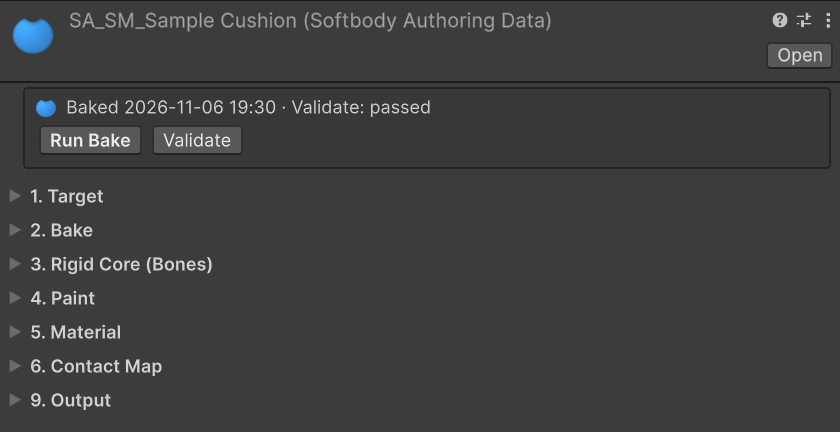
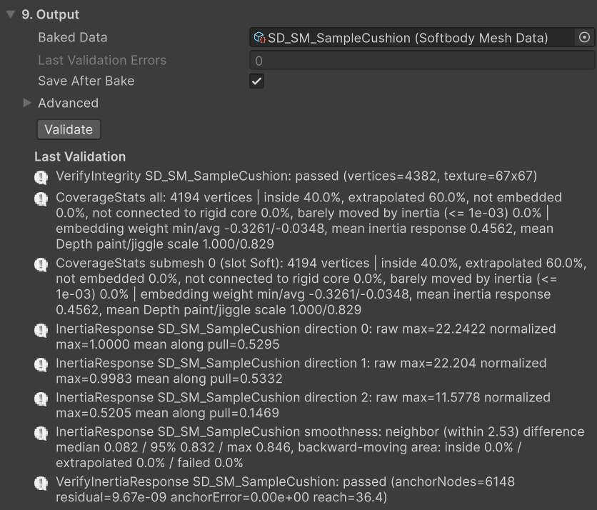
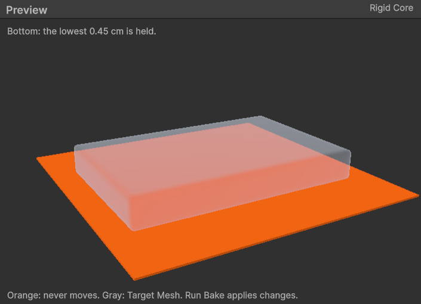

# Baking

Create the authoring asset with **Assets > Create > Softbody > Softbody Authoring Data**. Or select a model or prefab in the Project window and use **Assets > Softbody > Create Authoring Data**: it creates `SA_<mesh name>` next to it and fills in **Target Mesh**. For a model with several meshes, make one authoring asset for each mesh to make soft.

Set **Target Mesh** and press **Run Bake**. The result is a **Baked Data** asset for the Softbody component's **Mesh Data**. The authoring asset itself is editor-only and is not included in builds. Skinned meshes: see also [Characters](./Characters).

## What Run Bake does {#what-run-bake-does}

Run Bake takes 15 to 20 seconds on the [Quick Start](./Quick-Start) cushion and a few minutes on a character. It runs in the background; the status box at the top of the inspector shows a progress bar and **Cancel**. Cancel changes nothing. A bake has no Undo. Only one bake runs at a time in the whole editor, and entering Play mode cancels it.

If the first stage fails, the bake stops. If a later stage fails, the remaining stages still run.

| Stage | Runs when | What it does |
|---|---|---|
| 1. Measuring the flesh | Always | Reads the paint and Volume Preservation to measure the flesh, and creates `SD_<mesh name>` and `SD_<mesh name>_Bake` in the **Output Folder**. |
| 2. Converting the slot mask paint | Always | Turns the paint into the values used for contact and jiggle, applies **Physics Driven Bones**, and finds the pieces painted in Flex. |
| 3. Creating the Softbody material | **Create Softbody Material** is on | Creates a Softbody material for each slot and puts it on the renderer. |
| 4. Baking the contact map | **Bake Contact Map** is on | Bakes the contact map. The cells of the plates (pieces painted in Flex) and the parts split by **Separated Pairs** are also baked here. |
| 5. Saving | **Save After Bake** is on | Saves what this bake changed, and the authoring asset itself. |

Messages go to the Console as `<authoring asset name>: `. When a stage fails, the reason is in the line just above. Fixes are on [Troubleshooting](./Troubleshooting).

### What the bake changes {#what-the-bake-changes}

- **The mesh is not changed.** Re-importing the model keeps the bake. If a re-import changed the vertices, [Validate](#validate) reports it; press Run Bake then.
- **Stage 1**: `SD_<mesh name>` is the Baked Data and goes into builds. `SD_<mesh name>_Bake` is the **Bake Cache**, used only in the editor.
- **Stage 3**: creates `M_<mesh name>_Softbody` with the Softbody/Lit shader and, for each slot in **Softbody Material Slots**, a variant of it `MI_<mesh name>_<slot>`. It copies the base color and normal map from the original material (and the other matching settings of a URP Lit material). Slots that already use a Softbody material are left alone. Set textures it could not find on the variant yourself.
  - A model gets it through the material remap in its import settings. The remap replaces that material everywhere in the model, so other slots or renderers using the same material change too (the Console warns). Give such slots a different material in your 3D tool, or assign the material in a prefab.
  - A prefab gets it on the renderers inside the prefab, and the prefab is saved.
  - A model inside a package cannot be changed. Copy it into the Assets folder and bake the copy.
- Empty entries in **Slot Names** are filled with this bake's material names.
- **Stage 5**: the authoring asset, Baked Data and Bake Cache are always saved. Other assets that had unsaved changes before the bake are not saved; the Console lists them.

## 1. Target {#_1-target}

| Setting | Default | What it does |
|---|---|---|
| **Target Mesh** | None | The Skinned Mesh Renderer or Mesh Renderer to make soft. Only one inside a model or prefab asset can be picked, not a scene object. |
| **Output Folder** | empty | Where the baked assets are written (empty = the folder of this asset). It must be inside the Assets folder (or an embedded or local package); pick it with the **…** button next to it. |
| **Slot Names** (Advanced) | empty | The slot name of each submesh. Slot Masks, Softbody Material Slots and Pressable Slots pick slots by these names. Empty entries are filled with the model's material names when you bake, so the slot names stay when you swap materials later. |

## 2. Bake {#_2-bake}

| Setting | Default | What it does |
|---|---|---|
| **Measure Cell Size** | 0.015 | Sets the cell size for measuring the flesh, as a fraction of the mesh's longest side (about 2.7 cm on a human-sized character). Smaller = more detail, slower bake. 0.005 to 0.1. |
| **Max Inertia Groups** | 16 | The number of bone groups of a skinned mesh that can jiggle separately, each with its own entry in the component's **Inertia Group Overrides** ([Inertia](./Inertia)). Dimmed on static meshes. 1 to 16. |
| [**Layer Max Gap**](#layer-max-gap) | 1.0 cm | The distance within which clothing that lies on the skin follows the paint and jiggle of the flesh under it. 0 = off, up to 10 cm. |

### Layer Max Gap {#layer-max-gap}

For clothing that lies on the skin, such as a tight suit or leggings. When there is skin within this distance inward from a cloth vertex, the cloth takes the Depth, Jiggle and Volume paint of the flesh under it and jiggles with it. Cloth farther than half this distance follows less. Raise it to make thick outer clothing jiggle with the body. The clothing must be in the same mesh as the body; clothing on a separate renderer is another mesh and does not follow.

Denting together does not depend on this value; the contact map decides it. Skin right under the clothing and skin hidden inside the outer surface dent with the outer clothing.

## 3. Rigid Core (Bones) {#_3-rigid-core-bones}

Flesh far from the rigid core jiggles more, and its dents spread wider. See the core in the **Rigid Core** view of the preview pane under the inspector ([Preview](#preview)).

Fields in this category hide by target. Core Placement shows only for static meshes, Rigid Core Spheres only with Custom Spheres, and Bone Overrides only for skinned meshes. Bone Thickness shows for skinned meshes and Core Placement Center.

| Setting | Default | What it does |
|---|---|---|
| [**Core Placement**](#core-placement) | Center | Static meshes: chooses where the part that never moves sits. |
| [**Rigid Core Spheres**](#rigid-core-spheres) | empty | With Core Placement Custom Spheres: places the part that never moves as spheres. |
| [**Bone Thickness**](#bone-thickness) | 0.45 | The thickness of the bones or the core. Larger = thinner flesh: less jiggle, narrower dents. 0.05 to 1. |
| [**Bone Overrides**](#bone-overrides) | empty | Sets the role (bone, lump, accessory) and thickness per bone. |
| [**Flesh Reach**](#flesh-reach) | 3 cm | Makes thick flesh jiggle by its paint, not by its thickness. About 3 for a human-sized body. |

If the last bake used different Bone Overrides, Bone Thickness or Softbody material slots, a warning shows at the end of this category (under Flesh Reach). Press Run Bake then.

### Core Placement {#core-placement}

Used on static meshes.

- **Center**: a core like a bone runs through the middle of the shape (the middle plane of a slab, the center of a ball, the axis of a sausage), as thick as **Bone Thickness**. Use it for objects firm in the middle, such as a ball or a toy.
- **Bottom**: only the bottom of the mesh is held. Use it for objects resting on a floor or seat, such as a cushion or a pudding.
- **Custom Spheres**: uses the spheres you place in [Rigid Core Spheres](#rigid-core-spheres). With no sphere, this row shows a red message and Run Bake does not start.

Center lets the surface dent only as deep as the flesh above the core, so a slab or cushion pressed deep wants Bottom. Center and Bottom need a closed mesh.

### Rigid Core Spheres {#rigid-core-spheres}

For each sphere, enter **Center** and **Radius** in cm. Center is the mesh's local coordinates times 100; the radius default is 10 cm. At least one must sit inside the mesh. The flesh inside a sphere never moves, so where a sphere's edge crosses a visible face, jiggle and lump motion bend along that line. A flat base is the top of a very large sphere.

### Bone Thickness {#bone-thickness}

Used on skinned meshes and with Core Placement Center. It sets the thickness of the bones or the core as a fraction of the distance to the skin. The bones come from the skeleton, so no colliders are needed. Bones the skeleton does not have (ribs, pelvis, skull) are not found. Paint those areas dark in [Depth](./Painting#the-four-channels).

### Bone Overrides {#bone-overrides}

Add one entry per bone.

- **Bone Name**: a bone of the target skeleton. The dropdown lists every bone of the skeleton.
- **Include Child Bones** (on): the bones below take this entry unless they have their own. One entry covers a chain or a limb.
- **Role** (Rigid Core): one of the three below.
- **Bone Thickness** (0.45): enabled only when Role is Rigid Core.

Role:

- **Rigid Core**: the bone is used as a rigid core.
- **Lump**: leaves the bone out of the skeleton, so its flesh becomes a lump that moves out of the way as a whole when pressed. Use it for breast and buttock bones.
- **Accessory**: for ribbon, necklace and belt bones rigged onto the body. The bone is neither rigid core nor a lump, and what it carries jiggles with the flesh under it. Left as Rigid Core, such a bone counts as bone just under the skin and makes the flesh there thin.

### Flesh Reach {#flesh-reach}

Flesh thicker than this does not jiggle more for being thicker, so areas painted the same Jiggle brightness jiggle about the same. Thin flesh such as forearms or shins jiggles less. Raise it for bigger jiggle on thick flesh and a softer base of a lump.

0 = off. Then a belly with no bone inside jiggles far more than another part painted the same brightness.

## 4. Paint {#_4-paint}

How to paint: [Painting](./Painting). What Volume Preservation does: [Flesh material](./Concepts#flesh-material).

| Setting | Default | What it does |
|---|---|---|
| **Volume Preservation** | 1 | The material of the mesh: 1 for flesh or jelly, 0 for foam or a sponge, and in between a denser foam that compresses only partly. A change reaches the dents at once without baking; how a whole lump spreads changes after Run Bake. 0 to 1. |
| [**Slot Masks**](./Painting#the-four-channels) | empty | Per material slot: one paint texture, and where each of the four channels (Depth, Jiggle, Volume, Flex) is read from. |
| [**Physics Driven Bones**](./Painting#physics-driven-bones) | empty | Bones already moved by another jiggle system, such as spring bones, cloth or a physics component. Flesh on them gets no Softbody jiggle. |

## 5. Material {#_5-material}

| Setting | Default | What it does |
|---|---|---|
| **Create Softbody Material** | off | Run Bake makes a Softbody material for the mesh (stage 3). Leave it off when your own shader includes the Softbody vertex functions ([Materials](./Materials)). |
| **Softbody Material Slots** | empty | The slots that get the Softbody material: skin and tight clothing, not the face or hair. Used only with Create Softbody Material on, and then it cannot be empty. |
| [**Tessellation**](./Materials#tessellation) | off | Turn it on for skin seen up close. The bake makes the material **Softbody/Lit (Tessellated)**, so narrow dents such as a fingertip show as shape. It adds GPU time. For a material that already exists, **Run Bake** or **Recreate Material** only changes the shader. |

## 6. Contact Map {#_6-contact-map}

With **Bake Contact Map** off, the fields below are dimmed.

| Setting | Default | What it does |
|---|---|---|
| **Bake Contact Map** | on | Off = no contact at all; the mesh only jiggles. |
| **Contact Map Resolution** | 512 | Cells along one side of the contact map (a power of two, 64 to 2048). Higher = sharper small dents but more GPU time and memory. 512 for a human-sized character; 1024 if it is seen up close. |
| **Pressable Slots** | empty | The material slots that can be pressed. Empty = the slots that use a Softbody material (or the whole mesh if none do yet). Leaving out the face or hair gives the rest more detail. |
| [**Contact Map Seams**](#contact-map-seams) | Mesh UV0 Islands | Where the contact map is split into pieces. |
| **Max Flesh Thickness** | 0 cm | Deeper than this from the surface counts as solid. 0 = no limit. Use it on boxes and cushions whose core sits only at the bottom; without it, pressing the top dents the sides too. Make it a little more than the deepest press and less than a quarter of the object's width. |
| [**Separated Pairs**](#separated-pairs) | empty | Skinned meshes: keeps apart two parts whose surface is connected but whose flesh underneath is separate (for example a left and right pair of lumps). |
| **Envelope Cell Size** (Advanced) | 0 cm | Cell size for finding the mesh's outer surface. 0 = automatic (longest side / 256). |
| **Envelope Triangles** (Advanced) | 40000 | Triangle count of the simplified outer surface. Raise it if flesh thickness on large curved areas looks stepped. 1000 to 400000. |

The Console line "Contact map finished - resolution N, cell X cm" gives the average surface length of one cell.

### Contact Map Seams {#contact-map-seams}

Dents are slightly less exact across a split.

- **Mesh UV0 Islands**: the seams follow the UV0 seams, and each island is flattened again with even cell sizes, so the dent rim keeps its width where UV0 was stretched for texturing. UV0 and the material textures are not changed. An island whose mirrored halves share the same UVs (left and right, or the two sides of a sheet) is cut where the mirror flips. When UV0 has zero area or folded UVs, the bake stops with the reason; fix the mesh's UV0 then.
- **Automatic (XAtlas)**: not available yet. Choosing it shows a red message on this row, and the bake stops.
- **Mesh UV0 Islands (As Is)**: the UV0 islands as laid out, for comparison. Cell size and dent rim width follow UV0's stretch.

### Separated Pairs {#separated-pairs}

Use it for parts whose surface is connected but whose flesh underneath is separate, such as a left and right pair of lumps covered by one piece of clothing. Add one pair for each two parts to keep apart, and pick the top bone of each part in **Side A** and **Side B** (child bones included). For a rig where a part is split over several bone chains, add the top bone of each chain. It applies with **Rebake Contact Map**.

Pressing one side then does not raise, sink or drag the other. Clothing weighted to both parts is split by its bone weights. If the editor or build runs on D3D11 or Metal, the split parts dent together ([Known Limitations](./Known-Limitations#contact-detail)).

Check the result in the Console (the preview has no view for the split parts). The "Separated Pairs baked" line gives the number of pairs used, and the number of cells on one side only and on both sides. Pairs that are not used show as `Separated Pairs on <mesh>:` warnings:

- A pair with a bone the mesh does not have, an empty side, or the same bone on both sides.
- A pair that conflicts with the pairs above it: the contact map keeps only two groups apart, and this pair would need three.

If pairs touch on the mesh so that some flesh not in any pair is kept apart, that is a warning too. Separate fewer bones, or pair those two as well.

## 9. Output {#_9-output}

| Setting | Default | What it does |
|---|---|---|
| **Baked Data** | None | The baked result, for the component's Mesh Data. Run Bake fills it in; you can also point it at an existing bake. |
| **Bake Cache** (Advanced) | None | Bake-only data kept next to Baked Data. Validate, Reapply Paint and Rebake Contact Map read it; it is not in builds. Run Bake fills it in. |
| **Last Validation Errors** | -1 | The number of problems found by the last Validate. 0 = no problems. -1 = not checked since the last bake. |
| **Save After Bake** | on | Saves what the bake changed as soon as it finishes (stage 5). |

## Buttons {#buttons}

The status box at the top of the inspector shows the last bake time and the Validate result (for example `Baked 2026-11-04 14:20 · Validate: passed`).

| Button | Where | Time | What it does |
|---|---|---|---|
| **Run Bake** | status box | minutes | Everything, in the order above. |
| **Validate** | status box, 9. Output | | Checks the bake against the mesh without baking again. |
| **Reapply Paint** | 4. Paint | seconds to tens of seconds | Runs stage 2 and the contact map again. If the paint changed since the last Run Bake, runs Run Bake instead (minutes). |
| **Recreate Material** | 5. Material | seconds to tens of seconds | Creates and puts on the Softbody material again, and rebakes the contact map. |
| **Rebake Contact Map** | 6. Contact Map | seconds to tens of seconds | Bakes only the contact map again. |
| **Cancel** | status box (while baking) | | Stops the bake. Nothing is changed. |

Reapply Paint, Recreate Material and Rebake Contact Map need Baked Data, and Target Mesh must be the renderer the bake was made from. With Save After Bake on, they save when they finish.

### Which button after which change {#which-button-after-which-change}

| You changed | Press |
|---|---|
| Target Mesh, Measure Cell Size, Max Inertia Groups, Layer Max Gap | Run Bake |
| Core Placement, Rigid Core Spheres, Bone Thickness, Bone Overrides, Flesh Reach | Run Bake |
| The Paint Texture or the channels of Slot Masks | Run Bake (pressing Reapply Paint runs Run Bake anyway) |
| Volume Preservation value | Nothing for dents; Run Bake for how a whole lump spreads (Validate reports it until then) |
| Physics Driven Bones | Reapply Paint |
| Saved the Paint Texture file or changed its import settings | Nothing; the paint is reapplied automatically (if the paint changed, Run Bake runs) |
| Softbody Material Slots, or you want the generated material and variants again | Recreate Material |
| Put on or changed the Softbody material yourself | Rebake Contact Map |
| Contact Map Resolution, Pressable Slots, Contact Map Seams, Max Flesh Thickness, Separated Pairs, Envelope Cell Size, Envelope Triangles | Rebake Contact Map |
| Turned Bake Contact Map on after a bake | Rebake Contact Map |
| Re-exported the model or changed its import settings so the vertices changed | Run Bake (Validate reports it) |

## Validate {#validate}

**Validate** checks that the baked data, the mesh and the mesh's materials still match, without baking again. The count goes to **Last Validation Errors**, and the messages to the Console and to the **Last Validation** list under 9. Output. Each row of the list gets a fix button (Run Bake, Reapply Paint, Recreate Material, Rebake Contact Map, Select); clicking the text selects the asset it is about. The list is not saved, so press Validate again after reopening the editor. Run Bake and Rebake Contact Map reset the count to -1.

The checks on paint and material are below. Every message and its fix: [Troubleshooting](./Troubleshooting).

| Message | Meaning | Do |
|---|---|---|
| `Volume Preservation is X but the flesh was measured with Y` | Dents already use the new value, but how a whole lump spreads is baked with the old one. | Run Bake |
| `the contact map holds an older plate layout` | The plate (piece painted in Flex) layout baked into the contact map is an older one, so the plates dent like flesh. This check is an error. | Run Bake |
| `the slot paint changed since the flesh was measured` | The paint changed after the flesh was measured, so jiggle and contact read different paint. | Run Bake |
| `has sRGB on`, `which is black everywhere`, `has no source pixels` | A paint texture is not read as chosen (warning). | [When the paint is not read as chosen](./Painting#paint-texture-problems) |

## Preview {#preview}

With one authoring asset selected, the preview pane under the inspector (**Preview**) shows the **Rigid Core** view. There is no field for choosing a view. It shows what the bake will hold still with the current settings, before you bake. Drag to orbit; use the wheel to zoom.

Target Mesh is drawn in see-through gray and the rigid core in orange. Orange never moves; the farther from orange, the thicker the flesh, the more it jiggles and the wider its dents. Orange close to the skin makes the flesh there thin. Thin bones are drawn thicker to match the measure cell size, and the bake uses the same thickness. It redraws 0.3 seconds after you change a value, and when a bake ends.

- **Skinned mesh:** spheres along the bones, on the mesh in its default pose. Their thickness comes from [Bone Thickness](#bone-thickness) and [Bone Overrides](#bone-overrides). If a ribbon or necklace bone makes an orange sphere just under the skin, set its Role to Accessory.
- **Static mesh:** as [Core Placement](#core-placement) says. Center is a sphere through the middle of the shape, Bottom a thin slab at the bottom, Custom Spheres the spheres you placed.

The top line counts the spheres. It turns red when:

- No bone lies inside the mesh. A bake like this has no jiggle.
- Core Placement is Custom Spheres with no sphere. The bake will not start.
- The mesh has no closed inside, so the core cannot be placed.
- The last bake used different Bone Overrides, Bone Thickness or Softbody material slots. The jiggle and contact now differ from this preview; press Run Bake.

See the result of the last bake (vertices inside the flesh, flesh connected to the core, contact map seams and so on) while playing, with **Debug View** on the Softbody component ([Debug View Mode](./Softbody-Component#debug-view-mode)).

