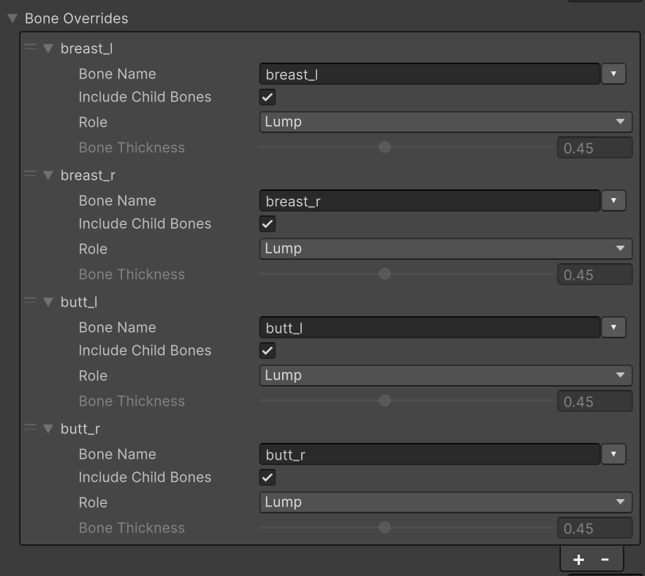
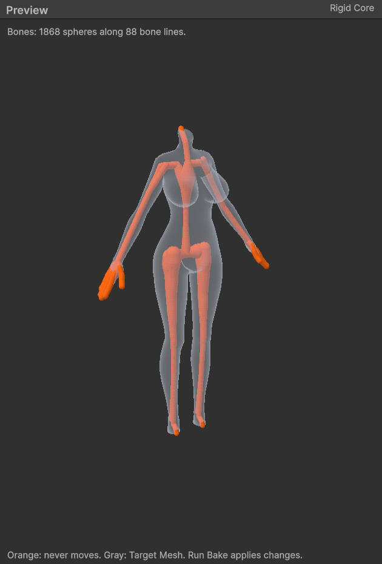

# Characters

A Skinned Mesh Renderer is baked like a prop ([Quick Start](./Quick-Start)). This page covers only what differs.

## Before you bake {#before-you-bake}

- **Target Mesh** is a Skinned Mesh Renderer in the model (FBX) or prefab asset. For a model whose body, clothes, and hair are split into several renderers, create one authoring asset for each renderer to be made soft. **Assets > Softbody > Create Authoring Data** picks the model's first Skinned Mesh Renderer and tells you in the Console if there are other meshes.
- If **Skin Weights** in the model import settings' Rig tab is Standard, each vertex receives at most 4 bone weights. Set it to **Custom**, raise **Max Bones/Vertex** to 32, and then bake. Validate reports this.
- Bones with skin weights must be inside the mesh. The skeleton is the rigid core. Only bones that move a slot with a Softbody material become the core, so hair strands or ornaments with their own bones do not hold the flesh lying over them. The bake needs no colliders.
- Give the face and hair their own material slots, using materials different from the skin. **Create Softbody Material** applies through the model's material remap, so slots that use the same material as the skin are also changed to the Softbody material ([Baking](./Baking#what-the-bake-changes)).
- Clothes that fit the body and are modeled over the skin (tight suits, leggings) go into the same renderer as the body as slots, so they enter and jiggle with the flesh below and the flesh does not poke through the clothes. Clothes in a separate renderer are a different mesh and do not follow. Do not paint Depth on clothes and ornament slots with the rule used for the body. Depth 0 turns that part into bone.
- Jiggle bones: if another system already moves them (spring bones, cloth, physics components), put them in **Physics Driven Bones**. Otherwise set that bone's **Role** to **Lump** in **Bone Overrides**, so that flesh becomes a lump moved by the Softbody component.
- For a renderer in a LOD Group, only LOD0 dents and jiggles.

## Body parts come from skin weights {#body-parts-come-from-skin-weights}

You do not paint separate masks to pick body parts. All of these settings use a bone's skin weights as the mask for that part.

- **Role Lump**: Flesh skinned to that bone chain is the lump.
- **Inertia groups**: Each vertex jiggles with the movement of the groups it has the largest weight in, mixed by weight ([Inertia](./Inertia)).
- **Separated Pairs**: Clothes weighted to two parts are split by weight.
- **Physics Driven Bones**: Jiggle is lost in proportion to the weight.

So to move the boundary of a part, such as where a lump of flesh ends, edit the weights in a 3D tool and press Run Bake. If the weights change sharply within a narrow band, that spot can look torn or folded when it jiggles, so let them fall off widely and gently. Only what weights cannot express (where bone is near the skin, firmer flesh, other materials) is [painted](./Painting).

## Bake settings {#bake-settings}

Settings in the authoring asset that matter for skinned meshes. Defaults and ranges are in [Baking](./Baking). For skinned meshes, Core Placement and Rigid Core Spheres are hidden, because the core comes from the skeleton.

| Setting | Category | On characters |
|---|---|---|
| [**Bone Thickness**](./Baking#bone-thickness) | 3. Rigid Core (Bones) | The thickness of all bones. The larger it is, the thinner the flesh everywhere, so it jiggles less and the dented area is narrower. |
| [**Bone Overrides**](./Baking#bone-overrides) | 3. Rigid Core (Bones) | Set **Role** to **Lump** on the top bone of a chest or hip chain, and to **Accessory** on ribbon, necklace, and belt chains rigged to the torso. |
| [**Flesh Reach**](./Baking#flesh-reach) | 3. Rigid Core (Bones) | At about 3 cm, places painted with the same Jiggle brightness jiggle about the same regardless of flesh thickness. |
| **Max Inertia Groups** | 2. Bake | The number of bone groups that can jiggle separately. If too few, a lump bone does not get its own group. |
| [**Layer Max Gap**](./Baking#layer-max-gap) | 2. Bake | The distance within which clothing vertices follow the paint and jiggle of the flesh below. Raise it for thick outerwear; 0 turns it off. What dents together is decided by the contact map. |
| **Physics Driven Bones** | 4. Paint | Flesh of these bones (including child bones) gets no Softbody jiggle, so the same flesh is not shaken twice. |
| **Softbody Material Slots** | 5. Material | The slots of skin and body-hugging clothes. Face and hair are not included. |
| **Pressable Slots** | 6. Contact Map | If empty, the Softbody material slots can be dented. Removing slots that are not dented makes the rest finer. |
| [**Separated Pairs**](#separated-pairs) | 6. Contact Map | Splits off, as a pair, two parts whose surface is connected but whose flesh underneath is separate. |

- With **Include Child Bones** on in **Bone Overrides**, one entry per chain is enough. With it off, only that bone changes.
- With **Flesh Reach** at about 3 cm, thick white flesh becomes the reference flesh for **Inertia Amount**.
- Bones that are not in the skeleton (ribs, pelvis, skull) are not found. Paint those parts dark in Depth ([Painting](./Painting)).
- The core appears in the authoring asset's [Rigid Core preview](./Baking#preview) as orange spheres placed along the bones. If a ribbon or necklace bone makes an orange sphere right under the skin, set that bone to Accessory.
- If a lump bone does not get a group, the Console shows `Inertia groups: all N groups are taken, so lump bone X gets no group of its own.` Raise Max Inertia Groups.

### Separated Pairs {#separated-pairs}

Use it for parts whose surface is connected but whose flesh underneath is separate, such as a left and right pair of lumps covered by one piece of clothing. For each pair, put the top bone of each part in **Side A** and **Side B**. For a rig like an MMD model, where one side's lump is split into several bone chains, add the top bone of each chain. Pressing one side does not make the other side rise, sink, or get dragged. Check the split result in the Console after Rebake Contact Map ([Baking](./Baking#separated-pairs)). It has no effect on D3D11 and Metal ([Known Limitations](./Known-Limitations#contact-detail)).

## Component settings {#component-settings}

Settings of the Softbody component that matter for characters. All settings are in the [Softbody component](./Softbody-Component).

| Setting | Category | On characters |
|---|---|---|
| **Lump Yield** | Inertia > Lumps | How easily a pressed lump moves aside as a whole (0 = dents only). |
| **Lump Grip** | Inertia > Lumps | How firmly a hand holding the lump's skin (Drag Friction) drags the lump along. Contact Detail must be Full. |
| **Squeeze Stiffening** | Inertia > Lumps | How much harder the flesh pushes back when deeply squashed. |
| **Inertia Group Overrides** | Inertia | Amount Scale, Damping, and Gravity Scale for one body part only. |
| **Inertia Amount** | Inertia | How far the reference flesh (thick flesh with Jiggle painted white) sags at 1 g. About 10 to 20 for flesh that jiggles as a big lump. |
| **Animation Motion Weight** | Inertia | How much the animation moving the bones makes the flesh jiggle. 1 = real acceleration. |

- **Lump Yield**: Parts on top of the skeleton, such as the belly and back, do not move as a lump. Enable Contact and Enable Inertia must be on, and Inertia Amount must be above 0.
- **Squeeze Stiffening**: If a lump moves too far when pressed deeply, lower Lump Yield instead of this value.
- **Inertia Group Overrides**: The same character can have a big, slow lump and a small, fast belly. The bone dropdown lists the inertia groups the bake found ([Inertia](./Inertia)).
- **Inertia Amount** has a fixed reference flesh, so it means the same flesh on every character.

## Pressing with the whole body {#pressing-with-the-whole-body}

For a character to press other Softbody meshes with its body, it needs a collider on each bone. Select the character in the scene (or in Prefab Mode) and choose **GameObject > Softbody > Create Bone Colliders**. **Create Bone Colliders** in **Pressing** at the bottom of the Softbody component inspector, or **Softbody: Create Bone Colliders** in the Skinned Mesh Renderer component's menu, also works. For each bone, a child `<bone name>_SoftbodyCollider` is created on the same layer as the renderer and receives a capsule collider (a box for the top bone). Pressing it again recreates only what this tool made, and Edit > Undo reverts it.

- The layer must be in the pressed mesh's **Collider Channel**.
- The character's own Softbody mesh ignores colliders under **Ignore Root** (the nearest parent Animator if empty), so it is not pressed by its own bone colliders.
- Let only one side press. For a Softbody sofa, attach the **Softbody Ignore** component to the sofa's colliders so the sofa does not press the character. Otherwise a gap opens by the amount of overlap because of the contact ([Colliders](./Colliders)).
