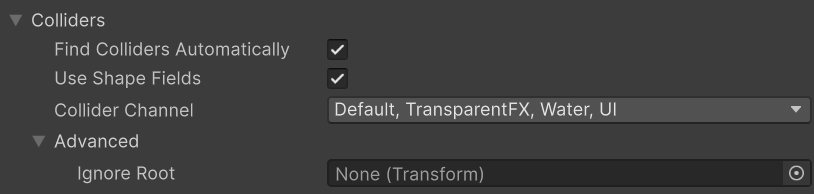
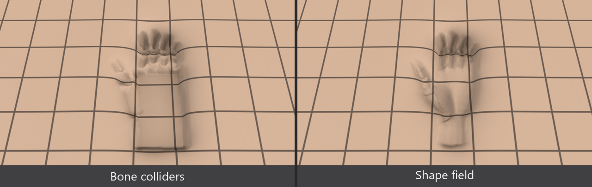
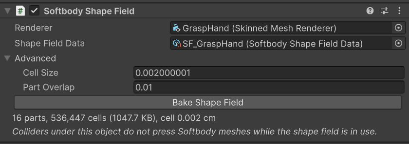

# Colliders

Whatever presses the flesh (a hand, a prop, the floor, another character) is either a Unity collider or a [shape field](#shape-fields), which is the baked actual shape of the pressing mesh. The Softbody component finds both by itself around the mesh every frame.

## What can press the flesh {#what-can-press-the-flesh}

A collider presses the flesh when all of these hold:

1. The collider's layer is in the component's **Collider Channel**. The default is every layer except Ignore Raycast.
2. The collider is enabled and not a trigger.
3. It is not under **Ignore Root**. If empty, this is the nearest parent Animator (or the object with the Softbody component if there is none), so a character's own colliders do not press its own flesh.
4. Neither the collider's object nor any of its parents has a [Softbody Ignore](#softbody-ignore) component.
5. It is one of the colliders in the table below.

| Collider | Pressing shape |
|---|---|
| Sphere Collider | Sphere |
| Capsule Collider | Capsule |
| Box Collider | Box |
| Mesh Collider (**Convex** on) | Convex hull |
| Character Controller | A capsule that always stands upright, regardless of the object's rotation. Skin Width is not included. |
| Colliders under an object with **Softbody Shape Field** | They do not press while **Use Shape Fields** is on; the [shape field](#shape-fields) presses instead with the actual shape. |
| Mesh Collider (Convex off), Terrain Collider, Wheel Collider | They do not press, and log `has no simple collision shape and no shape field` once in the Console. |

The default Plane object has a Mesh Collider with Convex off, so it does not press. Use a Box Collider for a floor that must press.

Colliders are searched for inside a box made by growing the mesh bounds by **Max Contact Depth** (at least 1 cm) and by the distance moved this frame. If the mesh is not visible in any camera or appears smaller than **Min Screen Size**, the search is skipped. The shape's position is read from the collider's Transform, not from the physics scene, so a collider moved by animation or script this frame also presses at its moved position.

## Settings {#settings}

**Find Colliders Automatically**, **Use Shape Fields**, **Collider Channel**, and **Ignore Root** (Advanced) are in the Softbody component's **Contact > Colliders** ([Softbody component](./Softbody-Component#contact-colliders)).

## Shape fields {#shape-fields}

A shape field is an asset that bakes the actual shape of the pressing mesh. With a shape field, a hand presses with each finger and the hollow palm, instead of the smooth dents a collider makes (such as the boxy mark of a palm box). Use it for pressing hands and props.

In Edit mode, select the pressing mesh in the scene (or in Prefab Mode) and choose **GameObject > Softbody > Bake Shape Field**. The ⋮ menu of the Skinned Mesh Renderer or Mesh Renderer, **Softbody: Bake Shape Field**, also works. One hand takes about 1 second.

- `<mesh name>_ShapeField.asset` is created in the mesh asset's folder (the FBX folder for a mesh inside an FBX, or `Assets` for a read-only location such as a package). If it already exists, the bake goes into that asset again.
- A **Softbody Shape Field** component is added to the renderer's nearest parent Animator (or the renderer's object if there is none), with **Renderer** and **Shape Field Data** filled in. Edit > Undo reverts it.
- The Console shows `Shape field bake: <mesh name> - ... N parts`. A skinned mesh gets one part per bone, each following its own bone; a static mesh has one part.
- Baking inside a prefab asset in the Project window creates only the asset and does not add the component. Open the prefab and press it again.

How a shape field presses:

- It presses even without a collider. The conditions are [the same as for colliders](#what-can-press-the-flesh), and the layer is taken from the **Renderer**'s layer.
- While **Use Shape Fields** is on, colliders on the object with the component and its children do not press. The colliders stay for physics. If the shape field fails the conditions and cannot press, those colliders press instead.
- If the component is attached directly to the renderer's object, bone colliders outside it (those made by **Create Bone Colliders** under the bones) are not excluded and press together with the shape field. The menu attaches it to the Animator, so this does not happen.
- Baking a character's own hand still does not press that character's flesh, because the component is under that character's **Ignore Root** (self contact is [not in the beta](./Known-Limitations#not-in-the-beta)). It presses other Softbody meshes.
- If the mesh was changed after baking, the Softbody Shape Field inspector shows the warning `The mesh changed since the bake`. Press the inspector's **Bake Shape Field** button to bake again. A shape field baked with an earlier plugin version is not used, and the inspector tells you to bake it again.

Advanced in the inspector has two bake settings. Both are stored in the Shape Field Data asset and take effect from the next bake.

| Setting | Default | Description |
|---|---|---|
| **Cell Size** | 0 (auto) | Change it if thin fingers press bluntly or the bake takes long. The size of one cell of the baked shape; 0 picks a size that fits fingers. |
| **Part Overlap** | 1 | Raise it if bent finger joints leave a groove in the dented area. The length by which a part reaches into the neighboring part along the bone chain. |

Both values are cm measured in the mesh's own coordinates. If the mesh object has a scale inside the model (for example 100), they differ from real lengths by that factor, and the bake warns in the Console.

## Softbody Ignore {#softbody-ignore}

Colliders and shape fields on an object with the **Softbody Ignore** component (Add Component > Softbody > Softbody Ignore), and on its children, press no Softbody mesh.

A renderer on an object with this component is also not picked automatically as a target by a Softbody component. If you attach it to a Softbody mesh whose renderer and collider are on one object, set that component's **Target Mesh Component** yourself, or move the collider to a child object and attach it there.

## Presser size for lumps {#presser-size}

How far a [lump](./Concepts#lumps) is pushed as a whole depends on the area the pressing collider shows on the skin. A narrow poke like a fingertip mostly dents only, and a wide push like a palm moves the lump aside.

| Collider | What counts as the area |
|---|---|
| Sphere | Radius |
| Capsule | Radius when poking with the tip; also the length when pressing sideways |
| Box | Area seen from the skin side |
| Convex Mesh Collider | The box enclosing it along the mesh's local axes |

So if a whole hand is one convex Mesh Collider, even one finger pushes the lump like a palm. Give the finger segments and the palm separate colliders. The amount of pushing itself is set by **Lump Yield** ([Softbody component](./Softbody-Component#lump-yield)).

## Softbody meshes pressing each other {#softbody-meshes-pressing-each-other}

A Softbody mesh presses another Softbody mesh only with its own colliders. To let a character press with its body, create colliders for each bone.

- **Create Bone Colliders** in the **Pressing** group at the bottom of the Softbody component inspector, or **GameObject > Softbody > Create Bone Colliders**, or the Skinned Mesh Renderer's ⋮ menu **Softbody: Create Bone Colliders**.
- For each bone, a child object `<bone name>_SoftbodyCollider` gets a Capsule Collider (a Box Collider for the top bone) and a Kinematic Rigidbody. The layer is the renderer's layer.
- Use it in Edit mode on an object in the scene (or in Prefab Mode) with the character in bind pose. Pressing it again deletes only the colliders this tool made and creates new ones; Undo reverts it.
- These colliders are under the character's Animator, so Ignore Root excludes them and they do not press the character's own flesh.

Let only one side press. If both press each other, each enters the other's shape and a gap opens between them. For a cushion a character sits on, move the cushion's collider to a layer that is not in the character's Collider Channel, or attach [Softbody Ignore](#softbody-ignore), so the cushion is only pressed.

## Out of reach and sleeping {#out-of-reach-and-sleeping}

Every frame, found colliders that cannot reach the flesh that can be dented, even with a margin of at least 2 cm, are dropped. If none remain, the dented area slowly returns and contact sleeps ([Performance](./Performance)).

Contact maps baked with an older version do not have the data for this check, so contact does not sleep while a collider is near the bounds. The Console then shows `has no sleep boxes`. Press **Rebake Contact Map**.

## Per-frame limits {#per-frame-limits}

| Limit | Per mesh per frame | When exceeded |
|---|---|---|
| Collider shapes | 32 | The rest are skipped, and the Console logs `contact skipped ... over the per-frame budget` once. |
| Convex hull planes, total of all Mesh Colliders | 2048 | Same. Each collider counts one more. |
| Shape field parts | 512 | A shape field that makes more is skipped entirely, and the Console logs `shape field of ... skipped` once. |

They are counted after the reach check, so only what is near each mesh counts.

## Setting up a hand that presses {#setting-up-a-hand-that-presses}

Set up a hand that is a separate object, or another character's hand, like this:

1. Bake a [shape field](#shape-fields) on the hand. It presses in the shape of the gaps between fingers and the palm.
2. If you need physics, give the finger segments and palm colliders too. For a skinned hand, **Create Bone Colliders** makes one per bone. If you do not use a shape field, these colliders press.
3. Put the layers of the hand renderer and colliders into the pressed mesh's **Collider Channel**.
4. Do not place it under the pressed mesh's Ignore Root. A hand under the same Animator does not press that character's flesh.

## Recommended setup {#recommended-setup}

With the default **Collider Channel** (every layer except Ignore Raycast), floors, walls, and props are all found. Those that can reach the flesh that can be dented take one of the 32 shapes per frame and keep the mesh from sleeping. Use one of these instead.

**Dedicated layer (recommended).** Add a layer (for example `SoftbodyPress`). Set every Softbody component's **Collider Channel** to this layer only, and put the colliders that must press (hands, props) on this layer. A layer also decides physics collisions, so check in the Layer Collision Matrix of the Physics settings what this layer collides with. Create Bone Colliders makes them in the renderer's layer, so move the layer after creating them. Shape fields look at the renderer's layer, so put the hand renderer on this layer too.

**Softbody Ignore.** Leave the Collider Channel as it is and attach [Softbody Ignore](#softbody-ignore) to the floor and wall objects (or their parents). This is quicker in a small scene. Newly placed colliders press by default, so a dedicated layer is better as the scene grows.
