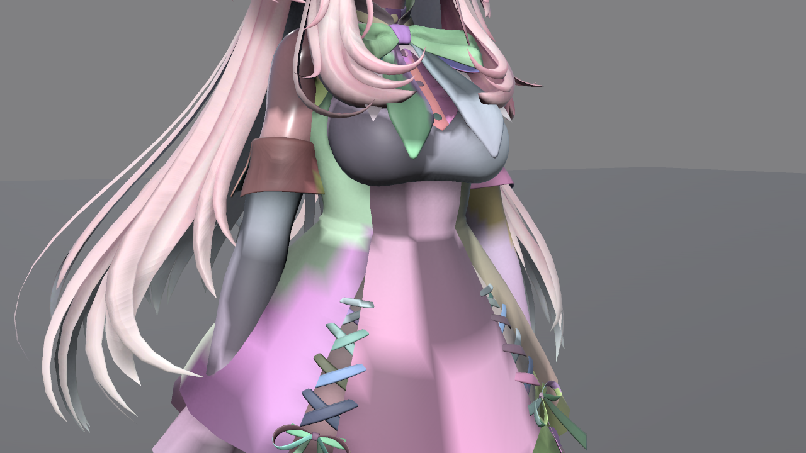

# Concepts

These are the terms used throughout this documentation. The settings mentioned here are listed with their defaults in the [Softbody Component](./Softbody-Component) and [Baking](./Baking).

## Bake and run {#bake-and-run}

- **Bake** is a one-time preparation in the Editor. You put the target mesh and settings in a **Softbody Authoring Data** asset and press **Run Bake**. It measures the flesh, reads the paint, builds the contact map and writes them to the **Baked Data** (`SD_` asset). The bake does not modify the mesh.
- **Run** is what the **Softbody** component does during Play. The component reads the Baked Data, the deformation is computed on the GPU, and the **Softbody/Lit** material moves the vertices. A slot without this material (or a shader with the Softbody vertex functions) neither dents nor jiggles ([Materials](./Materials)). Softbody Authoring Data is Editor-only and is not included in builds.
- Baked Data reads values by vertex index. If you reimport the mesh after the bake and the vertices change, bake again; the Console tells you when Play starts. Do not use static batching or the GPU Resident Drawer, which reorder vertices, on Softbody meshes ([Installation](./Installation#after-installing)).
- Because the material moves the vertices, a dent narrower than the mesh's triangles (a fingertip) does not show as shape and appears only as shading.

## Contact map {#contact-map}

- **Contact** is everything a hand and an object do to a surface: dent, bulge, drag and their recovery.
- The **contact map** is a baked grid over the pressable surface, and contact is computed on it (**Bake Contact Map**). Without a contact map the mesh only jiggles.
- A **contact map cell** is one square of the grid. **Edge Smoothing** is measured in cells.
- **Contact Map Seams** sets where the map is cut into pieces (the seams). By default (Mesh UV0 Islands) it cuts along the mesh's UV0 seams. A press that crosses a cut is slightly less accurate. With **Debug View** on in the Softbody component, **Debug View Mode** 2 draws the cells as a checker pattern. The lines where the pattern breaks are the seams.

## Dent, bulge, drag, recovery and lasting marks {#dent-bulge-drag-recovery-and-lasting-marks}

- **Contact Detail** sets how far contact is computed. Basic (default) computes only dents and pushed lumps. Full also computes bulge, drag, Edge Smoothing and Flex paint (bending skin and plates). If this GPU cannot run Full (Metal included), a mesh set to Full runs as Basic, and the Console says so when Play starts.
- A **dent** is the surface going in under a collider. It goes in as far as the collider penetrates, and **Max Contact Depth** is the limit.
- A **bulge** is flesh rising around the dent. It exists only when Contact Detail is Full. **Volume Preservation** sets how much it rises. Flesh and jelly bulge, and foam only goes in ([Flesh material](#flesh-material)).
- **Drag** is the skin being pulled along by a collider that moves while pressing. The skin follows until the pull-back force of the flesh exceeds **Drag Friction**, then slips. It exists only when Contact Detail is Full.
- **Recovery** is the surface returning at the speed of **Recovery Rate** after the collider leaves.
- A **lasting mark** is a dent that stays after release and then fades, like memory foam. It exists only when **Memory Time** is above 0.

## Flesh thickness and the rigid core {#flesh-thickness-and-the-rigid-core}

- The **rigid core** is the part that does not move at all. On a skinned mesh it is the bones, found directly from the skeleton, so no bone colliders are needed. On a static mesh, **Core Placement** sets it: the middle of the shape (Center), the bottom (Bottom), or spheres you place (Custom Spheres). The Preview field below the Softbody Authoring Data inspector draws the core of the current settings in orange.
- **Flesh thickness** is the distance from the skin to the rigid core, measured by the bake. It sets how wide a dent is and how far bulge and drag reach. How much the flesh jiggles also follows flesh thickness, together with the **Jiggle** paint and **Flesh Reach**.
- The **outer surface** is the simplified skin of the mesh that the bake uses as the reference when measuring thickness. A vertex more than 5 cm from the outer surface (a hair card or decoration floating off the body) follows dents less, and from 10 cm it does not follow.

## Pressable slots and slot paint {#pressable-slots-and-slot-mask-paint}

- **Pressable Slots** are the material slots that dent. If empty, it means the slots that use a Softbody material.
- **Slot paint** is one RGBA texture (**Paint Texture**) for each material slot in **Slot Masks**, painted in that slot's UV0. Its four channels each hold one property of the material. **Depth** (R, how deep the flesh is from the skin to the bone), **Jiggle** (G, how soft the flesh is), **Volume** (B, whether the pressed flesh keeps its volume) and **Flex** (A, how the surface bends). White means unpainted in every channel. See [Painting](./Painting).
- Flex works only when **Contact Detail** is Full. With Basic, a Flex-painted area presses like bare flesh. A piece painted black becomes a **plate** that sinks and tilts as one piece ([Plates in Painting](./Painting#plates)).

## Flesh material {#flesh-material}

How deep a collider goes is set by the collider's animation or physics, not by the flesh. So how stiff the flesh is does not change the shape of a dent. What does change it is the following.

| Property | Set by | Changes |
|---|---|---|
| Flesh thickness | Bake: where the rigid core sits (Core Placement, Rigid Core Spheres, Bone Thickness), Max Flesh Thickness, Depth paint | The size of every shape. Thick flesh gives wide, gentle dents and bulges; thin flesh gives narrow, sharp ones. |
| Compressibility | **Volume Preservation** (Softbody Authoring Data, 4. Paint) × Volume paint, plus **Volume Offset** (Softbody component) during Play | 1 = flesh or jelly: it rises around the dent, and a lump pushed as a whole spreads sideways. 0 = foam: it compresses in place, so the dent has a sharp edge and nothing rises. Values in between act like a dense foam that compresses only partly. The rise around the dent shows only with Contact Detail Full. |
| Skin | **Skin Tension** (Softbody component) | A taut skin covering the whole mesh. 0 = bare flesh or jelly, above 1 = a drumhead (0-2). The tauter the skin, the rounder and wider the dent, the more it covers across fingers, and the more the shape of the pressing object blurs. The thinner the flesh, the stronger the effect. |
| Surface bending | **Flex** paint, plus **Flex Offset** (Softbody component) during Play | For when only part of the surface is stiff. The darker the gray, the stiffer it bends and the wider and rounder the press spreads. Black is a **plate** that sinks and tilts as one piece. Works only when Contact Detail is Full. |
| Time | **Recovery Rate**, **Memory Time**, **Memory Fade Time** | How fast the dent returns and whether a mark stays. |
| Friction | **Drag Friction** | How much a moving hand drags the skin. Works only with Contact Detail Full. |
| Stiffening when squeezed deep | **Squeeze Stiffening** | How much harder the flesh pushes back the deeper it is squeezed. Applies to lumps and drag. |

There is no setting that widens a dent without changing the material. For a wider, gentler dent, make the flesh thicker or the skin tauter.

Volume Preservation is a value for the whole mesh, and if only part of the mesh differs, Volume paint multiplies that value ([Painting](./Painting)). It affects dents immediately, without rebaking. Skin Tension is a single component value that is not painted, and it is set per component, so objects that use the same bake can have different skin. To try compressibility during Play, use **Volume Offset** on the Softbody component. Dents and bulge follow immediately. The way a whole lump of a skinned mesh spreads stays as baked until you put the result into the authoring asset and press Run Bake. A static mesh has no lumps, so objects that use one bake can still be split into foam and gel with Volume Offset.

### Recipes {#recipes}

| Material | Volume Preservation | Skin Tension | Time | Flesh thickness |
|---|---|---|---|---|
| Flesh under skin (character) | 1 | About 0.15 | Defaults | Set from the bones. Paint Depth where the bone is close to the skin |
| Jelly | 1 | 0 | Defaults | Thick: Core Placement Bottom, or a small core |
| Slime | 1 | 0 | Recovery Rate 1 | Thick |
| Memory foam | 0 | 0 | Recovery Rate 8, Memory Time 1.5 | Max Flesh Thickness at Bottom |
| Sponge | 0 | 0 | Defaults | Max Flesh Thickness at Bottom |
| Rubber | 1 | 0 | Defaults | Thin: a core placed near the skin (Rigid Core Spheres, or Bone Thickness with Core Placement Center), or Max Flesh Thickness |
| Sausage | 1 | A little, as much as the casing | Defaults | Core Placement Center: the core runs along the axis |
| Leather | As the inner material | About 0.5 | Defaults | As the inner material |
| Drumhead | As the inner material | 1-2 | Defaults | As the inner material |

The defaults are Recovery Rate 30 and Memory Time 0.

## Lumps {#lumps}

A **lump** is flesh hanging from a bone with nothing solid inside, like breast or buttock flesh. Create one by setting the **Role** of that bone to **Lump** in **Bone Overrides** of the Softbody Authoring Data. That bone and the bones below it are removed from the rigid core (only that bone if **Include Child Bones** is off). A fingertip poke mostly ends as a dent, but a wide, deep push with the palm moves the whole lump sideways, and on release it wobbles back. A hand that wraps around a lump or lifts it from below moves the lump with it. Adjust it with **Lump Yield** and **Squeeze Stiffening**. **Lump Grip**, which drags the lump along by the skin the hand holds, works only with Contact Detail Full.

A lump moves only when **Enable Contact** and **Enable Inertia** are on and **Inertia Amount** is above 0. Parts attached over the skeleton, such as the belly or back, and static meshes never move as a lump.

## Colliders {#colliders}

- A **collider** is an enabled collider on a layer of the **Collider Channel** (default: every layer except Ignore Raycast). It presses with the collider's shape, not the mesh's real shape. Sphere, Capsule, Box, Character Controller and Mesh Collider with Convex on press; triggers, Mesh Colliders without Convex, Terrain and Wheel Collider do not.
- A **shape field** is a baked asset of the real shape of the pressing mesh. Hands and props with a **Softbody Shape Field** component use it in place of the colliders under them. A hand presses with the hollows of its fingers and palm. Bake it with **GameObject > Softbody > Bake Shape Field** ([Colliders](./Colliders#shape-fields)).
- Colliders under **Ignore Root** (default: the nearest parent with an Animator, otherwise the object with the component) and under an object with a **Softbody Ignore** component do not press. So a character's bone colliders do not press its own flesh.
- **Create Bone Colliders** (GameObject > Softbody) creates a capsule collider for each bone of a character so that its body presses other Softbody meshes.

See [Colliders](./Colliders).

## Layered clothing {#layered-clothing}

**Layered clothing** is clothing worn over the skin, such as a body suit or leggings. It dents and jiggles together with the flesh below, so the flesh does not poke through the clothing. The clothing takes the Depth, Jiggle and Volume paint of the flesh below. **Layer Max Gap** (bake) is the distance within which clothing follows the paint and jiggle of the flesh below. The contact map decides what dents together. Skin right under the clothing and skin hidden inside the outer surface dent together with the outer clothing.

## Inertia and inertia groups {#inertia-and-inertia-groups}

- **Inertia** is jiggle. When the mesh speeds up, turns, stops or tilts, the flesh lags behind and wobbles back (**Enable Inertia**). **Inertia Amount** sets how soft the flesh is (how far thick flesh painted white in Jiggle sags at 1 g), **Inertia Damping** how many times it overshoots before stopping, and **Jiggle Speed** the rhythm. Inertia keeps working while contact is idle, while **Enable Contact** is off, and when the GPU cannot run contact.
- The **measure bake** is the first step of the bake. It measures how soft each part is and finds the inertia groups.
- An **inertia group** is a set of bones that jiggle together, found by the bake (up to **Max Inertia Groups**). **Inertia Group Overrides** in the Softbody component gives one group its own amount, damping and gravity. A static mesh is one group.

## Sleeping {#sleeping}

Contact uses GPU time only while something is happening.

- A mesh **sleeps** when no collider can touch it, when it is outside every view, or when it appears smaller than **Min Screen Size**. The screen size is the largest value among all cameras, the Scene view included. The dent recovers gradually as if released, and then contact calculation stops. The next touch updates it in the same frame.
- The **update budget** is the maximum number of meshes whose contact updates in one frame (default 4, **Update Budget** in Project Settings > Softbody). The rest update in turn.
- The **contact update rate limit** caps the update rate of each mesh regardless of the frame rate (**Limit Contact Update Rate** in Project Settings > Softbody).

See [Performance](./Performance).
