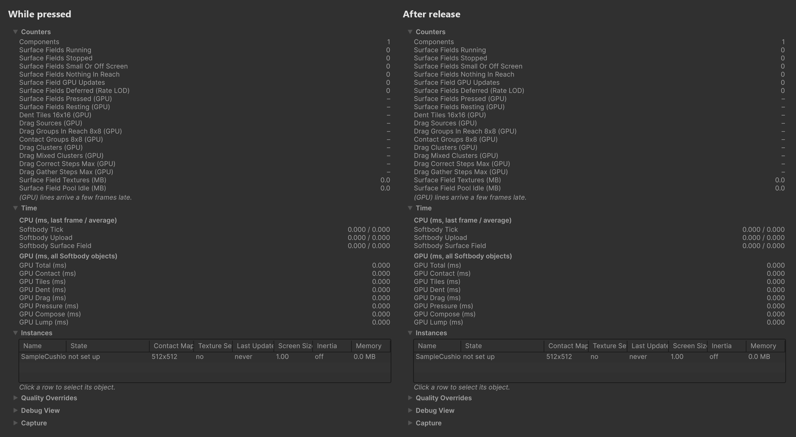

# How It Works

A short summary of what runs inside the package. Settings are described in the [Softbody Component](./Softbody-Component).

## What the bake makes {#what-the-bake-makes}

**Run Bake** makes **Baked Data** (`SD_<mesh name>`) for each mesh. It does not change the mesh. The values needed per vertex are stored in lookup-table textures indexed by vertex index.

| Data | Content | Used by |
|---|---|---|
| Flesh softness | Fills the inside of the flesh with tetrahedra and measures how much each vertex sags when the body is pushed in three directions. | Jiggle |
| Inertia groups | The bone sets that jiggle together, and each vertex's share in following its set. | Jiggle |
| Paint | Depth, Jiggle, Volume and Flex converted to vertex and cell values. Flex becomes the bend values of cells and a table (plate table) of the pieces that become plates. | Jiggle, contact |
| Contact map | A flat atlas with one cell for each small region of skin. Each cell holds a reference position, outward normal, flesh thickness and skin weights, and each vertex holds the location of its own cell. The tables of the cells across seams and of neighboring cells are baked too. | Contact |
| Wake box | A box around the pressable flesh for each bone. The CPU uses it to cheaply check whether a collider can touch the flesh. | Sleep |
| Lump | For each lump that moves aside as a whole, its resistance to being pushed and its pushed shape. | Lump |

## Three layers {#three-layers}

| Layer | Content |
|---|---|
| Model | While pressed, the flesh moves as a layer of the baked thickness over a rigid core. The dent solves the flesh-layer equation x − ℓ²∇²x = f on the contact map, with the skin held to the collider. The width ℓ comes from flesh thickness and **Skin Tension**. Foam (Volume 0) holds only up to a constant force. Beyond that it collapses under the collider, so the dent in foam has a sharp edge. Time enters through a single ratio. The remembered dent depth from the previous update shrinks by a factor of e−RΔt, where R is **Recovery Rate**. A lump (a whole piece of flesh attached to a bone) moves sideways until the pushing force and the resisting force balance. **Squeeze Stiffening** sets how much harder it resists as it is pressed deeper. When Contact Detail is Full, the contact pressure that holds the skin to the collider is solved on a coarse grid, that pressure draws the rise around the dent, and drag solves the same equation at a wider width. A piece painted black in Flex is a plate that does not bend. It moves by the position and tilt in the plate table and pushes the flesh below (Full). |
| Rules that prevent visible defects | The wall of a dent follows the edge of the collider, not the cell grid. Each cell remembers from which side the collider came, so a buried collider does not dig into the side face. A seam cell copies the cell across the UV seam as it is, and the atlas neighbor check separates cells that are adjacent in the atlas but apart on the mesh. A hand cannot pass through a lump. In Full, the baked surface distance limit stops drag and rise from crossing a wrinkle or leaking into another body part, and a newly pressed cell receives only half a drag step. Two parts separated by Separated Pairs pass neither dent, rise nor drag to each other. |
| GPU pipeline | Only the 8×8 cell groups that are pressed or still returning are computed, so a mesh at rest costs almost nothing. Wide dents and lumps share one coarse grid. Contact textures are taken from a pool shared by all Softbody meshes. The compute shaders are split into `SoftbodySurfaceField.compute` for Basic and `SoftbodySurfaceFieldFull.compute` for Full. D3D11 and Metal use copies compiled with FXC, and D3D12 and Vulkan use copies (`…Dxc.compute`) compiled with DXC. That is why the first compile time differs per API. |

## One contact update {#one-contact-update}

1. **Contact.** For each cell, the current position is found by skinning, and for each collider (sphere, capsule, box, convex) the penetration depth (up to **Max Contact Depth**) and the distance to the collider edge are measured.
2. **Activity.** "Pressed now" and "left over from the previous update" decide how many groups all later passes run on. If nothing is pressed and nothing is left over, it is 0.
3. **Tiles.** The list of 16×16 dent tiles to solve. It includes tiles that are pressed or still hold a dent, one ring around them, and the paired tile across a seam.
4. **Lump.** Each lump receives the pushing force and moves aside. The CPU reads the result back from the GPU asynchronously and uses it as the lump position for the jiggle. In Full, a gripping hand drags the lump with a force limited by **Drag Friction** (**Lump Grip**).
5. **Contact pressure.** Runs only when Contact Detail is Full. It gathers pressed cells into coarse cells and solves the pressure that makes the skin touch the collider. It starts from 0 every update and keeps no state. Then, for each coarse cell, it adds the rise that this pressure lifts. Plates are treated in this solve as one body that moves on top of the flesh below.
6. **Dent.** It solves on the coarse grid first, then on the fine tiles. So a wide dent (palm, seat) spreads to its full width in a single update. The remembered dent depth shrinks by a factor of e−RΔt, and pressing deeper replaces it with that depth. The lingering mark is handled by **Memory Time** and **Memory Fade Time**. The rim width comes from flesh thickness, Volume Preservation and Skin Tension for each cell. When Contact Detail is Basic, only this step draws the dent. Foam still collapses and taut skin still rounds the rim, but there is no rise and no plate.
7. **Drag.** Runs only when Contact Detail is Full. A pressed cell moves its held position along with the collider and accumulates pull, and slips when it exceeds the friction limit (**Drag Friction** times the pressing force).
8. **Compose.** It builds the displacement map, moves the values across seams to the seam cells, and builds the normal map by rotating the shading normal by the amount found from displaced neighbor cells. It also records **Dent Darkening**.

In the vertex shader, the material finds its own cell by vertex index and reads the displacement (a vertex more than 5 cm from the outer surface follows less and stops at 10 cm), and in the pixel shader it reads the normal rotation and the darkening. So the normal map stays as it is. The GPU time of each step appears in the GPU Contact, Tiles, Dent, Drag, Pressure, Compose and Lump lines of **Window > Softbody > Debugger**, and in GPU sections such as `Softbody Contact` in the Unity Profiler.

## Between updates {#between-updates}

During Play, a Softbody mesh with contact on goes through the following states.

1. **Sleep.** No collider can touch the mesh (checked with the baked wake box of each bone). It holds no contact texture, and the contact switch of the material is off.
2. **First touch.** The mesh receives a set of contact textures from the pool and updates in the same frame. If the pool has no ready set, it waits a few frames until a set is created.
3. **Awake.** The mesh requests an update in every LateUpdate, and which meshes to run is chosen all at once at the end of the frame. With **Full Rate Screen Size** set, a mesh that looks small on screen runs once every few frames. At most **Update Budget** meshes run in one frame, and the contact update rate limit caps the updates per second. A mesh that is visible to no camera or is smaller than **Min Screen Size** is treated as unable to be touched. The time of skipped frames is solved in one step at the next update. A pressed mesh where nothing moves does not skip updates.
4. **Collider leaves.** An update that actually ran adds the recovery it finished to a stability counter. It counts the work done, not the number of frames, so a mesh skipped because of the update budget is not emptied early. A mesh that is not on screen counts in frames.
5. **Recovery done.** When the counter reaches 1, the textures are emptied and returned to the pool, and the contact switch is turned off. It returns to state 1. Sets left in the pool beyond **Texture Pool** are released after **Release Delay**.

Turning off the component or the game object goes straight to state 1 from any state and empties the inertia. Turning it on starts from rest without a velocity record. See [Performance](./Performance#life-cycle).

## Jiggle {#jiggle}

Jiggle runs separately from contact, and it runs even when contact is asleep or off. In every LateUpdate, the component reads the acceleration and rotation of each inertia group (the whole mesh for a static mesh) and solves one damped oscillation step per group with the exact equation. So the sway does not depend on the frame rate. The result is uploaded as one small texture, and the vertex stage of the Softbody shader mixes the sway using the baked softness per vertex and the group share, moves the vertex and tilts the shading. A lump is pushed to the position found by contact while pressed, then returns swaying after the hand leaves. See [Inertia](./Inertia).
