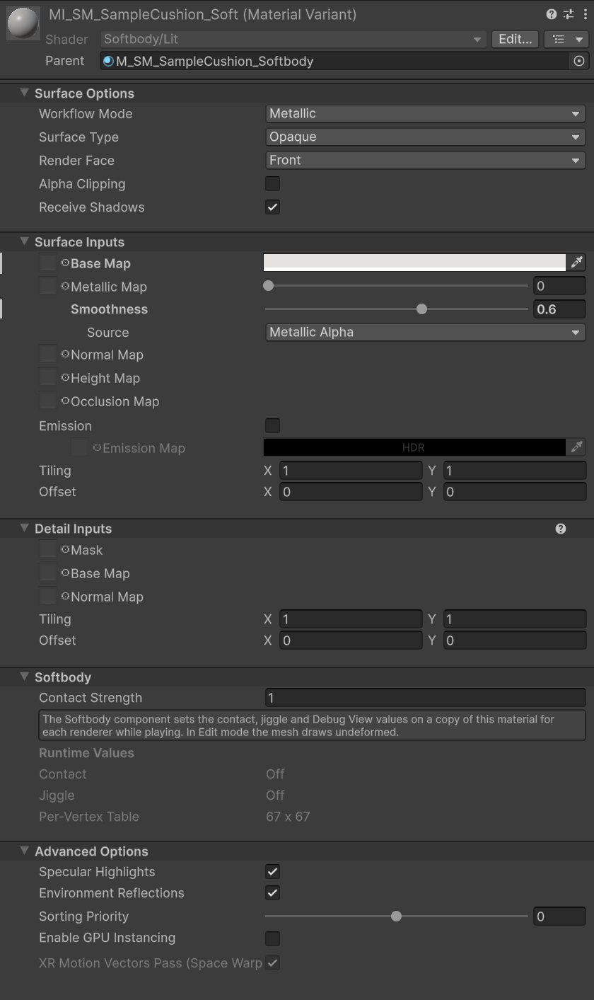
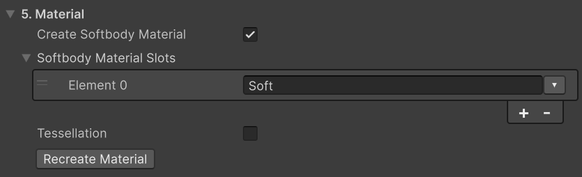
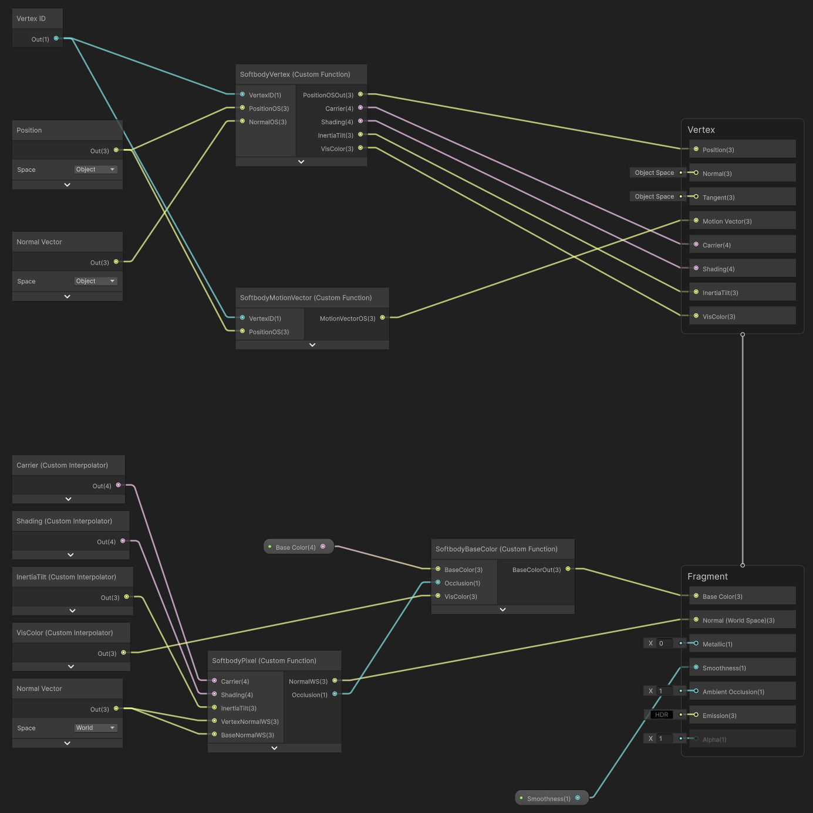
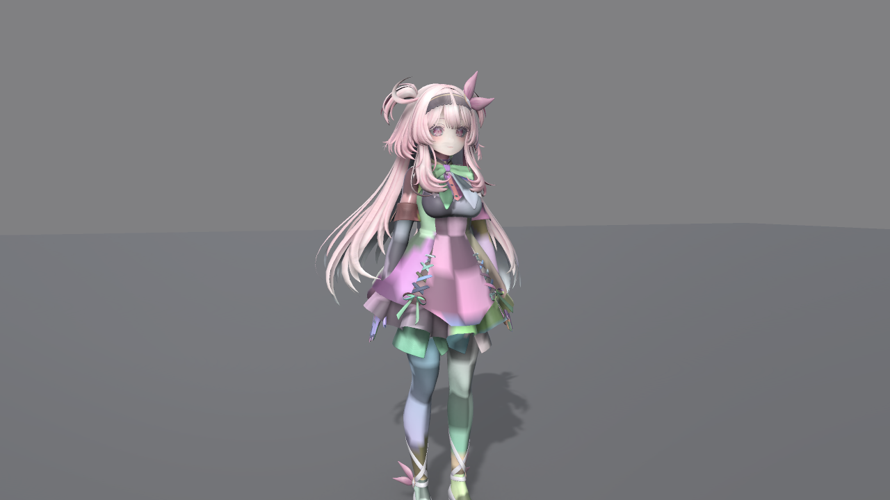

# Materials

A slot deforms only when its material is a Softbody shader. Use the package's **Softbody/Lit** (the bake can create the material for you), or add the Softbody functions to your own URP shader.

## Softbody/Lit {#softbody-lit}

**Softbody/Lit** is URP Lit plus dents and jiggle. It is a hand-written shader, not a Shader Graph, and has every URP Lit property under the same name. Changing the **Shader** of a URP Lit material to Softbody/Lit carries the values over. The inspector is the same as URP Lit, with a **Softbody** group added at the end.

| Field | Description |
|---|---|
| **Contact Strength** | How much this material follows the dent. 1 = the flesh as simulated, 0 = ignores contact (jiggle is unchanged). |
| **Runtime Values** | Read-only. The state of the values the component writes (**Contact**, **Jiggle**, **Per-Vertex Table**). Visible during Play when you select the renderer's copy material. |

The component fills in the other Softbody values. When Play starts, the component creates a material copy (name ending `(Softbody)`) for each Softbody shader slot, assigns it to the renderer and writes the values into that copy.

- In Edit mode the mesh is drawn without deformation.
- A value changed on the original material asset during Play appears from the next Play.
- Removing the component or ending Play returns the renderer to the original material.

Shadows, depth and motion vectors follow the same deformation. Lightmap bakes use the undeformed mesh.

## Softbody/Lit (Tessellated) {#tessellation}

**Softbody/Lit (Tessellated)** is Softbody/Lit plus tessellation. It splits the triangles of pressable slots to match their on-screen size, so a dent narrower than a triangle, such as a fingertip, shows as shape and not only as shading. Its properties are the same as Softbody/Lit, so changing the **Shader** carries the values over. To have the bake create materials with this shader, turn on **Tessellation** in **5. Material** ([Baking](./Baking#_5-material)).

The **Softbody** group of the inspector gets an extra **Tessellation** field set.

| Field | Default | Description |
|---|---|---|
| **Edge Length** | 8 | The on-screen length (pixels) of one split edge. Smaller values make narrow dents sharper and cost more GPU time. |
| **Max Splits** | 16 | The maximum number of pieces one triangle edge is divided into (1-64). Raise it for large triangles seen up close. |
| **Phong Strength** | 0.75 | How much the split triangles curve along the pressed surface. 0 is flat and 1 follows it fully. |

- Only triangles with pressable vertices are split, and a renderer with contact off is not split. Triangles are split even while nothing presses them, so use Softbody/Lit for meshes that are not seen up close.
- On edges with split normals (hard edges), a small gap can open when pressed. **Validate** reports it. Smooth the normals of that slot in the DCC tool.
- On graphics devices without tessellation support, the mesh is drawn with Softbody/Lit.
- Shader Graph and custom shaders have no tessellation.

## Let the bake make the material {#let-the-bake-make-the-material}

1. In **5. Material** of the Softbody Authoring Data, turn on **Create Softbody Material** and put the slots to deform in **Softbody Material Slots**. Add skin and clothes that fit the body, and leave out the face and hair.
2. Press **Run Bake**. The bake decides the materials before the contact map, so with an empty **Pressable Slots**, these slots become pressable slots from the first bake.
3. The `slot '<slot>' now uses MI_<mesh>_<slot> ... Copied: ...` line in the Console lists the copied textures. Assign anything listed as `(not found)` yourself in the material variant (**Base Map**, **Normal Map**).

The bake creates `M_<mesh>_Softbody` (a Softbody/Lit material) in the **Output Folder** (the folder of the authoring asset if empty), and one material variant `MI_<mesh>_<slot>` of it for each slot you listed. Existing ones are reused. A slot that is already a Softbody material is left as it is.

Values come from the slot's original material.

- URP Lit or Complex Lit: every value with the same name is copied (Smoothness, Metallic and detail maps included).
- Other shaders: only the base color and the normal map are copied, and Smoothness keeps its default.
  - Base color: looks for `_BaseMap`, `_MainTex`, `_BaseColorMap` in that order. If none exists, a texture whose name contains `BaseColor`, `Albedo`, `Diffuse`, `_Col` or `_BC` or ends with `_D`, and otherwise the first sRGB texture that is not a normal map.
  - Normal map: the first texture whose Texture Type is Normal map.

Where the variant is assigned to the mesh depends on where the target mesh lives.

- Model (FBX and similar): put it in the model's Import Settings under Remapped Materials and reimport. Remapping replaces every use of the same original material inside the model, so other renderers that use the same material and slots you did not list also become Softbody variants, and the Console warns. To avoid this, split the material in the 3D tool, or assign the Softbody material directly to that renderer in the prefab.
- Prefab: assign it on the prefab's renderer and save the prefab.

A model inside a package cannot be changed. Import the sample from Package Manager, or copy the model into the Assets folder, and bake that. If the Output Folder holds a variant with the same name for another mesh, the bake leaves the materials unchanged and logs an error. Change the Output Folder.

**Recreate Material** (same category) recreates and assigns the Softbody material and rebakes the contact map. Baked Data must exist. Use it after changing Softbody Material Slots or replacing the material of a slot.

## After changing the material: Rebake Contact Map {#after-changing-the-material-rebake-contact-map}

After the bake, press **Rebake Contact Map** (category 6. Contact Map) each time you assign or change a Softbody material on the mesh. With an empty **Pressable Slots**, the contact map holds only the slots that use a Softbody material.

The Setup box of the Softbody component shows the number of Softbody shader slots in the line `<N> of <M> material slots use a Softbody shader`. If the scene's renderer uses different materials than the model and some slots lack the variant material, a **Use Softbody Materials** button appears on this line. The button puts `MI_<mesh>_<slot>` from the Output Folder into the same slot of that renderer.

## Use your own shader {#use-your-own-shader}

Leave **Create Softbody Material** off. A hand-written URP shader or a Shader Graph can deform exactly like Softbody/Lit with the functions in the package's `Shaders/Include/`. The property block to copy and an example shader are in `README.md` in the same folder.

Every Softbody shader follows these rules:

1. Keep the property names and defaults identical to Softbody/Lit (textures black, only `_SoftbodyPaintTex` white). The component writes values by name and deforms only slots that have all of the textures `_SoftbodyContactData`, `_SoftbodyInertiaResponseTex` and `_SoftbodySurfaceDispTex`. The bake treats a slot with `_SoftbodyCarrierUVTex` as a Softbody material slot.
2. Every pass that outputs a position (forward, deferred, shadow, depth, depth-normals, motion vectors, scene selection) moves vertices with the same function. Pick one of `SoftbodyDisplacedPositionOS` and `SoftbodyDisplacedPositionWS` and use it in every pass. Mixing them shifts depth slightly and drops pixels in the depth prepass and motion vectors.
3. Read the per-vertex table in the vertex shader by vertex index (`SV_VertexID`) and pass the result through interpolators.
4. Do not replace the normal. Run your own normal (including the normal map) through `SoftbodyPixelNormalWS`.
5. **Dent Darkening** multiplies the base color, not ambient occlusion (`SoftbodyBaseColor`). The Debug View colors also come from this function.
6. Do not create a `DOTS_INSTANCING_ON` variant. The GPU Resident Drawer draws with changed vertex indices.
7. Put the tag `"AlwaysRenderMotionVectors" = "true"` in the SubShader. This draws the motion vectors of jiggle and dents on renderers that do not move.

### Shader Graph {#shader-graph}

Importing **Shader Graph** from the package's Samples tab copies a URP Lit graph (`Softbody Lit Graph`) with all the nodes below connected to `Assets/Samples/MallangPhysics/<version>/Shader Graph/`. To skip adding each Blackboard property, copy this graph and edit only the surface (textures, colors). Below is how that graph is wired and how to build one from scratch.

- Set **GPU Resident Drawer** in the URP asset to **Disabled**. Shader Graph adds a `DOTS_INSTANCING_ON` variant to every pass, and with it on the table is read with the wrong vertices.
- Set **Precision** in Graph Settings to **Single**. Except for `SoftbodyBaseColor`, the nodes below exist only in Single, and Half stops with an error such as `undeclared identifier 'SoftbodyVertex_half'`.
- Add every Softbody property to the Blackboard with the same **Reference** and turn on **Exposed** (Texture2D for textures, Float for numbers, Vector4 for vectors). If any one is missing, compilation stops with `undeclared identifier`.

Set the Custom Function nodes to Type **File**, Source `Packages/com.wjsekrud.mallangphysics/Shaders/Include/SoftbodyShaderGraph.hlsl`.

| Name | Inputs | Outputs → connect to |
|---|---|---|
| `SoftbodyVertex` | `VertexID` (Vertex ID node), `PositionOS`, `NormalOS` (Object space) | `PositionOSOut` → Vertex block **Position**. `Carrier`, `Shading`, `InertiaTilt`, `VisColor` → four Custom Interpolators |
| `SoftbodyPixel` | `Carrier`, `Shading`, `InertiaTilt` (interpolators), `VertexNormalWS` (Normal Vector in World space), `BaseNormalWS` (your normal map converted to world, or the same normal if none) | `NormalWS` → Fragment block **Normal** (Fragment Normal Space = **World**), `Occlusion` |
| `SoftbodyBaseColor` | `BaseColor`, `Occlusion`, `VisColor` | `BaseColorOut` → **Base Color** |
| `SoftbodyMotionVector` | `VertexID`, `PositionOS` | `MotionVectorOS` → Vertex block **Motion Vector** (Additional Motion Vectors in Graph Settings = **Custom**) |

Shader Graph does not know the previous frame's vertex positions, so the motion vectors of jiggle are slightly off when a bone turns fast. A renderer that moves as a whole comes out right. Softbody/Lit does not have this error.

## Unsupported shaders {#unsupported-shaders}

A slot without a Softbody shader is drawn as usual. It neither dents nor jiggles, and the component makes no copy of its material. Leave slots you excluded on purpose, such as the face or hair, as they are.

If no slot has a Softbody shader, the whole mesh is not deformed and Validate Setup reports an error: `target <renderer> has no material slot with a Softbody shader.`

Softbody shaders read the baked table by vertex index, so do not use them with draw methods that reorder vertices (static batching, GPU Resident Drawer) ([Installation](./Installation#after-installing)). For a mesh in a LOD Group, only LOD0 is baked and deformed.

## Debug View {#debug-view}

**Debug View** (Debug group of the Softbody component) replaces the shading with debug colors during Play. It is visible only with Softbody/Lit and shaders that use `SoftbodyBaseColor`. The list of modes is under **Debug View Mode** in the [Softbody Component](./Softbody-Component#debug-view-mode). The Debug View group of the [Softbody Debugger](./Project-Settings#debug-view) can also change the Debug View of the selected component.

