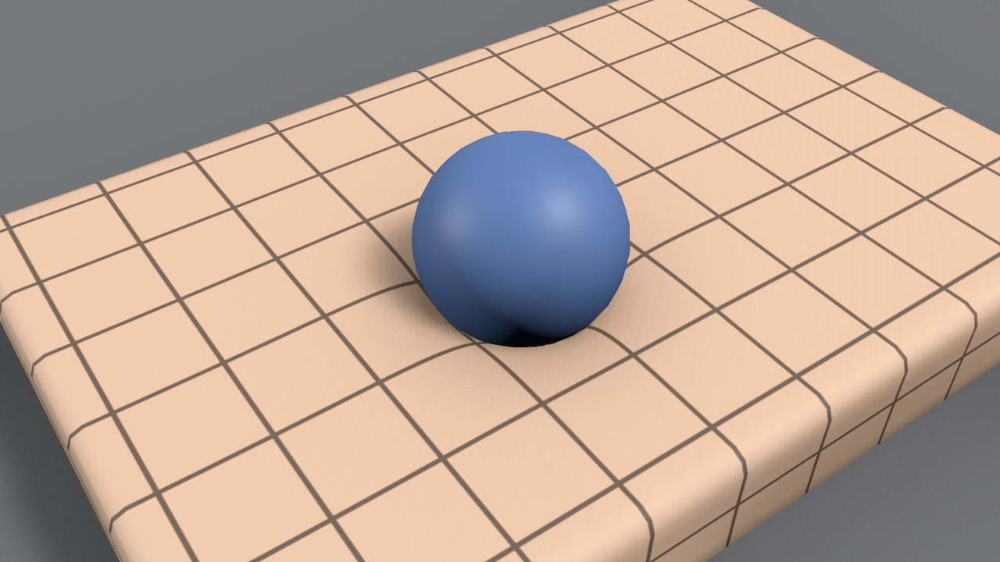

# Overview

MallangPhysics makes skinned and static meshes soft in Unity 6.3 URP. Where a hand or an object presses, the flesh dents, a flesh lump attached to a bone moves aside as a whole under a wide push, and the flesh jiggles when the body moves. Bake the mesh once in the editor and add one component, and the deformation is computed on the GPU.

## Names in the editor {#names-in-the-editor}

The editor uses the plugin's working names as they are. Menu and setting names in this documentation are for the English editor.

| | Name in the editor |
|---|---|
| Package | **MallangPhysics** (`com.wjsekrud.mallangphysics`) |
| Component | **Softbody** |
| Authoring asset | **Softbody Authoring Data** |
| Bake result | **Baked Data** (`SD_` asset) |
| Shader | **Softbody/Lit** |
| Project settings | Project Settings > **Softbody** |

## What is in the beta {#whats-in-the-beta}

| | |
|---|---|
| Bake | Flesh measurement, paint, material and contact map in one **Run Bake** |
| Dent | **Contact Detail** Basic: dent, recovery, lingering mark, skin, lump push |
| Rise and drag | **Contact Detail** Full: rise around the dent, skin dragged by the hand, Edge Smoothing, lump dragged by a gripping hand (Lump Grip) |
| Hard surface | Flex paint: the surface bends stiffly, or gems and buckles sink and tilt like plates (Full) |
| Separating parts | Separated Pairs: two parts with a continuous surface but separate flesh underneath are pressed separately |
| Inertia | Jiggle and per-part jiggle (inertia groups) |
| Tessellation | Softbody/Lit (Tessellated): narrow dents such as a fingertip are shaped too |
| Shape field | Hands and props press with the baked real shape (between fingers, a concave palm) instead of the collider |

Missing: self contact, where a character presses its own body with its own hand; a volume mesh that gives the inside of a hollow object; automatic contact map seam placement; Softbody Grabber, which pulls skin with a hand. The full list is in [Known Limitations](./Known-Limitations).

## Status {#status}

Version 0.1.0-beta.1. It ships as compiled assemblies (DLLs) without C# source, and the shaders are included as source. Verified on Unity 6.3 (6000.3.26f1) and URP 17.3, on Windows with D3D12, D3D11 and Vulkan. Metal is not verified.
